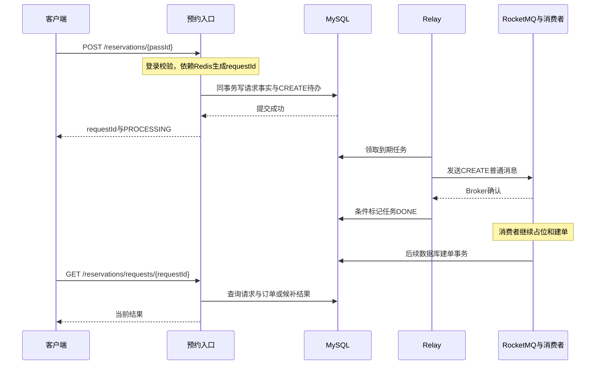
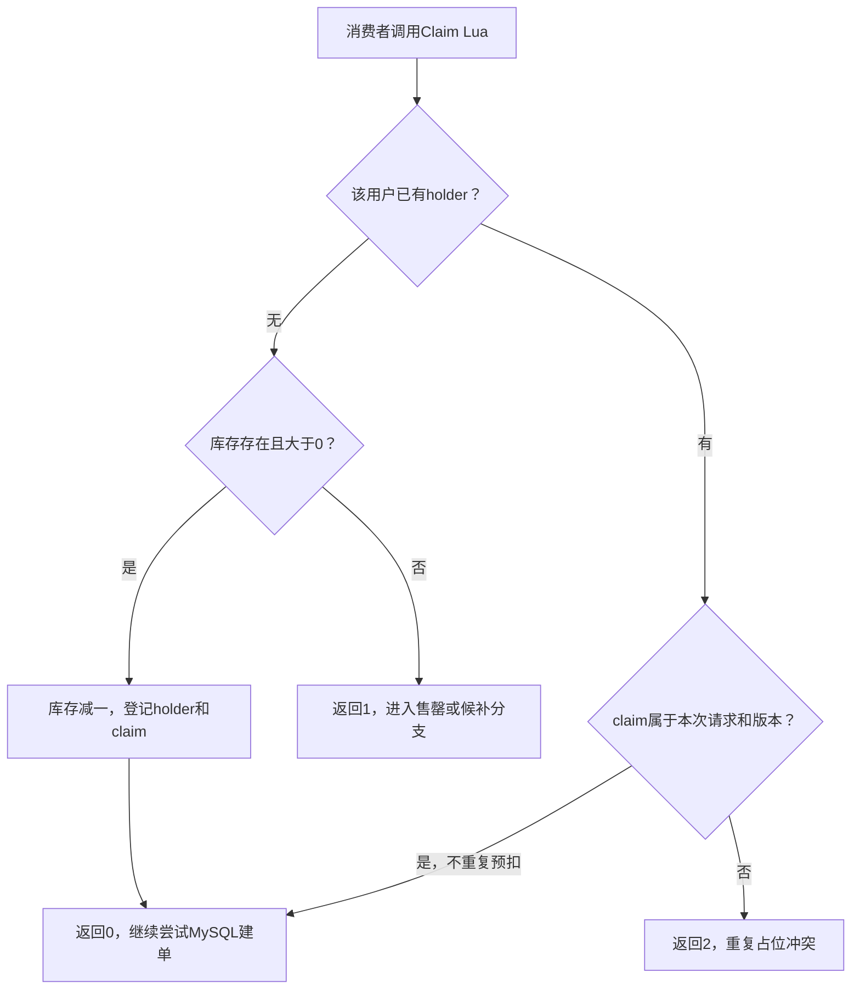
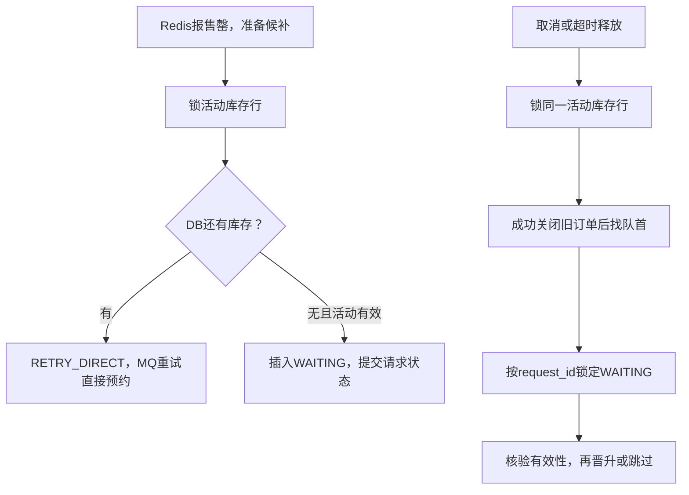
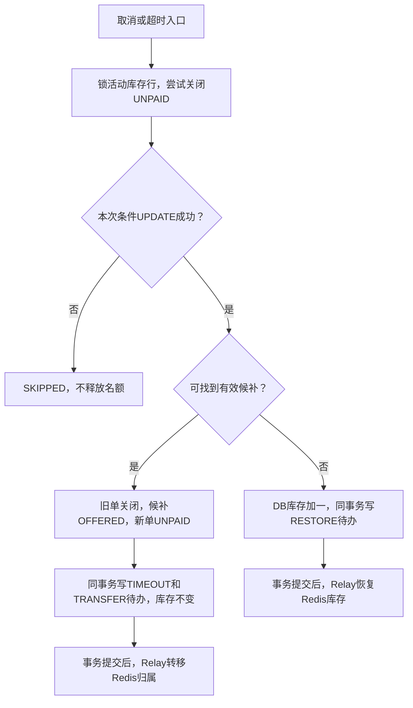
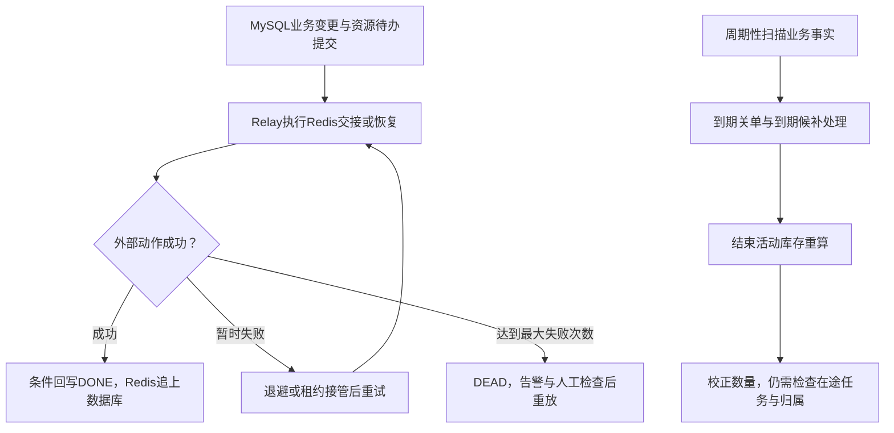
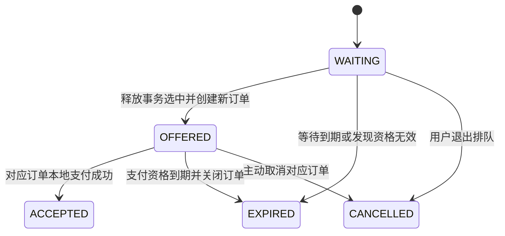

# CityPass 学习文档一：异步预约与候补调度

> 修订日期：2026-10-30。依据最新副项目简历，将原来的分散机制收拢成四条业务主线；关键代码先说明功能，再逐行讲解，行末注释按代码块对齐。
>
> 源码核对提交：[`48ab46bb3c6484151c8dc61cfdb928d875928d12`](https://github.com/SyH-101/citypass-platform/commit/48ab46bb3c6484151c8dc61cfdb928d875928d12)。展示代码保留真实语句、关键条件与执行顺序，教学注释不属于仓库实现变更；可通过每段链接查看完整方法。本次修改学习文档，没有重新运行整套中间件验收，历史测试与实际能力分别说明。

## 先抓住重点：这条简历在讲一份名额怎样被可靠分配

> **异步预约与候补调度：** 基于本地可靠任务与 RocketMQ 解耦预约受理和订单创建，通过 Redis Lua 占位、MySQL 条件扣减及有效订单唯一约束，防止超卖与重复预约；按请求号锁定候补队首并直接交接释放名额，结合资源版本、幂等重试与定时对账，保证资源状态最终一致。

把它连成四句话：**先可靠记住请求；再决定能否拿到名额；有人放弃时优先交给候补；外部动作失败以后还能继续推进。**

| 简历分句 | 面试官真正想知道什么 | 本节需要记住的主线 |
| --- | --- | --- |
| 本地可靠任务与 RocketMQ 解耦受理和建单 | 返回成功承诺了什么，宕机后工作还在不在 | 请求事实与待办同提交 → Relay → MQ → 消费建单 |
| Lua 占位、条件扣减、有效订单唯一约束 | 名额能否超发，同一用户能否同时拿两份 | Redis 先认归属 → MySQL 条件扣库存 → 同事务建单与唯一约束 |
| 按请求号锁队首并直接交接 | 谁应该优先得到释放的名额，怎样避免新用户抢走 | 活动行协调 → 锁可见队首 → 关闭旧单、创建候补新单 → 库存不变 |
| 资源版本、幂等重试与定时对账 | 重复、乱序、进程退出以后怎样恢复 | 核对归属 → 成功标记去重 → 可靠任务重试 → 对账补充到期与数量检查 |

全文沿用一个例子：夜跑活动有 10 个名额。A 已拿到未支付资格，B、C 正在候补。每一节都围绕“现在属于谁、能否继续分配、失败后谁来处理”展开。数字和时间用于教学推演。

**建议读法：** 先只读第一部分各节的重点与“面试时可以这样说”，把整条链讲顺；第二遍再看代码；最后练 15 道追问。第二部分集中补支付竞争、状态、补偿与任务边界，避免主线里反复岔开。

- [第一部分：沿四条主线逐句讲简历](#part-1)
- [1.1 可靠受理：请求怎样进入异步建单链](#resume-1)
- [1.2 库存与重复：占位和数据库约束怎样配合](#resume-2)
- [1.3 候补交接：谁接替，为什么不先回公共库存](#resume-3)
- [1.4 失败恢复：资源版本、幂等与对账怎样接力](#resume-4)
- [第二部分：必须准备的重要补充](#part-2)
- [第三部分：15 道深挖问答](#part-3)
- [最后复习：完整介绍与源码导航](#review)

相关文档：[02 多级缓存一致性](https://github.com/SyH-101/citypass-platform/blob/main/02-多级缓存一致性.md)、[03 活动笔记发布与文件管理](https://github.com/SyH-101/citypass-platform/blob/main/03-活动笔记发布与文件管理.md)。

<a id="part-1"></a>

## 第一部分：沿四条主线逐句讲简历


<a id="resume-1"></a>

### 1.1 可靠受理：请求怎样进入异步建单链

**对应简历：** “基于本地可靠任务与 RocketMQ 解耦预约受理和订单创建”。

**本节重点：受理事务保存事实与待办，HTTP 不等建单；发送完成、消费完成、业务成功要分开。**

#### 先把“受理”与“创建订单”分开理解

**受理**是系统已经把“用户提出了这个请求”可靠记下来。**订单创建成功**则代表库存竞争完成，数据库已经产生一张有效的未支付订单，用户获得限时支付资格。两者之间允许有等待时间。

如果在 HTTP 线程里同时完成库存竞争、建单与其他操作，瞬时大量请求会一起争抢数据库。当前项目把入口和后续执行拆开：入口先落一笔小事务，然后返回请求号；后台通过 MQ 消费推进建单，客户端再查结果。

这里的“解耦”可以具体说成：**HTTP 返回不必等待订单创建完成；进程重启后，已经受理的工作仍有数据库记录可追踪。** 这两点分别来自异步执行与可靠待办。

#### “本地可靠任务”到底存在哪里？

“本地”指任务记录与业务使用同一个 MySQL 数据源，可以加入同一个数据库事务。任务放在 `tb_reliable_task`，不会因为当前 JVM 的内存消失而直接消失。

例如入口事务同时保存：

| 写入位置 | 记录的内容 | 为什么需要 |
| --- | --- | --- |
| `tb_reservation_request` | requestId、用户、活动、PROCESSING | 即使没有订单，也能回答这次请求是否被受理 |
| `tb_reliable_task` | CREATE_RESERVATION、业务幂等键、请求载荷、PENDING | 即使进程在发消息前退出，也能发现仍待发送的工作 |

这种将业务事实与外部动作意图一起提交的做法就是 **Transactional Outbox（事务发件箱）**。可以把它理解为：在登记预约申请时，同时写下“后续必须发送建单消息”这张待办单。

#### 完整链路怎样走？



图展示一种可能的执行顺序。消费者可能在 Relay 回写 DONE 前就完成业务，Broker 确认与消费成功是独立的两件事。

主入口是 `ReservationController.reserve`，调用 `ReservationServiceImpl.reserve`。生成请求号后，进入另一个 Spring Bean 的事务方法 `acceptRequest`。事务成功后，入口尽力写 Redis 的短期请求投影，最后返回 `PROCESSING`。

<a id="code-accept"></a>

**代码 01：把请求事实与创建待办一起提交**

**功能：** 在同一 MySQL 事务确认请求被受理，并保存后续必须发送建单消息的意图。

**源码文件：** `src/main/java/com/citypass/service/impl/ReservationTransactionalService.java`  
**所属类／方法：** `ReservationTransactionalService.acceptRequest`；[查看固定版本源码](https://github.com/SyH-101/citypass-platform/blob/48ab46bb3c6484151c8dc61cfdb928d875928d12/src/main/java/com/citypass/service/impl/ReservationTransactionalService.java#L90-L104)。以下为教学注释版节选，保留原语句与关键条件。

```java
@Transactional(rollbackFor = Exception.class)                                               // 请求事实与待办加入同一个数据库事务
public void acceptRequest(ReservationOrder request) {                                       // 接收尚未成为数据库订单的请求载荷
    ReservationRequest fact =                                                               // 开始构造持久请求事实
            new ReservationRequest()                                                        // 创建请求事实对象
                    .setRequestId(request.getId())                                          // 使用这次请求的稳定编号
                    .setUserId(request.getUserId())                                         // 记录请求所属用户
                    .setActivityPassId(request.getActivityPassId())                         // 记录目标活动
                    .setAcceptWaitlist(Boolean.TRUE.equals(request.getAcceptWaitlist()))    // 记录用户是否接受候补
                    .setStatus(ReservationStatus.PROCESSING);                               // 初始状态为处理中
    requestMapper.insert(fact);                                                             // 先保存请求已经受理的事实
    reliableTaskRepository.enqueue(                                                         // 在同一事务登记后续必须执行的工作
            ReliableTaskRepository.CREATE_RESERVATION,                                      // 任务类型是异步创建预约
            "create-reservation:" + request.getId(),                                        // 用请求号区分并去重同一创建意图
            JSONUtil.toJsonStr(request));                                                   // 把后续消费者所需参数序列化保存
}                                                                                           // 结束受理事务方法
```

**读完抓住：** 受理成功尚未得到订单；两次数据库写入一起提交。

这段代码的阅读重点只有三处。`requestMapper.insert(fact)` 保存请求事实；`enqueue` 保存待办；`@Transactional` 让两次数据库写入共同提交或回滚。`enqueue` 底层使用同一数据源的 `JdbcTemplate`，能够加入外层事务。它不需要再套一个与业务隔离的新事务。

`"create-reservation:" + request.getId()` 是同一创建意图的业务幂等键。即使内部重复登记同一个意图，任务表唯一索引也能去重。它无法把用户再次点击产生的新 requestId 自动合并成同一 HTTP 请求。

<a id="code-enqueue"></a>

**代码 02：持久保存可靠任务**

**功能：** 通过业务唯一键去重登记，把任务类型、参数、失败上限和可执行时间保存到 MySQL。

**源码文件：** `src/main/java/com/citypass/reliable/ReliableTaskRepository.java`  
**所属类／方法：** `ReliableTaskRepository.enqueueAt`；[查看固定版本源码](https://github.com/SyH-101/citypass-platform/blob/48ab46bb3c6484151c8dc61cfdb928d875928d12/src/main/java/com/citypass/reliable/ReliableTaskRepository.java#L45-L55)。以下为教学注释版节选，保留原语句与关键条件。

```java
public void enqueueAt(String taskType, String bizKey, String payload, LocalDateTime executeAt) {            // 登记可以立即或指定时刻执行的任务
    jdbcTemplate.update(                                                                                    // 使用同一数据源的 JdbcTemplate 写入
            "INSERT IGNORE INTO tb_reliable_task"                                                           // 由业务唯一键约束重复登记
                    + "(task_type,biz_key,payload,status,retry_count,max_retry,next_retry_time,version) "   // 任务表保存类型、载荷、重试时间与执行版本
                    + "VALUES (?,?,?,'PENDING',0,?,?,0)",                                                   // 新任务从 PENDING、零次失败、版本零开始
            taskType,                                                                                       // 绑定任务类型参数
            bizKey,                                                                                         // 绑定本次动作的业务去重键
            payload,                                                                                        // 绑定外部执行所需载荷
            Math.max(1, defaultMaxRetry),                                                                   // 失败上限至少为一次
            executeAt);                                                                                     // 绑定允许领取的时间点
}                                                                                                           // 结束任务登记方法
```

**读完抓住：** 任务在数据库中，可以在 JVM 退出后继续被发现。

`INSERT IGNORE` 利用任务表 `biz_key` 的唯一约束避免重复插入。`next_retry_time` 决定什么时候允许领取；失败次数、状态和版本用于后续恢复。任务进入 DEAD 后，再执行同一个 `enqueue` 仍会被唯一键忽略，恢复要走原任务的人工重放入口。

后台 `ReliableTaskScheduler.relay` 默认每秒扫描一次，每轮最多处理 50 条，但它**每次只领取即将执行的一条**，避免一次领 50 条后，后面的任务还在排队就先过租约。

<a id="code-relay-send"></a>

**代码 03：把任务发送给 RocketMQ**

**功能：** 从任务载荷恢复 CREATE 或 TIMEOUT 参数，发送普通消息并检查 Broker 确认。

**源码文件：** `src/main/java/com/citypass/task/ReliableTaskScheduler.java`  
**所属类／方法：** `ReliableTaskScheduler.execute（CREATE/TIMEOUT 分支）`；[查看固定版本源码](https://github.com/SyH-101/citypass-platform/blob/48ab46bb3c6484151c8dc61cfdb928d875928d12/src/main/java/com/citypass/task/ReliableTaskScheduler.java#L104-L110)。以下为教学注释版节选，保留原语句与关键条件。

```java
if (ReliableTaskRepository.CREATE_RESERVATION.equals(task.getTaskType())) {         // 根据任务类型分发创建动作
    ReservationOrder request =                                                      // 准备恢复原请求对象
            JSONUtil.toBean(task.getPayload(), ReservationOrder.class);             // 由持久任务载荷反序列化
    requireSendOk(producer.sendOrderCreate(request), "CREATE", request.getId());    // 发送 CREATE 并检查 Broker 确认
} else if (ReliableTaskRepository.ORDER_TIMEOUT.equals(task.getTaskType())) {       // 到期关单任务走另外的发送分支
    Long orderId = Long.valueOf(task.getPayload());                                 // 取出待关闭的订单号
    requireSendOk(producer.sendOrderTimeout(orderId), "TIMEOUT", orderId);          // 发送普通 TIMEOUT 消息并检查确认
```

**读完抓住：** Broker 接收、任务 DONE 和业务消费完成是不同的时间点。

CREATE 分支把待办载荷反序列化成 `ReservationOrder`，调用消息发布器发送，再检查 `SEND_OK`。该对象此时作为请求载体使用，不能因为类名叫 Order 就认为它已经是一条数据库订单。消费者 `OrderMQConsumer` 收到 CREATE 后调用 `createOrderFromMQ`；异常时返回 `RECONSUME_LATER`。


#### 为什么需要“可靠任务 + MQ”两层？

可靠任务填上“数据库提交成功、消息还没发出去，应用就退出”的窗口；MQ 为后续建单提供异步缓冲，并由消费者处理消息。任务表还能承载 Redis 资源交接、超时通知等其他外部动作。

代价是入口仍有两次数据库写，后台还有轮询与维护成本。小流量可以采用同步事务建单；本项目选择这套链路，是为了练习可恢复的异步执行。没有生产数据时，不应宣称已经支撑某个 QPS。

| 失败发生在哪里 | 已留下的事实 | 后续怎样处理 |
| --- | --- | --- |
| 入口事务提交前 | 事务整体回滚 | 本次不能承诺受理成功 |
| 事务已提交，尚未发 MQ | 请求事实与 PENDING 待办存在 | 其他扫描轮次或实例继续发送 |
| Broker 已收消息，DONE 回写前退出 | Broker 有消息，任务可能仍 RUNNING | 租约接管后可能重复发送，消费者必须幂等 |
| 消费者订单已提交，消费确认丢失 | 数据库已有业务结果 | 消息重投，再次处理要识别已有结果 |

#### 面试时可以这样说

> 我把预约受理和订单创建分开，首先是为了让 HTTP 请求不用等待后面完整的库存竞争和建单，同时保证已经受理的工作在服务退出后仍然可追踪。入口返回 requestId 和 PROCESSING，只表示系统可靠记住了申请，用户有没有名额要看后续结果。
>
> 具体实现上，入口调用独立事务 Bean 的 acceptRequest，在同一个 MySQL 事务保存请求事实和 CREATE_RESERVATION 待办。请求表负责回答这次申请处理到哪一步，任务表保存后续必须发送消息的意图。如果事务没提交，两边一起回滚；提交以后就算应用还没发 MQ 就宕机，后台也能继续发现任务。
>
> 之后 Relay 认领到期任务，把参数发送到 RocketMQ，Broker 确认以后再按本轮执行资格回写 DONE。消费者接收 CREATE，取得用户锁，检查已有资格，再执行 Redis 占位和数据库建单。客户端使用请求号查询数据库里的处理结果，不能把发送任务 DONE 当成订单已经成功。
>
> 这里仍有重复窗口：消息已经到 Broker，但 DONE 尚未写回就退出，后续 worker 会再发一次；消费者提交了订单但消费确认丢失，也可能再次处理。所以 Outbox 负责保存和恢复待办，业务约束负责让重复执行保持安全，两层要连着解释。
>
> 代价是入口仍然写数据库、结果异步可见，还要治理重试和积压。对小流量，同步事务可以更简单。我在副项目中展示的是可恢复异步链路，没有把使用 MQ 本身当作吞吐提升的证明。

**本节记忆：** 请求事实与待办同提交 → Relay → MQ → 消费建单 → 按请求号查结果。

<a id="resume-2"></a>

### 1.2 库存与重复：占位和数据库约束怎样配合

**对应简历：** “通过 Redis Lua 占位、MySQL 条件扣减及有效订单唯一约束，防止超卖与重复预约”。

**本节重点：Redis 原子占位减少竞争，MySQL 条件更新和事务兜住数量，唯一索引限制同时有效的重复资格。**

#### 占位成功，用户拿到了什么？

消费者处理请求时，先校验活动、取得用户锁，并检查用户已有有效订单或候补。通过后，再执行 Lua。Lua 成功代表 **Redis 允许这个请求继续尝试数据库建单**；真正拿到数据库订单，还要等下一步事务提交。

Redis 中维护三类数据。假设活动 ID 为 100、用户为 8、请求号为 10001：

| Redis key | 示例内容 | 含义 |
| --- | --- | --- |
| `reservation:stock:100` | `10` | Redis 当前可供直接预约的数量 |
| `reservation:holders:100` | Set 中包含用户 `8` | 哪些用户存在占位 |
| `reservation:claim:100:8` | `10001:0` | 用户 8 的占位属于订单／请求 10001 的资源版本 0 |

`claim` 可以理解为带归属的凭据。仅保存“用户 8 占过位”无法区分先前失败的请求和后来成功的新请求，回滚时可能误删后者；把订单号和版本一起保存，清理与交接才能核对具体归属。

#### 为什么用 Lua 把几步合在一起？

如果 Java 先 GET 库存，判断大于 0 后再 DECR，两个请求都可能先看到最后一份库存。Lua 把检查、扣减与记录归属放在同一次 Redis 脚本执行中，其他请求不能插入这些步骤之间。



图中省略了脚本对旧版无资源版本 claim 的兼容；完整代码如下。

<a id="code-lua-claim"></a>

**代码 04：原子检查库存与占位归属**

**功能：** 同一归属重试允许继续，新占位才减 Redis 库存并记录 holder 与 claim。

**源码文件：** `src/main/resources/reservation-claim.lua`  
**所属类／方法：** `reservation-claim.lua 完整脚本`；[查看固定版本源码](https://github.com/SyH-101/citypass-platform/blob/48ab46bb3c6484151c8dc61cfdb928d875928d12/src/main/resources/reservation-claim.lua#L1-L36)。以下为教学注释版节选，保留原语句与关键条件。

```lua
-- 预约消费者：Redis 库存 + 一人一单（幂等：已 claim 则返回 0，便于 MQ 重试续跑落库）。     -- 脚本用于占位，同一归属可重试续跑
-- ARGV: activityPassId, userId, orderId, resourceVersion                                   -- 四个输入分别描述活动、用户、订单与代次
-- 返回: 0 可落库；1 库存不足；2 该用户已被另一订单 claim                                   -- 三种结果决定后续建单或冲突处理
local activityPassId = ARGV[1]                                                              -- 取得目标活动
local userId = ARGV[2]                                                                      -- 取得申请用户
local orderId = ARGV[3]                                                                     -- 取得稳定请求或订单号
local resourceVersion = ARGV[4]                                                             -- 取得资源交接代次
local expectedClaim = orderId .. ':' .. resourceVersion                                     -- 组合本次期待的占位归属

local stockKey = 'reservation:stock:' .. activityPassId                                     -- 活动的 Redis 可用库存
local holderKey = 'reservation:holders:' .. activityPassId                                  -- 活动当前占位用户集合
local claimKey = 'reservation:claim:' .. activityPassId .. ':' .. userId                    -- 当前用户的具体占位归属

-- 已 claim：说明上次可能扣了 Redis 但 SQL 未成功，允许继续落库                             -- 已有占位可能来自上一次未完成建单
if redis.call('sismember', holderKey, userId) == 1 then                                     -- 先判断这个用户是否已经占位
    local existing = redis.call('get', claimKey)                                            -- 读取这份占位具体属于谁
    if existing == expectedClaim then                                                       -- 相同请求与资源代次属于安全重入
        return 0                                                                            -- 允许继续数据库建单，不再扣 Redis
    end                                                                                     -- 结束同归属判断
    -- 兼容 v3 留下的无版本直接预约 claim，并原地升级。                                     -- 兼容历史上不包含资源版本的占位
    if resourceVersion == '0' and existing == orderId then                                  -- 只为初始版本识别旧格式
        redis.call('set', claimKey, expectedClaim)                                          -- 把旧格式原地升级为带版本归属
        return 0                                                                            -- 兼容重入也不重复扣库存
    end                                                                                     -- 结束兼容分支
    return 2                                                                                -- 归属不同，拒绝另一请求重复占位
end                                                                                         -- 结束已有占位分支

local stock = tonumber(redis.call('get', stockKey))                                         -- 读取当前 Redis 数量
if stock == nil or stock <= 0 then                                                          -- 库存缺失和非正数都无法新占位
    return 1                                                                                -- 返回无可用预占资格
end                                                                                         -- 结束库存条件检查

redis.call('incrby', stockKey, -1)                                                          -- 仅新占位执行一次数量减一
redis.call('sadd', holderKey, userId)                                                       -- 登记当前占位用户
redis.call('set', claimKey, expectedClaim)                                                  -- 保存订单与代次的具体归属
return 0                                                                                    -- 返回允许继续数据库建单
```

**读完抓住：** 返回零表示可以继续数据库，未必刚扣过库存。

按执行顺序读：

1. `expectedClaim` 把本次请求号与资源版本拼起来。
2. 已有 holder 时先核对 claim：同一次请求重试返回 0，允许继续落库，避免再次扣 Redis；其他请求返回 2。
3. 新占位才判断库存；不存在或不大于 0 返回 1。
4. 最后三条 Redis 写命令共同完成库存减一、记录持有人和归属。

返回 0 只说明可以继续，不能理解为刚刚一定扣过一次库存，因为重复请求也会返回 0。返回 1 也不能绝对理解成数据库售罄：Redis 的库存 key 丢失，同样会进入这个分支。

#### Redis 占位与数据库建单能一起原子提交吗？

它们分属两个系统。Lua 保护 Redis 内这一段，MySQL 事务保护后面数据库那一段。两段之间如果进程退出，Redis 可能已有 claim，数据库还没有订单；重投同一请求时，Lua 认出同一归属，允许继续进入数据库。

消费者每次还会先查有效订单，已经成功建单的重投通常在前置检查就返回。前置检查可能与并发交错，所以仍需数据库唯一约束做最终限制。

**接下来把 Redis 资格落成数据库事实：** Redis 的占位只完成前半段，下面的条件更新、事务和唯一索引才决定订单能否合法提交。

#### 先分清两个问题

**超卖**关注全活动有没有发出过多名额；**重复预约**关注同一用户是否同时持有多张有效订单。库存条件与唯一约束分别处理这两个维度，不能只靠一个用户锁回答全部问题。

数据库扣库存必须让“还有库存”成为 UPDATE 的条件。如果先 SELECT 到 stock=1，返回 Java 后再写成 stock=0，两个线程可能各自认为自己拿到了最后一份。

当前项目使用 MyBatis-Plus 生成条件更新，源码直接体现条件：

<a id="code-db-stock"></a>

**代码 05：MySQL 条件扣减库存**

**功能：** 把活动有效时间与 stock 大于零一起放进 UPDATE，靠影响行数判断本次是否取得名额。

**源码文件：** `src/main/java/com/citypass/service/impl/ReservationTransactionalService.java`  
**所属类／方法：** `ReservationTransactionalService.createOrder（条件扣减）`；[查看固定版本源码](https://github.com/SyH-101/citypass-platform/blob/48ab46bb3c6484151c8dc61cfdb928d875928d12/src/main/java/com/citypass/service/impl/ReservationTransactionalService.java#L112-L121)。以下为教学注释版节选，保留原语句与关键条件。

```java
LocalDateTime now = LocalDateTime.now();                                    // 取数据库扣减所用的当前业务时间
int stockRows =                                                             // 接收条件更新的影响行数
        stockMapper.update(                                                 // 对库存表执行一次 UPDATE
                null,                                                       // 具体修改由 UpdateWrapper 指定
                new UpdateWrapper<LimitedPassStock>()                       // 开始组合条件更新
                        .setSql("stock = stock - 1")                        // 扣减直接在数据库表达式中执行
                        .eq("activity_pass_id", order.getActivityPassId())  // 只作用于目标活动
                        .le("begin_time", now)                              // 活动已经开始才允许预约
                        .gt("end_time", now)                                // 活动截止时间必须仍在未来
                        .gt("stock", 0));                                   // 库存必须大于零，数据库兜住最后一份
```

**读完抓住：** 防超卖条件存在于最终数据库更新中。

`.gt("stock", 0)` 就是只允许从正库存扣减；预约时间也一起进入 UPDATE。执行成功返回影响行数，0 行表示本次未取得数据库库存，需要继续区分未开始、结束、不可用或售罄。

正常并发扣减时，InnoDB 协调同一库存行的更新。两个事务争最后一份，一个成功扣成 0，另一个随后检查条件，无法再满足 `stock > 0`。安全条件来自 UPDATE 本身；不能把数据库操作描述成无锁 CAS，也不需要依赖先前快照读“永远不过时”。

#### 扣减后插单失败，会不会留下少一份库存？

`createOrder` 由独立事务 Bean 的 public 方法执行，带 `@Transactional(rollbackFor = Exception.class)`。扣库存、插单、更新请求事实、登记超时待办在同一事务内：

<a id="code-db-order"></a>

**代码 06：在扣减事务中建单并登记超时**

**功能：** 设置未支付资格、保存订单与请求结果，同时保存真实截止时间的超时意图。

**源码文件：** `src/main/java/com/citypass/service/impl/ReservationTransactionalService.java`  
**所属类／方法：** `ReservationTransactionalService.createOrder（扣减成功后建单）`；[查看固定版本源码](https://github.com/SyH-101/citypass-platform/blob/48ab46bb3c6484151c8dc61cfdb928d875928d12/src/main/java/com/citypass/service/impl/ReservationTransactionalService.java#L139-L153)。以下为教学注释版节选，保留原语句与关键条件。

```java
    LimitedPassStock current = stockMapper.selectById(order.getActivityPassId());                   // 读取目标活动的支付截止约束
    LocalDateTime expiresAt =                                                                       // 准备计算本单资格到期时间
            capOfferExpiry(now, offerMinutes, current == null ? null : current.getEndTime());       // 取默认支付时长与活动截止的较早值
    order.setStatus(ORDER_STATUS_UNPAID);                                                           // 建成未支付订单，已经占用名额
    order.setSource(                                                                                // 设置订单来源
            order.getSource() == null ? ReservationStatus.SOURCE_DIRECT : order.getSource());       // 缺省来源是直接预约
    order.setPromotionRound(order.getPromotionRound() == null ? 0 : order.getPromotionRound());     // 直接预约缺省晋升轮数为零
    order.setResourceVersion(                                                                       // 设置资源代次
            order.getResourceVersion() == null ? 0L : order.getResourceVersion());                  // 直接预约的缺省资源版本为零
    order.setOfferExpireTime(expiresAt);                                                            // 保存真实支付资格截止时间
    orderMapper.insert(order);                                                                      // 插单失败会使前面的库存扣减一起回滚
    updateRequestState(order.getId(), ReservationStatus.RESERVED, order.getId(), null);             // 把请求事实推进到已分配订单资格
    enqueueTimeout(order.getId(), expiresAt);                                                       // 同事务登记该订单的到期关单待办
    return CreateResult.CREATED;                                                                    // 返回数据库建单完成
}                                                                                                   // 结束建单事务方法
```

**读完抓住：** 插单失败会回滚数据库扣减，Redis 另行处理。

如果 `orderMapper.insert` 因唯一键冲突抛异常，整笔数据库事务回滚，前面的扣减也回滚。异常从事务代理返回编排层以后，编排层再选择 Redis 清理策略。库存与订单各自独立提交，会留下“扣了库存但没有订单”的窗口。

`UNPAID` 表示已经给出限时支付资格，所以未支付订单也占名额。数据库扣减成功、订单尚未提交时，外部请求不能据此宣称预约已经成功。

#### “有效订单唯一约束”为什么比永久一人一单更合适？

用户取消以后允许重新预约，同时要保留取消记录。如果把 `(activity_pass_id, user_id)` 永久唯一，历史取消订单会一直挡住新订单。

当前 DDL 用生成列 `active_user_id`：有效状态时等于 user_id，关闭等状态时为 NULL，再对活动与该生成列建唯一索引。

<a id="code-order-unique"></a>

**代码 07：只限制有效订单的一人一单**

**功能：** 用状态生成 active_user_id，并建立活动与有效用户唯一约束，允许保留取消历史。

**源码文件：** `src/main/resources/db/citypass.sql`  
**所属类／方法：** `tb_reservation_order 生成列与唯一索引`；[查看固定版本源码](https://github.com/SyH-101/citypass-platform/blob/48ab46bb3c6484151c8dc61cfdb928d875928d12/src/main/resources/db/citypass.sql#L256-L262)。以下为教学注释版节选，保留原语句与关键条件。

```sql
  `active_user_id` bigint(20) GENERATED ALWAYS AS (                                             -- 根据订单状态生成有效用户列
      CASE WHEN `status` IN (1,2,3,5) THEN `user_id` ELSE NULL END                              -- 有效状态保留用户号，失效状态生成 NULL
  ) STORED COMMENT '有效订单用户，用于允许取消后重新预约',                                      -- 持久保存生成结果，允许取消后再预约
  PRIMARY KEY (`id`) USING BTREE,                                                               -- 订单号本身也必须唯一
  UNIQUE INDEX `uk_active_user_pass`(`activity_pass_id`, `active_user_id`) USING BTREE,         -- 同一活动的同一有效用户最多一条
  INDEX `idx_order_expire`(`status`, `offer_expire_time`) USING BTREE                           -- 加速到期未支付订单扫描
) ENGINE = InnoDB CHARACTER SET = utf8mb4 COLLATE = utf8mb4_general_ci ROW_FORMAT = Compact;    -- 使用 InnoDB 保存订单表
```
各种状态是什么意思？


**读完抓住：** 取消后索引仍存在，变化的是生成列值变为 NULL。

| 用户 8 在活动 100 的订单 | 生成列 | 唯一索引表现 |
| --- | --- | --- |
| 第一张有效订单 | `active_user_id=8` | 占住 `(100,8)` |
| 再插另一张有效订单 | `active_user_id=8` | 唯一冲突，禁止同时生效 |
| 原订单取消为状态 4 | `active_user_id=NULL` | 不再占住有效用户键 |
| 随后重新预约 | 新单生成列重新为 8 | 可以建立新的有效订单，旧历史仍保留 |

MySQL 唯一索引允许多条含 NULL 的组合，因而能保留多笔失效历史。DDL 将 1、2、3、5 视为有效订单；当前主业务主要走未支付 1、已支付 2、关闭 4，定义了核销、退款字段不代表这些链路已完整实现。

候补表也有自身的有效用户唯一约束，限制 WAITING/OFFERED；**两个索引各自约束本表**，不构成跨表唯一约束。用户锁与正确事务编排仍有作用，不能把索引说成涵盖所有跨表竞争。

#### 面试时可以这样说

> 我把防超卖和防重复分开：防超卖关心一个活动总共分配了多少份，防重复关心同一个用户能否同时持有两张有效订单。Redis 先减少无效竞争，最终数据库还要独立守住这两个约束。
>
> 消费者先执行占位 Lua，把库存检查、减一、记录 holder 和 claim 放在一次 Redis 执行中。claim 保存请求号与资源版本；同一请求重试时认出相同归属，返回可以继续建单，不再扣 Redis。其他请求占着同一用户的资格时则拒绝。这里成功只代表可以继续尝试数据库，还没有提交订单。
>
> 数据库侧把 stock 大于零和预约窗口一起放进 UPDATE，只有影响一行才获得名额。扣库存、插入未支付订单、更新请求状态、登记超时任务在同一个事务，插单或任务登记抛异常会把数据库扣减一起回滚。不能靠 Java 先看到库存大于零就认为最后一份一定属于自己。
>
> 防重复用的是有效用户生成列与活动联合唯一索引。只要订单处于有效状态（1，2，3，5），就生成用户 ID，参与唯一索引约束；订单取消或退款完成后，就生成 NULL，释放唯一索引限制。
>
> Redis 与 MySQL 没有共同事务。占位后数据库出错，要根据已知失败和结果未知选择回滚、清理或同请求续跑，不能所有 catch 都直接加一。这也是下一步恢复设计需要明确归属的原因。

**本节记忆：** 认 claim → Lua 占位 → DB 条件扣减 → 同事务插单与超时 → 有效唯一限制重复。

<a id="resume-3"></a>

### 1.3 候补交接：谁接替，为什么不先回公共库存

**对应简历：** “按请求号锁定候补队首并直接交接释放名额”。

**本节重点：先协调入队与释放，再锁当前可见队首；有候补直接换持有人，没人承接才把名额回池。**

#### 候补是等待获得资格，还没有一张未支付订单

售罄且用户接受候补时，系统保存 WAITING 记录。B 的请求号是 10002、C 是 10003，那么当前可见的候补队列里 B 排在 C 前面。释放名额时，按 `request_id` 升序选择一条。

<a id="code-waiter-sql"></a>

**代码 08：按请求号锁定当前队首**

**功能：** 选择同一活动最小 request_id 的可见 WAITING，并在事务中持有该候补行锁。

**源码文件：** `src/main/java/com/citypass/mapper/ReservationWaitlistMapper.java`  
**所属类／方法：** `ReservationWaitlistMapper.selectNextForUpdate`；[查看固定版本源码](https://github.com/SyH-101/citypass-platform/blob/48ab46bb3c6484151c8dc61cfdb928d875928d12/src/main/java/com/citypass/mapper/ReservationWaitlistMapper.java#L13-L17)。以下为教学注释版节选，保留原语句与关键条件。

```java
@Select(                                                                                // 声明 MyBatis 查询
        "SELECT * FROM tb_reservation_waitlist "                                        // 从候补表选择一条记录
                + "WHERE activity_pass_id=#{activityPassId} AND status='WAITING' "      // 限定当前活动且仍在等待
                + "ORDER BY request_id LIMIT 1 FOR UPDATE")                             // 按请求号找队首，并在事务中锁住
ReservationWaitlist selectNextForUpdate(@Param("activityPassId") Long activityPassId);  // 返回受保护的候补记录
```

**读完抓住：** 业务 FIFO 不使用 SKIP LOCKED 跳过正在处理的队首。

这条 SQL 同时做三件事：限定同一活动、只选 WAITING、取最小请求号并持有行锁。`FOR UPDATE` 必须在事务中配合使用，它让“决定把名额给谁”期间的队首记录受到保护。

这里不能照搬可靠任务领取的 `SKIP LOCKED`。如果 B 正被某事务处理，另一释放事务跳过 B 给 C，就改变了队首优先语义。独立待办可以跳过已锁任务分摊工作，业务候补则需要等待该排队决定完成。

#### 为什么候补入队还要锁活动库存行？

仅锁队首还不够。考虑两个动作交错：B 看到 Redis 售罄，准备入队；A 恰好取消恢复库存。如果释放没看到 B，先把库存加回；B 随后又提交 WAITING，就可能出现库存有余量但用户仍在排队。

当前 `createWaitlist` 与 `releaseOrPromote` 都锁同一活动的库存行，作为**活动内协调入队和释放的共同位置**：

<a id="code-waiter-insert"></a>

**代码 09：协调候补入队与名额释放**

**功能：** 先锁活动库存行，再判断仍售罄还是应重试直接预约，避免有库存却落入等待。

**源码文件：** `src/main/java/com/citypass/service/impl/ReservationTransactionalService.java`  
**所属类／方法：** `ReservationTransactionalService.createWaitlist`；[查看固定版本源码](https://github.com/SyH-101/citypass-platform/blob/48ab46bb3c6484151c8dc61cfdb928d875928d12/src/main/java/com/citypass/service/impl/ReservationTransactionalService.java#L159-L178)。以下为教学注释版节选，保留原语句与关键条件。

```java
@Transactional(rollbackFor = Exception.class)                                                   // 入队检查和候补写入处于同一事务
public WaitlistResult createWaitlist(ReservationWaitlist waitlist)                              // 接收候补申请
        throws DuplicateKeyException {                                                          // 唯一冲突向外传播处理
    LimitedPassStock stock = stockMapper.selectByIdForUpdate(waitlist.getActivityPassId());     // 与释放流程争同一活动库存行锁
    if (stock == null                                                                           // 活动库存记录缺失
            || stock.getEndTime() == null                                                       // 或者缺少合法截止时间
            || !stock.getEndTime().isAfter(LocalDateTime.now())) {                              // 或者预约窗口已经结束
        updateRequestState(waitlist.getRequestId(), ReservationStatus.FAIL_ENDED, null, null);  // 请求事实记录活动结束
        return WaitlistResult.ENDED;                                                            // 返回无法候补
    }                                                                                           // 结束活动有效性检查

    if (stock.getStock() != null && stock.getStock() > 0) {                                     // 锁住以后发现数据库仍有余量
        return WaitlistResult.RETRY_DIRECT;                                                     // 让编排层重试直接预约，避免有库存却排队
    }                                                                                           // 结束余量检查

    waitlist.setStatus(ReservationStatus.WAITING).setWaitExpireTime(stock.getEndTime());        // 设置等待状态与等待截止时间
    waitlistMapper.insert(waitlist);                                                            // 持久保存候补申请
    updateRequestState(waitlist.getRequestId(), ReservationStatus.WAITLISTED, null, null);      // 同步这次请求的候补状态
    return WaitlistResult.WAITLISTED;                                                           // 返回已经入队
}                                                                                               // 结束入队事务方法
```

**读完抓住：** 入队和释放必须使用同一个活动内协调位置。

如果释放先提交，入队事务随后看到数据库库存大于 0，返回 `RETRY_DIRECT`；编排层抛异常，让 MQ 稍后重新尝试直接预约。如果入队先提交，释放事务拿到库存行锁后可以看到候补，再直接交接。这解决的是两个数据库事务的先后问题，Redis 的异步投影仍可能暂时落后。



队首已过期或已拥有有效订单时，会记录失效原因，继续看下一位；不能把明显失效的记录永久堵在队头。

#### FIFO 的准确范围是什么？

可以说：**当前已入队、数据库可见的 WAITING 记录，按请求号选择队首。** 不能说所有 HTTP 请求严格按到达时间全局排队。MQ 可能并发乱序消费，更早请求号的记录还没落库时，当前查询看不见它；请求号本身也依赖 JVM 时间与 Redis 序列，并非已经证明的分布式真实到达顺序。

这一点很适合面试主动说明：你清楚队列在什么范围内保证顺序，也知道 SQL 无法排序尚未出现的记录。

**队首确定以后，直接在这笔释放事务里交接：** 接下来关注新订单和库存，不要把交接理解为先放回去再重抢。

#### 为什么不先加库存，再通知 B 来抢？

A 放弃资格，B 已经在候补。如果先把公共库存从 0 加到 1，再通知 B，新的直接预约 D 可能抢先扣走名额，B 还要重新竞争。既然数据库已经知道谁排第一，就可以在释放事务内直接创建 B 的新订单。

因此有两个互斥分支：

| 释放时的情况 | 数据库做什么 | Redis 后续做什么 |
| --- | --- | --- |
| 有有效候补 | 关闭 A，B 变 OFFERED，为 B 建新 UNPAID，保存超时与交接待办；stock 不变 | TRANSFER 将归属从 A 换为 B，stock 不变 |
| 没有可接替候补，或活动已结束不再晋升 | 关闭 A，stock 加一，保存库存恢复待办 | RESTORE 核对归属后清理 A，并将 Redis stock 加一 |

这里交接的是名额；A 的历史订单不会被改成 B 的订单。B 使用自己的候补 requestId 建新单，A 的旧单保留关闭记录。



<a id="code-release-choice"></a>

**代码 10：有候补直接交接，无人承接才回池**

**功能：** 成功关闭旧单后选择互斥分支，晋升成功就返回，无人接替才恢复库存并保存回补待办。

**源码文件：** `src/main/java/com/citypass/service/impl/ReservationTransactionalService.java`  
**所属类／方法：** `ReservationTransactionalService.releaseOrPromote（交接或回库存）`；[查看固定版本源码](https://github.com/SyH-101/citypass-platform/blob/48ab46bb3c6484151c8dc61cfdb928d875928d12/src/main/java/com/citypass/service/impl/ReservationTransactionalService.java#L260-L288)。以下为教学注释版节选，保留原语句与关键条件。

```java
    boolean canPromote =                                                                                        // 判断活动是否仍允许候补晋升
            pass != null && pass.getEndTime() != null && pass.getEndTime().isAfter(now);                        // 活动存在且截止时间仍未到达
    if (canPromote) {                                                                                           // 满足条件才尝试把名额交给队首
        ReservationOrder promoted = promoteFirstValidWaiter(oldOrder, pass, offerMinutes, now);                 // 在当前事务寻找并创建合法候补新单
        if (promoted != null) {                                                                                 // 确实有候补承接
            return new ReleaseResult(ReleaseAction.PROMOTED, oldOrder, promoted);                               // 直接结束释放流程，不再恢复公共库存
        }                                                                                                       // 结束承接成功分支
    }                                                                                                           // 结束晋升尝试

    if (pass == null) {                                                                                         // 无法取得活动库存记录
        throw new IllegalStateException("活动通行证不存在，无法恢复库存: " + oldOrder.getActivityPassId());     // 抛异常使关单等数据库修改回滚
    }                                                                                                           // 结束活动记录检查

    int stockRows =                                                                                             // 接收恢复库存的影响行数
            stockMapper.update(                                                                                 // 执行数据库库存更新
                    null,                                                                                       // 修改内容由条件包装指定
                    new UpdateWrapper<LimitedPassStock>()                                                       // 构造当前活动的更新条件
                            .setSql("stock = stock + 1")                                                        // 只有无人承接才把库存加一
                            .eq("activity_pass_id", oldOrder.getActivityPassId()));                             // 限定旧订单所属活动
    if (stockRows != 1) {                                                                                       // 必须准确恢复一条活动记录
        throw new IllegalStateException("活动通行证不存在，无法恢复库存: " + oldOrder.getActivityPassId());     // 异常让整个释放事务回滚
    }                                                                                                           // 结束恢复行数检查

    reliableTaskRepository.enqueue(                                                                             // 同事务登记 Redis 后续恢复
            ReliableTaskRepository.RESTORE_REDIS_STOCK,                                                         // 任务类型为资源数量回补
            "restore-redis-stock:" + orderId,                                                                   // 旧订单号区分这次释放动作
            JSONUtil.toJsonStr(oldOrder));                                                                      // 载荷保存需要核对的旧归属
    return new ReleaseResult(ReleaseAction.RELEASED, oldOrder, null);                                           // 返回已经释放到公共库存
}                                                                                                               // 结束释放实现
```

**读完抓住：** 同一名额不能既交给候补又增加公共库存。

注意 `return PROMOTED`：成功晋升后就从方法返回，所以不会再落到 stock 加一分支。这个控制流与外层事务共同防止一个释放名额既交给 B 又回到公共池。

这段之前还有旧订单的状态条件 UPDATE；只有关单成功才有资格执行本段。否则重复取消可能每次都继续释放，出现超发。

下面看新候补订单如何创建：

<a id="code-promote"></a>

**代码 11：创建候补新订单并保存交接意图**

**功能：** 为候补建立独立限时订单，把资源版本递增，并将超时和 Redis 交接任务一起提交。

**源码文件：** `src/main/java/com/citypass/service/impl/ReservationTransactionalService.java`  
**所属类／方法：** `ReservationTransactionalService.promoteFirstValidWaiter（新订单与待办）`；[查看固定版本源码](https://github.com/SyH-101/citypass-platform/blob/48ab46bb3c6484151c8dc61cfdb928d875928d12/src/main/java/com/citypass/service/impl/ReservationTransactionalService.java#L336-L369)。以下为教学注释版节选，保留原语句与关键条件。

```java
long oldVersion =                                                                       // 读取旧名额归属的版本
        oldOrder.getResourceVersion() == null ? 0L : oldOrder.getResourceVersion();     // 历史缺省版本按零处理
long newVersion = oldVersion + 1;                                                       // 新持有人进入下一资源代次
ReservationOrder promoted =                                                             // 准备为候补创建新订单
        new ReservationOrder()                                                          // 旧订单历史保留，单独创建新对象
                .setId(candidate.getRequestId())                                        // 新订单使用候补自身的请求号
                .setActivityPassId(candidate.getActivityPassId())                       // 活动沿用该候补记录
                .setUserId(candidate.getUserId())                                       // 新单属于候补用户
                .setStatus(ORDER_STATUS_UNPAID)                                         // 新单先获得限时支付资格
                .setSource(ReservationStatus.SOURCE_WAITLIST)                           // 来源标记为候补晋升
                .setPromotionRound(                                                     // 准备计算晋升轮次
                        (oldOrder.getPromotionRound() == null                           // 先判断旧单是否已有轮次
                                        ? 0                                             // 没有时从零计
                                        : oldOrder.getPromotionRound())                 // 有则沿用原晋升轮次
                                + 1)                                                    // 在旧轮次基础上增加一轮
                .setOfferExpireTime(expiresAt)                                          // 记录本轮支付截止时间
                .setResourceVersion(newVersion);                                        // 保存新的资源归属版本
orderMapper.insert(promoted);                                                           // 持久创建候补用户的新单
updateRequestState(                                                                     // 推进候补请求的处理结果
        candidate.getRequestId(), ReservationStatus.RESERVED, promoted.getId(), null);  // 将请求关联到刚创建的新订单
enqueueTimeout(promoted.getId(), expiresAt);                                            // 同事务登记新单的超时工作
ReservationClaimTransfer transfer =                                                     // 构造 Redis 归属交接载荷
        new ReservationClaimTransfer(                                                   // 描述旧持有人与新持有人的关系
                oldOrder.getActivityPassId(),                                           // 交接发生在同一活动
                oldOrder.getUserId(),                                                   // 旧持有人用户号
                oldOrder.getId(),                                                       // 旧持有人订单号
                oldVersion,                                                             // 旧资源代次
                promoted.getUserId(),                                                   // 新持有人用户号
                promoted.getId(),                                                       // 新持有人订单号
                newVersion);                                                            // 新资源代次
reliableTaskRepository.enqueue(                                                         // 保存跨存储交接待办
        ReliableTaskRepository.TRANSFER_RESERVATION_CLAIM,                              // 任务类型是 Redis 归属转移
        "transfer-reservation:" + oldOrder.getId(),                                     // 按旧订单标识这一次交接
        JSONUtil.toJsonStr(transfer));                                                  // 持久化完整交接参数
```

**读完抓住：** 旧单历史保留，新用户使用自己的请求号建新单。

按顺序理解：

1. `oldVersion + 1` 建立新一轮资源归属。
2. 为候补用户新建 UNPAID 订单，`source=WAITLIST`，使用其 requestId。
3. 把该请求推进为 RESERVED，并登记真实截止时间的超时待办。
4. TRANSFER 载荷保存旧用户／订单／版本与新用户／订单／版本。
5. 新订单与待办都在释放事务中提交，必要操作失败则旧单关闭、候补变更和新单一起回滚。

这段前置代码已在同一事务把候补 WAITING 改为 OFFERED，并检查更新行数。**OFFERED 表示取得限时支付资格；支付成功后才是 ACCEPTED。**

#### 用一个名额贯穿数据库与 Redis

| 时刻 | A 订单 | B 候补／订单 | DB stock | Redis 归属 |
| --- | --- | --- | ---: | --- |
| 初始 | UNPAID，版本 0 | WAITING，没有订单 | 0 | A，订单 10001:0 |
| 释放事务提交 | CANCELLED | OFFERED，新单 UNPAID，版本 1 | 0 | 可能仍为 A |
| TRANSFER 任务完成 | CANCELLED | OFFERED，新单 UNPAID | 0 | B，订单 10002:1 |
| B 本地支付成功 | CANCELLED | ACCEPTED，新单 PAID | 0 | B 继续持有 |

第二行是允许出现的短暂不一致：数据库已经换持有人，Redis 尚未追上。MySQL 决定业务归属，可靠任务负责让 Redis 追赶；两步没有跨存储原子事务。

#### 面试时可以这样说

> 候补的核心是让已经排队的人按规则接替名额。如果 A 取消以后先恢复公共库存，再通知 B 来抢，新到的 D 可能先扣走这一份。因此我在释放事务里直接决定是否把资格交给候补，避免让队首重新参与公共竞争。
>
> 顺序上，候补入队与释放都先锁同一活动库存行。这样入队看到库存刚被恢复，就返回 RETRY_DIRECT 让 MQ 再尝试直接预约；入队先完成，释放就能看到候补。释放成功关闭旧 UNPAID 以后，再按 request_id 找最早可见 WAITING，并用 FOR UPDATE 锁住队首，核验资格。
>
> 找到有效候补，就把它改成 OFFERED，使用它自己的 requestId 建一张新的 UNPAID 订单，旧单保留关闭历史；同时登记新单超时和 Redis 归属交接待办。这些数据库动作一起提交，公共 stock 保持不变。只有没有人承接或活动已结束时，才把 stock 加一，并登记 Redis 恢复任务。
>
> Redis 随后异步把 holder 和 claim 从 A 换到 B，所以数据库提交与 Redis 投影之间允许短暂不同；结果查询以数据库事实为主。支付、取消、超时竞争则由状态条件 UPDATE 决定谁有权继续，重复关闭不能再释放第二份。
>
> FIFO 的范围是当前已经入队、数据库可见的等待记录，按请求号选择。MQ 并发消费没有为所有 HTTP 到达建立全局顺序屏障。队首也不能用 SKIP LOCKED 跳过，独立任务领取与业务排队的顺序要求不同。

**本节记忆：** 锁活动行 → 成功关旧单 → 锁可见队首 → 新单与交接待办同提交 → 无承接才回池。

<a id="resume-4"></a>

### 1.4 失败恢复：资源版本、幂等与对账怎样接力

**对应简历：** “结合资源版本、幂等重试与定时对账，保证资源状态最终一致”。

**本节重点：归属条件拒绝乱序误操作，成功标记承受重放，待办持续推进，对账补充检查业务结果。**

#### 重试至少有三种，先问清楚“重复的是什么”

| 重复来源 | 重复的动作 | 主要保护 |
| --- | --- | --- |
| Broker 收到消息，发送方没成功记 DONE | 同一请求可能再次发布 CREATE | 已有订单查询、请求 ID、claim、唯一约束 |
| Redis 已转移／恢复，任务回写失败 | 同一外部资源动作再次执行 | Lua 永久 marker 与归属条件 |
| 任务租约过期后由其他 worker 接管 | 同一任务两个执行轮次交错 | owner/version 限制任务记录回写；外部动作仍靠业务幂等 |

幂等指重复执行后，不额外产生重复订单、重复加库存或错误转移。Java 方法、SQL 或网络调用完全可能执行多次。

#### 资源版本解决“现在这份名额属于哪一轮”

A 持有 `10001:0`，释放给 B 后是 `10002:1`，B 再释放给 C 后是 `10003:2`。执行交接必须核对**期待的旧订单与旧版本**，不能只比较目标版本更大就强行改归属。

这里的版本随该名额交接链推进，不是整个活动只有一个全局资源版本号。任务表的 `version`、订单 `resource_version` 也不是同一个概念。

TRANSFER 脚本先检查 `reservation:transfer:{oldOrderId}` 这个 marker 是否已存在；存在就返回已处理。随后读取、检查并更新归属，关键后半段如下：

<a id="code-claim-transfer"></a>

**代码 12：按期待归属转移 Redis 名额**

**功能：** 核对新旧用户 claim，确认旧代次匹配以后原子换持有人并保存成功标记。

**源码文件：** `src/main/resources/transfer-reservation.lua`  
**所属类／方法：** `transfer-reservation.lua（归属核验与交接）`；[查看固定版本源码](https://github.com/SyH-101/citypass-platform/blob/48ab46bb3c6484151c8dc61cfdb928d875928d12/src/main/resources/transfer-reservation.lua#L19-L39)。以下为教学注释版节选，保留原语句与关键条件。

```lua
local oldClaim = redis.call('get', oldClaimKey)                                         -- 读取 Redis 里旧用户当前归属
local newClaim = redis.call('get', newClaimKey)                                         -- 读取新用户是否已有其他归属
local expectedOld = oldOrderId .. ':' .. oldVersion                                     -- 组合期待的旧订单与版本
local expectedNew = newOrderId .. ':' .. newVersion                                     -- 组合本轮目标订单与版本

-- 不允许覆盖新用户的其他有效归属。                                                     -- 先防止覆盖目标用户另一份有效资格
if newClaim and newClaim ~= expectedNew then                                            -- 新用户存在其他占位就拒绝
    return -2                                                                           -- 返回目标归属冲突
end                                                                                     -- 结束目标检查

-- 兼容 v3 的无版本直接 claim，其他不匹配一律拒绝交接。                                 -- 旧归属也必须匹配，保留历史格式兼容
if oldClaim ~= expectedOld and not (oldVersion == '0' and oldClaim == oldOrderId) then  -- 期待旧归属尚未出现，不能越级交接
    return -1                                                                           -- 拒绝本次执行，让上层决定重试
end                                                                                     -- 结束旧归属检查

redis.call('srem', holderKey, oldUserId)                                                -- 从持有人集合中移除旧用户
redis.call('del', oldClaimKey)                                                          -- 移除旧用户的具体归属
redis.call('sadd', holderKey, newUserId)                                                -- 把新用户加入持有人集合
redis.call('set', newClaimKey, expectedNew)                                             -- 保存新订单及资源版本
redis.call('set', KEYS[1], '1')                                                         -- 同脚本登记永久成功标记
return 1                                                                                -- 返回本次交接成功，数量不变
```

**读完抓住：** 交接只换归属，Redis stock 不加也不减。

最后的写操作在同一次 Lua 执行中完成。它没有给 stock 加一或减一，处理的只是持有人与 claim。

如果 B→C 比 A→B 先执行，Redis 仍属于 A，B→C 的期待旧归属就对不上，返回失败并重试。等 A→B 完成，B→C 才能继续。版本校验提供安全拒绝，并不自动补齐永久失败的前序任务。

#### 永久 marker 解决“这次动作是否已经成功过”

假设 RESTORE 已让库存从 0 变成 1，应用在任务 DONE 前退出。重跑时如果只做 INCR，就会变成 2。marker 与加库存写在同一 Lua 中，重跑先看 marker，存在就返回 0，不再加库存。

<a id="code-restore"></a>

**代码 13：无候补时幂等恢复 Redis 数量**

**功能：** 先查永久标记，再检查库存基准与旧归属，删除占位并只加一次库存。

**源码文件：** `src/main/resources/restore-stock.lua`  
**所属类／方法：** `restore-stock.lua 完整脚本`；[查看固定版本源码](https://github.com/SyH-101/citypass-platform/blob/48ab46bb3c6484151c8dc61cfdb928d875928d12/src/main/resources/restore-stock.lua#L1-L24)。以下为教学注释版节选，保留原语句与关键条件。

```lua
-- 名额释放后的 Redis 库存与归属回补。                                                      -- 脚本负责无候补承接时的数量恢复
-- KEYS[1] stock key, KEYS[2] permanent idempotency marker                                  -- 两个 key 是库存与该动作的永久标记
-- ARGV: activityPassId, userId, orderId, resourceVersion                                   -- 参数描述本次释放的旧归属
if redis.call('exists', KEYS[2]) == 1 then                                                  -- 成功标记已存在说明动作做过
    return 0                                                                                -- 重复执行直接返回，不再加一
end                                                                                         -- 结束成功标记检查
if redis.call('exists', KEYS[1]) == 0 then                                                  -- 库存 key 已丢失，不能凭空重造
    return -1                                                                               -- 返回缺少库存基准
end                                                                                         -- 结束库存存在检查
local activityPassId = ARGV[1]                                                              -- 读取目标活动
local userId = ARGV[2]                                                                      -- 读取旧持有人
local orderId = ARGV[3]                                                                     -- 读取旧订单号
local resourceVersion = ARGV[4]                                                             -- 读取旧资源版本
local claimKey = 'reservation:claim:' .. activityPassId .. ':' .. userId                    -- 拼出该用户的归属 key
local existing = redis.call('get', claimKey)                                                -- 读取当前真实归属
local expectedClaim = orderId .. ':' .. resourceVersion                                     -- 组合本次允许清理的归属
if existing ~= expectedClaim and not (resourceVersion == '0' and existing == orderId) then  -- 归属不匹配时不能删除后来者
    return -2                                                                               -- 返回旧归属不匹配
end                                                                                         -- 结束归属核对
redis.call('srem', 'reservation:holders:' .. activityPassId, userId)                        -- 从占位集合移除旧用户
redis.call('del', claimKey)                                                                 -- 删除对应旧 claim
redis.call('incrby', KEYS[1], 1)                                                            -- 确认有资格以后恢复一次库存
redis.call('set', KEYS[2], '1')                                                             -- 与加库存一起写成功标记，不设置 TTL
return 1                                                                                    -- 返回本次恢复完成
```

**读完抓住：** marker 与资源修改同脚本提交，重放不再加一。

这个脚本还要求库存 key 存在，并核对旧 claim。不能因某条旧任务到来就重新造库存，也不能删掉已归属另一轮的 claim。

| 机制 | 你可以说它保证什么 | 不能夸大成什么 |
| --- | --- | --- |
| 资源版本与 claim | 当前操作只能作用于期待的旧归属 | 前序永久失败也能自动跨过去 |
| 永久 marker | Redis 状态保留时，同一成功资源动作重放不再重复修改 | Redis 全量丢失后仍保留全部去重历史 |
| 任务 owner/version | 接管后旧 worker 不能覆盖这条任务的新执行记录 | 已发出的 Redis、MQ 调用被自动取消 |
| 订单唯一键与状态条件 | 重复动作受到数据库业务约束 | 所有代码都恰好执行一次 |

marker 当前没有 TTL，是为了覆盖迟到重放；空间会增长，安全归档尚未完整实现。随意加一天 TTL，会让更晚的历史任务失去去重依据。

**已知动作之外，再检查当前业务结果：** 下面的对账负责到期与数量偏差；它不会替代前面的归属核验和精确待办。

#### 为什么有可靠任务还要对账？

可靠任务从“已经登记的某项工作”出发，例如这张订单需要恢复 Redis 库存；对账从当前业务记录出发，检查到期订单有没有关闭、等待资格有没有结束、结束活动的库存数字是否合理。

它们相互补充。任务能精确恢复一次已知动作，对账能发现部分结果偏差；对账无法替代每个动作的归属、时序与幂等信息。

当前 `ReservationReconcileTask.reconcile` 默认每轮完成后延迟 60 秒再运行，先拿独立 Redisson 对账锁，主体实际按下面的顺序执行：

<a id="code-reconcile-sequence"></a>

**代码 14：按真实业务步骤执行对账**

**功能：** 依次处理到期订单、到期候补和已结束活动的数量偏差。

**源码文件：** `src/main/java/com/citypass/task/ReservationReconcileTask.java`  
**所属类／方法：** `ReservationReconcileTask.reconcile（执行顺序）`；[查看固定版本源码](https://github.com/SyH-101/citypass-platform/blob/48ab46bb3c6484151c8dc61cfdb928d875928d12/src/main/java/com/citypass/task/ReservationReconcileTask.java#L75-L78)。以下为教学注释版节选，保留原语句与关键条件。

```java
try {                           // 进入本轮对账主体
    closeTimeoutOrders();       // 先复用关闭入口处理到期未支付订单
    expireFinishedWaiters();    // 再关闭到期等待候补
    reconcileFinishedStocks();  // 最后核对已结束活动的库存数量
```

**读完抓住：** 当前没有按 Redis holder 差集自动补建所有订单。

| 实际方法 | 做什么 | 主要边界 |
| --- | --- | --- |
| `closeTimeoutOrders` | 扫描过期 UNPAID，复用超时关闭与候补晋升入口 | 扫到的订单可能已被其他事务处理，仍需条件 UPDATE |
| `expireFinishedWaiters` | 每轮最多关闭 500 条到期 WAITING，同步请求事实 | 处理等待记录，不能替代 OFFERED 对应订单释放 |
| `reconcileFinishedStocks` | 对预约结束超过 2 分钟的活动重算库存数量 | 不全面恢复 holders/claim，也未证明全部在途任务已排空 |

**源码注释里仍有“补单”的遗留描述，实际第二步是关闭过期候补。** 面试按真实方法回答，当前没有从 Redis holder 差集自动补建全部订单的逻辑。

#### 重算库存的依据从哪里来？

用初始库存 `initial_stock` 减去当前有效订单数，并把结果限制为非负数：

`expected = max(0, initial_stock - count(status in (1,2,3,5)))`

初始库存缺失或不大于 0 会跳过，不凭空猜测基准。假设初始库存 10，当前有效订单 7，预期剩余量是 3；如果 Redis 或数据库记录的剩余量不同，就记录差异并覆盖数量。

<a id="code-reconcile-count"></a>

**代码 15：从初始库存与有效订单推算余额**

**功能：** 用持久业务事实计算期望数量，分别比较 Redis 和 MySQL。

**源码文件：** `src/main/java/com/citypass/task/ReservationReconcileTask.java`  
**所属类／方法：** `ReservationReconcileTask.reconcileFinishedStocks（计算与比较）`；[查看固定版本源码](https://github.com/SyH-101/citypass-platform/blob/48ab46bb3c6484151c8dc61cfdb928d875928d12/src/main/java/com/citypass/task/ReservationReconcileTask.java#L153-L167)。以下为教学注释版节选，保留原语句与关键条件。

```java
long valid =                                                                            // 准备统计有效订单数量
        reservationService                                                              // 使用订单服务构建查询
                .lambdaQuery()                                                          // 开始按条件计数
                .eq(ReservationOrder::getActivityPassId, activityPassId)                // 只统计当前活动
                .in(ReservationOrder::getStatus, 1, 2, 3, 5)                            // 有效状态与订单生成列口径保持一致
                .count();                                                               // 得到该活动的有效订单总数
int expected = Math.max(0, initial - (int) valid);                                      // 初始数量减有效订单，并限制为非负
boolean dbOk = pass.getStock() != null && pass.getStock() == expected;                  // 比较数据库记录的剩余数
String redisStock =                                                                     // 准备读取 Redis 数量
        stringRedisTemplate.opsForValue().get(RESERVATION_STOCK_KEY + activityPassId);  // 按当前活动读取库存投影
boolean redisOk = String.valueOf(expected).equals(redisStock);                          // 比较 Redis 与计算结果
if (dbOk && redisOk) {                                                                  // 两边数量已经符合预期
    // 两边已一致，跳过写库                                                             // 源码说明此时不重复修复
    continue;                                                                           // 继续处理其他活动
}                                                                                       // 结束一致判断
```

**读完抓住：** 有效订单是计算依据，不能看到两边不同就随便选一边。

接下来先写 Redis，再写数据库：

<a id="code-reconcile-write"></a>

**代码 16：分别修复两套存储的数量**

**功能：** 发现差异以后先覆盖 Redis，再修改数据库，推动数量收敛。

**源码文件：** `src/main/java/com/citypass/task/ReservationReconcileTask.java`  
**所属类／方法：** `ReservationReconcileTask.reconcileFinishedStocks（两次独立写入）`；[查看固定版本源码](https://github.com/SyH-101/citypass-platform/blob/48ab46bb3c6484151c8dc61cfdb928d875928d12/src/main/java/com/citypass/task/ReservationReconcileTask.java#L177-L186)。以下为教学注释版节选，保留原语句与关键条件。

```java
// 告警与修复同一步：差异已记录，Redis 与 DB 统一改写为 expected            // 差异已记录，接下来分别写两套存储
stringRedisTemplate                                                         // 准备更新 Redis 字符串值
        .opsForValue()                                                      // 选择普通值操作
        .set(                                                               // 直接覆盖当前数量
                RedisConstants.RESERVATION_STOCK_KEY + activityPassId,      // 目标是该活动的库存 key
                String.valueOf(expected));                                  // 写入由订单事实计算的期望数
limitedPassStockService.update(                                             // 随后单独修改 MySQL 库存行
        Wrappers.<LimitedPassStock>lambdaUpdate()                           // 使用 MyBatis 条件更新
                .set(LimitedPassStock::getStock, expected)                  // 把数据库库存也改为期望数
                .eq(LimitedPassStock::getActivityPassId, activityPassId));  // 只作用于当前活动
```

**读完抓住：** 这是两次独立写入，仍会与在途恢复任务交错。

两次写入没有跨存储原子性。在途 RESTORE 也可能与重算交错。例如对账把 Redis 覆盖成 expected 后，早先的 RESTORE 又加一，就可能短暂再偏离。后续轮次可能继续发现差异，但当前没有统一版本或停写屏障来消除这个窗口。



#### “最终一致”应当怎样准确说明？

可以这样理解：业务事实先在 MySQL 提交，跨组件允许暂时不同；在基础设施恢复、任务能够继续执行、永久失败被处理等前提下，通过重试、版本核对和对账推动状态收敛。

当前不能保证任意严重故障都全自动恢复。Redis 全量丢失时，库存、claim 与永久 marker 都可能缺失；对账只覆盖一部分数量和到期状态，没有完整重建全部归属。任务进入 DEAD 也不会无限自动重试。

简历原文保留了“保证资源状态最终一致”，面试时要补上这些前提。若希望书面措辞更贴近实现，可以写“推动资源状态最终收敛”；它是对实现范围的准确表达，不影响这条技术亮点。

#### 面试时可以这样说

> 跨系统操作会遇到三种恢复问题：同一个动作重复执行、前后交接乱序，以及已经保存的待办迟迟没完成。我分别用资源归属、成功标记、可靠任务和业务对账处理，先保证重复操作不会误伤，再推动状态追上数据库。
>
> 资源 claim 包含订单号和 resourceVersion。A 交给 B 时，新订单版本等于旧版本加一，脚本必须核对当前确实是期待的旧归属。若 B 到 C 比 A 到 B 先执行，旧归属对不上就拒绝，让任务重试，不能因为目标版本大就无条件覆盖。
>
> 重复动作则通过 Lua 永久 marker 处理。恢复数量或交接成功时，业务修改与 marker 在同一脚本中完成；成功以后 DONE 回写失败，重跑先看到 marker 就不会再加一或再交接。任务表还用 owner 和执行版本限制接管后的旧 worker 回写，但不会自动停止它已经发出的外部请求，所以业务幂等仍然需要。
>
> 对账从业务事实再补一层：扫描到期未支付订单和到期候补，复用合法关闭入口；对已结束活动，用初始库存减有效订单核对数量。它与精确动作待办相互补充，但当前没有全面重建 Redis claim 和 marker，也没有与所有在途 RESTORE 建立统一停写屏障。
>
> 所以我会补充最终收敛的前提：依赖恢复、任务能够继续执行、DEAD 得到处理。当前实现可以安全拒绝错误归属并恢复很多失败窗口，完整灾难重建和安全归档仍有改进空间，不能把定时对账描述成任意故障都自动修好。

**本节记忆：** 查成功标记 → 核对旧归属 → 修改并记成功 → 任务条件回写 → 周期检查遗漏与偏差。

<a id="part-2"></a>

## 第二部分：简历没有展开，但必须准备的重要内容

这一部分补齐主线背后的状态、事务与故障条件。第一轮学习先把第一部分讲顺；面试官追问具体实现时，再从这里找依据。

<a id="extra-state"></a>

### 2.1 请求、订单、候补为什么需要三套状态？

请求可能还没有抢到名额，甚至最终失败；订单只记录已经分配的资格；候补则记录等待和晋升过程。把三种对象混在一起，会很难说明“没有订单但正在排队”的用户处境。

| 对象／表 | 主要状态 | 怎么理解 |
| --- | --- | --- |
| 请求事实／`tb_reservation_request` | PROCESSING、WAITLISTED、RESERVED、PAID、CANCELLED、EXPIRED、FAIL_* | 这次请求处理到哪里了 |
| 订单／`tb_reservation_order` | 1 UNPAID、2 PAID、4 CANCELLED | 名额当前是否由这张订单有效占用 |
| 候补／`tb_reservation_waitlist` | WAITING、OFFERED、ACCEPTED、EXPIRED、CANCELLED | 还在等、已得到支付资格，还是已接受／退出 |



超时与主动取消都会把订单改成数字 4，原因通过请求事实和候补状态区分。不能凭空增加一个订单 `EXPIRED` 数字状态。WAITING 不占名额；OFFERED 已有对应 UNPAID，所以取消 OFFERED 要走订单释放链，不能只删候补记录。

请求结果还要防止状态倒退。例如已 PAID 的请求遇到迟到 CREATE，不能又被投影成 RESERVED。当前事务服务先判断迁移是否合法，再以原状态作为 UPDATE 条件。

<a id="code-monotonic"></a>

**代码 17：限制请求状态的合法推进方向**

**功能：** 允许重复保持状态，并限定候补、已分配与终态之间的迁移。

**源码文件：** `src/main/java/com/citypass/service/impl/ReservationTransactionalService.java`  
**所属类／方法：** `ReservationTransactionalService.canTransition`；[查看固定版本源码](https://github.com/SyH-101/citypass-platform/blob/48ab46bb3c6484151c8dc61cfdb928d875928d12/src/main/java/com/citypass/service/impl/ReservationTransactionalService.java#L493-L515)。以下为教学注释版节选，保留原语句与关键条件。

```java
private boolean canTransition(String from, String target) {     // 判断请求状态迁移是否合法
    if (target.equals(from)) {                                  // 目标与当前相同，属于重复确认
        return true;                                            // 允许幂等保持当前状态
    }                                                           // 结束相同状态判断

    if (ReservationStatus.PROCESSING.equals(from)) {            // 处理中允许进入处理结果
        return true;                                            // 允许继续推进
    }                                                           // 结束初始状态判断

    if (ReservationStatus.WAITLISTED.equals(from)) {            // 候补中只开放后续合法方向
        return ReservationStatus.RESERVED.equals(target)        // 可以晋升为获得订单资格
                || ReservationStatus.CANCELLED.equals(target)   // 可以主动退出
                || ReservationStatus.EXPIRED.equals(target);    // 也可以等待到期
    }                                                           // 结束候补状态判断

    if (ReservationStatus.RESERVED.equals(from)) {              // 已分配资格只开放支付或关闭
        return ReservationStatus.PAID.equals(target)            // 允许支付完成
                || ReservationStatus.CANCELLED.equals(target)   // 允许取消
                || ReservationStatus.EXPIRED.equals(target);    // 允许资格过期
    }                                                           // 结束已分配状态判断

    return false;                                               // 其余终态不允许任意回退
}                                                               // 结束迁移判断
```

**读完抓住：** 状态不倒退不等于迟到消息完全没有其他副作用。

`updateRequestState` 最多尝试两轮条件更新，冲突后读最新状态返回，并非无限自旋。它防止非法回退，但不能夸成任何极端竞争下请求表与订单表的状态都必然同步更新成功。

**源码继续读：** [ReservationStatus.java](https://github.com/SyH-101/citypass-platform/blob/48ab46bb3c6484151c8dc61cfdb928d875928d12/src/main/java/com/citypass/utils/ReservationStatus.java)、[ReservationTransactionalService.updateRequestState](https://github.com/SyH-101/citypass-platform/blob/48ab46bb3c6484151c8dc61cfdb928d875928d12/src/main/java/com/citypass/service/impl/ReservationTransactionalService.java)。

<a id="extra-race"></a>

### 2.2 支付、取消、超时同时发生，名额到底归谁？

判断依据是数据库条件更新是否成功。先在 Java 读到 UNPAID，只是早期检查；另一个事务可能已经改变状态，所以最后 UPDATE 仍必须带状态、归属和时间条件。

支付要求当前用户本人、订单仍 UNPAID，且支付资格尚未到期：

<a id="code-pay"></a>

**代码 18：用条件 UPDATE 争取支付成功资格**

**功能：** 要求本人、未支付且未超时，只有影响一行才执行支付成功的后续联动。

**源码文件：** `src/main/java/com/citypass/service/impl/ReservationTransactionalService.java`  
**所属类／方法：** `ReservationTransactionalService.payUnpaidOrder（条件支付）`；[查看固定版本源码](https://github.com/SyH-101/citypass-platform/blob/48ab46bb3c6484151c8dc61cfdb928d875928d12/src/main/java/com/citypass/service/impl/ReservationTransactionalService.java#L385-L397)。以下为教学注释版节选，保留原语句与关键条件。

```java
int changed =                                                               // 接收支付状态更新的影响行数
        orderMapper.update(                                                 // 让数据库完成带条件的状态迁移
                null,                                                       // 更新字段由条件包装指定
                new UpdateWrapper<ReservationOrder>()                       // 构建目标订单更新
                        .set("status", ORDER_STATUS_PAID)                   // 成功状态改为已支付
                        .set("pay_time", LocalDateTime.now())               // 记录本地模拟支付时间
                        .eq("id", orderId)                                  // 仅修改指定订单
                        .eq("user_id", userId)                              // 必须属于当前登录用户
                        .eq("status", ORDER_STATUS_UNPAID)                  // 只有未支付状态可以迁移
                        .gt("offer_expire_time", LocalDateTime.now()));     // 支付资格必须尚未截止
if (changed != 1) {                                                         // 本次没有赢得状态迁移
    return false;                                                           // 支付失败，不执行成功后的联动
}                                                                           // 结束更新行数判断
```

**读完抓住：** 最终条件在数据库，初读 UNPAID 不能代替它。

取消／超时共用关闭逻辑：只关 UNPAID；主动取消加用户条件；超时还加 `offer_expire_time <= now`：

<a id="code-close"></a>

**代码 19：取消与超时只允许成功关闭一次**

**功能：** 从 UNPAID 条件关闭；超时额外核对截止，未成功就跳过释放。

**源码文件：** `src/main/java/com/citypass/service/impl/ReservationTransactionalService.java`  
**所属类／方法：** `ReservationTransactionalService.releaseOrPromote（关闭条件）`；[查看固定版本源码](https://github.com/SyH-101/citypass-platform/blob/48ab46bb3c6484151c8dc61cfdb928d875928d12/src/main/java/com/citypass/service/impl/ReservationTransactionalService.java#L228-L244)。以下为教学注释版节选，保留原语句与关键条件。

```java
UpdateWrapper<ReservationOrder> close =                                 // 准备取消或超时共用的关闭条件
        new UpdateWrapper<ReservationOrder>()                           // 构造订单更新
                .set("status", ORDER_STATUS_CANCELLED)                  // 关闭后统一使用取消数字状态
                .eq("id", orderId)                                      // 只处理这张订单
                .eq("status", ORDER_STATUS_UNPAID);                     // 只允许从未支付关闭
if (expectedUserId != null) {                                           // 主动取消需要核对用户
    close.eq("user_id", expectedUserId);                                // 加入当前用户归属条件
}                                                                       // 结束主动取消条件

if (requireExpired) {                                                   // 超时路径还要检查真实截止
    close.le("offer_expire_time", now);                                 // 截止时间已到才允许超时关闭
}                                                                       // 结束时间条件

int cancelled = orderMapper.update(null, close);                        // 真正执行条件 UPDATE
if (cancelled == 0) {                                                   // 未赢得关单资格
    return new ReleaseResult(ReleaseAction.SKIPPED, oldOrder, null);    // 直接跳过，不能再释放名额
}                                                                       // 结束关单结果检查
```

**读完抓住：** 释放名额必须发生在成功关单之后。

两个动作竞争同一行，成功改变状态的事务才能继续其后续动作。支付先提交，关闭条件不成立；关闭先提交，支付也不能把 CANCELLED 改回 PAID。关闭影响行数为 0 时直接 SKIPPED，不能再加库存或晋升下一人。

对于候补订单，支付事务还把 OFFERED 改为 ACCEPTED；必要更新失败会抛异常，整个数据库事务回滚。名额释放与候补晋升同理，必须把相关状态变更放在一笔事务中。

**当前是本地模拟支付状态迁移。** 没有接真实支付平台、资金扣款、回调验签、退款或支付流水，面试不扩展成已经解决真实资金并发问题。

<a id="extra-timeout"></a>

### 2.3 超时任务按什么时间触发？为什么不能背成固定延迟消息？

订单的支付资格截止时间取“当前时间加默认 15 分钟”与“活动预约截止时间”中较早的那个。该时间既写到订单，也用于超时待办的 `next_retry_time`。

<a id="code-due"></a>

**代码 20：按真实业务截止安排超时任务**

**功能：** 支付资格取配置时长与活动截止的较早值，再按此时间登记本地待办。

**源码文件：** `src/main/java/com/citypass/service/impl/ReservationTransactionalService.java`  
**所属类／方法：** `ReservationTransactionalService.enqueueTimeout / capOfferExpiry`；[查看固定版本源码](https://github.com/SyH-101/citypass-platform/blob/48ab46bb3c6484151c8dc61cfdb928d875928d12/src/main/java/com/citypass/service/impl/ReservationTransactionalService.java#L517-L529)。以下为教学注释版节选，保留原语句与关键条件。

```java
private void enqueueTimeout(Long orderId, LocalDateTime expiresAt) {                            // 按订单真实截止登记超时待办
    reliableTaskRepository.enqueueAt(                                                           // 使用支持指定执行时间的登记入口
            ReliableTaskRepository.ORDER_TIMEOUT,                                               // 任务类型为到期关单
            "order-timeout:" + orderId,                                                         // 同一订单使用稳定的业务键
            String.valueOf(orderId),                                                            // 载荷只需订单号
            expiresAt);                                                                         // 以真实到期时间决定何时可领取
}                                                                                               // 结束待办登记

private LocalDateTime capOfferExpiry(                                                           // 计算支付资格的截止时间
        LocalDateTime now, int offerMinutes, LocalDateTime activityEnd) {                       // 输入创建时刻、配置时长与活动截止
    LocalDateTime configured = now.plusMinutes(Math.max(1, offerMinutes));                      // 默认时长至少为一分钟
    return activityEnd != null && activityEnd.isBefore(configured) ? activityEnd : configured;  // 取配置支付时限与活动截止的较早值
}                                                                                               // 结束时间计算
```

**读完抓住：** 到期调度来自任务表，消费者仍需要再次核对时间。

任务到期后 Relay 发送普通 TIMEOUT 消息，消费者再次用数据库条件检查是否真的到期。当前 `RocketMQProducer.sendOrderTimeout` 没有设置 `delayTimeLevel`，到期调度在本地任务表。

这意味着超时处理可能晚于截止时刻：扫描间隔、消息积压、失败重试都会产生延迟。即便关单尚未执行，支付 UPDATE 也检查截止时间，不能继续支付；释放名额则要等后续消费或对账推进。若消息因时钟差提前到达，消费者在仍为 UNPAID 且未到期时抛异常要求重试。

数据库领取用 `NOW()`，业务时间还使用 JVM `LocalDateTime.now()`，当前依赖时钟同步。不能承诺跨机器完全没有时钟偏差。

**源码继续读：** [RocketMQProducer.sendOrderTimeout](https://github.com/SyH-101/citypass-platform/blob/48ab46bb3c6484151c8dc61cfdb928d875928d12/src/main/java/com/citypass/mq/RocketMQProducer.java)、[ReservationServiceImpl.cancelTimeoutOrder](https://github.com/SyH-101/citypass-platform/blob/48ab46bb3c6484151c8dc61cfdb928d875928d12/src/main/java/com/citypass/service/impl/ReservationServiceImpl.java)、[默认配置](https://github.com/SyH-101/citypass-platform/blob/48ab46bb3c6484151c8dc61cfdb928d875928d12/src/main/resources/application.yaml)。

<a id="extra-lock"></a>

### 2.4 Redis 用户锁与数据库约束各自有什么作用？

消费者获取 `lock:reservation:user:{userId}` 的 Redisson 锁，把同一用户的消费尽量串行化，减少重复查单、占位与插单冲突。锁的粒度是用户，跨活动也会竞争该用户锁。

当前调用 `tryLock()`，没有传固定 lease time，正常情况下由 Redisson Watchdog 续租。最终释放前检查 `isHeldByCurrentThread()`，避免释放不属于本线程的锁。

但网络分区、Redis 故障或进程长暂停仍可能破坏正常互斥。数据库条件扣减、有效订单唯一索引及状态条件 UPDATE 需要独立成立。只用 `synchronized` 也只能协调一个 JVM，多实例下不够。

特别区分三类“锁”：用户锁降低消费者冲突；库存行锁协调一个活动的入队与释放；队首行锁保护被选中的候补。它们的粒度、位置和目的不同，不能只说“项目加了分布式锁，所以都安全”。

**源码继续读：** [ReservationServiceImpl.createOrderFromMQ](https://github.com/SyH-101/citypass-platform/blob/48ab46bb3c6484151c8dc61cfdb928d875928d12/src/main/java/com/citypass/service/impl/ReservationServiceImpl.java)、[LimitedPassStockMapper.selectByIdForUpdate](https://github.com/SyH-101/citypass-platform/blob/48ab46bb3c6484151c8dc61cfdb928d875928d12/src/main/java/com/citypass/mapper/LimitedPassStockMapper.java)。

<a id="extra-failure"></a>

### 2.5 Redis 占位后 MySQL 失败，到底要不要立即还库存？

必须区分失败类型，不能统一回答“catch 后 Redis 加一”。

| 场景 | 当前代码的分支 | 为什么 |
| --- | --- | --- |
| 普通数据库运行时异常、事务提交结果不确定 | 外层抛给 MQ 重试，通常保留本次 claim | 重投同请求能续跑；未知结果不能当作确定失败立即释放 |
| 订单唯一键冲突 | 数据库事务回滚，执行 `rollbackClaim`，再查询赢家 | 清理本次无效预扣，但先核对 claim 归属 |
| 数据库判断活动未开始 | `rollbackClaim` | 此次预扣不应该消耗名额 |
| 数据库售罄 | `clearStaleClaim`，再进入售罄／候补处理 | Redis 多出来的可用量不应继续放大 |
| 活动结束或不可用 | `clearStaleClaim`，写相应失败结果 | 结束本次无效占位，避免继续用陈旧数量制造请求 |

`rollbackClaim` 与 `clearStaleClaim` 是两种不同动作。前者核对归属后恢复一次预扣；后者核对归属后移除占位，并把 Redis stock 设为 0。

<a id="code-rollback"></a>

**代码 21：只回滚本次无效的 Redis 预扣**

**功能：** 核对订单与资源代次，在库存基准存在时撤销占位、加回预扣。

**源码文件：** `src/main/resources/reservation-rollback.lua`  
**所属类／方法：** `reservation-rollback.lua 完整脚本`；[查看固定版本源码](https://github.com/SyH-101/citypass-platform/blob/48ab46bb3c6484151c8dc61cfdb928d875928d12/src/main/resources/reservation-rollback.lua#L1-L23)。以下为教学注释版节选，保留原语句与关键条件。

```lua
-- 仅允许拥有 claim 的订单回滚 Redis 预扣，避免失败消息破坏另一笔成功预约。                 -- 只有拥有期待 claim 的请求可以回滚预扣
-- ARGV: activityPassId, userId, orderId, resourceVersion                                   -- 参数给出完整旧归属
local activityPassId = ARGV[1]                                                              -- 读取活动
local userId = ARGV[2]                                                                      -- 读取用户
local orderId = ARGV[3]                                                                     -- 读取本次订单号
local resourceVersion = ARGV[4]                                                             -- 读取本次资源代次
local expectedClaim = orderId .. ':' .. resourceVersion                                     -- 拼出期待的占位凭据
local stockKey = 'reservation:stock:' .. activityPassId                                     -- 定位 Redis 库存
local orderKey = 'reservation:holders:' .. activityPassId                                   -- 定位持有人集合
local claimKey = 'reservation:claim:' .. activityPassId .. ':' .. userId                    -- 定位当前用户归属

local existing = redis.call('get', claimKey)                                                -- 读取当前占位具体属于谁
if existing ~= expectedClaim and not (resourceVersion == '0' and existing == orderId) then  -- 不匹配则无权影响后来者
    return 0                                                                                -- 没有执行回滚
end                                                                                         -- 结束归属检查
if redis.call('exists', stockKey) == 0 then                                                 -- 库存 key 丢失时缺少恢复基准
    return -1                                                                               -- 返回异常结果，不重造库存
end                                                                                         -- 结束库存存在检查
redis.call('incrby', stockKey, 1)                                                           -- 把本次无效预扣加回一次
redis.call('srem', orderKey, userId)                                                        -- 撤销当前用户占位
redis.call('del', claimKey)                                                                 -- 删除匹配的 claim
redis.call('del', 'reservation:txn:' .. orderId)                                            -- 同时清理对应事务辅助记录
return 1                                                                                    -- 返回本次回滚完成
```

**读完抓住：** 旧失败请求不能清掉后来请求的合法 claim。

该脚本看到 claim 已不是本次订单和版本，就返回 0；库存 key 丢失则返回负值，不自行重造库存。这避免旧失败请求破坏后来的有效占位。

<a id="code-clear"></a>

**代码 22：清理陈旧 claim 并保守清零**

**功能：** 数据库已无法建单时核对归属、清占位并把 Redis 可用量设零。

**源码文件：** `src/main/resources/clear-stale-claim.lua`  
**所属类／方法：** `clear-stale-claim.lua 完整脚本`；[查看固定版本源码](https://github.com/SyH-101/citypass-platform/blob/48ab46bb3c6484151c8dc61cfdb928d875928d12/src/main/resources/clear-stale-claim.lua#L1-L19)。以下为教学注释版节选，保留原语句与关键条件。

```lua
-- DB 已无库存时清理本次 Redis 占位，并把 Redis 库存收敛为 0，避免继续制造无效请求。        -- 清理陈旧占位，同时保守清零数量
-- ARGV: activityPassId, userId, orderId, resourceVersion                                   -- 参数仍需描述具体旧归属
local activityPassId = ARGV[1]                                                              -- 读取活动
local userId = ARGV[2]                                                                      -- 读取占位用户
local orderId = ARGV[3]                                                                     -- 读取订单号
local resourceVersion = ARGV[4]                                                             -- 读取资源版本
local expectedClaim = orderId .. ':' .. resourceVersion                                     -- 组合期待的旧 claim
local stockKey = 'reservation:stock:' .. activityPassId                                     -- 定位当前库存 key
local holderKey = 'reservation:holders:' .. activityPassId                                  -- 定位持有人集合
local claimKey = 'reservation:claim:' .. activityPassId .. ':' .. userId                    -- 定位用户具体归属

local existing = redis.call('get', claimKey)                                                -- 读取当前 Redis claim
if existing ~= expectedClaim and not (resourceVersion == '0' and existing == orderId) then  -- 与本次不匹配就不能清理
    return 0                                                                                -- 返回没有执行清理
end                                                                                         -- 结束归属判断
redis.call('srem', holderKey, userId)                                                       -- 移除本次旧占位用户
redis.call('del', claimKey)                                                                 -- 删除匹配的旧 claim
redis.call('set', stockKey, 0)                                                              -- 把陈旧的可用数量置零，避免继续无效放行
return 1                                                                                    -- 返回清理完成
```

**读完抓住：** 它与加回预扣的 rollback 是两种不同策略。

这段明确包含 `SET stockKey 0`。如果面试只说“清理占位，不影响库存”就与源码不符。清零偏向保守拦截，可能使暂时可用名额被低估；当前没有一条在活动期间全面重建所有库存与归属的自动协议。

普通数据库异常被 MQ 重试，不代表某次 commit 抛异常就能确定数据库未提交。如果实际已提交，重试先查已有有效订单；若未提交，则认同 claim 继续建单。现有代码对迟到 CREATE 在请求已终结后的入口检查仍有改进空间，终态迁移限制与数据库约束不能被夸大成已经消除所有无效副作用。

**源码继续读：** [ReservationServiceImpl.createOrderFromMQ 的异常与结果分支](https://github.com/SyH-101/citypass-platform/blob/48ab46bb3c6484151c8dc61cfdb928d875928d12/src/main/java/com/citypass/service/impl/ReservationServiceImpl.java)。

<a id="extra-task"></a>

### 2.6 多实例怎样领可靠任务？Lease 和版本又怎样配合？

默认任务租约 30 秒。领取 SQL 选择到期 PENDING 或租约过期 RUNNING，在短事务中锁住记录：

<a id="code-claim-select"></a>

**代码 23：多实例认领到期与失联任务**

**功能：** 在短事务中选出可执行任务，并允许独立任务跳过彼此持锁的记录。

**源码文件：** `src/main/java/com/citypass/reliable/ReliableTaskRepository.java`  
**所属类／方法：** `ReliableTaskRepository.claimReady（领取 SQL）`；[查看固定版本源码](https://github.com/SyH-101/citypass-platform/blob/48ab46bb3c6484151c8dc61cfdb928d875928d12/src/main/java/com/citypass/reliable/ReliableTaskRepository.java#L63-L69)。以下为教学注释版节选，保留原语句与关键条件。

```java
List<ReliableTask> candidates =                                                                     // 准备取出一批可领取任务
        jdbcTemplate.query(                                                                         // 使用数据库查询并在外层短事务持锁
                "SELECT id,task_type,payload,retry_count,max_retry,version FROM tb_reliable_task "  // 取执行所需标识、载荷、失败数与版本
                        + "WHERE ((status='PENDING' AND next_retry_time<=NOW()) "                   // 到期的 PENDING 可以领取
                        + "OR (status='RUNNING' AND lease_until<=NOW())) "                          // 租约过期的 RUNNING 也可接管
                        + "ORDER BY id LIMIT ? FOR UPDATE SKIP LOCKED",                             // 独立任务可跳过已锁记录分摊工作
                new Object[] {limit},                                                               // 绑定本次领取数量上限
```

**读完抓住：** 这里的 SKIP LOCKED 用于任务分发，与候补队首语义不同。

随后把任务改成 RUNNING，记录 `locked_by`、`lease_until`，并把任务 `version` 加一。其他实例可以跳过仍被本轮领取事务锁住的独立任务；实例退出后，过期 RUNNING 能再次被接管。

执行外部动作后，完成回写必须匹配这轮 owner/version：

<a id="code-done"></a>

**代码 24：完成回写核对本轮 owner 和版本**

**功能：** 只允许仍持有同一任务执行轮次的 worker 标记 DONE。

**源码文件：** `src/main/java/com/citypass/reliable/ReliableTaskRepository.java`  
**所属类／方法：** `ReliableTaskRepository.markDone`；[查看固定版本源码](https://github.com/SyH-101/citypass-platform/blob/48ab46bb3c6484151c8dc61cfdb928d875928d12/src/main/java/com/citypass/reliable/ReliableTaskRepository.java#L102-L110)。以下为教学注释版节选，保留原语句与关键条件。

```java
public boolean markDone(ReliableTask task) {                                                                        // 完成回写仍要核对领取轮次
    return jdbcTemplate.update(                                                                                     // 执行带条件的任务状态更新
                    "UPDATE tb_reliable_task SET status='DONE',locked_by=NULL,lease_until=NULL,update_time=NOW() "  // 标记完成并清理本轮持有信息
                            + "WHERE id=? AND status='RUNNING' AND locked_by=? AND version=?",                      // 必须仍是同一 owner 与执行版本
                    task.getId(),                                                                                   // 绑定任务 ID
                    task.getLockedBy(),                                                                             // 绑定本轮 worker 标识
                    task.getVersion())                                                                              // 绑定本轮领取得到的版本
            == 1;                                                                                                   // 只有修改一行才表示回写成功
}                                                                                                                   // 结束完成回写方法
```

**读完抓住：** 接管会改变版本；仅租约时间经过而无人接管时仍可能完成。

例如 A 领取版本 7，超时后 B 接管成版本 8，A 再回来不能用版本 7 标记这条任务 DONE。**这里围住的是任务记录回写，不能自动阻止 A 继续发送 MQ 或调用 Redis。** 外部动作仍需消费者幂等、Lua marker 与归属校验。

还有一个源码细节：`markDone` 没有 `lease_until > NOW()` 条件。租约时间已过但尚未被接管时，旧 worker 仍可能成功回写；精确说法是“接管后的旧轮次被版本拒绝”。

当前没有任务心跳续租。失败退避由 `min(300, 1 << min(nextRetryCount,8))` 计算，实际最长 256 秒；默认最大失败次数 12，达到后进入 DEAD。再次 enqueue 同一个 biz_key 不会自动重启 DEAD，需要检查原因后重放原任务。

**源码继续读：** [ReliableTaskRepository.claimReady / markFailed / replayDead](https://github.com/SyH-101/citypass-platform/blob/48ab46bb3c6484151c8dc61cfdb928d875928d12/src/main/java/com/citypass/reliable/ReliableTaskRepository.java)、[ReliableTaskScheduler](https://github.com/SyH-101/citypass-platform/blob/48ab46bb3c6484151c8dc61cfdb928d875928d12/src/main/java/com/citypass/task/ReliableTaskScheduler.java)。

<a id="extra-transaction"></a>

### 2.7 事务边界、结果查询与工程取舍

**事务边界。** 预约编排 Bean 调用独立的 `ReservationTransactionalService`，通过 Spring 代理进入 public 事务方法。内部 protected 释放实现是在外层 public 方法已经开启的事务中执行，不能把它的注解当作自调用自动开启新事务的证明。Redis、MQ 不参加这笔 MySQL 原子事务。

**结果查询。** `getReservationResult` 优先读取 MySQL 请求事实，再查订单和候补，并检查当前用户归属。Redis owner/status 投影是短期数据，主要给旧版缺请求事实的记录提供回退。当前不能说轮询主要被 Redis 承接，更不能从“Redis 投影写失败可忽略”推导入口在 Redis 故障时不受影响：请求号生成仍访问 Redis。

**扩容代价。** 同一热门活动的库存行会成为协调点；候补处理循环没有额外扫描上限，无效队首很多时可能延长事务。共享 Relay 没有业务优先级和独立线程池，耗时 Feed 或存储任务也可能延迟预约相关待办。它们是当前版本的真实扩展限制。

**部署假设。** 当前 Redis 使用单节点配置，Lua 中动态拼 key；不能直接宣称已支持 Redis Cluster 多键槽。MQ 消费是并发消费，没有额外实现全局到达顺序。数据库隔离级别没有在项目里显式固定，回答并发时以 SQL 条件、行锁和唯一约束为依据。

**源码继续读：** [RedisIdWorker](https://github.com/SyH-101/citypass-platform/blob/48ab46bb3c6484151c8dc61cfdb928d875928d12/src/main/java/com/citypass/utils/RedisIdWorker.java)、[结果查询](https://github.com/SyH-101/citypass-platform/blob/48ab46bb3c6484151c8dc61cfdb928d875928d12/src/main/java/com/citypass/service/impl/ReservationServiceImpl.java)、[Redis 配置](https://github.com/SyH-101/citypass-platform/blob/48ab46bb3c6484151c8dc61cfdb928d875928d12/src/main/java/com/citypass/config/RedissonConfig.java)、[StoryFeedHandler](https://github.com/SyH-101/citypass-platform/blob/48ab46bb3c6484151c8dc61cfdb928d875928d12/src/main/java/com/citypass/story/StoryFeedHandler.java)。

<a id="extra-evidence"></a>

### 2.8 怎样用源码与测试支撑回答？

证据要分层。源码告诉你条件是什么；测试断言告诉你检查了什么；真实中间件的验收记录告诉你在什么环境观察到什么。它们不能互相替代。

| 依据 | 可以支撑的结论 | 使用时的边界 |
| --- | --- | --- |
| [ReservationTransactionalServiceTest](https://github.com/SyH-101/citypass-platform/blob/48ab46bb3c6484151c8dc61cfdb928d875928d12/src/test/java/com/citypass/service/impl/ReservationTransactionalServiceTest.java) | 条件扣库存后建单与登记超时；无候补回库存；有候补交接不更新库存；候补支付联动；迟到请求终态不倒退 | 使用 Mockito 等替身，不能单独证明真实 InnoDB 行锁或跨系统事务恢复 |
| [预约可靠性脚本](https://github.com/SyH-101/citypass-platform/blob/48ab46bb3c6484151c8dc61cfdb928d875928d12/scripts/reliability-test.ps1) | 提供并发预约、候补、Broker 故障等实验入口，便于自己复现 | 脚本存在不等于今天已经执行通过；运行需按隔离环境说明 |
| [2026-10-05 验收记录](https://github.com/SyH-101/citypass-platform/blob/48ab46bb3c6484151c8dc61cfdb928d875928d12/docs/10-活动笔记与文件验收.md) | 仓库记录了百人竞争 10 名额／90 候补、队首阻塞、并发晋升、Broker 恢复、支付超时竞争、恢复 Lua 仅加一次等本地观察 | 是当时本地环境证据；本次文档改写未重新实测，也没有生产 QPS、P99 或真实支付报告 |

IDE 可以先在 `ReservationTransactionalServiceTest` 看这几个测试名，理解它们准备了什么前提、断言了什么结果：

- `createOrderPersistsOrderAndTimeoutTaskAfterConditionalStockDeduction`；
- `releaseRestoresStockOnlyWhenWaitlistIsEmpty`；
- `releaseTransfersSlotToFirstWaiterWithoutChangingStock`；
- `payingPromotedOrderAlsoAcceptsWaitlist`；
- `staleCreateDeliveryCannotRegressTerminalRequestState`。

准备自己的实验时，优先记录“初始库存、有效订单数、候补次序、任务状态、Redis claim、故障注入点”。例如要证明“直接交接”，需要同时看到旧单关闭、新单存在和库存未加一；只看到接口返回成功还不够。

下一步最有价值的补充包括：真实数据库下的竞争／回滚测试、Redis 全量丢失恢复演练、对账与在途 RESTORE 交错测试，以及积压和长任务接管实验。这些目前应作为改进计划描述。

<a id="part-3"></a>

## 第三部分：真实面试视角的 15 道深挖问答

下面的问题从简历最容易被追问的地方展开。每题先练习自然口述，再回到对应代码条件；不用逐字背诵，但要能解释同一设计在失败场景下会发生什么。

### Q01. 一个活动预约副项目，为什么使用异步建单？直接在数据库事务里扣库存、插订单不行吗？

**重要程度：** 必背。

**面试官考察：** 能否结合实际成本解释技术选择，而不是把使用 MQ 本身当作性能证明。

**参考回答：**

我选择异步，是想把请求受理和后续库存竞争分开。入口在一笔较小的事务里保存请求与待办，然后返回 PROCESSING；后续消费者处理占位和建单。突发时工作可以在消息链路中等待，入口不用等完整业务执行完成，数据库提交后应用退出也能继续发现工作。

我也会说明它的成本：入口仍要写 MySQL，整个系统没有因此摆脱数据库容量限制；客户端需要轮询结果，还要处理重复投递、积压和补偿。对于小流量预约，同步条件 UPDATE 加事务建单完全可以更简单。本项目用异步链路展示的是可靠执行和故障恢复能力，目前没有生产压测来证明某个吞吐提升。

选型是否值得，最终要看请求峰值、建单耗时、允许的排队时长与恢复要求。规模增长后，我会分别测受理 TPS、消费建单速度、积压年龄与用户等待时间，避免只看接口返回很快。

**继续追问：MQ 积压一个小时，用户还会得到“预约成功”吗？**

HTTP 初次只承诺受理。消费者会检查活动状态和预约窗口，过期请求可能得到 FAIL_ENDED；用户不能因拿到 requestId 就被承诺获得名额。超时支付资格也按业务截止时间检查，消息晚处理不会把支付有效期无限延长。

**源码回看：** [1.1 受理与异步建单](#resume-1)、[2.3 超时调度](#extra-timeout)。

**容易答错：** “用了 MQ，所以所有入口请求都不访问数据库。”

**快速记忆：** 可靠受理 → 异步执行 → 结果可追踪；先看真实等待与容量成本。

### Q02. MySQL 已提交，MQ 发送失败，你怎么保证工作还能继续？那为什么还会重复消息？

**重要程度：** 必背。

**面试官考察：** 能否画出数据库与 Broker 之间的失败窗口，准确说明 Outbox 的保证范围。

**参考回答：**

我在受理事务里同时写请求事实和 CREATE_RESERVATION 任务，所以事务提交后，就算还没发消息应用就宕机，PENDING 待办也已经保存在 MySQL。后台领取它并发送普通 RocketMQ 消息，Broker 返回 SEND_OK 后再条件标记 DONE；发送失败则退避重试，RUNNING 执行器退出后可以由租约接管。

重复发生在外部动作成功、数据库完成回写失败的窗口。例如 Broker 已接收，应用还没写 DONE 就退出，新 worker 无法仅凭原任务判断上一次发送到底有没有生效，只能允许重发。所以业务消费者必须对同一请求去重并安全重入。

这套设计把提交后的待办变得可追踪、可恢复，没有把 MQ 与 MySQL 变成一个原子事务。任务还可能进入 DEAD，需要监控和人工重放。项目用的是本地 Outbox 配合普通消息，并没有调用 RocketMQ 事务消息 API。

**继续追问：任务已 DONE，但订单还没建出来，是 bug 吗？**

CREATE 任务的 DONE 只表示发送动作获得了 Broker 确认，消费仍可能等待或重试。排查要沿 requestId 看请求事实、Broker／消费者和建单错误，不能把发送完成当成业务完成。

**源码回看：** [1.1 可靠待办与失败窗口](#resume-1)、[2.6 领取与回写](#extra-task)。

**容易答错：** “Outbox 让消息和订单创建恰好执行一次。”

**快速记忆：** 事务留意图 → Broker 收到 → DONE 可能丢 → 允许重复并安全重入。

### Q03. 同一个 CREATE 消息重复十次，为什么不会建十张订单？用户再次点击提交也是同一种幂等吗？

**重要程度：** 必背。

**面试官考察：** 是否理解稳定业务键、重复消息与新请求之间的区别。

**参考回答：**

同一条业务请求的重投保留 requestId。消费者先取得用户锁，查询该活动的有效订单和有效候补；已有同请求结果就返回，其他请求占用有效资格则拒绝重复。进入 Redis 时，claim 比较请求号与资源版本，同一个 claim 允许继续数据库，但不会再次预扣。

最终数据库订单主键和有效订单唯一索引限制重复建单。库存扣减、插单和待办在同一事务内，插入冲突会回滚数据库扣减。支付或取消以后，请求状态迁移也不能被迟到消息退回 RESERVED。因此幂等是多层业务约束一起工作，不能只依赖一个会过期的 Redis 去重标记。

用户再次点提交会生成新的 requestId。当前没有客户端幂等键把两次 HTTP 合并为同一个请求；有效订单唯一约束可以限制同时占两份，但它不代表两次受理只写一条事实。

**继续追问：原订单已经取消，旧 CREATE 又到达，会怎样？**

前置有效单查询可能看不到已取消订单，旧请求仍可能走到占位和插单，最终同订单主键冲突并回滚，状态迁移也限制终态倒退。我会承认入口应增加请求事实终态检查来减少这些副作用，不能宣称当前每种迟到消息都在最前面拦住。

**源码回看：** [1.2 同 claim 续跑](#resume-2)、[1.2 数据库约束](#resume-2)、[2.1 终态迁移](#extra-state)。

**容易答错：** “requestId 能自动识别用户重复点击，因此两次 HTTP 不会重复受理。”

**快速记忆：** 稳定请求号 → 查已有资格 → 同 claim 续跑 → 数据库约束兜底。

### Q04. Lua 为什么能保护库存预扣？它原子执行，是不是 Redis 和 MySQL 的库存也一起安全提交了？

**重要程度：** 必背。

**面试官考察：** 能否区分单组件原子执行、跨组件事务和业务安全。

**参考回答：**

Lua 把 Redis 中的库存检查、减一、holder 与 claim 登记放在一次脚本执行里，其他请求不会插入这些步骤之间。这样就避免两个请求分别看到最后一份库存再各自扣减；同一请求重试时先核对 claim，也不会再次扣 Redis。

这个原子范围只在 Redis。后续 MySQL 更新是独立步骤，仍要把 stock 大于 0 和预约窗口写进条件 UPDATE，再用事务和唯一索引保护建单。两段中间宕机时可能出现 Redis 已占位、数据库未建单，我允许重投同 claim 续跑，而不是假定它们已经原子提交。

脚本还需要短小、键类型正确，当前没有跨 Redis Cluster 多键槽适配。Lua 的隔离执行也不能被说成像数据库事务一样，发生任何脚本错误都会撤销先前所有写命令。

**继续追问：Lua 返回 1，能直接断言业务库存确实为零吗？**

不能。当前脚本在库存 key 缺失时也返回 1，Redis 状态丢失可能导致错误售罄或进入候补。最终名额安全依赖数据库，Redis 状态恢复仍需要单独设计。

**源码回看：** [1.2 Claim Lua 完整代码](#resume-2)、[2.7 部署假设](#extra-transaction)。

**容易答错：** “Lua 原子，所以 Redis 成功后数据库就一定成功。”

**快速记忆：** Lua 原子占位 → 同归属不再扣 → 数据库提交才成为订单。

### Q05. 最后一份数据库库存被两个事务同时扣，会发生什么？为什么插单还需要唯一索引？

**重要程度：** 必背。

**面试官考察：** 是否能以真实 SQL 条件、影响行数和事务回滚解释防超卖、防重复。

**参考回答：**

我的扣库存 UPDATE 同时带活动 ID、合法预约时间和 stock 大于 0。两个事务更新同一库存行时，数据库会协调并发写入，一个成功扣成 0，另一个随后检查条件无法再成功扣减。代码通过影响行数判断有没有取得名额，而不是相信之前 SELECT 看到的数值。

扣库存只控制名额总量，不能限制同一个用户占两份。所以订单还有有效用户生成列与唯一索引，同一活动同一用户只能存在一张有效订单。有效状态时生成列等于 userId，关闭后变成 NULL，从而允许保留历史并重新预约。

扣减和插单必须在同一事务。插单冲突抛异常，事务回滚前面的数据库减一。Redis 预扣的处理则由编排层另外决定，数据库回滚不会替它恢复。

**继续追问：把隔离级别改为 READ COMMITTED 就会失效吗？**

这些核心约束不依赖一次普通快照 SELECT 的结果：条件 UPDATE、唯一索引和事务回滚仍负责安全。具体锁范围与阻塞表现要结合索引、实际数据库配置和并发实验，不能由此推断所有复杂跨表竞争都已经被解决。

**源码回看：** [1.2 条件扣减、事务与生成列](#resume-2)。

**容易答错：** “只要事务里先查库存再减库存，就天然不会超卖。”

**快速记忆：** stock 大于零 → 条件更新争名额 → 有效唯一限制重复 → 插单失败同事务回滚。

### Q06. Redis 已占位，MySQL 报错了，你为什么不统一把 Redis 库存加回来？

**重要程度：** 必背。

**面试官考察：** 能否区分确定失败、业务拒绝与提交结果未知。

**参考回答：**

我会先判断是哪种失败。普通数据库运行时异常通常保留 claim 并让 MQ 重试，同一请求重投时 Lua 认出原归属，不再扣 Redis，继续尝试落库。尤其提交响应不确定时，不能直接把它理解成数据库肯定没成功，否则实际已提交订单的名额可能被重新释放。

确定的唯一键冲突会让数据库事务回滚，编排层再 rollbackClaim，核对本次归属后还一次预扣，并查询最终赢家。未开始也回滚预扣。数据库售罄、活动结束或不可用则走 clearStaleClaim，清理本次占位并把 Redis 库存清零，避免用陈旧数量继续制造请求。

这两种 Lua 都检查订单号和资源版本，旧失败请求不能删除后来有效占位。当前保守清零会影响可用性，后续对账和恢复范围也有限，所以我不会把它说成所有不一致都立即自动修正。

**继续追问：应用恰好在 Redis 预扣后、调用 MySQL 前退出呢？**

原消息未完成，之后重投。同一 claim 返回 0，允许继续进入数据库且不再预扣；如果数据库先前实际上已成功，前置有效单查询也能识别结果。

**源码回看：** [2.5 失败分支矩阵与两份 Lua](#extra-failure)。

**容易答错：** “任何数据库异常都应该立即 INCR Redis。”

**快速记忆：** 失败先分类 → 结果未知保留续跑 → 已知无效再核对归属清理。

### Q07. 你的候补 FIFO 到底保证到哪一层？为什么选 FOR UPDATE，不选 SKIP LOCKED？

**重要程度：** 高频。

**面试官考察：** 是否理解公平性的精确范围，以及锁策略背后的业务语义。

**参考回答：**

当前队列在 MySQL 中保存 WAITING，释放时按 request_id 升序 LIMIT 1 FOR UPDATE。它保护的是当前数据库可见、已入队的队首，处理期间不能被另一个事务随意改动。若队首正在被处理，我选择等待这个决定，不跳到后面把资格先给其他用户。

SKIP LOCKED 更适合任务表里互相独立的工作，让多个 worker 分摊任务；放到候补队首会改变先后语义。当前释放流程还先锁同一活动库存行，把该活动的入队与释放协调起来，代价是热点活动的事务更容易串行等待。

我不会说它保证所有 HTTP 请求真实到达顺序。MQ 并发消费时，更小请求号可能尚未入队，SQL 无法选择一条还不存在的记录。若业务要求更严格的接入顺序，需要额外定义入队顺序与处理协议。

**继续追问：队首一直无效，会不会永远卡住？**

当前发现有效订单重复或候补过期时，会把该记录标 EXPIRED 并继续找下一位。但循环没有额外扫描上限，很多无效队首可能加长事务；这是需要监控与后续优化的边界。

**源码回看：** [1.3 队首 SQL 与入队协调](#resume-3)。

**容易答错：** “ORDER BY request_id 已经证明所有分布式请求严格按到达顺序处理。”

**快速记忆：** 锁最早可见 WAITING → 等队首决定 → FIFO 有可见范围。

### Q08. Redis 判断售罄后，正好另一人取消恢复库存，你怎样避免“有库存却在排队”？

**重要程度：** 必背。

**面试官考察：** 能否推演两个数据库事务的交错，而不只画顺序流程。

**参考回答：**

Redis 的售罄判断和候补落库不在一个事务里，所以我在 createWaitlist 再锁数据库的活动库存行并检查库存。释放名额的事务也先拿同一行锁，让入队与释放在同一个活动内形成明确先后。

释放先提交，入队拿锁后会看到数据库库存已经大于 0，返回 RETRY_DIRECT，编排层抛异常要求 MQ 重试直接预约；入队先提交，释放拿锁后能看到 WAITING，就可以直接把名额交给候补。这里重新检查数据库库存很关键，只相信早先 Redis 的判断会遗漏中间释放。

这并没有让 Redis 与 MySQL 强一致，Redis 恢复仍在后台执行，重试可能还会暂时看到售罄。我也没有实现“只要活动有库存就自动扫描晋升所有候补”的通用分配器，当前晋升主要由订单释放链触发。

**继续追问：库存行锁能让 Redis 恢复也和候补事务一起提交吗？**

不能。它协调的是数据库内部的决定。数据库事务只保存 Redis 恢复或交接待办，外部执行依靠 Relay、归属核验和幂等重试。

**源码回看：** [1.3 createWaitlist](#resume-3)、[1.3 释放分支](#resume-3)。

**容易答错：** “锁住数据库行以后，Redis 与 MQ 的动作也都一起串行提交。”

**快速记忆：** 入队和释放锁同一库存行 → 看到余量重试直接预约 → 避免有库存仍等待。

### Q09. 为什么要直接把名额交给候补？新候补订单插入失败，旧订单会不会已经取消？

**重要程度：** 必背。

**面试官考察：** 能否解释名额守恒，以及跨多表决定的事务范围。

**参考回答：**

A 放弃名额时，如果先加回公共库存再通知 B，新的直接预约可能抢先拿走它，队首还得重新竞争。我在释放事务里先赢得旧单的关闭条件更新，再锁定有效候补，让候补变 OFFERED，创建它自己的 UNPAID 订单，并登记 TIMEOUT 与 TRANSFER 待办。这个分支数据库 stock 不加一，Redis 随后只换归属也不改 stock。

旧单关闭、候补状态、新单和待办处于同一笔 MySQL 事务。插单冲突或者必要状态更新失败会抛异常，数据库回滚，旧单也不会单独保留为已关闭。确认没有可接替者，或活动结束不再晋升，才走库存加一和 RESTORE 分支。

代价是释放事务比简单取消更重，持有活动行与队首锁，热点下可能阻塞。但它让“释放给谁”的决定留在数据库里，避免队首收到通知后再抢一次名额。

**继续追问：DB 已把名额交给 B，Redis 仍属于 A，B 能否看到资格？**

结果查询以数据库为主，可以看到新订单。Redis 由交接任务异步追赶；B 若再取消，后续任务可能因前序尚未完成而等待重试。前序 DEAD 时需要处理，不能直接覆盖归属跳过去。

**源码回看：** [1.3 互斥释放分支与数字例子](#resume-3)。

**容易答错：** “候补晋升时必须先 stock 加一，然后立即再减一。”

**快速记忆：** 关闭旧单 → 候补新单 → 库存不变 → Redis 异步换归属。

### Q10. 支付、取消、超时同时到达，为什么不会既支付成功又把库存退回？

**重要程度：** 必背。

**面试官考察：** 是否把资源副作用放在成功状态迁移之后，并明确支付能力范围。

**参考回答：**

我让数据库条件 UPDATE 决定资格。支付要求用户匹配、订单仍为 UNPAID、截止时间大于当前时间；取消与超时只允许从 UNPAID 关闭，超时还检查截止时间已经到达。这些动作竞争同一行，只有成功改变旧状态的事务才能继续。

支付先成功，关闭 UPDATE 影响行数为 0，释放入口返回 SKIPPED；关闭先成功，支付也不能把已关闭订单变成 PAID。释放只有在关闭成功后才选择候补或回库存，并把对应状态与待办同事务提交，不能初读到 UNPAID 就直接执行库存加一。

对于候补订单，支付还要把 OFFERED 改成 ACCEPTED。当前 pay 接口是本地状态迁移，没有真实支付扣款或回调。若接第三方支付，还要处理支付流水、验签、通知幂等以及已关单但款项成功的退款或人工对账，这些不应被当成当前实现。

**继续追问：用户在截止前点击，服务器在截止后才执行 UPDATE，会怎样？**

当前依据服务端执行时刻校验，可能被拒绝，没有把客户端点击时刻作为可信支付凭证。真实支付场景要依据渠道完成事实重新定义截止与回调协议。

**源码回看：** [2.2 两个条件 UPDATE](#extra-race)。

**容易答错：** “Java 已经查到未支付，后续支付或释放就都能直接执行。”

**快速记忆：** 支付和关闭竞争 UNPAID → 只有成功迁移者继续副作用。

### Q11. A→B→C 交接任务乱序执行，你的版本如何处理？为什么还需要永久 marker？

**重要程度：** 必背。

**面试官考察：** 是否区分归属代次校验与同一动作去重。

**参考回答：**

资源 claim 带订单号与 resourceVersion，每次交接让新单版本等于旧单加一。执行 B→C 时，要确认 Redis 当前确实是 B 对应的旧订单与版本。如果 A→B 还没完成，Redis 仍属于 A，脚本就返回失败，任务稍后重试，不能因为 C 的版本较大就直接覆盖。

永久 marker 负责记录某次交接或恢复已经成功。如果 A→B 已成功，但数据库 DONE 回写失败，重放先看 marker 就能返回，不会再次移动资源；RESTORE 同理，不会再给库存加一。版本判断当前归属，marker 记住具体动作完成，两者用途不同。

这些记录都在 Redis，持久化状态整体丢失后不能继续假设去重历史存在。marker 没有 TTL 也会积累空间，目前尚未实现带安全重放边界的自动归档。

**继续追问：A→B 已进入 DEAD，B→C 怎么办？**

B→C 可能持续因旧归属不匹配而失败。我会先检查并恢复前序任务或修复有依据的状态，再推进后序，不会让脚本无条件覆盖。当前安全拒绝优先于自动越过未知归属。

**源码回看：** [1.4 资源版本、TRANSFER 与 RESTORE](#resume-4)。

**容易答错：** “资源版本足够大就有权覆盖旧状态。”

**快速记忆：** 版本核对当前归属 → marker 记住动作已完成 → 乱序等待前序。

### Q12. 任务租约过期后，旧线程还在运行，Fencing 真能阻止它继续操作吗？

**重要程度：** 高频。

**面试官考察：** 是否理解执行资格、任务记录保护与外部副作用的区别。

**参考回答：**

当前领取任务时在短事务里设置 RUNNING、owner、lease_until，并增加执行版本。超时后其他 worker 可以接管并再次增加版本。markDone 和 markFailed 都比较 owner/version，接管后的旧线程无法再用旧版本覆盖这条任务记录。

但 lease 过期不会杀掉线程，任务表版本也不会自动传递为 RocketMQ 或 Redis 的强制执行资格。旧线程仍可能发消息、调用脚本；这些外部动作由消费者业务幂等、Redis marker 与 claim 条件保护。所以我会把“防止旧轮次回写”与“重复外部调用仍然安全”分别解释。

当前没有任务心跳续租，耗时任务可能被接管。改进时可以把工作拆小、增加有条件续租与超时控制，外部动作仍保留幂等，不能仅靠续租宣称只执行一次。

**继续追问：租约已经过期，但暂时没人接管，旧 worker 的 markDone 一定失败吗？**

不会。当前 SQL 没检查 lease_until 是否仍在未来，只比较 owner、版本与 RUNNING。尚未接管时仍可能成功；精确保证是接管后旧版本被拒绝。

**源码回看：** [2.6 领取 SQL 与 markDone](#extra-task)。

**容易答错：** “Lease 到期就停止旧线程，Fencing 自动阻止全部外部请求。”

**快速记忆：** Lease 可接管 → owner/version 保护任务回写 → 外部动作仍须幂等。

### Q13. 为什么按真实截止时间登记超时待办？消息提前、延迟或重复到达分别怎样处理？

**重要程度：** 高频。

**面试官考察：** 是否理解时间事实、调度精度与状态校验的关系。

**参考回答：**

我的订单会持久化 offerExpireTime，取配置支付时长和活动截止时间中较早的值。创建订单时，把同一个时间登记成 ORDER_TIMEOUT 待办的 next_retry_time。到期后发送普通 TIMEOUT 消息，消费者再以订单仍 UNPAID 且截止已到作为关闭条件。

消息迟到时，名额释放会晚一些，但支付接口本身检查截止，不能一直支付。消息重复时，只有第一次合法关闭能继续释放，后面条件不成立就跳过。消息因时钟偏差提前到达而订单仍有效时，消费者抛异常让 MQ 稍后重试，不能悄悄吞掉唯一关单机会。

任务调度还可能失败或积压，所以对账会再次扫描到期未支付订单并复用相同关闭入口。当前没有精确到某一毫秒的关单保证，也没有采用 RocketMQ 固定延迟等级调度这条主链。

**继续追问：你怎么判断这是正常短暂延迟，还是恢复链路卡住了？**

我会看最老到期任务年龄、PENDING／RUNNING／DEAD、消费者积压、数据库 offer_expire_time 与订单状态，并沿 requestId／orderId 关联错误。只看接口平均耗时或任务总数不够，因为未来才到期的超时待办不算当前积压。

**源码回看：** [2.3 超时登记与时间条件](#extra-timeout)、[2.6 任务领取](#extra-task)。

**容易答错：** “默认十五分钟，所以发送固定十五分钟延迟消息就足够。”

**快速记忆：** 持久截止时间 → 到期任务 → 消费再核验 → 扫描补充。

### Q14. 你说最终一致，有了定时对账，Redis 全部丢失也能恢复吗？对账会不会与恢复任务打架？

**重要程度：** 必背。

**面试官考察：** 能否主动说明事实源、修复范围和恢复过程的并发风险。

**参考回答：**

当前对账依次扫描到期未支付订单、到期 WAITING，再对预约结束超过两分钟的活动重算库存数量。数量依据 initialStock 减有效订单数，缺少初始基准会跳过。它可以补充到期处理和部分数字差异，但不会重建全部 Redis holder、claim、初始化标记与永久去重 marker。

对账先写 Redis 再写 MySQL，并未和所有在途 RESTORE 建立统一版本或屏障。旧 RESTORE 在重算后再加一，仍可能让数量再次偏离。两分钟只是等待缓冲，没有代码证明消息和所有补偿都排空。因此我不能把当前设计说成任意 Redis 灾难都能自动恢复。

更完整的恢复需要受控暂停或划定恢复版本，协调在途任务，从数据库事实重建数量与归属，并验证去重历史的处理规则。这是后续改进设计，当前已实现的是可靠待办推进加有限对账。

**继续追问：为什么不直接以 Redis holders 数量反推出订单，自动补单？**

Redis 可能丢失或残留失败占位，holder 不能单独证明合法订单应该存在。当前代码也没有这条补单逻辑。修复订单必须有持久请求、合法业务条件与可追踪决策，不能由可丢失投影直接制造事实。

**源码回看：** [1.4 实际对账顺序、公式与两次写入](#resume-4)。

**容易答错：** “对账自动修好一切”，或把遗留注释中的“补单”当成已实现能力。

**快速记忆：** 订单事实算数量 → 只修覆盖范围 → 在途恢复与灾难重建仍有边界。

### Q15. 你怎样证明这套设计有效？如果流量增长十倍，会先改哪里？

**重要程度：** 必背。

**面试官考察：** 是否具备验证与取舍能力，能否区分实验事实和生产能力。

**参考回答：**

我会分三层提供证据。先给出源码条件：stock 大于 0 的更新、有效订单唯一索引、关闭后才释放、交接分支不加库存，以及 Lua 的归属和 marker。再看测试验证了哪些行为，比如有候补时不更新库存、支付联动候补和终态不倒退。最后说明仓库保留的本地真实中间件验收覆盖了百人竞争、队首阻塞、Broker 恢复和恢复脚本仅加一次。

这些记录不能替代生产容量测试，也不等于我今天重新执行了全部实验。规模增长前，我会分别测受理与建单吞吐、活动行锁等待、候补事务时长、消费者积压和最老到期任务年龄，再决定优化位置。

当前优先改正确性恢复边界：迟到 CREATE 的终态入口检查、Redis 状态重建与在途对账协调。容量上优先隔离共享 Relay 的长任务、缩小可恢复执行单元、限制长事务，再评估分片或更多组件。每一步用对照实验验证，避免只因流量数字变大就先堆组件。

**继续追问：项目是个人副项目，没有真实用户，你怎么体现价值？**

我会展示明确业务约束、可重复的故障实验、真实数据库与 Redis 结果，以及能解释的失败边界。副项目的价值在于工程判断和实现闭环；没有证据的 QPS、性能提升比例或生产经历不写进成果。

**源码回看：** [2.8 测试与验收证据](#extra-evidence)、[2.7 扩展代价](#extra-transaction)。

**容易答错：** 把配置值、测试并发数或一次演示当成线上容量证明。

**快速记忆：** 条件源码 → 定向断言 → 真实故障记录 → 同环境容量对照。

<a id="review"></a>

## 最后复习：两分钟介绍与源码阅读顺序

### 用一段话串起这条简历亮点

> 我的 CityPass 提供限量活动预约与候补。用户提交后，我先把请求事实与 CREATE 待办放进同一个 MySQL 事务，返回请求号和 PROCESSING；后台 Relay 通过 RocketMQ 驱动消费者建单。消费者先用 Redis Lua 核对占位和预扣，再用 MySQL 带 stock 大于 0 的条件更新与事务建单，配合有效订单唯一索引限制重复预约。
>
> 售罄且用户接受候补，就保存 WAITING。入队和释放共用活动库存行锁；取消或超时成功关闭旧订单后，按请求号锁定有效队首，直接创建它的新订单并登记 Redis 交接待办，这个分支库存不加一。没有接替者才恢复公共库存。
>
> 外部动作可能重复或乱序，所以我用订单与资源版本核对归属，用 Lua 永久 marker 去重，任务回写再比较 owner 与执行版本。定时对账补充到期扫描和结束库存重算。跨系统允许暂时不同，当前仍有 DEAD 人工处理、Redis 全量丢失重建与在途任务协调等边界，我会按代码已实现范围介绍。

这是开场表达素材。面试官打断时，沿被追问的分句展开即可；个人实现经历与贡献范围请根据本人实际调整。

### 在 IDE 中按什么顺序看？

下面链接都固定在本次核对提交。表中只挑第一条亮点最值得看的文件，主线看完再补工具类与测试。

| 优先级／顺序 | 文件 | 重点看哪里 | 对应章节 |
| --- | --- | --- | --- |
| P0／1 | [ReservationController.java](https://github.com/SyH-101/citypass-platform/blob/48ab46bb3c6484151c8dc61cfdb928d875928d12/src/main/java/com/citypass/controller/ReservationController.java) | reserve、result、pay、cancel | 1.1、2.2 |
| P0／2 | [ReservationServiceImpl.java](https://github.com/SyH-101/citypass-platform/blob/48ab46bb3c6484151c8dc61cfdb928d875928d12/src/main/java/com/citypass/service/impl/ReservationServiceImpl.java) | reserve、createOrderFromMQ、handleSoldOut、getReservationResult | 1.1–1.3、2.5 |
| P0／3 | [ReservationTransactionalService.java](https://github.com/SyH-101/citypass-platform/blob/48ab46bb3c6484151c8dc61cfdb928d875928d12/src/main/java/com/citypass/service/impl/ReservationTransactionalService.java) | acceptRequest、createOrder、createWaitlist、releaseOrPromote、promoteFirstValidWaiter | 1.1–1.3 |
| P0／4 | [reservation-claim.lua](https://github.com/SyH-101/citypass-platform/blob/48ab46bb3c6484151c8dc61cfdb928d875928d12/src/main/resources/reservation-claim.lua) | 同 claim 返回、库存判断与三项写入 | 1.2 |
| P0／5 | [citypass.sql](https://github.com/SyH-101/citypass-platform/blob/48ab46bb3c6484151c8dc61cfdb928d875928d12/src/main/resources/db/citypass.sql) | 五张表、生成列、唯一键、队首索引 | 1.2、1.3、2.1 |
| P0／6 | [ReservationWaitlistMapper.java](https://github.com/SyH-101/citypass-platform/blob/48ab46bb3c6484151c8dc61cfdb928d875928d12/src/main/java/com/citypass/mapper/ReservationWaitlistMapper.java) | selectNextForUpdate、countWaitingAhead | 1.3 |
| P0／7 | [transfer-reservation.lua](https://github.com/SyH-101/citypass-platform/blob/48ab46bb3c6484151c8dc61cfdb928d875928d12/src/main/resources/transfer-reservation.lua) | marker、期待旧归属、新归属检查 | 1.4 |
| P0／8 | [restore-stock.lua](https://github.com/SyH-101/citypass-platform/blob/48ab46bb3c6484151c8dc61cfdb928d875928d12/src/main/resources/restore-stock.lua) | 库存存在、claim 检查、幂等加一 | 1.4 |
| P0／9 | [ReliableTaskRepository.java](https://github.com/SyH-101/citypass-platform/blob/48ab46bb3c6484151c8dc61cfdb928d875928d12/src/main/java/com/citypass/reliable/ReliableTaskRepository.java) | enqueueAt、claimReady、markDone、markFailed、replayDead | 1.1、2.6 |
| P0／10 | [ReliableTaskScheduler.java](https://github.com/SyH-101/citypass-platform/blob/48ab46bb3c6484151c8dc61cfdb928d875928d12/src/main/java/com/citypass/task/ReliableTaskScheduler.java) | relay、execute、requireSendOk | 1.1、1.4、2.6 |
| P1／11 | [OrderMQConsumer.java](https://github.com/SyH-101/citypass-platform/blob/48ab46bb3c6484151c8dc61cfdb928d875928d12/src/main/java/com/citypass/mq/OrderMQConsumer.java) | CREATE／TIMEOUT 分发与失败重投 | 1.1、2.3 |
| P1／12 | [RocketMQProducer.java](https://github.com/SyH-101/citypass-platform/blob/48ab46bb3c6484151c8dc61cfdb928d875928d12/src/main/java/com/citypass/mq/RocketMQProducer.java) | sendOrderCreate、sendOrderTimeout | 1.1、2.3 |
| P0／13 | [ReservationReconcileTask.java](https://github.com/SyH-101/citypass-platform/blob/48ab46bb3c6484151c8dc61cfdb928d875928d12/src/main/java/com/citypass/task/ReservationReconcileTask.java) | reconcile、到期扫描、reconcileFinishedStocks | 1.4 |
| P1／14 | [reservation-rollback.lua](https://github.com/SyH-101/citypass-platform/blob/48ab46bb3c6484151c8dc61cfdb928d875928d12/src/main/resources/reservation-rollback.lua) 与 [clear-stale-claim.lua](https://github.com/SyH-101/citypass-platform/blob/48ab46bb3c6484151c8dc61cfdb928d875928d12/src/main/resources/clear-stale-claim.lua) | 归属核验、加回与清零的区别 | 2.5 |
| P1／15 | [ReservationTransactionalServiceTest.java](https://github.com/SyH-101/citypass-platform/blob/48ab46bb3c6484151c8dc61cfdb928d875928d12/src/test/java/com/citypass/service/impl/ReservationTransactionalServiceTest.java) | 用测试前提和断言复盘主线，区分 mock 与实测 | 2.8 |
| P1／16 | [LimitedPassStockMapper.java](https://github.com/SyH-101/citypass-platform/blob/48ab46bb3c6484151c8dc61cfdb928d875928d12/src/main/java/com/citypass/mapper/LimitedPassStockMapper.java) | 活动库存行 FOR UPDATE | 1.3、1.3 |

### 面试前最后检查这七件事

| 简历分句 | 能独立解释到什么程度才算掌握 |
| --- | --- |
| 可靠任务与 MQ 解耦 | 指出请求事实与待办的事务，解释发送成功但 DONE 失败为何重复 |
| Redis Lua 占位 | 说出 stock、holder、claim 各存什么，解释返回 0 不一定重新扣库存 |
| 条件扣减与有效唯一 | 找到 stock 大于 0、影响行数、事务回滚与 NULL 生成列 |
| 按请求号锁队首 | 说清 FOR UPDATE、活动行协调、为何不用 SKIP LOCKED，以及 FIFO 范围 |
| 直接交接 | 有候补时 DB／Redis stock 都不加一，指出新订单与待办同事务 |
| 资源版本与幂等 | 区分期待归属、永久 marker、任务 owner/version，并推演 A→B→C |
| 对账与最终一致 | 讲真实三个方法，明确只部分修复数量、DEAD 与在途竞争边界 |

如果某题卡住，回到它对应的简历分句和代码条件，不要先背额外术语。副项目最重要的是：**主线讲得清、关键条件找得到、失败结果推演得出。**

优先复习顺序：先讲清 Q01、Q02 的受理与恢复，再用 Q04、Q06、Q07 解释数量与重复；接着串 Q08、Q09 的候补交接，最后练 Q10–Q14 的竞争与故障。
