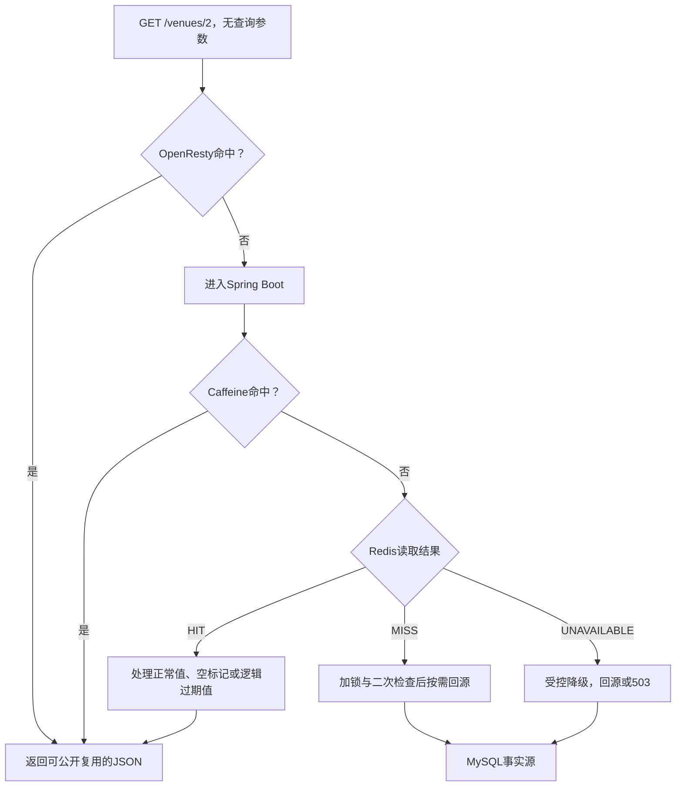
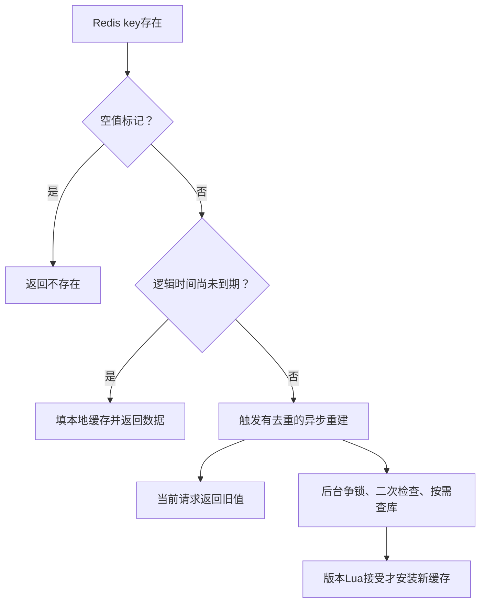
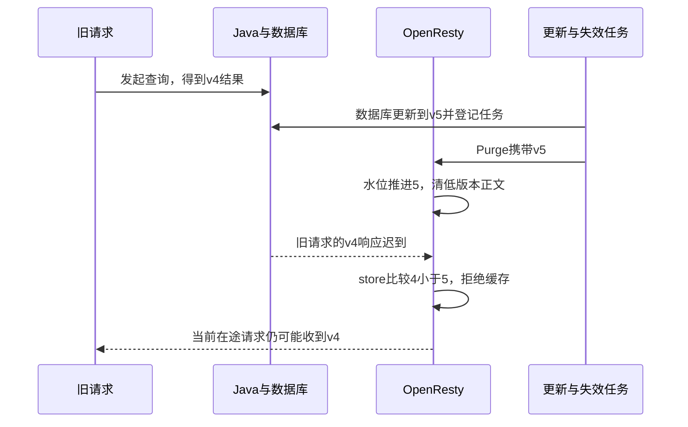
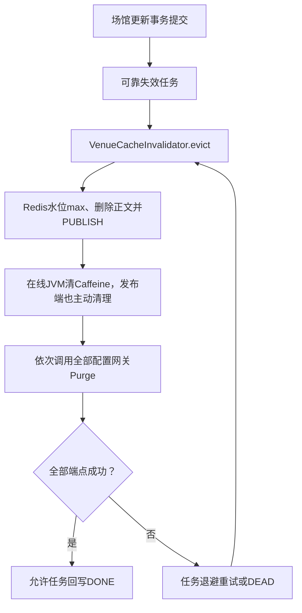
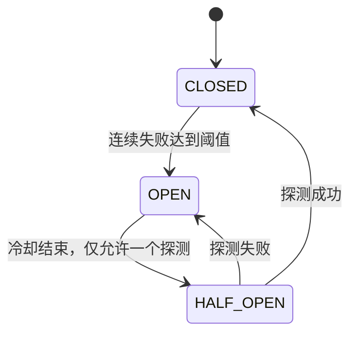

# CityPass 学习文档二：多级缓存一致性

> 按最新副项目简历逐句理解，结构与 01 保持一致：简历讲解 → 重要补充 → 15 道面试深挖问答。
>
> 更新日期：2026-10-28。源码依据为核对时 main 提交 [`9c995aee273bf641cd0152bf626805aadbb83078`](https://github.com/SyH-101/citypass-platform/commit/9c995aee273bf641cd0152bf626805aadbb83078)。示例中的场馆、版本、并发数均为教学推演；仓库验收记录会明确标注，本次文档修改没有重新运行完整中间件验收。
>
> 相关主线：[01 预约与候补](https://github.com/SyH-101/citypass-platform/blob/main/01-异步预约与候补调度.md)、[03 笔记与文件](https://github.com/SyH-101/citypass-platform/blob/main/03-活动笔记发布与文件管理.md)。本文只讲场馆详情缓存，不把预约库存、Feed 或所有查询都算入这条缓存链。

## 先看这次要解释的简历原文

**多级缓存一致性：** 构建 OpenResty + Caffeine + Redis 多级缓存，结合逻辑过期、同 Key 异步去重与 Redisson Watchdog 分布式锁，减少热点数据反复重建；通过 Redis/OpenResty 双层版本校验防止旧值回填，并结合 Pub/Sub 与多网关版本化 Purge 更新各层缓存。

带着一个例子往下读：热门场馆 2 原名为“星河剧场”，管理员把它改成“星河艺术中心”。很多人同时查询，其中一条旧查询很慢。我们既希望少访问数据库，又希望旧查询回来时不要重新污染缓存；Redis 故障时，还要限制转移给数据库的压力。

## 阅读顺序与目录

| 部分 | 要解决的学习问题 | 怎么读 |
| --- | --- | --- |
| 第一部分：逐句讲简历 | 每个机制解决哪个问题，在哪层起作用 | 先顺着读链，再看更新链 |
| 第二部分：重要补充 | 新版本从哪里来、失败时怎么处理、保证到哪里 | 对照事务、三态读取和边界表 |
| 第三部分：15 道深挖问答 | 面试官质疑重复、旧读、宕机时怎样回答 | 先练口述，再找源码条件 |

- [第一部分：把简历每个分句讲清楚](#part-1)
  - [1.1 多级缓存：请求在哪一层返回](#resume-1)
  - [1.2 逻辑过期：旧值与重建分开](#resume-2)
  - [1.3 同 Key 异步去重：别重复提交后台工作](#resume-3)
  - [1.4 Watchdog 锁：跨 JVM 协调重建](#resume-4)
  - [1.5 Redis 版本校验：拒绝已知旧对象回填](#resume-5)
  - [1.6 OpenResty 版本校验：拒绝迟到响应缓存](#resume-6)
  - [1.7 Pub/Sub：清理在线 JVM 副本](#resume-7)
  - [1.8 多网关版本化 Purge：可靠推进网关失效](#resume-8)
- [第二部分：简历没有展开的重要补充](#part-2)
- [第三部分：15 道大厂面试深挖问答](#part-3)
- [最后复习：完整链路、两分钟介绍与源码导航](#review)

<a id="part-1"></a>

## 第一部分：把简历每个分句讲清楚

<a id="resume-1"></a>

### 1.1 “构建 OpenResty + Caffeine + Redis 多级缓存”是什么意思？

#### 每一层存什么，省掉什么？

MySQL 保存场馆真实资料。缓存将同一份资料以不同形式放在更靠近请求的位置，命中越靠前，后面经过的组件越少。

| 层 | 当前保存什么 | 命中时省掉什么 | 共享范围 |
| --- | --- | --- | --- |
| OpenResty | 带版本的公开 HTTP JSON 正文 | Java 处理和后面的缓存／数据库访问 | 同一网关实例的共享内存 |
| Caffeine | Java 场馆对象与版本包装 | 一次 Redis 网络请求和反序列化 | 单个 JVM |
| Redis | 数据、版本、逻辑到期时间；另存版本水位与锁 | 大部分数据库回源 | 多个 Java 实例共享 |
| MySQL | `tb_venue` 与 `cache_version` | 业务事实源 | 数据库访问范围 |

OpenResty 是可以执行 Lua 的 Nginx 扩展平台，在这里承担反向代理、读限流和 HTTP 缓存。**网关命中时直接返回正文，不需要再进入 Spring Boot。** Caffeine 位于 Java 进程内部，多个 JVM 各有一份。



图概括了主分支。降级没有拿到许可时直接 503，不查询 MySQL；Redis HIT 也要继续区分空标记、逻辑新鲜与过期。

真实入口为 `VenueController.queryVenueById` → `VenueServiceImpl.queryById` → `MultiLevelCacheService.queryWithMultiLevel`。`this::getById` 作为数据库回源函数传入，只有真正需要回源时才调用。

**源码位置：** `src/main/java/com/citypass/utils/MultiLevelCacheService.java`  
**类／方法：** `MultiLevelCacheService.queryWithMultiLevel`；[固定版本源码，第 154–176 行](https://github.com/SyH-101/citypass-platform/blob/9c995aee273bf641cd0152bf626805aadbb83078/src/main/java/com/citypass/utils/MultiLevelCacheService.java#L154-L176)。以下为连续节选，原语句未改动，省略的外围条件见上下文。

```java
        String cacheKey = keyPrefix + id;
        Object cached = venueLocalCache.getIfPresent(cacheKey);
        if (cached instanceof LocalEntry) {
            metrics.caffeineHit();
            log.debug("cache.caffeine.hit key={}", cacheKey);
            return (R) ((LocalEntry) cached).getData();
        }

        RedisReadResult redisRead = readRedis(cacheKey);
        if (redisRead.state == RedisReadState.HIT) {
            return serveRedisHit(keyPrefix, id, type, dbFallback, ttl, unit, redisRead.data);
        }

        if (redisRead.state == RedisReadState.UNAVAILABLE) {
            return degradedDbFallback(cacheKey, id, dbFallback, "REDIS_UNAVAILABLE");
        }

        return queryColdMiss(keyPrefix, id, type, dbFallback, ttl, unit);
    }

    public void evictLocal(String keyPrefix, Object id) {
        venueLocalCache.invalidate(keyPrefix + id);
    }
```

读这段时从前往后看：先取本地对象；没有才读 Redis；HIT 走命中处理；UNAVAILABLE 走受控降级；普通 MISS 走冷重建。它没有在每次 Caffeine 命中时再访问 Redis 校验版本，因此本地缓存能省掉网络，但一致性需要后续失效通知配合。

#### 所有 HTTP 响应都能被网关缓存吗？

当前网关只考虑无 query string 的精确 `GET /venues/{id}`，并对上游响应继续检查：

**源码位置：** `src/main/resources/openresty/nginx.conf`  
**类／方法：** `nginx.conf：body_filter_by_lua_block（允许缓存的响应）`；[固定版本源码，第 142–149 行](https://github.com/SyH-101/citypass-platform/blob/9c995aee273bf641cd0152bf626805aadbb83078/src/main/resources/openresty/nginx.conf#L142-L149)。以下为连续节选，原语句未改动，省略的外围条件见上下文。

```nginx
                    ngx.ctx.response_cacheable = ngx.status == 200
                        and ngx.var.upstream_http_x_gateway_cacheable == "1"
                        and ngx.ctx.response_version ~= nil
                        and ngx.ctx.response_version >= 0
                        and ngx.var.upstream_http_set_cookie == nil
                        and string.find(content_type, "application/json", 1, true) ~= nil
                        and string.find(cache_control, "private", 1, true) == nil
                        and string.find(cache_control, "no-store", 1, true) == nil
```

要求成功 HTTP 状态、Java 的明确缓存许可和合法版本、JSON、无 Set-Cookie、无 private/no-store。正文还限制在 1 MiB，超限跳过填充。加入个性化字段后，不能继续未经审视地共用同一份公开正文缓存。

这套多级缓存适合读多写少、允许暂时旧值的场馆资料。库存与订单决策不能从缓存名称相同就套用同样的旧读策略。

**面试时可以这样说：**

> 网关缓存公开 HTTP 正文，命中后请求不进入 Java；Caffeine 缓存 JVM 对象，省掉 Redis 网络访问；Redis 提供多个实例共享的数据副本，MySQL 保存事实。三层降低的成本不同，也增加了失效和版本维护成本。当前覆盖的是公开场馆详情，性能收益还需要同环境对照测量。

**记忆主线：** 网关尽早返回 → JVM 省网络 → Redis 减回源 → MySQL 保存事实。

<a id="resume-2"></a>

### 1.2 “结合逻辑过期”是什么意思？

#### Redis key 还在，为什么会说数据已经过期？

数据包装 `RedisData` 内有 `data`、`version`、`expireTime`、`nullValue`。其中 expireTime 是应用判断“该刷新了”的逻辑时间；Redis key 自己还有一段更长的物理 TTL。

假设逻辑到期是 10:30，物理删除是 11:30。10:31 来的请求仍能读到旧对象，可以先返回，再异步重建；过了物理 TTL，key 被删除，就只能按冷 MISS 处理。

**源码位置：** `src/main/java/com/citypass/utils/MultiLevelCacheService.java`  
**类／方法：** `MultiLevelCacheService.serveRedisHit`；[固定版本源码，第 303–319 行](https://github.com/SyH-101/citypass-platform/blob/9c995aee273bf641cd0152bf626805aadbb83078/src/main/java/com/citypass/utils/MultiLevelCacheService.java#L303-L319)。以下为连续节选，原语句未改动，省略的外围条件见上下文。

```java
        if (Boolean.TRUE.equals(redisData.getNullValue())) {
            metrics.nullMarkerHit();   //metrics.nullMarkerHit() 则是记录空值缓存命中次数。
            return null;  //返回空值，可以防止不存在的场馆被反复查询，避免缓存穿透。
        }

        R data = convert(redisData, type); //Redis 存储的是序列化数据，这里将其转换成业务需要的 Java 对象。
        if (!isLogicallyExpired(redisData)) {
            String cacheKey = keyPrefix + id; 
            venueLocalCache.put(cacheKey, new LocalEntry(data, versionOfRedisData(redisData)));  //将 Redis 中的数据写入 Caffeine
            return data;
        }

        rebuildAsync(keyPrefix, id, type, dbFallback, ttl, unit);  //过期了就异步重建缓存
        return data;
    }

    private <R> R serveFreshRedisData(String cacheKey, Class<R> type, RedisData redisData) {
```

空标记先返回 null。正常值未逻辑过期时放入 Caffeine 后返回；已经逻辑过期时调用 `rebuildAsync`，随后返回旧数据。这里是先提交后台工作、前台无需等重建完成；不要把过期分支描述成同步查库更新后才返回。

当前旧值分支不再写入本地 Caffeine，避免这次逻辑过期命中直接延长本地 TTL。不过本地已有对象只按 Caffeine 自己的规则淘汰，不逐次判断 RedisData 的逻辑时间。

#### 两段 TTL 怎样设置？

**源码位置：** `src/main/java/com/citypass/utils/MultiLevelCacheService.java`  
**类／方法：** `MultiLevelCacheService.writeWithLogicalExpire`；[固定版本源码，第 408–431 行](https://github.com/SyH-101/citypass-platform/blob/9c995aee273bf641cd0152bf626805aadbb83078/src/main/java/com/citypass/utils/MultiLevelCacheService.java#L408-L431)。以下为连续节选，原语句未改动，省略的外围条件见上下文。

```java
            long baseSec = Math.max(1L, unit.toSeconds(ttl));
            long jitter = (long) (baseSec * 0.2 * ThreadLocalRandom.current().nextDouble());
            long logicalTtlSeconds = baseSec + jitter;
            long physicalTtlSeconds = Math.max(logicalTtlSeconds * 2, logicalTtlSeconds + 3600);
            RedisData redisData = new RedisData();
            redisData.setData(value);
            redisData.setVersion(versionOf(value));
            redisData.setExpireTime(LocalDateTime.now().plusSeconds(logicalTtlSeconds));
            Long written =
                    stringRedisTemplate.execute(
                            WRITE_IF_VERSION_SCRIPT,
                            Arrays.asList(key, CACHE_VENUE_VERSION_KEY + id),
                            String.valueOf(redisData.getVersion()),
                            JSONUtil.toJsonStr(redisData),
                            String.valueOf(physicalTtlSeconds));
            redisFailureGate.onSuccess(permission);
            return Long.valueOf(1L).equals(written)
                    ? WriteState.ACCEPTED
                    : WriteState.STALE_REJECTED;
        } catch (RuntimeException e) {
            recordRedisFailure(permission, "cache write", key, e);
            return WriteState.UNAVAILABLE;
        }
    }
```

数据库对象的版本和逻辑到期时间一起包装，交给版本 Lua 判断能否写回。Redis 逻辑 TTL 默认为 30 分钟，另加 0～20% 抖动；物理 TTL 取逻辑 TTL 的两倍与“逻辑 TTL 加 3600 秒”中的较大者，因为逻辑过期后，项目仍然需要保留旧数据一段时间，以便在异步重建期间继续提供旧数据。抖动用于分散同时重建。



#### 这种做法的代价是什么？

用户可能短暂看到旧名称，这是设计允许的读语义。如果后台长期失败，旧值最多存在于其物理存活窗口内；物理过期以后仍可能出现冷回源和降级拒绝。不能把“先返回旧值”理解成无限兜底，或把逻辑过期说成 Redis 已经删除 key。

**面试时可以这样说：**

> 我给缓存同时设应用逻辑到期和更长的 Redis 物理 TTL。逻辑到期后仍能先返回旧值，再安排后台重建，减少热点请求一起等数据库。代价是接受短暂旧读；物理 TTL 决定 key 实际还能存在多久，后台失败和 Redis 故障还要走其他保护机制。

**记忆主线：** 逻辑时间决定要不要刷新，物理 TTL 决定还能不能读到这个 key。

<a id="resume-3"></a>

### 1.3 “同 Key 异步去重”是什么意思？

#### 都已经异步了，为什么还会冲击线程池？

异步只改变谁等待，不能自动减少工作量。100 个请求同时发现场馆 2 逻辑过期，如果每个都提交一个重建任务，仍会让线程池和 Redis 锁竞争承受 100 次工作。
下面这段代码实现的是 同一个 JVM 内，同一个缓存 Key 只提交一个异步重建任务，避免大量请求同时发现缓存过期后，重复创建后台任务。
当前 `localRebuilds` 是 JVM 内的 ConcurrentHashMap，用 key 记录“这份缓存已有后台重建任务”。只有第一个 `putIfAbsent` 成功的请求继续提交，其余直接返回。

**源码位置：** `src/main/java/com/citypass/utils/MultiLevelCacheService.java`  
**类／方法：** `MultiLevelCacheService.rebuildAsync（本地去重与跨JVM锁）`；[固定版本源码，第 338–361 行](https://github.com/SyH-101/citypass-platform/blob/9c995aee273bf641cd0152bf626805aadbb83078/src/main/java/com/citypass/utils/MultiLevelCacheService.java#L338-L361)。以下为连续节选，原语句未改动，省略的外围条件见上下文。

```java
        if (localRebuilds.putIfAbsent(cacheKey, Boolean.TRUE) != null) {
            return;
        }
 //localRebuilds 是一个记录正在重建的 Key 的集合式 Map。
 //putIfAbsent() 是 Java 并发容器提供的原子操作：
 //Key 不存在：插入成功，返回 null，允许提交任务; Key 已存在：返回原来的值，直接 return，不再提交任务。
        

        try {
            rebuildExecutor.submit(   //提交异步任务
                    () -> {
                        RLock lock = null;
                        String lockKey = LOCK_VENUE_REBUILD_KEY + id;
                        try {
                            LockAttempt lockAttempt = tryRebuildLock(lockKey);  // 获取redisson分布式锁
                            if (lockAttempt.state != LockState.ACQUIRED) {
                                if (lockAttempt.state == LockState.BUSY) {
                                    metrics.rebuildLockBusy();
                                }

                                return;
                            }

                            lock = lockAttempt.lock;
                            RedisReadResult latest = readRedis(cacheKey);
                            if (latest.state == RedisReadState.UNAVAILABLE) {
                                // The caller already received stale data; avoid DB pressure during
                                // an outage.
```

这里的 key 是缓存前缀加场馆 ID。场馆 2 和场馆 3 是不同工作，不会互相去重；同一场馆在另一台 Java 实例中也有自己的 map，所以还需要下一节的分布式锁。
为什么已经有了 localRebuilds，还需要分布式锁？因为 localRebuilds 只在当前 JVM 内有效。

后台拿到锁后，再读一次 Redis。别人已经更新就直接使用；Redis 故障则停止这次后台重建，因为前台已经得到旧数据，不必再在故障期间追加数据库压力。需要回源时执行数据库函数，再按版本写回：

**源码位置：** `src/main/java/com/citypass/utils/MultiLevelCacheService.java`  
**类／方法：** `MultiLevelCacheService.rebuildAsync（回源、写回与finally）`；[固定版本源码，第 371–394 行](https://github.com/SyH-101/citypass-platform/blob/9c995aee273bf641cd0152bf626805aadbb83078/src/main/java/com/citypass/utils/MultiLevelCacheService.java#L371-L394)。以下为连续节选，原语句未改动，省略的外围条件见上下文。

```java
                            metrics.rebuildStarted();
                            log.debug(
                                    "normal asynchronous cache rebuild started: key={}", cacheKey);
                            R data = dbFallback.apply(id);
                            if (data == null) {
                                writeNullMarker(cacheKey, id);
                                venueLocalCache.invalidate(cacheKey);
                            } else if (writeWithLogicalExpire(cacheKey, id, data, ttl, unit)
                                    == WriteState.ACCEPTED) {
                                venueLocalCache.put(
                                        cacheKey, new LocalEntry(data, versionOf(data)));
                            } else {
                                venueLocalCache.invalidate(cacheKey);
                            }
                        } catch (RuntimeException e) {
                            log.error(
                                    "asynchronous Venue cache rebuild failed: key={}", cacheKey, e);
                        } finally {
                            unlockSafely(lock, lockKey);
                            localRebuilds.remove(cacheKey);
                        }
                    });
        } catch (RuntimeException rejected) {
            localRebuilds.remove(cacheKey);
```

`finally` 释放锁并删除本地去重标记，允许之后再重建。线程池提交失败时，外层 catch 也移除标记。否则一次异常可能让这个 key 一直被认为“正在处理”。

#### 同 Key 去重能保证队列长度有上限吗？

不能。当前 `Executors.newFixedThreadPool(10,...)` 的工作队列默认无界，大量不同 key 仍可排队；去重只限制单 JVM 同一个 key 的重复任务。它是减少重复工作的措施，不等于完整背压。

**面试时可以这样说：**

> 我在提交后台重建前用 ConcurrentHashMap 的 putIfAbsent 按缓存 key 去重，同 JVM 一次只安排一份同 key 的未完成重建。任务结束或提交失败都会清标记。它减少线程池和锁竞争，但不同 key、不同 JVM 仍可能并发，所以还需要分布式锁和容量控制。

**记忆主线：** 先标记同 key → 只提交一次 → finally 清标记；本地去重不协调其他 JVM。

<a id="resume-4"></a>

### 1.4 “Redisson Watchdog 分布式锁，减少热点数据反复重建”是什么意思？

#### 为什么本地去重后还需要锁？

两台 JVM 的 Caffeine 与 localRebuilds 都不共享，A、B 可以各自安排一个场馆 2 的重建。Redisson 的 `lock:venue:rebuild:{id}` 把跨 JVM 的正常重建协调起来。

当前主链没有给 tryLock 传固定 lease time：

**源码位置：** `src/main/java/com/citypass/utils/MultiLevelCacheService.java`  
**类／方法：** `MultiLevelCacheService.tryRebuildLock`；[固定版本源码，第 493–504 行](https://github.com/SyH-101/citypass-platform/blob/9c995aee273bf641cd0152bf626805aadbb83078/src/main/java/com/citypass/utils/MultiLevelCacheService.java#L493-L504)。以下为连续节选，原语句未改动，省略的外围条件见上下文。

```java
            RLock lock = redissonClient.getLock(key);
            // No lease time is supplied: Redisson's watchdog renews the lock while this owner
            // lives.
            boolean acquired = lock.tryLock();
            redisFailureGate.onSuccess(permission);
            return new LockAttempt(
                    acquired ? LockState.ACQUIRED : LockState.BUSY, acquired ? lock : null);
        } catch (RuntimeException e) {
            recordRedisFailure(permission, "rebuild lock", key, e);
            return new LockAttempt(LockState.UNAVAILABLE, null);
        }
    }
```

不传固定租期时，正常情况下 Redisson Watchdog 为仍存活的持锁客户端续租，避免数据库查询超过旧的固定 10 秒后锁先失效，第二个重建者提前进入。释放前还会检查当前线程是否仍为持有者。

Watchdog 依赖客户端、续租调度与 Redis 通信，长暂停或网络异常仍会影响互斥。它不检查查出来的数据是不是最新，防止旧写还需要版本条件。

#### 为什么拿锁以后再查一次 Redis？

A、B 同时第一次 MISS，B 先拿锁并把缓存建好；A 随后拿锁时，第一次 MISS 的结论已经过时。如果不二次检查，A 会重复查库。

**源码位置：** `src/main/java/com/citypass/utils/MultiLevelCacheService.java`  
**类／方法：** `MultiLevelCacheService.queryColdMiss（二次检查）`；[固定版本源码，第 202–224 行](https://github.com/SyH-101/citypass-platform/blob/9c995aee273bf641cd0152bf626805aadbb83078/src/main/java/com/citypass/utils/MultiLevelCacheService.java#L202-L224)。以下为连续节选，原语句未改动，省略的外围条件见上下文。

```java
            if (lockAttempt.state == LockState.ACQUIRED) {
                boolean redisUnavailable = false;
                try {
                    RedisReadResult doubleChecked = readRedis(cacheKey);
                    if (doubleChecked.state == RedisReadState.UNAVAILABLE) {
                        redisUnavailable = true;
                    } else if (doubleChecked.state == RedisReadState.HIT
                            && !isLogicallyExpired(doubleChecked.data)) {
                        return serveFreshRedisData(cacheKey, type, doubleChecked.data);
                    } else {
                        return normalRebuild(cacheKey, id, dbFallback, ttl, unit);
                    }
                } finally {
                    unlockSafely(lockAttempt.lock, lockKey);
                }

                if (redisUnavailable) {
                    return degradedDbFallback(
                            cacheKey, id, dbFallback, "REDIS_DOUBLE_CHECK_UNAVAILABLE");
                }
            }

            metrics.rebuildLockBusy();
```

这个片段属于冷 MISS：拿锁成功后检查 Redis，已经新鲜就直接返回；仍需重建才查库。异步重建也做二次检查。异步拿锁失败直接结束本轮，后续过期请求可以再触发；冷 MISS 则有限等待、重复读缓存，等待耗尽后进入受控降级。

| 机制 | 解决的问题 |
| --- | --- |
| 同 key map | 单 JVM 别提交一堆同样的后台任务 |
| Redisson 锁 | 多 JVM 正常情况下别同时重建同一个 key |
| Watchdog | 正常长重建期间维持锁的有效期 |
| 拿锁后二次检查 | 前面的请求可能已经把缓存建好 |
| 版本校验 | 重建期间发生更新，回来的是旧数据 |

仓库通用 `CacheClient` 中仍有旧字符串锁和固定 TTL 的基线路径；当前 Venue 多级缓存主链应看 `MultiLevelCacheService.tryRebuildLock`。

**面试时可以这样说：**

> 我用本地 map 降低重复任务，再用 Redisson 锁协调多 JVM。主链不传固定 lease time，由 Watchdog 正常续租；拿锁后再检查缓存，避免后来拿到锁的人重复查库。锁保证重建协调，版本保证返回数据能否写回，两者要分开解释。

**记忆主线：** 本地去重 → 跨 JVM 抢锁 → 二次读缓存 → 按需回源 → 比版本再安装。

<a id="resume-5"></a>

### 1.5 “通过 Redis 版本校验防止旧值回填”是什么意思？

#### 更新后为什么还会出现旧值？

看这个交错：A 从数据库读到版本 4，但返回很慢；管理员把名称更新到版本 5，失效任务删除缓存；A 随后才把版本 4 写回来。如果只 DEL 正文，旧请求就会让旧值重新出现。

当前额外保留 `cache:venue:version:{id}`，表示 Redis 已知的**最低可接受版本**。正文删除以后，这条判断线仍保留。

| 时刻 | 数据库 | Redis 正文 | Redis 水位 | A 的旧读 |
| --- | --- | --- | ---: | --- |
| A 读库 | v4 | 可能缺失 | 4 | 取得 v4 |
| 更新提交、失效生效 | v5 | 删除 | 5 | 仍在途中 |
| A 尝试回填 | v5 | 不接受 v4 | 5 | 低于水位，被拒绝 |

真实写回脚本如下：

**源码位置：** `src/main/resources/write-cache-if-version.lua`  
**类／方法：** `write-cache-if-version.lua 完整脚本`；[固定版本源码，第 1–9 行](https://github.com/SyH-101/citypass-platform/blob/9c995aee273bf641cd0152bf626805aadbb83078/src/main/resources/write-cache-if-version.lua#L1-L9)。以下为连续节选，原语句未改动，省略的外围条件见上下文。

```lua
-- KEYS[1] cache data, KEYS[2] version key; ARGV[1] expectedVersion, ARGV[2] json, ARGV[3] ttlSeconds
local current = tonumber(redis.call('get', KEYS[2]) or '0')
local expected = tonumber(ARGV[1])
if expected < current then
    return 0
end
redis.call('set', KEYS[2], expected)
redis.call('set', KEYS[1], ARGV[2], 'EX', ARGV[3])
return 1
```

`expected < current` 才拒绝，等于水位可以写；比较与 SET 在一个 Lua 中，避免 Java 先 GET、后 SET 中间被更新插入。成功写入同时推进版本键，并对正文设置物理 TTL；版本键没有随正文一起设置 TTL。

水位在**失效任务执行以后**才一定反映这个更新；MySQL 已提交、任务尚未推进时，缓存可能仍接受旧版本。它防止已知旧写，不能把这段异步链变成强一致读取。

#### 失效任务如何推进水位？

**源码位置：** `src/main/resources/invalidate-venue-cache.lua`  
**类／方法：** `invalidate-venue-cache.lua 完整脚本`；[固定版本源码，第 1–16 行](https://github.com/SyH-101/citypass-platform/blob/9c995aee273bf641cd0152bf626805aadbb83078/src/main/resources/invalidate-venue-cache.lua#L1-L16)。以下为连续节选，原语句未改动，省略的外围条件见上下文。

```lua
-- KEYS[1] main cache, KEYS[2] baseline cache, KEYS[3] version key
-- ARGV[1] pub/sub channel, ARGV[2] venueId, ARGV[3] committed database version
local current = tonumber(redis.call('get', KEYS[3]) or '0')
local requested = tonumber(ARGV[3])
if requested < 0 then
    requested = current + 1
end
local version = requested
if current > requested then
    version = current
end
redis.call('set', KEYS[3], version)
redis.call('del', KEYS[1])
redis.call('del', KEYS[2])
redis.call('publish', ARGV[1], ARGV[2] .. ':' .. version)
return version
```

携带数据库版本的任务使用 `max(current, requested)`，乱序到达不会把水位降低。然后删除正文与基线缓存，并广播 `venueId:version`。重放较低版本仍会删除正文、发广播，可能造成额外 MISS，但不会倒退已知水位。

对于没有提交版本的调用，负数参数会使水位自行加一；这主要用于可选 Canal 等路径。若外部 SQL 没有同步递增数据库版本，这条额外水位可能高于随后读到的数据库版本，造成新回填一直被拒绝，需要统一版本规则。

**面试时可以这样说：**

> 我给场馆数据带数据库 cacheVersion，Redis 另外保留最低可接受版本。更新失效先把水位推进到已提交版本，再删除正文；迟到回填用 Lua 原子比较，低于水位就拒绝，等于或更高可以写入。这样删除后仍有拒旧依据，保证范围从水位生效开始，不代表更新提交后立刻全局读新。

**记忆主线：** 更新产生版本 → 水位单调推进 → 旧读回来 → Lua 比较 → 拒绝低版本。

<a id="resume-6"></a>

### 1.6 “OpenResty 双层版本校验”中的第二层做什么？

#### Redis 已经拒旧，HTTP 正文为什么还可能变旧？

某个请求在更新前已从 Java 得到 v4 的结果，网络传输或上游响应很慢。管理员更新后清掉网关缓存，这个在途 v4 响应随后到达 body filter，如果不检查版本，就又把旧正文存回网关。

Redis 水位约束 Java 对 Redis 的写入，管不到这份已经产生的 HTTP 正文。OpenResty 因而也维护版本与水位：

| 网关数据 | 内容 |
| --- | --- |
| `ngx.shared.venue_cache` | `版本 + 换行 + JSON正文` |
| `ngx.shared.venue_cache_version` | 每个场馆的最低可接受响应版本 |
| `resty.lock` | 按场馆协调 lookup、store、purge 的共享字典复合操作 |

Java 的 `VenueController.queryVenueById` 输出 `X-Venue-Cache-Version` 和内部缓存许可头。网关接收到正文后，将响应版本与本地水位比较：

**源码位置：** `src/main/resources/openresty/lua/venue_cache.lua`  
**类／方法：** `venue_cache.lua：store（版本比较与水位推进）`；[固定版本源码，第 104–126 行](https://github.com/SyH-101/citypass-platform/blob/9c995aee273bf641cd0152bf626805aadbb83078/src/main/resources/openresty/lua/venue_cache.lua#L104-L126)。以下为连续节选，原语句未改动，省略的外围条件见上下文。

```lua
    local watermark = tonumber(versions:get(key)) or 0
    if version < watermark then
        release(lock)
        ngx.log(ngx.WARN, "stale venue response rejected: id=", id,
                ", responseVersion=", version, ", watermark=", watermark)
        return false, "stale version"
    end

    -- A newer authoritative response also advances the floor so a later old
    -- response cannot replace it while the invalidation task is still in flight.
    if version > watermark then
        local version_ok, version_err = versions:safe_set(key, version)
        if not version_ok then
            release(lock)
            ngx.log(ngx.ERR, "venue cache watermark write failed: id=", id,
                    ", version=", version, ", error=", version_err or "unknown")
            return false, version_err
        end
    end

    local ok, err, forcible = cache:set(entry_key(id), tostring(version) .. "\n" .. body, ttl)
    release(lock)
    if not ok then
```

版本过低就跳过缓存填充；更高响应也能推进水位，防止晚来的更低响应覆盖。水位使用 `safe_set`：容量不足时显式失败，不依靠 LRU 静默挤掉这个拒旧依据。只有安全推进成功，后面才会写正文。



要特别看最后一行：拒绝把旧正文保存为后续缓存，并不能追回当前用户已经收到或正在收到的旧响应。

#### Purge 删除之后还留下什么？

**源码位置：** `src/main/resources/openresty/lua/venue_cache.lua`  
**类／方法：** `venue_cache.lua：purge（max水位与选择性删除）`；[固定版本源码，第 146–168 行](https://github.com/SyH-101/citypass-platform/blob/9c995aee273bf641cd0152bf626805aadbb83078/src/main/resources/openresty/lua/venue_cache.lua#L146-L168)。以下为连续节选，原语句未改动，省略的外围条件见上下文。

```lua
    local current = tonumber(versions:get(key)) or 0
    local next_version = math.max(current, committed_version)
    if next_version > current then
        local ok, err = versions:safe_set(key, next_version)
        if not ok then
            cache:delete(entry_key(id))
            release(lock)
            return nil, "watermark write failed: " .. (err or "unknown")
        end
    end

    local raw = cache:get(entry_key(id))
    if raw then
        local entry_version = _M.parse_entry(raw)
        if not entry_version or entry_version < next_version then
            cache:delete(entry_key(id))
        end
    end
    release(lock)
    ngx.log(ngx.NOTICE, "venue cache purge accepted: id=", id,
            ", committedVersion=", committed_version, ", watermark=", next_version)
    return next_version
end
```

水位取 max，只删除低于新水位的正文；等于或更高的合法正文不被较低版本 purge 清掉。这一点与 Redis 失效脚本“重放也直接 DEL 正文”的行为不同，面试可以用代码区分。

body filter 不能执行需要等待让出的操作，所以 store 采用零等待拿锁，冲突就跳过可选填充。lookup 和 purge 允许有限短等待。正文缓存可丢弃，拒旧依据需要更谨慎维护。

当前水位位于网关实例共享内存。`safe_set` 防容量不足时静默淘汰，不等于重启后持久保存；它也没有让多台网关自动共享同一个水位。

**面试时可以这样说：**

> 我在 Redis 和 OpenResty 分别做版本判断。Redis 保护对象回填，网关保护迟到 HTTP 正文的缓存安装；Purge 携带提交版本单调推进网关水位，store 遇到低版本就拒绝。当前请求仍可能返回旧值，水位也有重启丢失和静态拓扑边界，所以我不会说这实现了全层强一致。

**记忆主线：** Redis 拒旧对象，OpenResty 拒旧正文；Purge 之后仍需在 store 时检查。

<a id="resume-7"></a>

### 1.7 “结合 Pub/Sub 更新各层缓存”是什么意思？

#### 删除共享 Redis，为什么两台 JVM 仍可能不同？

A、B 两台 Java 都在 Caffeine 中存了旧名称。更新后只删 Redis，B 的下一次请求仍可能直接命中自己的本地对象，根本不访问 Redis。因此失效脚本除了 DEL，还 PUBLISH 一条通知，让当前在线 JVM 清理本地项。

**源码位置：** `src/main/java/com/citypass/config/RedisPubSubConfig.java`  
**类／方法：** `RedisPubSubConfig.cacheInvalidationContainer`；[固定版本源码，第 14–23 行](https://github.com/SyH-101/citypass-platform/blob/9c995aee273bf641cd0152bf626805aadbb83078/src/main/java/com/citypass/config/RedisPubSubConfig.java#L14-L23)。以下为连续节选，原语句未改动，省略的外围条件见上下文。

```java
    @Bean
    public RedisMessageListenerContainer cacheInvalidationContainer(
            RedisConnectionFactory connectionFactory, VenueCacheInvalidator invalidator) {
        RedisMessageListenerContainer container = new RedisMessageListenerContainer();
        container.setConnectionFactory(connectionFactory);
        container.addMessageListener(
                invalidator, new ChannelTopic(CACHE_VENUE_INVALIDATION_CHANNEL));
        return container;
    }
}
```

监听容器订阅 `CACHE_VENUE_INVALIDATION_CHANNEL`，把通知交给 `VenueCacheInvalidator`：

**源码位置：** `src/main/java/com/citypass/utils/VenueCacheInvalidator.java`  
**类／方法：** `VenueCacheInvalidator.onMessage`；[固定版本源码，第 102–108 行](https://github.com/SyH-101/citypass-platform/blob/9c995aee273bf641cd0152bf626805aadbb83078/src/main/java/com/citypass/utils/VenueCacheInvalidator.java#L102-L108)。以下为连续节选，原语句未改动，省略的外围条件见上下文。

```java
    public void onMessage(Message message, byte[] pattern) {
        String event = new String(message.getBody(), StandardCharsets.UTF_8);
        int separator = event.lastIndexOf(':');
        String venueId = separator < 0 ? event : event.substring(0, separator);
        multiLevelCacheService.evictLocal(CACHE_VENUE_KEY, venueId);
        log.debug("收到场馆缓存失效广播: {}", event);
    }
```

事件带 venueId 与版本，当前监听器只拆出 ID 并执行本地 invalidate，没有保存 JVM 的最高失效版本。发布端也会主动清一次自己的本地项，避免依赖 Pub/Sub 消息绕回本机。

Pub/Sub 的价值是让在线副本尽快丢弃旧值，但没有离线补发、逐 JVM 持久 ACK。B 断线错过通知时，可能继续读本地旧值，直到被后续失效或本地淘汰。Caffeine 当前是写入后 10 分钟、最大 10000 条；TTL 从安装时计算，不能直接当成从数据库提交开始的严格十分钟上界。

#### 带 version 字段，为什么还不能完全解决本地回填竞态？

例如线程 A 已拿到 Redis v4，更新广播随后清掉本地项；A 之后才执行 Caffeine put(v4)，旧对象又装回去了。正常重建的 Redis ACCEPTED 与 Caffeine put 之间也可能发生类似交错。

当前本地没有一个持续保留的最高失效版本，在安装时再次比较；本地命中也不逐次对比共享水位。所以“LocalEntry 里有 version”不等于这个竞态已经解决。改进方向是在 JVM 内维护失效版本并协调安装，但它目前属于后续设计。

**面试时可以这样说：**

> Pub/Sub 让当前在线 JVM 收到场馆失效通知，按 ID 删除自己的 Caffeine；发布端还主动清本机。它提高失效传播速度，但不持久保存广播，也没有逐 JVM 确认。当前安装与失效仍可交错，本地版本字段没有自动挡住所有旧写，TTL 是补充淘汰手段。

**记忆主线：** Redis 失效并广播 → 在线监听器清本地；漏消息与迟到 put 要分别考虑。

<a id="resume-8"></a>

### 1.8 “多网关版本化 Purge 更新各层缓存”是什么意思？

#### 为什么 Pub/Sub 之外还要发 HTTP DELETE？

Pub/Sub 的监听者是 Java 端，OpenResty 的共享字典不因 Redis DEL 自动清空。Java 需要向网关内部接口发送 `DELETE /internal/cache/venue?id=2&version=5`，由网关推进水位并清理低版本正文。Purge 就是主动驱逐缓存，这里还附带版本。

当前写链可概括为：



**源码位置：** `src/main/java/com/citypass/utils/VenueCacheInvalidator.java`  
**类／方法：** `VenueCacheInvalidator.evict`；[固定版本源码，第 82–99 行](https://github.com/SyH-101/citypass-platform/blob/9c995aee273bf641cd0152bf626805aadbb83078/src/main/java/com/citypass/utils/VenueCacheInvalidator.java#L82-L99)。以下为连续节选，原语句未改动，省略的外围条件见上下文。

```java
    public void evict(Object venueId, Long committedVersion) {
        Long version =
                redisTemplate.execute(
                        INVALIDATE_SCRIPT,
                        Arrays.asList(
                                CACHE_VENUE_KEY + venueId,
                                CACHE_VENUE_BASELINE_KEY + venueId,
                                CACHE_VENUE_VERSION_KEY + venueId),
                        CACHE_VENUE_INVALIDATION_CHANNEL,
                        String.valueOf(venueId),
                        String.valueOf(committedVersion == null ? -1L : committedVersion));
        if (version == null) {
            throw new IllegalStateException("场馆缓存失效脚本返回空");
        }
        // 发布端也立即清理，避免依赖自身能否收到 pub/sub 回环消息。
        multiLevelCacheService.evictLocal(CACHE_VENUE_KEY, venueId);
        purgeGateways(venueId, version);
    }
```

Purge URL 从显式配置读取，兼容旧单地址和多地址，合并去重。它会尝试所有配置地址，并收集失败：

**源码位置：** `src/main/java/com/citypass/utils/VenueCacheInvalidator.java`  
**类／方法：** `VenueCacheInvalidator.purgeGateways（逐端点DELETE）`；[固定版本源码，第 118–137 行](https://github.com/SyH-101/citypass-platform/blob/9c995aee273bf641cd0152bf626805aadbb83078/src/main/java/com/citypass/utils/VenueCacheInvalidator.java#L118-L137)。以下为连续节选，原语句未改动，省略的外围条件见上下文。

```java
        for (String endpoint : endpoints) {
            URI uri =
                    UriComponentsBuilder.fromHttpUrl(endpoint)
                            .queryParam("id", String.valueOf(venueId))
                            .queryParam("version", committedVersion)
                            .build()
                            .encode(StandardCharsets.UTF_8)
                            .toUri();
            try {
                ResponseEntity<Void> response =
                        restTemplate.exchange(uri, HttpMethod.DELETE, null, Void.class);
                if (!response.getStatusCode().is2xxSuccessful()) {
                    throw new IllegalStateException("HTTP " + response.getStatusCodeValue());
                }

                log.info(
                        "OpenResty 场馆缓存驱逐成功: endpoint={}, venueId={}, version={}",
                        endpoint,
                        venueId,
                        committedVersion);
```

下面的 catch 位于同一循环内，后面的异常判断位于循环结束后：

**源码位置：** `src/main/java/com/citypass/utils/VenueCacheInvalidator.java`  
**类／方法：** `VenueCacheInvalidator.purgeGateways（汇总失败并抛出）`；[固定版本源码，第 138–163 行](https://github.com/SyH-101/citypass-platform/blob/9c995aee273bf641cd0152bf626805aadbb83078/src/main/java/com/citypass/utils/VenueCacheInvalidator.java#L138-L163)。以下为连续节选，原语句未改动，省略的外围条件见上下文。

```java
            } catch (Exception e) {
                failedEndpoints.add(endpoint);
                if (firstFailure == null) {
                    firstFailure = e;
                }

                log.warn(
                        "OpenResty 场馆缓存驱逐失败: endpoint={}, venueId={}, version={}",
                        endpoint,
                        venueId,
                        committedVersion,
                        e);
            }
        }

        if (!failedEndpoints.isEmpty()) {
            throw new IllegalStateException(
                    "OpenResty 场馆缓存驱逐失败: venueId="
                            + venueId
                            + ", version="
                            + committedVersion
                            + ", endpoints="
                            + failedEndpoints,
                    firstFailure);
        }
    }
```

例如 A 成功、B 失败、C 成功，C 仍会尝试，但整次处理失败，不能把任务标 DONE。重试又访问 A、B、C，已成功节点使用 max 规则不会倒退水位。

每个端点当前连接超时 1 秒、读取超时 2 秒，多个端点顺序尝试，任务总耗时会随节点数量增长。共享任务租约还没有心跳续租，节点很多时要考虑任务被接管和外部动作重放。

#### 任务 DONE 到底能证明什么？

在相应配置下，它说明本轮 Redis 脚本成功、发布端清理了本地缓存、所有列出的网关 HTTP 调用成功；如果没有配置网关列表，就不会发出这些调用。它不能证明每个 JVM 都 ACK 广播，也无法覆盖未配置或动态新增的网关。

**面试时可以这样说：**

> 我让失效任务统一执行 Redis 版本失效、本机清理和多网关 Purge。网关列表内每个端点都会尝试，有一个失败就让任务重试；已成功节点靠版本 max 规则支持重放。当前是静态配置和在线广播，DONE 的范围是这些已执行动作，不是全世界所有副本都已确认。

**记忆主线：** 持久待办 → Redis 失效／广播 → 本机清理 → 全部配置网关 Purge → 整体成功才 DONE。

<a id="part-2"></a>

## 第二部分：简历没有展开的重要补充

<a id="extra-update"></a>

### 2.1 新版本从哪里来？为什么更新与 Outbox 同事务保存？

简历省略了这段实现细节，但“版本校验”必须有可信的版本源。当前场馆 `cache_version` 存在 MySQL，普通实体更新不允许客户端随意覆盖它；专用 SQL 在数据库中原地加一：

**源码位置：** `src/main/java/com/citypass/mapper/VenueMapper.java`  
**类／方法：** `VenueMapper.incrementCacheVersion`；[固定版本源码，第 17–18 行](https://github.com/SyH-101/citypass-platform/blob/9c995aee273bf641cd0152bf626805aadbb83078/src/main/java/com/citypass/mapper/VenueMapper.java#L17-L18)。以下为连续节选，原语句未改动，省略的外围条件见上下文。

```java
    @Update("UPDATE tb_venue SET cache_version=cache_version+1 WHERE id=#{id}")
    int incrementCacheVersion(@Param("id") Long id);
```

数据库写入、版本递增和失效意图保存由 `VenueServiceImpl.update` 的同一事务完成：

**源码位置：** `src/main/java/com/citypass/service/impl/VenueServiceImpl.java`  
**类／方法：** `VenueServiceImpl.update`；[固定版本源码，第 90–112 行](https://github.com/SyH-101/citypass-platform/blob/9c995aee273bf641cd0152bf626805aadbb83078/src/main/java/com/citypass/service/impl/VenueServiceImpl.java#L90-L112)。以下为连续节选，原语句未改动，省略的外围条件见上下文。

```java
    @Transactional
    public Result update(Venue venue) {
        Long id = venue.getId();
        if (id == null) {
            return Result.fail("场馆id不能为空");
        }
        // 1.更新数据库
        boolean updated = updateById(venue);
        if (!updated) {
            return Result.fail("场馆不存在或更新失败");
        }

        if (getBaseMapper().incrementCacheVersion(id) != 1) {
            throw new IllegalStateException("场馆缓存版本更新失败");
        }

        Venue refreshed = getById(id);
        reliableTaskRepository.enqueue(
                ReliableTaskRepository.INVALIDATE_VENUE_CACHE,
                "invalidate-venue-cache:" + id + ":" + refreshed.getCacheVersion(),
                JSONUtil.toJsonStr(new VenueCacheInvalidation(id, refreshed.getCacheVersion())));
        return Result.ok();
    }
```

按步骤理解：先更新场馆业务字段；再让数据库版本加一并检查行数；读取本事务更新后的版本；以场馆 ID 和版本组成 biz_key，登记 `INVALIDATE_VENUE_CACHE` 待办。待办插入失败会使事务回滚。事务返回后由 Relay 执行失效，不要求业务更新接口同步等所有网关完成。

它弥补“更新已提交，但进程在删缓存前退出”的缺口。只用进程内 afterCommit 回调，仍存在提交后回调未完成就宕机的窗口；持久待办能让之后的进程接着处理。

注意版本在数据库并发加一，不能先在 Java 做 read+1 再 update。两个正常更新会通过行写协调推进版本；接口返回更新成功仅代表本地事务已提交，不代表失效任务已完成。

当前 `POST /venues` 新增入口直接 save，没有接入与 PUT 相同的版本化失效事务。读不存在与随后新增交错时，空标记可能暂时遮住新场馆。直接 SQL 变更也要遵守版本与失效规则，不能只改业务字段后假定缓存自动更新。

**对应源码：** [Venue 的 cacheVersion 字段](https://github.com/SyH-101/citypass-platform/blob/9c995aee273bf641cd0152bf626805aadbb83078/src/main/java/com/citypass/entity/Venue.java)、[VenueController 新增／修改入口](https://github.com/SyH-101/citypass-platform/blob/9c995aee273bf641cd0152bf626805aadbb83078/src/main/java/com/citypass/controller/VenueController.java)、[任务执行器](https://github.com/SyH-101/citypass-platform/blob/9c995aee273bf641cd0152bf626805aadbb83078/src/main/java/com/citypass/task/ReliableTaskScheduler.java)。

<a id="extra-read"></a>

### 2.2 把一次完整读取分清三种状态

Redis 正常返回空字符串／无 key 是 MISS；Redis 超时、客户端异常，或 FailureGate 拒绝访问，是 UNAVAILABLE。两者处理目的不同：

| 情况 | 当前处理 | 原因 |
| --- | --- | --- |
| Caffeine HIT | 直接返回本地对象 | 保留低延迟与 Redis 故障时的热数据能力 |
| Redis HIT，正常且新鲜 | 放 Caffeine，返回 | 复用共享副本 |
| Redis HIT，逻辑过期 | 同 key 去重后安排异步重建，返回旧值 | 降低热点同时等待 |
| Redis HIT，null marker | 返回不存在，不写 Caffeine | 复用负缓存结论 |
| Redis MISS | 尝试重建锁，二次检查，按需查库 | 正常冷启动竞争 |
| 重建锁 BUSY | 有限等待后再读，耗尽进入受控回源 | 防无限阻塞 HTTP 线程 |
| Redis／锁 UNAVAILABLE | Gate 与数据库回源许可保护 | 故障流量不能无限转移 |

冷锁等待默认最多 20 轮，每次 25～50 毫秒随机等待，并非对所有代码的严格总超时承诺。超时仍受 Redis 调用、数据库与 HTTP 客户端配置影响。

普通重建的 Redis 写结果有 ACCEPTED、STALE_REJECTED、UNAVAILABLE。只有 ACCEPTED 后正常安装本地副本；其他结果会清理本地项，但当前请求仍可能返回自己这次从数据库取得的旧快照。拒绝污染缓存与保证当前响应一定最新是不同目标。

<a id="extra-penetration"></a>

### 2.3 穿透、击穿、雪崩在这里分别怎样处理？

| 问题 | 项目里的具体场景 | 已有措施 | 仍要注意 |
| --- | --- | --- | --- |
| 穿透 | 查询不存在的场馆 | Redis 空标记；网关按 IP 限流 | 随机不同 ID 的首次查询仍可能回源 |
| 击穿 | 单个热门 key 逻辑到期或物理消失 | 逻辑过期返旧、本地去重、分布式锁与二次检查 | 冷锁等待耗尽后可能出现受限额外回源 |
| 雪崩／故障扩散 | 多 key 同时过期或 Redis 故障 | TTL 抖动、Gate、数据库降级并发许可 | 不同 key 的正常回源没有统一全局上限 |

负缓存通过普通 SET 写入：

**源码位置：** `src/main/java/com/citypass/utils/MultiLevelCacheService.java`  
**类／方法：** `MultiLevelCacheService.writeNullMarker`；[固定版本源码，第 441–454 行](https://github.com/SyH-101/citypass-platform/blob/9c995aee273bf641cd0152bf626805aadbb83078/src/main/java/com/citypass/utils/MultiLevelCacheService.java#L441-L454)。以下为连续节选，原语句未改动，省略的外围条件见上下文。

```java
            String rawVersion = stringRedisTemplate.opsForValue().get(CACHE_VENUE_VERSION_KEY + id);
            long version = rawVersion == null ? 0L : Long.parseLong(rawVersion);
            RedisData nullData = new RedisData();
            nullData.setNullValue(true);
            nullData.setVersion(version);
            nullData.setExpireTime(LocalDateTime.now().plusMinutes(CACHE_NULL_TTL));
            stringRedisTemplate
                    .opsForValue()
                    .set(key, JSONUtil.toJsonStr(nullData), CACHE_NULL_TTL, TimeUnit.MINUTES);
            redisFailureGate.onSuccess(permission);
        } catch (RuntimeException e) {
            recordRedisFailure(permission, "null marker write", key, e);
        }
    }
```

默认 2 分钟，写入前读取版本，但它没有经过版本 Lua 的原子“比较并写入”。如果读不存在以后，另一个事务创建了场馆，再有迟到负缓存写回，就存在窗口。当前新增入口也没有同等 Outbox 失效，因此不能把所有写路径说成已经统一治理。

当前没有布隆过滤器。对副项目可以先解释“同一无效 ID 靠负缓存、随机扫描靠限流”，再把布隆过滤器作为有证据的后续选型：当随机无效请求的回源压力明显，才评估误判率、新增同步与重建期间误拒等维护成本。

**对应源码：** [nginx.conf 按 IP 令牌桶](https://github.com/SyH-101/citypass-platform/blob/9c995aee273bf641cd0152bf626805aadbb83078/src/main/resources/openresty/nginx.conf)、[TTL 常量](https://github.com/SyH-101/citypass-platform/blob/9c995aee273bf641cd0152bf626805aadbb83078/src/main/java/com/citypass/utils/RedisConstants.java)。

<a id="extra-failure"></a>

### 2.4 Redis 故障时，FailureGate 与数据库并发许可各做什么？

FailureGate 尽量减少对已故障 Redis 的重复等待；数据库许可限制被转移过去的回源并发，两者需要配合。



Gate 的核心许可判断：

**源码位置：** `src/main/java/com/citypass/utils/RedisFailureGate.java`  
**类／方法：** `RedisFailureGate.tryAcquire`；[固定版本源码，第 48–59 行](https://github.com/SyH-101/citypass-platform/blob/9c995aee273bf641cd0152bf626805aadbb83078/src/main/java/com/citypass/utils/RedisFailureGate.java#L48-L59)。以下为连续节选，原语句未改动，省略的外围条件见上下文。

```java
    public synchronized Permission tryAcquire() {
        if (state == State.CLOSED) {
            return Permission.NORMAL;
        }

        if (state == State.OPEN && nanoTime.getAsLong() >= reopenAtNanos) {
            state = State.HALF_OPEN;
            return Permission.PROBE;
        }

        return Permission.REJECTED;
    }
```

默认连续 3 次失败后 OPEN 3000 毫秒。冷却结束第一个调用获得 PROBE，其他调用继续拒绝；成功清除失败计数并关闭，失败重新冷却。时间使用单调时钟 `nanoTime`，状态访问以 synchronized 保护。

Redis 正常返回 MISS 算服务调用成功，不能因“没这个 key”把服务熔断。当前没有独立探测超时回收，探测长期不返回仍依赖客户端超时和后续回调；“3 秒冷却”不等于 Redis 必定 3 秒恢复。

需要降级时，数据库保护采用非阻塞 tryAcquire：

**源码位置：** `src/main/java/com/citypass/utils/MultiLevelCacheService.java`  
**类／方法：** `MultiLevelCacheService.degradedDbFallback`；[固定版本源码，第 271–293 行](https://github.com/SyH-101/citypass-platform/blob/9c995aee273bf641cd0152bf626805aadbb83078/src/main/java/com/citypass/utils/MultiLevelCacheService.java#L271-L293)。以下为连续节选，原语句未改动，省略的外围条件见上下文。

```java
        if (!dbFallbackBulkhead.tryAcquire()) {
            metrics.dbFallbackRejected();
            log.warn(
                    "degraded DB fallback rejected: key={}, reason={}, limit={}",
                    cacheKey,
                    reason,
                    Math.max(1, properties.getDbFallbackMaxConcurrency()));
            throw new CacheDegradedException("缓存服务暂时不可用，请稍后重试");
        }

        metrics.dbFallbackAccepted();
        log.warn("degraded DB fallback accepted: key={}, reason={}", cacheKey, reason);
        try {
            R result = dbFallback.apply(id);
            if (result != null) {
                venueLocalCache.put(cacheKey, new LocalEntry(result, versionOf(result)));
            }

            return result;
        } finally {
            dbFallbackBulkhead.release();
        }
    }
```

默认每 JVM 最多 8 个降级数据库请求，拿不到直接抛异常，由 Web 异常处理返回 503；成功后 finally 释放许可。10 个 JVM 就可能叠加到 80 个，正常不同 key 重建、基线和其他业务查询也不都受它约束，因此它不是数据库全系统配额。

降级查询无法验证共享水位，非空结果仍放本地缓存，存在与更新交错的旧值风险。它是在故障时限制损害与保留部分服务能力，不能描述成无损切换。Gate 也仅保护 Venue 缓存调用，登录、预约 ID、Feed 等模块仍有自身 Redis 依赖。

**对应源码：** [CacheReliabilityProperties 默认值](https://github.com/SyH-101/citypass-platform/blob/9c995aee273bf641cd0152bf626805aadbb83078/src/main/java/com/citypass/config/CacheReliabilityProperties.java)、[RedisFailureGate](https://github.com/SyH-101/citypass-platform/blob/9c995aee273bf641cd0152bf626805aadbb83078/src/main/java/com/citypass/utils/RedisFailureGate.java)、[异常映射](https://github.com/SyH-101/citypass-platform/blob/9c995aee273bf641cd0152bf626805aadbb83078/src/main/java/com/citypass/config/WebExceptionAdvice.java)。

<a id="extra-boundary"></a>

### 2.5 面试必须说准确的一致性范围

| 可以说明的实现 | 必须一起解释的范围 |
| --- | --- |
| Redis Lua 拒低版本 | 必须先有已知水位；失效未生效前存在旧读窗口 |
| OpenResty 拒迟到旧响应缓存 | 不会追回已经在途返回的旧响应 |
| Caffeine LocalEntry 保存 version | 本地命中不逐次比共享水位，安装时也无完整本地版本墓碑 |
| Pub/Sub 清在线本地副本 | 漏消息无离线补发，也没有逐 JVM 持久 ACK |
| 网关 safe_set 保水位 | 防静默 LRU 淘汰，不是磁盘持久化；重启会丢内存状态 |
| 配置了多网关 Purge | 覆盖显式端点，不覆盖未知动态节点 |
| FailureGate 与 Bulkhead | 只约束对应调用路径，实例数与其他 DB 请求需要另算 |
| Outbox 推进失效 | 有失败退避与 DEAD，最终收敛依赖任务能继续执行 |

Canal 是可选外部数据库变更入口，默认 `CANAL_ENABLED=false`。它可以消费 binlog 再调用 invalidator，但不等同于已经为所有外部 SQL 提供正确版本。没有 cache_version 时自行加 Redis 水位，可能超过 DB 版本，因此应用与外部写都需要统一规则。

异步重建线程池默认 10 个线程、无界任务队列，永久水位与任务历史也尚无完整安全归档策略。这些改进可以提出，但不要当作已完成成果。

<a id="extra-evidence"></a>

### 2.6 怎样证明设计有效，而不是只演示接口成功？

| 依据 | 检查什么 | 证据边界 |
| --- | --- | --- |
| [MultiLevelCacheServiceTest](https://github.com/SyH-101/citypass-platform/blob/9c995aee273bf641cd0152bf626805aadbb83078/src/test/java/com/citypass/utils/MultiLevelCacheServiceTest.java) | 同 key 并发、二次检查、长重建锁 API、低版本拒绝、降级容量 | 锁与组件存在替身，不是实际 Redis 网络分区实验 |
| [RedisFailureGateTest](https://github.com/SyH-101/citypass-platform/blob/9c995aee273bf641cd0152bf626805aadbb83078/src/test/java/com/citypass/utils/RedisFailureGateTest.java) | 连续失败、单探测、成功关闭等状态变化 | 可控时钟下定向验证，不是整个平台可用性报告 |
| [双 JVM 一致性脚本](https://github.com/SyH-101/citypass-platform/blob/9c995aee273bf641cd0152bf626805aadbb83078/scripts/cache-consistency-test.ps1) | 两个进程各自持有本地缓存时的更新传播 | 脚本存在不等于本次刚执行 |
| [网关一致性脚本](https://github.com/SyH-101/citypass-platform/blob/9c995aee273bf641cd0152bf626805aadbb83078/scripts/gateway-cache-consistency-test.ps1) | Purge 水位、迟到响应拒绝、多端点相关场景 | 仍需结合实际运行记录与部署配置 |
| [2026-10-05 验收记录](https://github.com/SyH-101/citypass-platform/blob/9c995aee273bf641cd0152bf626805aadbb83078/docs/10-活动笔记与文件验收.md) | 记录双 JVM 更新、低版本拒写、网关版本推进、迟到响应拒缓存和扫描限流 | 本地验收；缓存降级记录为定向单测，没有把真实停 Redis 当作已验收结果 |

自己验证时固定场馆 ID，记录更新前后 DB cache_version、Redis 正文版本／水位、两个 JVM 的返回值及网关响应版本。故意让 v4 查询延迟到 v5 失效后回来，观察“当前响应、Redis 正文、Caffeine、网关正文”分别怎样变化，不能把一次返回新名称当作覆盖全部窗口。

性能验证另测网关／本地／Redis 命中率、DB 回源量、P95/P99、错误与降级拒绝、线程队列和最老到期任务年龄。当前没有可写成生产成果的 QPS 或提升百分比。

<a id="part-3"></a>

## 第三部分：15 道大厂面试深挖问答

每题先用完整段落作答，再根据追问补条件。第一人称表述请结合自己的实际贡献与实验经历使用。

### Q01. 场馆资料不多，为什么还要 OpenResty、Caffeine、Redis 三层？删掉一层会怎样？

**面试官考察：** 能否解释各层成本与使用前提，而不是以组件数量展示复杂度。

**参考回答：**

我把三个层次解决的问题分开：OpenResty 命中直接返回公开 HTTP 正文，省掉 Java 及后续访问；Caffeine 在 JVM 内保存对象，省掉 Redis 网络和反序列化；Redis 为多个 JVM 提供共享副本，降低数据库回源。MySQL 始终保存业务事实。当前针对公开场馆详情，接受一定旧读窗口。

删掉网关层，请求都会进入 Java，但部署和响应失效更简单；去掉 Caffeine，每次 Java 请求更依赖 Redis，少了本地副本传播问题；不使用共享 Redis，多个 JVM 冷启动更容易各自回源，锁与水位方案也需要重设计。是否值得保留，应该用同环境流量、命中率与数据库负载衡量，当前没有生产性能数字证明三层必然收益更大。

**继续追问：预约库存也能走逻辑过期吗？**

库存分配是资源决策，需要数据库条件和占位控制；场馆资料的短暂旧读策略不能直接用于判断是否有名额。

**源码回看：** [1.1 多层分工](#resume-1)。

**容易答错：** 所有响应都能公共缓存，或多级缓存天然强一致。

### Q02. 一次请求真正从哪儿回源？为什么必须区分 Redis MISS 和 UNAVAILABLE？

**面试官考察：** 能否说出源码分支，避免把服务故障当普通冷缓存。

**参考回答：**

请求先尝试网关，进入 Java 后先查 Caffeine，本地没有再读 Redis。HIT 还要区分空标记、新鲜对象和逻辑过期对象；普通 MISS 说明 Redis 正常但无 key，可以通过重建锁和二次检查按需查库。UNAVAILABLE 则包括 Redis 异常和 Gate 拒绝访问，直接进入受控降级。

如果把超时当成 MISS，大量请求可能继续争不可用的 Redis 锁，或者一起转移到数据库，导致故障扩散。当前用 FailureGate 减少失败调用，再用 Semaphore 限制降级数据库并发。热数据在 Caffeine 命中时不需要进入 Gate，因此还能服务。

**继续追问：数据库回源返回了结果，Redis 拒写，本次请求能保证读到最新吗？**

不能。当前可以把本次 DB 快照返回，同时不安装被拒绝的缓存；这是保护副本不被已知旧写污染，无法把当前响应自动替换成最新版本。

**源码回看：** [1.1 入口代码](#resume-1)、[2.2 三态读取](#extra-read)。

**容易答错：** “Redis 查询为空”和“Redis 调用失败”完全相同。

### Q03. 逻辑过期为什么能缓解热点重建？后台一直失败会怎样？

**面试官考察：** 是否理解返旧的收益、有效期和用户读语义。

**参考回答：**

我把“该刷新”与“key 实际被删除”分开。数据逻辑过期但 Redis key 还在时，当前请求触发一次有去重的异步重建，直接返回旧数据，不需要所有用户一起等数据库。新鲜值才回填 Caffeine，过期分支不再次安装本地旧值。

它的代价是允许旧读，而且不是无限返旧。Redis 物理 TTL 更长，但仍会到期；后台持续失败、key 被删除以后，后续请求要走冷重建或受控降级。如果业务要求严格读新，我会重新设计读写协议，不能仅靠把 TTL 调短来承诺强一致。

**继续追问：Caffeine 的十分钟 TTL 会跟 Redis 逻辑时间同步吗？**

不会。Caffeine 按安装后写入时间物理淘汰，本地命中不逐次检查 RedisData 的 expireTime，两层不是同一个时钟。

**源码回看：** [1.2 逻辑与物理过期](#resume-2)。

**容易答错：** 逻辑到期后 Redis 已经删除 key，或过期值一定等到重建后才返回。

### Q04. 有分布式锁了，为什么还要同 Key 本地去重？这样线程池就不会被压满了吗？

**面试官考察：** 是否区分工作提交量、真正执行量与容量边界。

**参考回答：**

如果每个过期请求都提交一个后台任务，即使最后只有一个拿到锁，线程池仍要处理很多重复任务与 Redis 竞争。我在提交前用 ConcurrentHashMap 的 putIfAbsent 按 key 标记，同 JVM 已有未完成重建就不再提交，结束和提交失败都清标记。

跨 JVM 的 map 不共享，所以后台还要拿 Redisson 锁。这减少了同一热点的重复工作，但不能保证队列有上限：当前固定十个线程的默认队列无界，很多不同 key 仍能排队。更完整的容量保护需要有界队列、合理拒绝策略、任务取消与监控，这些应作为下一步改进。

**继续追问：忘记清 localRebuilds 会怎样？**

这个 key 之后可能一直被认为正在重建，过期值持续被返回直到物理失效；所以 finally 和提交异常分支都必须移除标记。

**源码回看：** [1.3 本地去重](#resume-3)。

**容易答错：** 同 Key 去重等同于对所有不同 key 实施全局限流。

### Q05. Watchdog 能保证锁永远有效吗？二次检查和版本判断是不是重复设计？

**面试官考察：** 是否清楚续租、避免重复回源与拒绝旧写的不同作用。

**参考回答：**

当前主链使用不带固定租期的 tryLock，正常情况下由 Redisson Watchdog 续租，避免重建超过固定十秒后锁提前消失。它依赖持锁客户端、续租调度与 Redis 通信；长暂停或网络分区时不能承诺永远互斥。

拿锁后二次检查是因为前一个持锁者可能已刷新缓存，后来者应复用结果，避免再查数据库。版本校验则针对拿锁以后数据库发生更新：即使这个线程始终持锁，它查到的 v4 仍可能在 v5 更新后才回来，因此写回时必须比水位。锁协调执行，版本判断数据新旧，三者各有必要。

**继续追问：冷 MISS 一直拿不到锁，会无限等吗？**

当前有限轮次随机等待并重新读缓存，耗尽后进入有许可限制的回源，满则 503；不能无限占用请求线程。

**源码回看：** [1.4 Watchdog 与二次检查](#resume-4)。

**容易答错：** Watchdog 能判断业务数据是否最新，或测试替身已经证明真实网络分区下互斥。

### Q06. 为什么更新后删缓存还不够？Redis 版本水位具体挡住哪个时序？

**面试官考察：** 能否用旧读迟到场景解释版本机制。

**参考回答：**

旧请求 A 从数据库拿到 v4，但返回很慢；管理员随后提交 v5 并删掉缓存，A 最后又把 v4 写回。单纯删除正文没有留下“这份数据至少应为 v5”的依据，所以我另存一个 Redis 水位。

失效任务把水位推进到提交版本与当前水位的最大值，再删正文。回填 Lua 在一次执行里比较版本并写入，低于水位拒绝，等于或更高可以接受。比较和 SET 分开写在 Java 中仍会有更新插入的竞态。水位不随正文 TTL 一起消失，避免下一次失去拒旧依据。

**继续追问：v6 任务先执行，v5 后执行，会把版本拉回去吗？**

max 不会倒退。但 Redis 的低版本失效仍删除正文和发广播，可能额外触发 MISS；不能把幂等重试理解成完全没有额外工作。

**源码回看：** [1.5 两份版本 Lua](#resume-5)。

**容易答错：** 只有版本严格大于水位才能写，或水位必须与正文一起过期。

### Q07. 简历没有写 Outbox，你的版本与失效为什么仍要同事务保存？afterCommit 不够吗？

**面试官考察：** 能否把缓存一致性与持久失败恢复联系起来。

**参考回答：**

我的版本事实来自 MySQL。场馆业务更新、数据库 cache_version 加一、登记 INVALIDATE_VENUE_CACHE 待办处于同一个事务，所以要么都提交，要么一起回滚。后台使用该提交版本推进 Redis 和网关，而不是由客户端随意指定版本。

只用 afterCommit 可以把删缓存放到提交后，但应用可能在提交成功、回调还没执行完时退出。持久待办保存了仍需失效的意图，后续 worker 可以恢复。代价是任务轮询、延迟和治理成本。更新成功不等于各层立即失效，任务也可能进入 DEAD，需要观察和处理。

**继续追问：POST 新增场馆也有同样保障吗？**

当前新增直接 save，没有走相同的版本化失效任务链，所以旧负缓存可能短暂遮住新增记录。这是实现缺口，不能把 PUT 的保证推广到所有写入口。

**源码回看：** [2.1 版本事务](#extra-update)、[2.3 负缓存](#extra-penetration)。

**容易答错：** 数据库提交成功就等于 Redis 与网关都已确认清理。

### Q08. Redis 已经拒绝旧回填，为什么 OpenResty 还需要版本？Purge 后迟到响应怎样处理？

**面试官考察：** 是否识别 HTTP 正文是独立副本，以及清理与安装的并发窗口。

**参考回答：**

有的请求在更新前已经生成 v4 的 Java 响应，只是稍后才到达网关。Redis 拒写不能改变这份在途正文。如果网关只按 ID 清缓存，Purge 以后 body filter 又可能把 v4 存回去。

我让响应携带场馆版本，网关保留自己的最低水位。Purge 用 max 推进版本并清低版本项；store 对迟到正文再次比较，低于水位就跳过填充，更高响应也能推进水位。lookup、store、purge 以同 key 锁协调，body filter 零等待拿锁，冲突时宁可不填。

当前用户仍可能收到 v4，机制保护的是后续缓存内容。水位还保存在网关内存，重启后的持久性也有边界。

**继续追问：低版本 Purge 会删掉已经缓存的更高版本吗？**

网关会比较正文版本，等于或高于当前 max 水位的合法项保留。Redis 失效脚本是直接 DEL，这两个实现不能混说。

**源码回看：** [1.6 网关水位与迟到响应](#resume-6)。

**容易答错：** Purge 完成就能让所有在途请求自动返回新版本。

### Q09. Pub/Sub 已经发了失效通知，某个 JVM 为什么还能读到旧值？LocalEntry 带版本还不够吗？

**面试官考察：** 是否知道广播可靠性和本地安装竞态。

**参考回答：**

首先 Pub/Sub 面向当前在线连接，没有离线补发，断线 JVM 可能错过消息。其次即使收到，也存在时序窗口：线程先从 Redis 取得 v4，更新通知清理本地项，线程随后才 put(v4)，旧值又安装了。

当前监听器只提取 ID 并 invalidate，没有保留最高失效版本；LocalEntry 虽然有 version，命中和安装时却没有完整的本地版本比较协议。因此字段存在本身不提供拒旧保证。当前依靠在线通知、安装失败时主动清理与本地 TTL 缩小窗口，下一步可以加 JVM 内版本水位并协调 put，但需要额外实现。

**继续追问：一定十分钟后所有用户都只读新吗？**

不能这样给出从数据库提交时刻起的严格上界。本地 TTL 从各次安装计算，迟到回填和其他副本可能继续提供旧值，整个链路还受任务恢复与失效传播影响。

**源码回看：** [1.7 Pub/Sub 与本地竞态](#resume-7)。

**容易答错：** 收到过一次广播就等于之后无法再安装旧值。

### Q10. 三个网关只有两个 Purge 成功，任务能 DONE 吗？重复清理成功节点有风险吗？

**面试官考察：** 是否正确处理部分成功和确认范围。

**参考回答：**

当前会尝试所有显式配置的端点，收集失败，有任意一个失败就抛异常，可靠任务不能标 DONE。重试会再调用成功节点，它们用 max 水位和正文版本比较支持重复、乱序请求，不会因为重放低版本把判断线降低。

任务成功能证明这轮 Redis 脚本、本机清理和所有已配置网关调用完成，不证明全部 JVM 都 ACK 广播，也不覆盖未知网关。没有配置 Purge 列表时，这段直接返回，不能把 DONE 说成验证了未部署的网关。

**继续追问：网关扩成一百台怎么办？**

当前逐端点顺序 HTTP 调用会延长任务，并可能超过共享租约。需要考虑服务发现、拆分可恢复子任务、有限并发与确认范围，当前没有这套大规模实现。

**源码回看：** [1.8 多网关 Purge](#resume-8)。

**容易答错：** 部分节点成功即可整体成功，或“多网关”自动发现任意新实例。

### Q11. Redis 故障时为什么要拒绝请求？有数据库不是可以全部回源吗？

**面试官考察：** 是否理解故障流量转移与可用性取舍。

**参考回答：**

正常时大量请求在缓存返回，数据库只承受少量 MISS。Redis 故障后让所有请求同步回源，数据库可能被瞬间放大的并发拖垮，进而影响预约等业务。我保留网关和 Caffeine 命中，冷请求先经过 FailureGate 减少无效 Redis 等待，再用非阻塞 Semaphore 限制降级数据库并发。

单 JVM 默认八个许可，满就 503，不在队列里无限等；完成或异常都释放。它是保留部分可用性并控制故障扩散的取舍，不能保证故障时所有请求成功。正常不同 key 回源和其他业务查询还需要另算，最终容量要与连接池和数据库实测配合。

**继续追问：十台 JVM 最大只有八个数据库请求吗？**

不是，总降级并发可能叠加到八十，其他路径还不受它限制。当前是每实例保护，不是数据库全局限流。

**源码回看：** [2.4 Gate 与并发许可](#extra-failure)。

**容易答错：** 用八个许可就等于保护了所有数据库请求。

### Q12. Gate 冷却后为什么只放一个探测？它能保证三秒后恢复吗？

**面试官考察：** 是否理解恢复探测与实际故障恢复的关系。

**参考回答：**

默认连续三次失败打开三秒冷却，OPEN 期间跳过 Redis，冷却后只有第一个请求拿到 PROBE 并进入 HALF_OPEN，其他仍拒绝访问。这避免 Redis 刚恢复就被所有请求同时打回去。探测成功关闭并清计数，失败重新 OPEN。

三秒只是再次尝试的时间，不是中间件恢复承诺。当前也没有独立的探测超时回收任务，如果探测一直挂着，还依赖客户端超时与返回回调。Redis 正常返回 MISS 会被视为调用成功，不能把缓存没数据当作服务故障。

**继续追问：Gate 能让整个 CityPass 无 Redis 运行吗？**

它只保护这条缓存读写和锁调用。登录、请求号生成、预约占位与 Feed 仍有各自 Redis 依赖，不能由此推广到整个平台。

**源码回看：** [2.4 Gate 状态机](#extra-failure)。

**容易答错：** OPEN 三秒后直接允许全部请求，或冷却结束意味着故障必然修复。

### Q13. 空值缓存为什么挡不住随机 ID 扫描？你会马上加布隆过滤器吗？

**面试官考察：** 是否理解穿透的不同来源，以及新增组件的维护代价。

**参考回答：**

空标记适合反复查同一个不存在的场馆；随机扫不同 ID 时，每个新 ID 第一次仍可能访问数据库。当前网关还有按 IP 的令牌桶，限制单来源扫描速度，但多来源或绕过网关仍存在边界。

我不会只为了增加一个技术名词马上加布隆过滤器。先测现有保护下无效回源量，如果确实成为压力，再评估它过滤无效 ID 的收益，同时处理新增场馆同步、初始化完成前的查询规则、过滤器丢失或重建以及误判率。负缓存自身也存在普通 SET 与新增交错的问题，需要先讲清楚。

**继续追问：已有负缓存的 ID 后来真的新增了，怎么办？**

当前 POST 没有与 PUT 同等失效事务，可能等负缓存 TTL。更完整方案要把新增也接入统一版本／失效协议，并让负缓存安装受正确条件保护；这是需要补的能力。

**源码回看：** [2.3 防穿透与负缓存](#extra-penetration)。

**容易答错：** 空值缓存足以防住任何扫描，或布隆过滤器不需要维护一致性。

### Q14. 有 Outbox 为什么还要 Canal？如果直接 SQL 修改数据，水位会怎样？

**面试官考察：** 能否说明主写路径与旁路写入的责任边界。

**参考回答：**

应用 PUT 已经在同一事务推进数据库版本和保存失效待办，是主写链。Canal 是可选补充，消费绕过应用的数据库变更并调用同一个 invalidator，当前默认关闭。它不替代应用事务里的意图保存。

如果外部 SQL 带合法递增 cache_version，可以按该提交版本做 max 失效；如果没有版本，当前负数参数会让 Redis 水位自己加一。数据库版本没一起推进，后续从库读出的版本可能低于水位而被拒绝，所以仅开启 binlog 广播并不能自动解决版本协议不一致。

我会要求所有写入口遵守统一版本与失效规则，再决定是否需要 Canal，而不会把两个重复入口当成天然双保险。

**继续追问：重复事件会破坏水位吗？**

携带合法提交版本时 max 不倒退，但可能重复删除正文和广播；无版本调用会继续增加水位，语义不同。

**源码回看：** [1.5 失效 Lua](#resume-5)、[2.5 可选 Canal 边界](#extra-boundary)。

**容易答错：** Canal 默认已启用，或所有无版本事件都与数据库版本自动一致。

### Q15. 你怎么证明缓存方案有效？命中率高但 P99 差，优先看什么？

**面试官考察：** 是否能组织验证与定位，并承认当前实现不足。

**参考回答：**

正确性上，我会制造 v4 慢读、v5 提交与失效、旧回填迟到的时序，分别看 Redis 水位、正文版本、本地副本和网关正文；再看双 JVM 通知、多端点部分失败与重试。测试和本地验收各自说明环境，不能用 mock 结果证明真实网络分区，也不能把历史记录说成本次刚重跑。

性能上看各层命中率、数据库回源量、P95/P99、锁等待、异步队列、连接池、Redis 超时和降级拒绝。命中率高只是大多数请求快，少数冷 MISS、锁等待或失败调用仍能拉高尾延迟。

当前优先改本地版本安装竞态、统一新增与负缓存协议、有界重建队列及资源隔离，再做同环境容量对照。没有生产 QPS 和性能提升比例，就按可复现机制与故障实验展示副项目价值。

**继续追问：一句话说当前最重要的边界？**

版本 Lua 与网关水位能拒绝已知低版本安装，但当前 Caffeine 没有完整本地版本墓碑，所以整个多级链仍接受短暂旧读。

**源码回看：** [2.5 一致性范围](#extra-boundary)、[2.6 验证证据](#extra-evidence)。

**容易答错：** 把命中率或一次接口演示当成生产容量与强一致证明。

<a id="review"></a>

## 最后复习：完整链路、两分钟介绍与源码导航

### 先把读链和写链各讲一遍

**读链：** OpenResty 命中返回正文；否则 Java 查 Caffeine；再读 Redis 三态；新鲜值返回，逻辑过期返旧并有去重地重建，MISS 加锁后二次检查，UNAVAILABLE 或等待耗尽走有许可的回源。数据库结果经版本 Lua 接受后才正常安装缓存。

**写链：** 场馆字段更新、cache_version 加一、失效意图同事务 → Relay → Redis max 水位、DEL、PUBLISH → 发布端与在线 JVM 清本地 → 全部配置网关版本化 Purge → 成功才 DONE。任一步失败可重试，DEAD 需要处理。

### 两分钟介绍素材

> 我给公开场馆详情设计了 OpenResty、Caffeine、Redis 三层缓存。网关直接返回公开正文，JVM 缓存对象减少网络请求，Redis 为多实例共享，MySQL 保存事实。热点逻辑过期时先返回旧值，再用本地同 key 去重与 Redisson Watchdog 锁协调重建，拿锁后还会二次检查。
>
> 更新的一致性主要靠版本：数据库修改与版本递增、失效待办同事务；后台把 Redis 水位推进到提交版本，Lua 拒绝更低版本对象回填。OpenResty 也维护响应水位，防止 Purge 后旧 HTTP 响应迟到又被缓存。Pub/Sub 清在线 JVM，本机主动失效，多网关列表只要一个失败就重试。
>
> 当前没有承诺强一致：本地 put 与失效仍可交错，广播没有离线补发，网关水位重启不持久。Redis 故障时我用 Gate 跳过失败调用，再限制每 JVM 的降级回源并发，超出就 503，避免把全部压力转到数据库。副项目的收益要用真实对照实验验证。

### 常用参数只作为实现事实记忆

| 参数 | 当前默认 | 依据 |
| --- | --- | --- |
| Caffeine | 最大 10000 条、写后 10 分钟 | [CaffeineConfig](https://github.com/SyH-101/citypass-platform/blob/9c995aee273bf641cd0152bf626805aadbb83078/src/main/java/com/citypass/config/CaffeineConfig.java) |
| Redis 正常缓存 | 逻辑 30 分钟加 0～20% 抖动；物理取更长值 | [RedisConstants](https://github.com/SyH-101/citypass-platform/blob/9c995aee273bf641cd0152bf626805aadbb83078/src/main/java/com/citypass/utils/RedisConstants.java)、MultiLevelCacheService |
| 空标记 | 2 分钟 | RedisConstants |
| 网关正文 | 600±60 秒，最大 1 MiB | [nginx.conf](https://github.com/SyH-101/citypass-platform/blob/9c995aee273bf641cd0152bf626805aadbb83078/src/main/resources/openresty/nginx.conf) |
| 冷锁等待 | 最多 20 轮，每轮 25～50ms | [CacheReliabilityProperties](https://github.com/SyH-101/citypass-platform/blob/9c995aee273bf641cd0152bf626805aadbb83078/src/main/java/com/citypass/config/CacheReliabilityProperties.java) |
| Redis Gate | 连续失败 3 次、冷却 3000ms、单探测 | 同上、RedisFailureGate |
| 降级 DB 许可 | 每 JVM 8 个，非阻塞 | 同上、MultiLevelCacheService |
| Purge HTTP | 每端点连接 1s、读取 2s | VenueCacheInvalidator |

这些值不是线上容量结论，也不自动构成整个接口的严格延迟上界。

### IDE 阅读顺序

| 优先级／文件 | 重点方法或条件 | 对应章节 |
| --- | --- | --- |
| P0 [VenueController.java](https://github.com/SyH-101/citypass-platform/blob/9c995aee273bf641cd0152bf626805aadbb83078/src/main/java/com/citypass/controller/VenueController.java) | 详情响应版本头、PUT 与 POST 差异 | 1.1、2.1 |
| P0 [VenueServiceImpl.java](https://github.com/SyH-101/citypass-platform/blob/9c995aee273bf641cd0152bf626805aadbb83078/src/main/java/com/citypass/service/impl/VenueServiceImpl.java) | queryById、update | 1.1、2.1 |
| P0 [MultiLevelCacheService.java](https://github.com/SyH-101/citypass-platform/blob/9c995aee273bf641cd0152bf626805aadbb83078/src/main/java/com/citypass/utils/MultiLevelCacheService.java) | queryWithMultiLevel、serveRedisHit、rebuildAsync、tryRebuildLock | 1.1–1.4 |
| P0 [write-cache-if-version.lua](https://github.com/SyH-101/citypass-platform/blob/9c995aee273bf641cd0152bf626805aadbb83078/src/main/resources/write-cache-if-version.lua) | 低版本拒绝、比较与SET同脚本 | 1.5 |
| P0 [invalidate-venue-cache.lua](https://github.com/SyH-101/citypass-platform/blob/9c995aee273bf641cd0152bf626805aadbb83078/src/main/resources/invalidate-venue-cache.lua) | max水位、删除、发布 | 1.5 |
| P0 [VenueCacheInvalidator.java](https://github.com/SyH-101/citypass-platform/blob/9c995aee273bf641cd0152bf626805aadbb83078/src/main/java/com/citypass/utils/VenueCacheInvalidator.java) | evict、onMessage、purgeGateways | 1.7、1.8 |
| P0 [venue_cache.lua](https://github.com/SyH-101/citypass-platform/blob/9c995aee273bf641cd0152bf626805aadbb83078/src/main/resources/openresty/lua/venue_cache.lua) | lookup、store、purge | 1.6 |
| P1 [nginx.conf](https://github.com/SyH-101/citypass-platform/blob/9c995aee273bf641cd0152bf626805aadbb83078/src/main/resources/openresty/nginx.conf) | access、header/body filter、内部Purge | 1.1、1.6 |
| P1 [RedisPubSubConfig.java](https://github.com/SyH-101/citypass-platform/blob/9c995aee273bf641cd0152bf626805aadbb83078/src/main/java/com/citypass/config/RedisPubSubConfig.java) | 监听容器与订阅频道 | 1.7 |
| P0 [RedisFailureGate.java](https://github.com/SyH-101/citypass-platform/blob/9c995aee273bf641cd0152bf626805aadbb83078/src/main/java/com/citypass/utils/RedisFailureGate.java) | tryAcquire、onSuccess、onFailure | 2.4 |
| P1 [VenueMapper.java](https://github.com/SyH-101/citypass-platform/blob/9c995aee273bf641cd0152bf626805aadbb83078/src/main/java/com/citypass/mapper/VenueMapper.java) | 数据库版本原地加一 | 2.1 |
| P1 [ReliableTaskScheduler.java](https://github.com/SyH-101/citypass-platform/blob/9c995aee273bf641cd0152bf626805aadbb83078/src/main/java/com/citypass/task/ReliableTaskScheduler.java) | INVALIDATE_VENUE_CACHE 分支与完成回写 | 1.8、2.1 |
| P1 [MultiLevelCacheServiceTest.java](https://github.com/SyH-101/citypass-platform/blob/9c995aee273bf641cd0152bf626805aadbb83078/src/test/java/com/citypass/utils/MultiLevelCacheServiceTest.java) | 读前提、操作交错与断言 | 2.6 |

**最后自测：** 能否分别推演旧对象回填、旧 HTTP 响应迟到、广播漏收、Caffeine put 迟到和 Redis 故障？每次都先说“谁已经知道哪个版本”，再指出具体条件与恢复动作。
