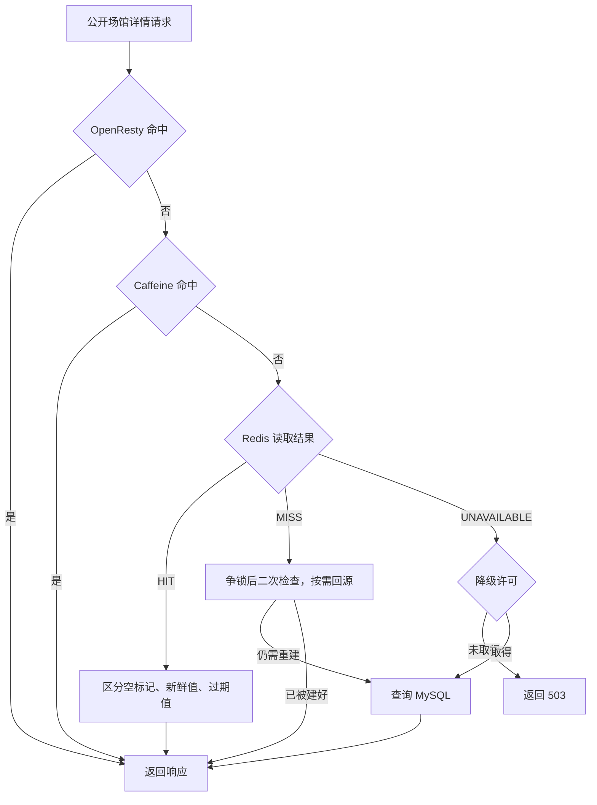
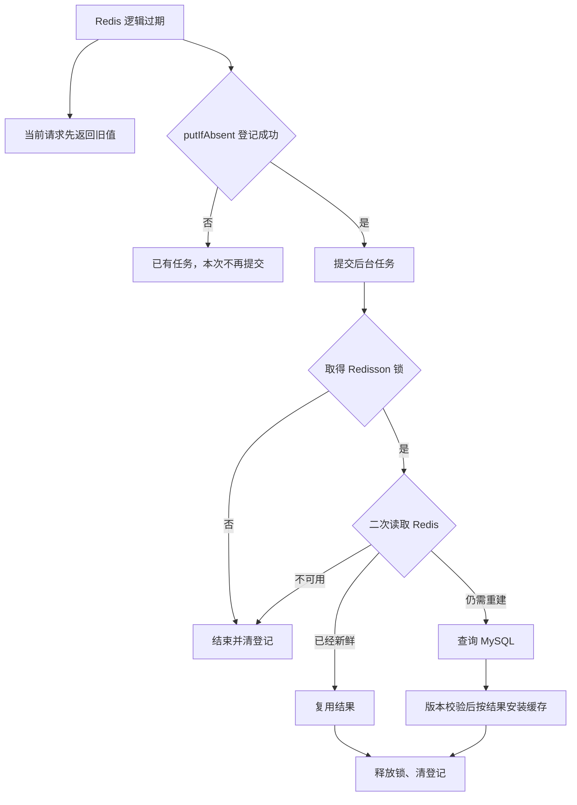
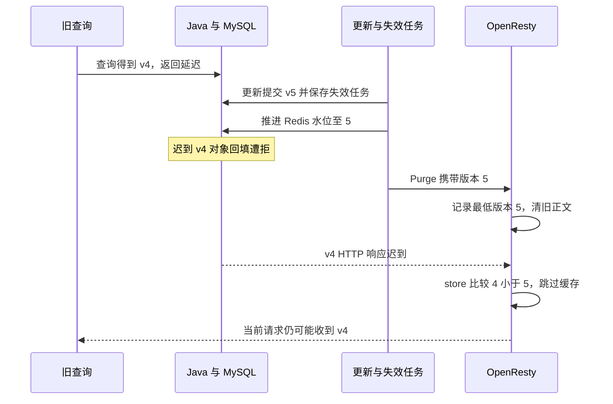
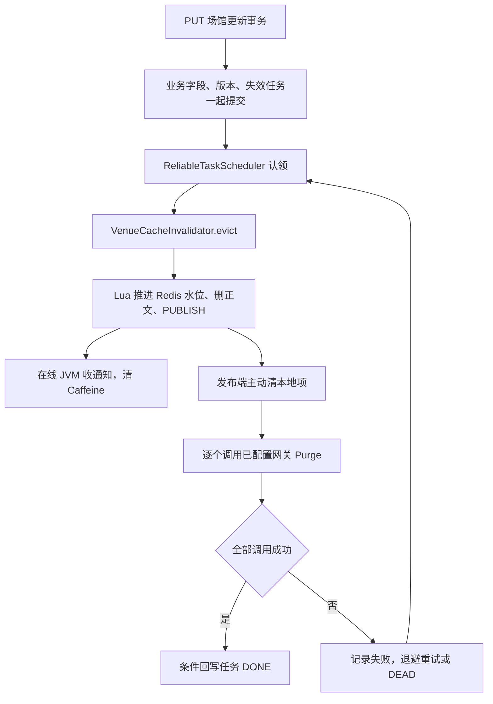
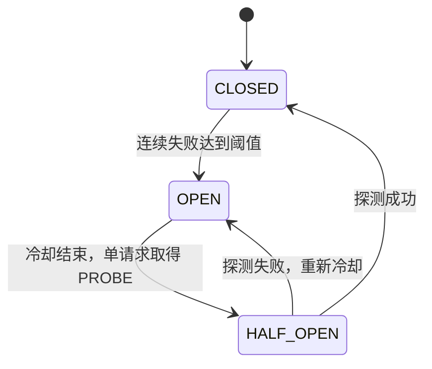

# CityPass 学习文档二：多级缓存一致性

> 修订日期：2026-10-30。本版依据最新副项目简历，将内容集中到四条主线，并给展示的关键源码逐行添加讲解注释。
>
> 源码核对提交：[`5956879024d13df937422142976baf797910695c`](https://github.com/SyH-101/citypass-platform/commit/5956879024d13df937422142976baf797910695c)。本文中的代码只增加教学注释、调整展示缩进，原有语句、条件和执行顺序保持不变；标有“节选”的代码需结合链接查看完整方法。场馆、版本和并发数示例用于推演，不代表生产测试结果。

## 先抓住重点：整段简历只围绕四个问题

**你的最新简历：**

> **多级缓存一致性：** 构建 OpenResty + Caffeine + Redis 多级缓存，结合逻辑过期、同 Key 异步去重与 Redisson Watchdog 分布式锁，减少热点数据反复重建；通过 Redis/OpenResty 双层版本校验防止旧值回填，并结合 Pub/Sub 与多网关版本化 Purge 更新各层缓存。

先把下面四句话连起来，再去记组件与方法名：**查询时尽早返回；过期时减少重复重建；更新时拦住迟到旧值；更新以后把失效传播给各份副本。**

| 简历原文 | 你要回答的核心问题 | 最需要掌握的结论 |
| --- | --- | --- |
| 构建 OpenResty + Caffeine + Redis 多级缓存 | 查询为什么快？ | 网关省 Java 处理，本地缓存省网络，共享缓存减数据库回源 |
| 逻辑过期、同 Key 异步去重与 Redisson Watchdog 分布式锁 | 热点过期后，为什么不会让大量请求反复重建？ | 先返旧，再本地去重、跨 JVM 争锁、二次检查、按需回源 |
| Redis/OpenResty 双层版本校验防止旧值回填 | 缓存已经删除，旧值为什么还可能回来？ | 数据对象与 HTTP 正文分别比较版本水位，拦住已知低版本 |
| Pub/Sub 与多网关版本化 Purge 更新各层缓存 | 一次更新怎样影响各个 JVM 和网关？ | 持久任务推进共享失效，广播清在线本地副本，逐网关推进水位 |

全文围绕同一个例子：场馆 2 原名“星河剧场”，当前版本 v4。管理员把名称改为“星河艺术中心”，数据库版本变成 v5。与此同时，很多用户在查询，一条拿到 v4 的旧请求还在途中。

**建议读法：** 第一遍只读第一部分四节的“重点”和“面试时可以这样说”；第二遍按代码编号看实现；最后用第三部分的 15 道题检验能否推演故障。补充章节放的是追问内容，不需要一开始全部背下来。

- [第一部分：沿四条主线逐句理解简历](#part-1)
- [1.1 查询怎么加速：三层各省掉什么](#resume-1)
- [1.2 过期怎么重建：把几个机制串成一条链](#resume-2)
- [1.3 旧值怎么拦截：两个回填位置分别校验](#resume-3)
- [1.4 更新怎么传播：通知本地副本与多个网关](#resume-4)
- [第二部分：重要补充与实现边界](#part-2)
- [第三部分：15 道有深度的面试问答](#part-3)
- [最后复习：两分钟介绍、机制速记与源码导航](#review)

<a id="part-1"></a>

## 第一部分：沿四条主线逐句理解简历

<a id="resume-1"></a>

### 1.1 查询怎么加速：三层各省掉什么

**对应简历：** “构建 OpenResty + Caffeine + Redis 多级缓存”。

**本节重点：命中越靠前，请求经过的组件越少；三层分别缓存 HTTP 正文、JVM 对象和跨实例共享数据。**

#### 先理解为什么要分层

如果所有场馆详情都查 MySQL，热门场馆会产生很多重复查询。加入 Redis 后能减少查库，但每个请求仍要进入 Java、发网络请求并反序列化。Caffeine 把常用对象留在当前 JVM，进一步省掉这次网络开销。公开详情还能缓存在 OpenResty，让一部分请求在网关直接结束。

| 位置 | 当前存的内容 | 命中后省掉的工作 | 范围 |
| --- | --- | --- | --- |
| OpenResty | 带版本的公开 JSON 响应正文 | Spring Boot 处理，以及后续缓存、数据库访问 | 同一个网关实例内共享 |
| Caffeine | `LocalEntry(data, version)` | Redis 网络访问和数据转换 | 单 JVM 独有 |
| Redis | `RedisData` 包装，包含数据、版本、逻辑到期时间或空标记 | 大部分 MySQL 回源 | 多个 Java 实例共享 |
| MySQL | `tb_venue` 业务字段与 `cache_version` | 保存权威业务事实 | 数据库 |

**完整读法：** 网关先尝试返回公开正文；未命中才进入 Java。Java 先查 Caffeine，再读 Redis。Redis 命中后还要判断新鲜、逻辑过期或空标记；只有普通冷 MISS、需要重建或受控降级时才可能查库。



#### 看源码：Java 在哪里决定走哪一层

真实入口是 `VenueController.queryVenueById` → `VenueServiceImpl.queryById` → `MultiLevelCacheService.queryWithMultiLevel`。Service 传入 `this::getById` 作为回源函数；传入函数本身不会立即查询数据库，后面真正执行 `dbFallback.apply(id)` 才会查库。

<a id="code-entry"></a>

**代码 01：选择查询分支**

**功能：** 先查询 Caffeine，再区分 Redis 命中、故障和普通未命中，决定后续处理路径。

**源码文件：** `src/main/java/com/citypass/utils/MultiLevelCacheService.java`  
**所属方法：** `MultiLevelCacheService.queryWithMultiLevel`；[固定版本源码，第 154–172 行](https://github.com/SyH-101/citypass-platform/blob/5956879024d13df937422142976baf797910695c/src/main/java/com/citypass/utils/MultiLevelCacheService.java#L154-L172)。以下为教学注释版节选，L 标记对应原文件行号。

```java
    String cacheKey = keyPrefix + id;  // L154：拼出当前场馆的缓存 key
    Object cached = venueLocalCache.getIfPresent(cacheKey);  // L155：只在当前 JVM 查询本地对象
    if (cached instanceof LocalEntry) {  // L156：只有合法的本地包装才视为命中
        metrics.caffeineHit();  // L157：记录本地命中指标
        log.debug("cache.caffeine.hit key={}", cacheKey);  // L158：记录命中的 key
        return (R) ((LocalEntry) cached).getData();  // L159：取出业务对象并直接结束查询
    }  // L160：结束本地命中分支

    RedisReadResult redisRead = readRedis(cacheKey);  // L162：本地没命中，再读共享 Redis
    if (redisRead.state == RedisReadState.HIT) {  // L163：Redis 中存在可解析的包装
        return serveRedisHit(keyPrefix, id, type, dbFallback, ttl, unit, redisRead.data);  // L164：交给空标记、新鲜值和过期值处理
    }  // L165：结束 Redis 命中分支

    if (redisRead.state == RedisReadState.UNAVAILABLE) {  // L167：Redis 故障或被 Gate 拒绝访问
        return degradedDbFallback(cacheKey, id, dbFallback, "REDIS_UNAVAILABLE");  // L168：走有并发许可保护的降级回源
    }  // L169：结束故障分支

    return queryColdMiss(keyPrefix, id, type, dbFallback, ttl, unit);  // L171：Redis 正常但无 key，进入冷重建
}  // L172：结束当前查询方法
```

**读完抓住：** 本地命中直接返回；UNAVAILABLE 与 MISS 走不同分支。

读完只抓三处：本地 HIT 直接返回；Redis HIT 交给命中处理；Redis 不可用走降级，正常无 key 走冷重建。**当前 Caffeine 命中时不会逐次访问 Redis 检查版本。** 这就是它省网络的原因，也是后面需要本地失效通知的原因。

#### 网关为什么只缓存公开详情

当前候选路径是无查询参数的精确 `GET /venues/{id}`。即使路径满足条件，也要检查响应是否允许公开缓存。

<a id="code-eligible"></a>

**代码 02：筛选可公开缓存的响应**

**功能：** 组合检查上游结果，避免把失败、带私人语义或缺少版本的响应当作公共正文缓存。

**源码文件：** `src/main/resources/openresty/nginx.conf`  
**所属方法：** `body_filter_by_lua_block`；[固定版本源码，第 142–149 行](https://github.com/SyH-101/citypass-platform/blob/5956879024d13df937422142976baf797910695c/src/main/resources/openresty/nginx.conf#L142-L149)。以下为教学注释版节选，L 标记对应原文件行号。

```lua
ngx.ctx.response_cacheable = ngx.status == 200  -- L142：HTTP 状态必须成功
    and ngx.var.upstream_http_x_gateway_cacheable == "1"  -- L143：Java 必须明确给出内部缓存许可
    and ngx.ctx.response_version ~= nil  -- L144：响应必须有能解析的版本
    and ngx.ctx.response_version >= 0  -- L145：版本必须非负
    and ngx.var.upstream_http_set_cookie == nil  -- L146：带 Set-Cookie 的响应不缓存
    and string.find(content_type, "application/json", 1, true) ~= nil  -- L147：正文内容类型必须是 JSON
    and string.find(cache_control, "private", 1, true) == nil  -- L148：Cache-Control 不能声明 private
    and string.find(cache_control, "no-store", 1, true) == nil  -- L149：Cache-Control 不能声明 no-store
```

**读完抓住：** 这些是 Lua 条件，位于 Nginx 配置内；满足路径条件仍不足以缓存。

只有成功响应、Java 明确许可、合法版本、JSON、没有 Set-Cookie 和 private/no-store 时，正文才有资格进入缓存；正文还受 1 MiB 上限限制。后续如果加入“当前用户是否预约”等个性化字段，就需要重新设计缓存范围或缓存键。

#### 面试时可以这样说

> 我给场馆详情加多级缓存，主要是因为它读多写少，同一个热门场馆会被很多用户重复查询，而且资料允许短暂旧读。我的目标是让请求尽量在靠前的位置返回，减少 Java、网络和数据库的重复工作。
>
> 第一层是 OpenResty，缓存可以公开复用的 HTTP JSON 正文，命中以后直接在网关返回，请求不需要进入 Spring Boot。这里做了明确的缓存资格判断，只覆盖无查询参数的场馆详情 GET，并检查版本头、内容类型、Cookie 和缓存控制，避免把不适合共享的响应存进去。
>
> 进入 Java 以后先查 Caffeine。它保存当前 JVM 中的场馆对象，命中就省掉一次 Redis 网络访问和反序列化。Caffeine 未命中再查 Redis，Redis 作为多实例共享的数据副本，减少数据库回源。MySQL 保存真实资料和版本，是业务事实源。
>
> 读取 Redis 时还要继续分支：新鲜值直接用，逻辑过期值先返回并触发后台重建，普通 MISS 按重建流程处理，Redis 故障则受控降级。三层的收益和代价也对应起来：越靠前命中越快，但副本越多，更新传播与并发回填就越需要处理，所以后面才加入版本和失效机制。性能收益需要用相同环境的命中率、回源量和延迟对照验证。

**本节记忆：** 网关省 Java → 本地省网络 → Redis 减查库 → 数据库保存事实。

<a id="resume-2"></a>

### 1.2 过期怎么重建：把几个机制串成一条链

**对应简历：** “结合逻辑过期、同 Key 异步去重与 Redisson Watchdog 分布式锁，减少热点数据反复重建”。

**本节重点：前台先返回还可用的旧值，后台按“本地去重 → 分布式锁 → 二次检查 → 查库 → 版本写回”执行必要的重建。**

这一整句描述的是同一件事：大量用户同时发现热门场馆该刷新了，系统怎样减少等待和重复工作。理解时务必把这些机制放在同一次重建里。

#### 第一步：逻辑过期让用户不用一起等查库

`RedisData.expireTime` 表示应用认定的刷新时间，Redis key 还设置了更长的物理 TTL。逻辑时间到了以后，key 仍可能存在，因此当前请求可以取出旧资料，同时安排后台刷新。物理 TTL 到了，Redis 才会真正删除 key，后续请求进入冷 MISS。

<a id="code-hit"></a>

**代码 03：区分返新值、返旧值与不存在**

**功能：** Redis 命中后检查空标记与逻辑时间；过期时提交重建，当前请求继续返回旧对象。

**源码文件：** `src/main/java/com/citypass/utils/MultiLevelCacheService.java`  
**所属方法：** `MultiLevelCacheService.serveRedisHit`；[固定版本源码，第 303–317 行](https://github.com/SyH-101/citypass-platform/blob/5956879024d13df937422142976baf797910695c/src/main/java/com/citypass/utils/MultiLevelCacheService.java#L303-L317)。以下为教学注释版节选，L 标记对应原文件行号。

```java
    if (Boolean.TRUE.equals(redisData.getNullValue())) {  // L303：先检查是否命中负缓存
        metrics.nullMarkerHit();  // L304：统计空标记命中
        return null;  // L305：复用不存在的结论，本次不查库
    }  // L306：结束负缓存分支

    R data = convert(redisData, type);  // L308：把包装内容转换为业务对象
    if (!isLogicallyExpired(redisData)) {  // L309：逻辑时间未到，属于新鲜值
        String cacheKey = keyPrefix + id;  // L310：构造本地缓存 key
        venueLocalCache.put(cacheKey, new LocalEntry(data, versionOfRedisData(redisData)));  // L311：把新鲜对象及版本装入 Caffeine
        return data;  // L312：直接返回新鲜对象
    }  // L313：结束新鲜值分支

    rebuildAsync(keyPrefix, id, type, dbFallback, ttl, unit);  // L315：逻辑过期，安排有去重的后台重建
    return data;  // L316：当前请求仍返回刚才读出的旧对象
}  // L317：结束命中处理方法
```

**读完抓住：** rebuildAsync 后面紧接 return data，没有等待数据库刷新完成。

例如一个包装的逻辑到期时间是 10:30、物理存活到 11:30。10:31 的请求仍可返回旧资料，同时触发重建。这两个时间用于说明语义；实际配置的逻辑 TTL 默认是 30 分钟并加 0～20% 抖动，物理 TTL 根据下面代码计算。

<a id="code-ttl"></a>

**代码 04：包装逻辑时间并设置更长物理 TTL**

**功能：** 为数据库对象保存版本和逻辑到期时间，再把正文、版本和物理 TTL 交给写回 Lua。

**源码文件：** `src/main/java/com/citypass/utils/MultiLevelCacheService.java`  
**所属方法：** `MultiLevelCacheService.writeWithLogicalExpire`；[固定版本源码，第 408–426 行](https://github.com/SyH-101/citypass-platform/blob/5956879024d13df937422142976baf797910695c/src/main/java/com/citypass/utils/MultiLevelCacheService.java#L408-L426)。以下为教学注释版节选，L 标记对应原文件行号。

```java
long baseSec = Math.max(1L, unit.toSeconds(ttl));  // L408：统一换算为秒，最少为一秒
long jitter = (long) (baseSec * 0.2 * ThreadLocalRandom.current().nextDouble());  // L409：生成基础 TTL 的零到百分之二十抖动
long logicalTtlSeconds = baseSec + jitter;  // L410：逻辑 TTL 等于基础值加抖动
long physicalTtlSeconds = Math.max(logicalTtlSeconds * 2, logicalTtlSeconds + 3600);  // L411：物理 TTL 取两倍和加一小时的较大值
RedisData redisData = new RedisData();  // L412：创建 Redis 数据包装
redisData.setData(value);  // L413：保存真实业务对象
redisData.setVersion(versionOf(value));  // L414：保存数据库对象自身的版本
redisData.setExpireTime(LocalDateTime.now().plusSeconds(logicalTtlSeconds));  // L415：记录应用判断该刷新的时间点
Long written =  // L416：接收 Lua 的写入结果
        stringRedisTemplate.execute(  // L417：通过 Redis 客户端执行脚本
                WRITE_IF_VERSION_SCRIPT,  // L418：使用带版本条件的写回脚本
                Arrays.asList(key, CACHE_VENUE_VERSION_KEY + id),  // L419：KEYS 依次为正文和版本水位
                String.valueOf(redisData.getVersion()),  // L420：ARGV1 是对象版本
                JSONUtil.toJsonStr(redisData),  // L421：ARGV2 是带逻辑时间的 JSON
                String.valueOf(physicalTtlSeconds));  // L422：ARGV3 是正文在 Redis 的物理 TTL
redisFailureGate.onSuccess(permission);  // L423：Redis 调用成功，通知 Gate
return Long.valueOf(1L).equals(written)  // L424：返回一表示版本校验接受
        ? WriteState.ACCEPTED  // L425：接受后返回 ACCEPTED
        : WriteState.STALE_REJECTED;  // L426：其他正常结果表示低版本遭拒
```

**读完抓住：** 包装内 expireTime 与 Redis EX 是两个不同的到期机制。

`expireTime` 控制“该不该刷新”，`EX` 控制 key 在 Redis 里还能存在多久。更长的物理 TTL 给后台刷新保留旧值；随机抖动分散不同 key 的到期时间。过期值分支不会再次写入 Caffeine，但 Caffeine 已有项仍按自己的写后过期规则工作。

#### 第二步：同 Key 本地去重，先减少任务提交量

假设 100 个请求同时发现同一场馆逻辑过期。若每次都提交后台任务，线程池仍要处理大量重复工作。`localRebuilds` 是 JVM 内的 ConcurrentHashMap，`putIfAbsent` 返回 null 表示登记成功，只有这个调用继续提交；返回已有值则直接结束本次安排。

<a id="code-dedup"></a>

**代码 05：登记同 Key 任务并提交后台执行**

**功能：** 在提交前用本地 Map 原子去重；真正执行时争分布式锁，未拿到锁就结束这轮后台工作。

**源码文件：** `src/main/java/com/citypass/utils/MultiLevelCacheService.java`  
**所属方法：** `MultiLevelCacheService.rebuildAsync`；[固定版本源码，第 337–355 行](https://github.com/SyH-101/citypass-platform/blob/5956879024d13df937422142976baf797910695c/src/main/java/com/citypass/utils/MultiLevelCacheService.java#L337-L355)。以下为教学注释版节选，L 标记对应原文件行号。

```java
String cacheKey = keyPrefix + id;  // L337：为本次重建拼出缓存 key
if (localRebuilds.putIfAbsent(cacheKey, Boolean.TRUE) != null) {  // L338：原子登记，已有登记说明已有未完成任务
    return;  // L339：不再提交重复后台任务
}  // L340：结束本地去重判断

try {  // L342：捕获线程池提交阶段的异常
    rebuildExecutor.submit(  // L343：把工作提交到重建线程池
            () -> {  // L344：以下内容在后台任务内执行
                RLock lock = null;  // L345：先记录尚未持有分布式锁
                String lockKey = LOCK_VENUE_REBUILD_KEY + id;  // L346：相同场馆使用相同重建锁 key
                try {  // L347：进入后台执行的保护区
                    LockAttempt lockAttempt = tryRebuildLock(lockKey);  // L348：尝试取得跨 JVM 重建锁
                    if (lockAttempt.state != LockState.ACQUIRED) {  // L349：未拿到锁就不承担本次重建
                        if (lockAttempt.state == LockState.BUSY) {  // L350：区分正常忙碌与 Redis 不可用
                            metrics.rebuildLockBusy();  // L351：记录锁被其他执行者占用
                        }  // L352：结束忙碌指标分支

                        return;  // L354：结束这轮异步工作，后续会执行 finally
                    }  // L355：结束未获锁分支
```

**读完抓住：** putIfAbsent 限制本 JVM 的同 Key 提交，锁协调多个 JVM 的重建执行。

这里去重的是“同 JVM、同 cacheKey、当前未完成的后台任务”。不同场馆不会相互去重，另一台 JVM 也有自己的 Map，因此还需要下一步。

#### 第三步：Redisson 锁协调不同 JVM，Watchdog 维持正常长任务的锁

两台 Java 实例都可能各自提交一个场馆 2 的任务，后台需要争同一个 `lock:venue:rebuild:{id}`。`tryRebuildLock` 中真正获取锁的代码如下：

<a id="code-lock"></a>

**代码 06：使用无固定租期的 Redisson tryLock**

**功能：** 调用当前主链的 Redisson 锁 API，不传固定 lease time，并区分拿到锁与锁忙。

**源码文件：** `src/main/java/com/citypass/utils/MultiLevelCacheService.java`  
**所属方法：** `MultiLevelCacheService.tryRebuildLock`；[固定版本源码，第 493–499 行](https://github.com/SyH-101/citypass-platform/blob/5956879024d13df937422142976baf797910695c/src/main/java/com/citypass/utils/MultiLevelCacheService.java#L493-L499)。以下为教学注释版节选，L 标记对应原文件行号。

```java
RLock lock = redissonClient.getLock(key);  // L493：获取这个 key 对应的 Redisson 锁对象
// No lease time is supplied: Redisson's watchdog renews the lock while this owner  // L494：源码说明未提供固定租期
// lives.  // L495：源码说明锁由存活的持有方续期
boolean acquired = lock.tryLock();  // L496：立即尝试获取，未显式传 lease time
redisFailureGate.onSuccess(permission);  // L497：Redis 调用成功，反馈给 Gate
return new LockAttempt(  // L498：把尝试结果包装为返回值
        acquired ? LockState.ACQUIRED : LockState.BUSY, acquired ? lock : null);  // L499：成功带回锁对象，忙碌时返回 BUSY
```

**读完抓住：** Watchdog 的正常续租源于这里的 API 用法；异常与 Gate 分支见完整方法。

这里的 `tryLock()` 不传固定 lease time，正常情况下由 Redisson Watchdog 续租，避免数据库查询时间超过手写固定租期后锁提前消失。拿不到锁的异步任务结束本轮，后续过期请求仍能再触发。

Watchdog 依赖持锁客户端、调度和 Redis 通信。长暂停、网络异常仍有边界，所以面试表达用“正常情况下协调同 Key 重建”，避免承诺锁在任何故障下都永远有效。

#### 第四步：拿到锁后再查 Redis，避免已经有人重建还继续查库

第一次发现过期，只是当时的状态。任务排队、争锁期间，另一个实例可能已经更新成功。拿锁以后再次读取，能直接复用新鲜结果。

<a id="code-double"></a>

**代码 07：拿锁后重新判断是否还需要重建**

**功能：** 复查任务排队期间可能已变化的 Redis，复用新鲜值，并在 Redis 故障时停止额外异步查库。

**源码文件：** `src/main/java/com/citypass/utils/MultiLevelCacheService.java`  
**所属方法：** `MultiLevelCacheService.rebuildAsync`；[固定版本源码，第 357–369 行](https://github.com/SyH-101/citypass-platform/blob/5956879024d13df937422142976baf797910695c/src/main/java/com/citypass/utils/MultiLevelCacheService.java#L357-L369)。以下为教学注释版节选，L 标记对应原文件行号。

```java
lock = lockAttempt.lock;  // L357：记住已持有的锁，供 finally 释放
RedisReadResult latest = readRedis(cacheKey);  // L358：取得锁后重新读取 Redis
if (latest.state == RedisReadState.UNAVAILABLE) {  // L359：二次读取时 Redis 不可用
    // The caller already received stale data; avoid DB pressure during  // L360：源码解释前台已经得到旧数据
    // an outage.  // L361：源码解释故障期间避免追加数据库压力
    return;  // L362：结束本轮后台工作
}  // L363：结束不可用分支

if (latest.state == RedisReadState.HIT  // L365：二次读取存在数据
        && !isLogicallyExpired(latest.data)) {  // L366：而且该包装还未逻辑过期
    serveFreshRedisData(cacheKey, type, latest.data);  // L367：复用结果并按方法逻辑填充本地
    return;  // L368：不再查询数据库
}  // L369：结束复用新鲜值分支
```

**读完抓住：** 二次检查减少顺序重复回源；它还不能判断后续 DB 读出的版本能否回填。

注意两个分支：发现新鲜值就填本地并结束；Redis 不可用时，这个异步任务直接停止，避免在前台已经拿到旧值后又增加故障期间的查库压力。只有仍然 MISS 或逻辑过期时才进入查库。

#### 第五步：真正查库、按版本安装，并收尾清除登记

<a id="code-async-write"></a>

**代码 08：查库、按版本安装并完成收尾**

**功能：** 仍需重建才查询数据库，根据版本写回结果决定本地安装，最后释放锁和去重标记。

**源码文件：** `src/main/java/com/citypass/utils/MultiLevelCacheService.java`  
**所属方法：** `MultiLevelCacheService.rebuildAsync`；[固定版本源码，第 371–397 行](https://github.com/SyH-101/citypass-platform/blob/5956879024d13df937422142976baf797910695c/src/main/java/com/citypass/utils/MultiLevelCacheService.java#L371-L397)。以下为教学注释版节选，L 标记对应原文件行号。

```java
                        metrics.rebuildStarted();  // L371：记录一次实际重建开始
                        log.debug(  // L372：输出重建开始日志
                                "normal asynchronous cache rebuild started: key={}", cacheKey);  // L373：日志携带当前 cacheKey
                        R data = dbFallback.apply(id);  // L374：真正调用传入的数据库查询函数
                        if (data == null) {  // L375：数据库没有这条记录
                            writeNullMarker(cacheKey, id);  // L376：写入短期空标记
                            venueLocalCache.invalidate(cacheKey);  // L377：清理可能存在的本地旧项
                        } else if (writeWithLogicalExpire(cacheKey, id, data, ttl, unit)  // L378：非空对象先走带版本的 Redis 写回
                                == WriteState.ACCEPTED) {  // L379：只有 ACCEPTED 才安装本地
                            venueLocalCache.put(  // L380：开始写入本地对象
                                    cacheKey, new LocalEntry(data, versionOf(data)));  // L381：本地包装同时保存对象和版本
                        } else {  // L382：Redis 拒旧或不可用时
                            venueLocalCache.invalidate(cacheKey);  // L383：主动清理本地项
                        }  // L384：结束查库结果分支
                    } catch (RuntimeException e) {  // L385：捕获后台执行时的运行异常
                        log.error(  // L386：记录后台重建失败
                                "asynchronous Venue cache rebuild failed: key={}", cacheKey, e);  // L387：日志关联 key 和异常
                    } finally {  // L388：成功、失败或提前返回都执行收尾
                        unlockSafely(lock, lockKey);  // L389：仅在安全条件下释放持有的锁
                        localRebuilds.remove(cacheKey);  // L390：清除本 JVM 的同 Key 登记
                    }  // L391：结束收尾区
                });  // L392：结束提交的后台任务
    } catch (RuntimeException rejected) {  // L393：线程池提交阶段也可能失败
        localRebuilds.remove(cacheKey);  // L394：提交失败必须撤销登记
        log.warn("Venue cache rebuild task rejected: key={}", cacheKey, rejected);  // L395：记录任务提交失败
    }  // L396：结束提交异常处理
}  // L397：结束异步重建方法
```

**读完抓住：** finally 处理执行阶段，外层 catch 处理提交阶段，两处都要清登记。

正常非空结果只有被版本写回接受后才安装 Caffeine；写回遭拒或 Redis 不可用则清理本地项。`finally` 释放锁并删除登记，线程池提交失败的 catch 也删除登记，防止一个 key 被永久误认为“正在重建”。版本写回的条件在下一节展开。



**用一张表记住各步骤的分工：**

| 步骤 | 解决的具体问题 |
| --- | --- |
| 逻辑过期返旧 | 大量用户不必同时等数据库 |
| localRebuilds | 单 JVM 不重复提交同一份后台工作 |
| Redisson 锁 | 多 JVM 正常情况下不同时执行同 Key 重建 |
| Watchdog | 正常长任务中减少固定租期过短带来的提前失锁 |
| 二次检查 | 后拿到锁的人复用前一个任务的结果 |
| 版本写回 | 读库期间发生更新时，避免已知低版本污染缓存 |

冷 MISS 没有旧值可以立即返回，其逻辑与这里略有不同：`queryColdMiss` 有限等待并重新读缓存，默认最多 20 轮、每轮随机 25～50ms；耗尽后走受控回源。不能把冷 MISS 说成也直接返旧。

#### 面试时可以这样说

> 在热点缓存逻辑过期以后，我把前台响应和后台重建分开。Redis key 的物理 TTL 比逻辑时间更长，所以当前请求仍能先返回旧资料，不需要所有用户一起等数据库。后台则用本地去重、分布式锁和二次检查，逐步减少重复工作。
>
> 首先，我通过 ConcurrentHashMap 的 putIfAbsent 对 cacheKey 登记。同一个 JVM 中，这个 key 已经有未完成任务就不再提交，避免大量重复任务占用线程池。任务结束和提交失败都会清登记，保证后面还能再次触发刷新。
>
> 本地 Map 无法协调不同 JVM，所以后台还会通过 Redisson 争同一个场馆的重建锁。主链使用没有指定固定租约的 tryLock，由 Watchdog 正常续期，减少查询耗时较长时锁提前过期的问题。异步任务拿不到锁就结束本轮，让拿到锁的实例负责处理。
>
> 取得锁以后还要二次读取 Redis，因为排队或者竞争期间可能已经有人重建完成。存在新鲜数据就直接复用、填充 Caffeine；仍然缺失或者逻辑过期时才查询 MySQL。查到结果以后经过版本 Lua 判断，接受后才正常安装本地缓存，最后在 finally 里释放锁、清掉本地登记。
>
> 这里要分清两件事：锁协调谁来重建，版本水位判断结果能不能写回。持锁期间数据库仍可能更新，所以拿到锁不能省略版本校验。另外，这些措施减少的是同 Key 重复工作；当前十线程重建池使用无界队列，很多不同 Key 仍可能排队，完整的背压还需要进一步完善。

**本节记忆：** 先返旧 → 本地登记 → 跨 JVM 争锁 → 二次检查 → 查库 → 比版本 → finally 收尾。

<a id="resume-3"></a>

### 1.3 旧值怎么拦截：两个回填位置分别校验

**对应简历：** “通过 Redis/OpenResty 双层版本校验防止旧值回填”。

**本节重点：删除缓存以后，要保留一条“最低可接受版本”的判断线；Redis 拦迟到的对象回填，OpenResty 拦迟到的 HTTP 正文缓存。**

#### 先用一个交错看清楚：为什么删除以后旧值还会回来

| 顺序 | 正在读的请求 A | 管理员更新与失效 | 只删除缓存会怎样 |
| --- | --- | --- | --- |
| 1 | 从 MySQL 得到 v4，尚未完成回填 | 尚未更新 | A 手里已经有旧资料 |
| 2 | 继续执行，发生延迟 | MySQL 提交 v5，后台清缓存 | 缓存暂时为空 |
| 3 | 尝试把 v4 安装为缓存 | v5 已经生效 | 如果无条件 SET，缓存又变成 v4 |

即使 A 在重建时拿着锁，管理员的更新事务仍然能执行。重建锁没有阻止数据库产生新版本，因此仅有锁和 DEL 仍不足以处理这个交错。

#### 版本从哪里来：先看 MySQL 事务

场馆的 `cacheVersion` 对应 MySQL 的 `cache_version`。它由数据库原地递增，普通实体更新不让客户端任意改写；缓存写回使用从数据库对象中取出的版本。

<a id="code-version-sql"></a>

**代码 09：在 MySQL 原地递增版本**

**功能：** 在数据库语句里执行 cache_version 加一，避免 Java 读旧版本后覆盖并发更新。

**源码文件：** `src/main/java/com/citypass/mapper/VenueMapper.java`  
**所属方法：** `VenueMapper.incrementCacheVersion`；[固定版本源码，第 17–18 行](https://github.com/SyH-101/citypass-platform/blob/5956879024d13df937422142976baf797910695c/src/main/java/com/citypass/mapper/VenueMapper.java#L17-L18)。以下为教学注释版节选，L 标记对应原文件行号。

```java
@Update("UPDATE tb_venue SET cache_version=cache_version+1 WHERE id=#{id}")  // L17：直接对目标行的版本字段加一
int incrementCacheVersion(@Param("id") Long id);  // L18：Mapper 返回受影响行数供事务校验
```

**读完抓住：** id 是参数绑定值，版本增量在 MySQL 内执行。

`VenueServiceImpl.update` 在同一事务更新业务字段、递增版本并登记失效任务。下面展示这三个动作怎样放到一起。

<a id="code-update"></a>

**代码 10：把业务更新、版本和失效意图一起提交**

**功能：** 在同一数据库事务内更新场馆、获取新版本，再向可靠任务表保存带版本的失效待办。

**源码文件：** `src/main/java/com/citypass/service/impl/VenueServiceImpl.java`  
**所属方法：** `VenueServiceImpl.update`；[固定版本源码，第 90–112 行](https://github.com/SyH-101/citypass-platform/blob/5956879024d13df937422142976baf797910695c/src/main/java/com/citypass/service/impl/VenueServiceImpl.java#L90-L112)。以下为教学注释版节选，L 标记对应原文件行号。

```java
@Transactional  // L90：本方法由 Spring 事务保护
public Result update(Venue venue) {  // L91：接收待更新的场馆业务字段
    Long id = venue.getId();  // L92：取出要修改的场馆 ID
    if (id == null) {  // L93：没有 ID 无法定位目标
        return Result.fail("场馆id不能为空");  // L94：直接返回业务参数错误
    }  // L95：结束参数检查
    // 1.更新数据库  // L96：源码提示先更新数据库
    boolean updated = updateById(venue);  // L97：更新场馆业务字段
    if (!updated) {  // L98：更新未成功则不继续登记失效
        return Result.fail("场馆不存在或更新失败");  // L99：返回未找到或更新失败
    }  // L100：结束更新失败分支

    if (getBaseMapper().incrementCacheVersion(id) != 1) {  // L102：数据库原地加一必须影响一行
        throw new IllegalStateException("场馆缓存版本更新失败");  // L103：异常让这个事务回滚
    }  // L104：结束版本递增检查

    Venue refreshed = getById(id);  // L106：读取本事务里的更新后对象与版本
    reliableTaskRepository.enqueue(  // L107：向可靠任务表登记后续工作
            ReliableTaskRepository.INVALIDATE_VENUE_CACHE,  // L108：任务类型是场馆缓存失效
            "invalidate-venue-cache:" + id + ":" + refreshed.getCacheVersion(),  // L109：场馆与版本共同组成业务去重键
            JSONUtil.toJsonStr(new VenueCacheInvalidation(id, refreshed.getCacheVersion())));  // L110：保存场馆 ID 和提交版本的 JSON
    return Result.ok();  // L111：返回本地更新成功
}  // L112：结束事务方法
```

**读完抓住：** 接口成功表示事务提交；Redis 与网关由后台继续处理。

这三步同事务提交，意味着不会正常出现“业务更新提交了，但这个事务没有保存失效意图”的半成品。版本号在 MySQL 里产生；后台使用它推进缓存层水位。**事务提交与缓存失效完成仍是两个时间点。**

#### 第一层：Redis 把“最低可接受版本”与缓存正文分开保存

正文 key 是 `cache:venue:{id}`，水位 key 是 `cache:venue:version:{id}`。当水位已经推进到 5，迟到对象 v4 就不能重新安装，即使正文已经被删掉。

<a id="code-redis-write"></a>

**代码 11：原子拒绝低版本回填**

**功能：** 在一段 Redis Lua 中完成读取水位、比较版本和更新正文，返回是否接受本次写入。

**源码文件：** `src/main/resources/write-cache-if-version.lua`  
**所属方法：** `write-cache-if-version.lua`；[固定版本源码，第 1–9 行](https://github.com/SyH-101/citypass-platform/blob/5956879024d13df937422142976baf797910695c/src/main/resources/write-cache-if-version.lua#L1-L9)。以下为教学注释版节选，L 标记对应原文件行号。

```lua
-- KEYS[1] cache data, KEYS[2] version key; ARGV[1] expectedVersion, ARGV[2] json, ARGV[3] ttlSeconds  -- L1：脚本入口说明正文、水位与三个参数
local current = tonumber(redis.call('get', KEYS[2]) or '0')  -- L2：读当前最低版本，没有时视为零
local expected = tonumber(ARGV[1])  -- L3：读本次对象携带的版本
if expected < current then  -- L4：对象已经低于已知版本
    return 0  -- L5：返回零，不修改正文
end  -- L6：结束拒旧判断
redis.call('set', KEYS[2], expected)  -- L7：接受后推进或维持水位，不设置 TTL
redis.call('set', KEYS[1], ARGV[2], 'EX', ARGV[3])  -- L8：写正文，同时设置物理 TTL
return 1  -- L9：返回一，表示写回被接受
```

**读完抓住：** 小于才拒绝，等于允许；水位与带 TTL 的正文分别保存。

这里最重要的是 `expected < current` 才拒绝，等于水位允许写入。读取水位、比较、写水位和正文放在同一个 Lua 执行中，避免 Java 先 GET 后 SET 中间被更新插入。水位没有和正文一起设置 TTL，正文到期后仍保留拒绝旧值的依据。

对应地，失效脚本使用提交版本推进水位、删除正文并发布通知。

<a id="code-redis-invalidate"></a>

**代码 12：推进 Redis 水位、删除正文并广播**

**功能：** 把 Redis 已知最低版本推进到合适值，然后在同一脚本中清缓存、通知在线订阅端。

**源码文件：** `src/main/resources/invalidate-venue-cache.lua`  
**所属方法：** `invalidate-venue-cache.lua`；[固定版本源码，第 1–16 行](https://github.com/SyH-101/citypass-platform/blob/5956879024d13df937422142976baf797910695c/src/main/resources/invalidate-venue-cache.lua#L1-L16)。以下为教学注释版节选，L 标记对应原文件行号。

```lua
-- KEYS[1] main cache, KEYS[2] baseline cache, KEYS[3] version key  -- L1：KEYS 依次是主正文、基线正文、水位
-- ARGV[1] pub/sub channel, ARGV[2] venueId, ARGV[3] committed database version  -- L2：ARGV 依次是频道、场馆 ID、提交版本
local current = tonumber(redis.call('get', KEYS[3]) or '0')  -- L3：读当前 Redis 版本水位
local requested = tonumber(ARGV[3])  -- L4：读本次失效请求携带的版本
if requested < 0 then  -- L5：负数表示调用方没有提交版本
    requested = current + 1  -- L6：这种兼容调用使 Redis 水位加一
end  -- L7：结束无版本兼容分支
local version = requested  -- L8：先以请求版本作为候选水位
if current > requested then  -- L9：当前已知版本更高时
    version = current  -- L10：保留更高版本，防乱序回退
end  -- L11：结束取最大值
redis.call('set', KEYS[3], version)  -- L12：保存新的水位，不设置 TTL
redis.call('del', KEYS[1])  -- L13：删除主读路径的缓存正文
redis.call('del', KEYS[2])  -- L14：同时删除对照基线路径正文
redis.call('publish', ARGV[1], ARGV[2] .. ':' .. version)  -- L15：广播场馆 ID 与最终版本
return version  -- L16：把实际推进后的版本返回 Java
```

**读完抓住：** 正常提交版本取 max；没有提交版本的负数兼容分支会自行加一。

正常有版本事件取 `max(current, requested)`，v6 先到、v5 后到也不倒退。注意 Redis 脚本在重复低版本失效时仍然 DEL 正文、PUBLISH，可能造成额外 MISS。负数版本走“当前水位加一”的兼容分支，与正常数据库提交版本的语义不同，补充章节会解释其风险。

**到这里就能说清 Redis 侧：** MySQL 得到 v5 → 后台把水位推进 5 → A 的 v4 回填被 Lua 拒绝。若任务尚未执行，Redis 还不知道 v5，旧值窗口仍然存在。

#### 第二层：OpenResty 还要拦一次迟到的 HTTP 正文

Redis 拒绝回填后，当前请求仍可能把自己读到的 v4 返回给用户；另一些请求也可能早已生成 v4 响应、正在传输。如果网关在 Purge 后无条件缓存这份迟到正文，就会重新保存旧响应。

因此 Java 的 `VenueController.queryVenueById` 在成功场馆响应上带 `X-Venue-Cache-Version`；OpenResty 缓存“版本 + 换行 + JSON”，并在自己的共享内存里保存版本水位。`store` 在同 Key 锁保护范围内做下面的比较。

<a id="code-gateway-store"></a>

**代码 13：在网关拒绝低版本 HTTP 正文**

**功能：** 在已经取得同 Key 锁的 store 中读取本地水位，拒绝旧响应，必要时先安全推进水位。

**源码文件：** `src/main/resources/openresty/lua/venue_cache.lua`  
**所属方法：** `venue_cache.store`；[固定版本源码，第 101–122 行](https://github.com/SyH-101/citypass-platform/blob/5956879024d13df937422142976baf797910695c/src/main/resources/openresty/lua/venue_cache.lua#L101-L122)。以下为教学注释版节选，L 标记对应原文件行号。

```lua
local cache = ngx.shared.venue_cache  -- L101：取得当前网关的正文共享字典
local versions = ngx.shared.venue_cache_version  -- L102：取得当前网关的版本水位字典
local key = watermark_key(id)  -- L103：确定这个场馆的水位 key
local watermark = tonumber(versions:get(key)) or 0  -- L104：水位不存在时按零处理
if version < watermark then  -- L105：响应版本低于已知水位
    release(lock)  -- L106：释放前面取得的同 Key 锁
    ngx.log(ngx.WARN, "stale venue response rejected: id=", id,  -- L107：记录拒绝迟到旧响应
            ", responseVersion=", version, ", watermark=", watermark)  -- L108：日志写入响应版本和水位
    return false, "stale version"  -- L109：只跳过缓存填充，不追回响应
end  -- L110：结束低版本判断

-- A newer authoritative response also advances the floor so a later old  -- L112：源码说明较新响应也推进最低版本
-- response cannot replace it while the invalidation task is still in flight.  -- L113：防止失效在途时稍后旧响应覆盖
if version > watermark then  -- L114：响应版本高于当前水位
    local version_ok, version_err = versions:safe_set(key, version)  -- L115：安全写水位，容量不足显式失败
    if not version_ok then  -- L116：水位未成功建立时
        release(lock)  -- L117：先释放锁
        ngx.log(ngx.ERR, "venue cache watermark write failed: id=", id,  -- L118：记录水位写入失败
                ", version=", version, ", error=", version_err or "unknown")  -- L119：日志关联版本和错误
        return false, version_err  -- L120：放弃本次可选缓存填充
    end  -- L121：结束水位写失败分支
end  -- L122：结束水位推进分支
```

**读完抓住：** 代码位于 acquire(id, 0) 之后；低版本跳过缓存，当前响应仍可继续返回。

v4 小于本地水位 5，跳过填充。更高响应也会先通过 `safe_set` 推进水位，再缓存正文，使“新响应先回来、旧响应后回来”的顺序也有拒旧依据。

<a id="code-gateway-fill"></a>

**代码 14：安装带版本的网关正文**

**功能：** 通过前面的版本判断以后，把版本与 JSON 合并保存，并处理正文写失败或淘汰。

**源码文件：** `src/main/resources/openresty/lua/venue_cache.lua`  
**所属方法：** `venue_cache.store`；[固定版本源码，第 124–135 行](https://github.com/SyH-101/citypass-platform/blob/5956879024d13df937422142976baf797910695c/src/main/resources/openresty/lua/venue_cache.lua#L124-L135)。以下为教学注释版节选，L 标记对应原文件行号。

```lua
    local ok, err, forcible = cache:set(entry_key(id), tostring(version) .. "\n" .. body, ttl)  -- L124：保存版本、换行和正文，并设置正文 TTL
    release(lock)  -- L125：完成字典修改后释放锁
    if not ok then  -- L126：正文保存失败
        ngx.log(ngx.ERR, "venue cache entry write failed: id=", id,  -- L127：记录写入错误
                ", version=", version, ", error=", err or "unknown")  -- L128：日志包含场馆、版本和错误
        return false, err  -- L129：把失败结果返回调用方
    end  -- L130：结束失败分支
    if forcible then  -- L131：本次正文写入挤掉了其他正文
        ngx.log(ngx.WARN, "venue cache entry write evicted another entry: id=", id)  -- L132：记录普通正文淘汰事件
    end  -- L133：结束淘汰日志分支
    return true  -- L134：返回本次填充成功
end  -- L135：结束 store
```

**读完抓住：** 版本水位与正文分开；正文可淘汰，水位使用前段的 safe_set。

`safe_set` 遇到共享内存容量不足会失败，避免为了写水位而静默挤掉其他水位。水位仍保存在内存，重启不会自动持久恢复。body filter 中不允许等待让出，`store` 使用零等待拿锁，冲突时跳过这次可选填充。



**双层版本校验的准确范围：** Redis 保护对象安装，网关保护正文安装；都依赖本层已经知道新版本。它们不会追回当前已经产生的旧响应，也没有给 Caffeine 自动补上完整的版本安装协议。

#### 面试时可以这样说

> 我加版本校验，是为了解决一个删除缓存仍会遇到的交错：旧请求先从数据库拿到 v4，管理员随后更新到 v5 并删缓存，旧请求最后才把 v4 写回来。单纯删除正文没有留下判断依据，所以我给每份场馆资料带数据库版本，并在缓存层保留最低可接受版本。
>
> 版本首先在 MySQL 中产生。场馆业务更新、cache_version 原地加一和失效任务登记处于同一个事务，后台再拿这个提交版本执行失效。Redis 侧通过 Lua 先取当前水位，与提交版本取最大值，再删除正文。这样即使正文已经不存在，水位仍保留着。
>
> 回填时另一段 Lua 原子完成比较和写入。旧对象版本低于水位就拒绝，等于或更高才接受，避免先比较后写入之间又插入一次更新。正常非空重建只有 Redis 接受后才安装 Caffeine，所以不能把被拒的对象当成正常刷新成果。
>
> 但 Redis 管不到已经生成的 HTTP 正文。一条 v4 响应可能在网关 Purge 以后才到达，所以 OpenResty 也根据响应头维护自己的版本水位，在 store 时重新检查。Purge 推进到 5 后，迟到的 v4 正文就跳过缓存；更新的响应也能推进水位。
>
> 这套机制保护的是已知新版本之后的缓存安装。数据库提交到失效执行之间仍有传播延迟，当前在途请求也可能返回旧数据；Caffeine 和网关重启还有各自边界。因此我会把它介绍为带版本约束的异步一致性设计，避免承诺所有请求在更新后立即读新。

**本节记忆：** MySQL 产生版本 → 缓存保留水位 → 对象回填比一次 → HTTP 正文安装再比一次。

<a id="resume-4"></a>

### 1.4 更新怎么传播：通知本地副本与多个网关

**对应简历：** “并结合 Pub/Sub 与多网关版本化 Purge 更新各层缓存”。

**本节重点：一次更新需要同时处理共享 Redis、多个 JVM 的 Caffeine 和多个网关的正文；持久任务保存待办，Pub/Sub 通知在线 JVM，Purge 逐个推进已配置网关。**

#### 先把更新链连起来

前一节已经说明更新事务保存 `INVALIDATE_VENUE_CACHE` 任务。后台 `ReliableTaskScheduler` 认领后，调用 `VenueCacheInvalidator.evict(venueId, cacheVersion)`，依次推进 Redis 失效、清发布端本地缓存、调用各个网关。



图里的重试仅指仍有重试资格的任务；进入 DEAD 后需要处理，不能理解为它会自动无限循环。在线订阅端清理是广播触发，不在任务的逐 JVM 确认范围里。

<a id="code-evict"></a>

**代码 15：连接 Redis、本地与网关失效**

**功能：** 执行版本化 Redis 失效脚本，主动清理发布端本地项，再发起多网关 Purge。

**源码文件：** `src/main/java/com/citypass/utils/VenueCacheInvalidator.java`  
**所属方法：** `VenueCacheInvalidator.evict`；[固定版本源码，第 82–99 行](https://github.com/SyH-101/citypass-platform/blob/5956879024d13df937422142976baf797910695c/src/main/java/com/citypass/utils/VenueCacheInvalidator.java#L82-L99)。以下为教学注释版节选，L 标记对应原文件行号。

```java
public void evict(Object venueId, Long committedVersion) {  // L82：接收场馆 ID 与数据库提交版本
    Long version =  // L83：接收 Redis 脚本实际推进后的水位
            redisTemplate.execute(  // L84：开始执行失效 Lua
                    INVALIDATE_SCRIPT,  // L85：选中场馆失效脚本
                    Arrays.asList(  // L86：向脚本传入三个 key
                            CACHE_VENUE_KEY + venueId,  // L87：主缓存正文 key
                            CACHE_VENUE_BASELINE_KEY + venueId,  // L88：基线缓存正文 key
                            CACHE_VENUE_VERSION_KEY + venueId),  // L89：共享版本水位 key
                    CACHE_VENUE_INVALIDATION_CHANNEL,  // L90：传入失效广播频道
                    String.valueOf(venueId),  // L91：传入场馆 ID
                    String.valueOf(committedVersion == null ? -1L : committedVersion));  // L92：提交版本缺失时按兼容负数处理
    if (version == null) {  // L93：脚本无返回值，不能视为成功
        throw new IllegalStateException("场馆缓存失效脚本返回空");  // L94：抛异常供任务执行器重试
    }  // L95：结束脚本结果检查
    // 发布端也立即清理，避免依赖自身能否收到 pub/sub 回环消息。  // L96：源码说明发布端不依赖回环广播
    multiLevelCacheService.evictLocal(CACHE_VENUE_KEY, venueId);  // L97：主动清除当前 JVM 本地项
    purgeGateways(venueId, version);  // L98：用实际水位处理所有配置网关
}  // L99：结束这次失效处理
```

**读完抓住：** 任一关键步骤抛异常会向可靠任务执行器传播。

这个方法是更新传播的连接点。Redis Lua 已在前节展示，它把 PUBLISH 与水位推进、正文删除放在同一次执行里。其后发布端主动清本地，避免依赖自己能否收到回环广播，然后处理网关。

#### Pub/Sub 负责在线 JVM 的本地副本

两台 JVM 都可能在 Caffeine 中保存 v4。只删共享 Redis，另一台 JVM 的请求仍会直接命中自己的旧对象。因此 `RedisPubSubConfig.cacheInvalidationContainer` 订阅场馆失效频道，把消息交给下面的监听方法。

<a id="code-on-message"></a>

**代码 16：广播到达后清 Caffeine**

**功能：** 解析 Redis Pub/Sub 的场馆失效通知，并清除当前 JVM 中的对应缓存。

**源码文件：** `src/main/java/com/citypass/utils/VenueCacheInvalidator.java`  
**所属方法：** `VenueCacheInvalidator.onMessage`；[固定版本源码，第 102–108 行](https://github.com/SyH-101/citypass-platform/blob/5956879024d13df937422142976baf797910695c/src/main/java/com/citypass/utils/VenueCacheInvalidator.java#L102-L108)。以下为教学注释版节选，L 标记对应原文件行号。

```java
public void onMessage(Message message, byte[] pattern) {  // L102：Redis 监听容器回调本方法
    String event = new String(message.getBody(), StandardCharsets.UTF_8);  // L103：把消息正文按 UTF-8 转为文本
    int separator = event.lastIndexOf(':');  // L104：从最后一个冒号定位版本分隔符
    String venueId = separator < 0 ? event : event.substring(0, separator);  // L105：取出冒号前的场馆 ID
    multiLevelCacheService.evictLocal(CACHE_VENUE_KEY, venueId);  // L106：仅按 ID 删除本地 Caffeine 项
    log.debug("收到场馆缓存失效广播: {}", event);  // L107：记录收到的通知
}  // L108：结束本次消息处理
```

**读完抓住：** 消息中的版本没有被保存为本地水位，当前只按 ID 失效。

消息是 `venueId:version`，当前监听器只取 ID 来 invalidate，本地没有持久消费位点、离线补发或逐节点 ACK。版本出现在消息里，也不代表当前监听器已经实现本地版本水位。

需要会解释一个具体竞态：线程先拿到 Redis 的 v4 → 通知清掉本地项 → 线程随后才 put(v4)。当前实现没有用本地最高失效版本阻止这个迟到安装。因此 Pub/Sub 能加快在线失效，但整个链路仍允许短暂旧读。

#### 多网关 Purge 负责每台网关自己的内存

每台 OpenResty 有独立共享字典，因此 Java 把配置中的 `gateway-cache.purge-urls` 与兼容单地址 `purge-url` 合并去重，逐个发 DELETE，请求携带场馆 ID 和版本。网关 `purge` 取 max 推进水位，再删除低版本正文。

<a id="code-gateway-purge"></a>

**代码 17：网关按版本失效并保留拒旧水位**

**功能：** 在已经取得同 Key 锁后单调推进网关水位，只移除低版本或损坏正文。

**源码文件：** `src/main/resources/openresty/lua/venue_cache.lua`  
**所属方法：** `venue_cache.purge`；[固定版本源码，第 146–168 行](https://github.com/SyH-101/citypass-platform/blob/5956879024d13df937422142976baf797910695c/src/main/resources/openresty/lua/venue_cache.lua#L146-L168)。以下为教学注释版节选，L 标记对应原文件行号。

```lua
    local current = tonumber(versions:get(key)) or 0  -- L146：读取当前网关已知版本
    local next_version = math.max(current, committed_version)  -- L147：提交版本与当前版本取最大值
    if next_version > current then  -- L148：有必要时才推进
        local ok, err = versions:safe_set(key, next_version)  -- L149：安全保存新水位
        if not ok then  -- L150：水位保存失败
            cache:delete(entry_key(id))  -- L151：清掉正文，避免继续使用旧项
            release(lock)  -- L152：释放同 Key 锁
            return nil, "watermark write failed: " .. (err or "unknown")  -- L153：向上返回失败，让调用方重试
        end  -- L154：结束水位失败分支
    end  -- L155：结束水位推进

    local raw = cache:get(entry_key(id))  -- L157：取出当前网关的正文包装
    if raw then  -- L158：有正文才需要比较
        local entry_version = _M.parse_entry(raw)  -- L159：从包装首行解析正文版本
        if not entry_version or entry_version < next_version then  -- L160：损坏正文或低于新水位
            cache:delete(entry_key(id))  -- L161：移除该正文
        end  -- L162：结束正文版本判断
    end  -- L163：结束正文存在判断
    release(lock)  -- L164：完成修改后释放锁
    ngx.log(ngx.NOTICE, "venue cache purge accepted: id=", id,  -- L165：记录本次 Purge 已接受
            ", committedVersion=", committed_version, ", watermark=", next_version)  -- L166：日志同时记录提交版本和最终水位
    return next_version  -- L167：向调用者返回实际水位
end  -- L168：结束 purge 方法
```

**读完抓住：** max 防回退；等于或高于水位的合法正文保留。

这里与 Redis DEL 有一个区别：网关保留等于或高于新水位的合法正文；旧 Purge 不应该把已缓存的更高版本清掉。lookup、store、purge 都通过同 Key 锁协调共享字典的复合操作。

Java 侧把版本放进请求，并检查响应结果。

<a id="code-purge-request"></a>

**代码 18：向每个已配置网关发送版本化 DELETE**

**功能：** 在配置端点循环内构建带 ID、版本的内部请求，并要求成功的 HTTP 状态。

**源码文件：** `src/main/java/com/citypass/utils/VenueCacheInvalidator.java`  
**所属方法：** `VenueCacheInvalidator.purgeGateways`；[固定版本源码，第 118–131 行](https://github.com/SyH-101/citypass-platform/blob/5956879024d13df937422142976baf797910695c/src/main/java/com/citypass/utils/VenueCacheInvalidator.java#L118-L131)。以下为教学注释版节选，L 标记对应原文件行号。

```java
for (String endpoint : endpoints) {  // L118：顺序遍历合并去重后的网关端点
    URI uri =  // L119：开始构建当前端点的 URI
            UriComponentsBuilder.fromHttpUrl(endpoint)  // L120：从配置地址创建构建器
                    .queryParam("id", String.valueOf(venueId))  // L121：附加场馆 ID 参数
                    .queryParam("version", committedVersion)  // L122：附加这次要推进的版本
                    .build()  // L123：完成参数构建
                    .encode(StandardCharsets.UTF_8)  // L124：对参数做 UTF-8 编码
                    .toUri();  // L125：转成实际请求 URI
    try {  // L126：单个端点失败在后面收集
        ResponseEntity<Void> response =  // L127：接收该网关的 HTTP 结果
                restTemplate.exchange(uri, HttpMethod.DELETE, null, Void.class);  // L128：发 DELETE，不提交业务正文
        if (!response.getStatusCode().is2xxSuccessful()) {  // L129：非成功状态视为本端点失败
            throw new IllegalStateException("HTTP " + response.getStatusCodeValue());  // L130：抛异常进入后面的收集分支
        }  // L131：结束状态检查
```

**读完抓住：** 本段后面的 catch 会汇总失败；循环结束才决定整个处理是否成功。

下面两段是同一方法的后半部分：逐端点异常先收集，循环结束后统一判断，保证会尝试剩余网关。

<a id="code-purge-catch"></a>

**代码 19：收集失败端点而不提前终止循环**

**功能：** 保存当前失败地址和首个原因，后续仍会继续尝试其余网关。

**源码文件：** `src/main/java/com/citypass/utils/VenueCacheInvalidator.java`  
**所属方法：** `VenueCacheInvalidator.purgeGateways`；[固定版本源码，第 138–142 行](https://github.com/SyH-101/citypass-platform/blob/5956879024d13df937422142976baf797910695c/src/main/java/com/citypass/utils/VenueCacheInvalidator.java#L138-L142)。以下为教学注释版节选，L 标记对应原文件行号。

```java
} catch (Exception e) {  // L138：捕获当前网关调用失败
    failedEndpoints.add(endpoint);  // L139：记录失败端点
    if (firstFailure == null) {  // L140：仅在尚无首个错误时保存
        firstFailure = e;  // L141：记住最早的异常原因
    }  // L142：结束首个错误记录分支
```

**读完抓住：** 省略的日志和循环闭合部分见原文件，失败最终由下一段统一抛出。

<a id="code-purge-fail"></a>

**代码 20：任一端点失败使整次任务失败**

**功能：** 完成全部端点尝试后，若存在失败就向外抛异常，使可靠任务进入失败重试处理。

**源码文件：** `src/main/java/com/citypass/utils/VenueCacheInvalidator.java`  
**所属方法：** `VenueCacheInvalidator.purgeGateways`；[固定版本源码，第 153–163 行](https://github.com/SyH-101/citypass-platform/blob/5956879024d13df937422142976baf797910695c/src/main/java/com/citypass/utils/VenueCacheInvalidator.java#L153-L163)。以下为教学注释版节选，L 标记对应原文件行号。

```java
    if (!failedEndpoints.isEmpty()) {  // L153：循环结束后检查失败列表
        throw new IllegalStateException(  // L154：任一失败就让处理抛异常
                "OpenResty 场馆缓存驱逐失败: venueId="  // L155：错误说明附带场馆 ID
                        + venueId  // L156：拼接场馆 ID
                        + ", version="  // L157：附带版本字段名
                        + committedVersion  // L158：拼接本次版本
                        + ", endpoints="  // L159：附带失败端点字段名
                        + failedEndpoints,  // L160：拼接所有失败地址
                firstFailure);  // L161：把首个异常保留为 cause
    }  // L162：结束失败判断
}  // L163：结束网关批量失效方法
```

**读完抓住：** 不会因为部分成功而成功完成整次处理。

例如三个网关中第二个失败，第三个仍然会被调用，但整次处理最终抛异常，可靠任务不能成功完成。重试时会再访问已经成功的节点，它们依靠 max 水位和正文版本比较承受重复、乱序调用。

**为什么还要持久任务：** 数据库提交后进程可能宕机，进程内回调可能来不及完成。Outbox 把待办存下来，后续进程能继续尝试外部失效。它保存和恢复动作意图，外部 Redis、HTTP 可能重复执行，并不保证恰好执行一次。

当前配置是显式端点列表，顺序 HTTP 调用，连接超时 1 秒、读取超时 2 秒；没有自动服务发现。任务 DONE 表示这次执行对已配置端点完成调用，不能扩展成“所有 JVM 都确认了”或“任意新扩容网关都覆盖了”。

#### 面试时可以这样说

> 多级缓存更新时，我需要考虑三种副本：共享 Redis、每个 JVM 的 Caffeine，以及每台 OpenResty 的响应缓存。单独删除 Redis，其他两层仍然可能直接返回旧资料，所以我把失效设计成一条可以恢复的传播链。
>
> 首先，场馆更新、数据库版本递增和失效任务在同一事务提交。后台认领任务以后调用 invalidator，先用 Redis Lua 推进版本水位、删除缓存正文，并发布一条场馆 ID 和版本的通知。这样服务即使在事务提交后退出，仍有持久待办供后续进程继续执行。
>
> Pub/Sub 负责通知当前在线的 Java 实例清 Caffeine，发布端也主动清自己的本地项。这里我会说明它的范围：广播没有离线补发，监听器当前只按 ID 失效，也没有完整本地版本安装协议，所以它提供及时传播，不能保证每个 JVM 在任意并发下都立即读新。
>
> 对于网关，我根据配置列表逐个发带版本的 Purge。每个网关用 max 推进自己的最低版本，再清低版本正文。Java 会尝试所有端点并汇总失败，只要有一个失败就让可靠任务重试；已经成功的网关可以安全承受重复和乱序 Purge。
>
> 因此这条链把“数据库已经更新、外部失效还没完成”的工作保存下来并继续推进，但任务可能重复执行或进入 DEAD，完成确认也只覆盖已配置网关。我的表述会同时交代恢复路径与确认范围，避免把持久待办或在线广播当作全系统强一致证明。

**本节记忆：** 同事务留待办 → Redis 推水位并广播 → 在线 JVM 清本地 → 全配置网关 Purge → 失败可重试。

<a id="part-2"></a>

## 第二部分：重要补充与实现边界

第一部分负责讲清简历。下面内容用来应对“Redis 坏了怎么办”“什么时候还会旧读”“测试到底验证了什么”等深入追问。学习时优先掌握 2.1、2.2，再看其他补充。

<a id="extra-read"></a>

### 2.1 冷 MISS、故障和旧值，是三种不同情况

**核心结论：先判断现在还有没有可返回的数据、Redis 是否正常，再选择等待、重建或降级。**

| 当前状态 | 源码处理 | 面试时怎么理解 |
| --- | --- | --- |
| Caffeine 命中 | 直接取 LocalEntry.data | 本地热数据不必接触 Redis |
| Redis HIT，空标记 | 返回 null | 已缓存“不存在”这个结论 |
| Redis HIT，新鲜对象 | 填 Caffeine 并返回 | 使用共享的新鲜副本 |
| Redis HIT，逻辑过期对象 | 安排有去重的异步重建，返回旧值 | 还有数据可用，先保证响应 |
| Redis MISS | 争锁，拿锁后二次检查，仍有必要才查库 | Redis 正常，只是没有这份数据 |
| 冷重建锁 BUSY | 有限等待、重新读 Redis，耗尽后进入降级回源 | 别人可能正在建，先尝试复用 |
| Redis／锁 UNAVAILABLE | 转受控降级 | Redis 调用失败或 Gate 拒绝，不应继续无节制等待 |

`queryColdMiss` 和 `rebuildAsync` 都会拿锁后二次检查，但没拿到锁时做法不同。异步请求已经返回旧值，后台任务可以结束本轮；冷 MISS 没有可返旧值，会有限等待，并尝试读取其他执行者重建的结果。

普通非空重建的写回还有三态：`ACCEPTED` 表示版本接受，可以正常装本地；`STALE_REJECTED` 表示比水位旧，清本地；`UNAVAILABLE` 表示 Redis 故障，也清本地。后两种情况并没有自动把本次 DB 查询结果变成最新版本，`normalRebuild` 仍返回自己取得的快照。

**最常见追问：写回被拒绝，这次请求怎么办？** 当前实现保护后续缓存不被这次已知旧写污染，本次请求仍可能返回旧快照。若业务需要“提交后读己之写”，需要设计更明确的读版本约束、指定读库或重读策略，不能把现有代码描述成已经完成这些能力。

**源码回看：** [queryColdMiss 与 normalRebuild](https://github.com/SyH-101/citypass-platform/blob/5956879024d13df937422142976baf797910695c/src/main/java/com/citypass/utils/MultiLevelCacheService.java#L188-L267)。

<a id="extra-failure"></a>

### 2.2 Redis 故障：为什么 Gate 和数据库并发许可要同时存在

**核心结论：Gate 减少对坏 Redis 的反复等待，Semaphore 限制故障流量转移给 MySQL 的规模。**

缓存正常时，一万次读取中可能只有少量请求查库。Redis 突然不可用以后，如果全部放行查库，数据库承受的压力会陡增。保留网关、本地命中，同时对剩下的请求控制损害，才有机会保护其他业务。

#### Gate：先跳过明显失败的 Redis，再用单探测判断恢复

`RedisFailureGate` 是当前 JVM 内的状态控制。默认连续 3 次失败后进入 OPEN，冷却 3000ms；冷却结束，只让一个请求变成 PROBE，其他请求继续跳过 Redis。

<a id="code-gate"></a>

**代码 21：按故障状态发放 Redis 调用许可**

**功能：** 正常时放行，冷却后只给一个探测调用，其余故障期间请求立即跳过 Redis。

**源码文件：** `src/main/java/com/citypass/utils/RedisFailureGate.java`  
**所属方法：** `RedisFailureGate.tryAcquire`；[固定版本源码，第 48–59 行](https://github.com/SyH-101/citypass-platform/blob/5956879024d13df937422142976baf797910695c/src/main/java/com/citypass/utils/RedisFailureGate.java#L48-L59)。以下为教学注释版节选，L 标记对应原文件行号。

```java
public synchronized Permission tryAcquire() {  // L48：同步保护本 JVM 的状态和许可判断
    if (state == State.CLOSED) {  // L49：正常 CLOSED 状态
        return Permission.NORMAL;  // L50：允许普通 Redis 调用
    }  // L51：结束正常状态判断

    if (state == State.OPEN && nanoTime.getAsLong() >= reopenAtNanos) {  // L53：OPEN 冷却结束才允许尝试恢复
        state = State.HALF_OPEN;  // L54：先把状态改成 HALF_OPEN
        return Permission.PROBE;  // L55：只给这次调用一个探测许可
    }  // L56：结束探测许可分支

    return Permission.REJECTED;  // L58：其他调用被拒绝访问 Redis
}  // L59：结束许可方法
```

**读完抓住：** synchronized 使 OPEN 到 HALF_OPEN 的状态转换与探测许可发放互斥。

下面的状态图对应 `onSuccess`、`onFailure` 与 `open`。时间使用单调时钟 `nanoTime`，避免用墙上时钟跳变判断冷却。



正常 Redis MISS 也是调用成功，不会因为 key 不存在而打开 Gate。三秒只表示允许再次探测；探测若长期不返回，当前还依赖客户端超时和回调，没有独立的探测租约回收任务。

#### Semaphore：Redis 跳过以后，也不能所有人一起查库

`degradedDbFallback` 用非阻塞 `tryAcquire`，默认每 JVM 最多 8 个降级回源并发。许可满了立即抛出 `CacheDegradedException`，由 `WebExceptionAdvice` 映射为 HTTP 503。

<a id="code-bulkhead"></a>

**代码 22：限制故障转移到 MySQL 的并发**

**功能：** 降级回源先非阻塞申请 Semaphore，容量满直接失败；得到许可后在 finally 释放。

**源码文件：** `src/main/java/com/citypass/utils/MultiLevelCacheService.java`  
**所属方法：** `MultiLevelCacheService.degradedDbFallback`；[固定版本源码，第 271–293 行](https://github.com/SyH-101/citypass-platform/blob/5956879024d13df937422142976baf797910695c/src/main/java/com/citypass/utils/MultiLevelCacheService.java#L271-L293)。以下为教学注释版节选，L 标记对应原文件行号。

```java
    if (!dbFallbackBulkhead.tryAcquire()) {  // L271：立即尝试获取降级数据库许可
        metrics.dbFallbackRejected();  // L272：记录因容量满而拒绝
        log.warn(  // L273：开始记录拒绝日志
                "degraded DB fallback rejected: key={}, reason={}, limit={}",  // L274：日志描述 key、原因、限额
                cacheKey,  // L275：关联当前缓存 key
                reason,  // L276：关联降级原因
                Math.max(1, properties.getDbFallbackMaxConcurrency()));  // L277：记录当前配置的并发上限
        throw new CacheDegradedException("缓存服务暂时不可用，请稍后重试");  // L278：抛异常，由 Web 层映射成 503
    }  // L279：结束许可不足分支

    metrics.dbFallbackAccepted();  // L281：记录一次已获准的降级
    log.warn("degraded DB fallback accepted: key={}, reason={}", cacheKey, reason);  // L282：记录降级原因
    try {  // L283：进入持有许可的执行区
        R result = dbFallback.apply(id);  // L284：真正调用数据库回源函数
        if (result != null) {  // L285：结果非空时
            venueLocalCache.put(cacheKey, new LocalEntry(result, versionOf(result)));  // L286：即使无法校验共享水位也填充本地
        }  // L287：结束本地填充分支

        return result;  // L289：向本次请求返回查询结果
    } finally {  // L290：成功或失败均进入收尾
        dbFallbackBulkhead.release();  // L291：释放当前降级数据库许可
    }  // L292：结束收尾
}  // L293：结束降级回源方法
```

**读完抓住：** 许可范围是每个 JVM 的这条降级路径，非空结果仍会安装本地缓存。

这里限制的是并发数，不是每秒固定 QPS；10 个 JVM 的许可可能叠加到 80。正常不同 Key 重建、基线接口和其他业务查库并不都走这个 Semaphore，需要从数据库整体容量另外评估。

降级拿不到共享版本信息，非空 DB 结果仍会放本地，这是可用性选择，也保留更新并发时的旧值窗口。Gate 仅覆盖这条缓存相关调用，不能由此推断登录、预约占位和 Feed 都已经实现无 Redis 运行。

#### 面试时可以这样说

> Redis 故障时，我首先考虑的是流量转移。如果平时大多数查询都被缓存吸收，故障以后全部回源，数据库可能承受远超正常的并发，还会影响预约等其他链路。因此我保留网关和 Caffeine 的热数据命中，剩下的请求再受控处理。
>
> 第一层保护是 RedisFailureGate。连续失败达到阈值后短暂跳过 Redis，减少无效等待；冷却结束只放一个探测，成功以后恢复正常调用，失败则重新冷却。Redis 正常返回 MISS 不属于服务故障，因此不会被当作失败计数。
>
> 第二层保护是降级数据库回源的 Semaphore。当前默认每 JVM 八个许可，申请时不等待，拿不到直接返回 503；拿到以后无论查询成功还是异常都在 finally 释放。这样可以牺牲部分冷请求成功率，避免缓存故障直接拖垮数据库。
>
> 这两个措施各自有范围。Gate 不代表 Redis 三秒必然恢复，八个许可也不代表整个数据库只有八个并发。部署多个 JVM 会叠加，其他查库路径还需要单独计算。降级结果的缓存安装也无法比对共享水位，所以我会把它作为限制故障扩散的保护，说明当前仍有一致性和容量边界。

<a id="extra-penetration"></a>

### 2.3 穿透、击穿、雪崩：把术语对应到项目现象

| 现象 | 项目例子 | 已有措施 | 重点范围 |
| --- | --- | --- | --- |
| 穿透 | 不存在的场馆仍不断被查询 | 短期空标记、网关按 IP 令牌桶 | 相同无效 ID 可复用结论，随机新 ID 首次仍可能查库 |
| 击穿 | 单个热点 key 到期，大量请求同时重建 | 逻辑过期返旧、本地去重、锁、二次检查 | 有旧值和冷 MISS 两种路径不同 |
| 雪崩 | 多 key 集中到期，或 Redis 故障 | TTL 抖动、Gate、降级回源许可 | 抖动缓解集中到期，故障还要专门保护 |

#### 负缓存具体怎样写入

<a id="code-null"></a>

**代码 23：记录短期不存在结论**

**功能：** 读当前水位后，用短期 RedisData 空标记缓存不存在，减少相同无效 ID 的反复查库。

**源码文件：** `src/main/java/com/citypass/utils/MultiLevelCacheService.java`  
**所属方法：** `MultiLevelCacheService.writeNullMarker`；[固定版本源码，第 441–449 行](https://github.com/SyH-101/citypass-platform/blob/5956879024d13df937422142976baf797910695c/src/main/java/com/citypass/utils/MultiLevelCacheService.java#L441-L449)。以下为教学注释版节选，L 标记对应原文件行号。

```java
String rawVersion = stringRedisTemplate.opsForValue().get(CACHE_VENUE_VERSION_KEY + id);  // L441：单独读取当前共享版本水位
long version = rawVersion == null ? 0L : Long.parseLong(rawVersion);  // L442：水位不存在时按零处理
RedisData nullData = new RedisData();  // L443：创建一个空标记包装
nullData.setNullValue(true);  // L444：标记这是不存在结论
nullData.setVersion(version);  // L445：记录刚才读取的版本
nullData.setExpireTime(LocalDateTime.now().plusMinutes(CACHE_NULL_TTL));  // L446：设置空标记的逻辑时间
stringRedisTemplate  // L447：准备操作 Redis 值
        .opsForValue()  // L448：选择普通字符串命令
        .set(key, JSONUtil.toJsonStr(nullData), CACHE_NULL_TTL, TimeUnit.MINUTES);  // L449：直接 SET 空标记并设置两分钟 TTL
```

**读完抓住：** 这里是 GET 后普通 SET，没有原子版本比较，是需要准确说明的实现边界。

空标记默认 2 分钟，适合重复查询同一个不存在的场馆。随机扫不同 ID 时，每个新 ID 的第一次仍可能回源；网关令牌桶按 IP 默认 60 次／秒、突发 120，但多来源或绕过网关仍有边界。

这里需要说准一个实现细节：负缓存先读水位、后普通 SET，没有走正常对象的原子版本写回。若“读不存在 → 别人新增 → 迟到负缓存写入”交错，会短暂遮住新数据；`POST /venues` 当前也直接 save，没有接入 PUT 的同等版本化失效事务。不能说所有写入口和缓存类型都已统一防旧。

当前没有布隆过滤器。对于这个副项目，优先讲清已有负缓存、限流和版本链；如果以后无效随机 ID 明显形成数据库压力，再评估过滤器的初始化、新增同步、误判率、丢失与重建行为，收益才有明确依据。

**源码回看：** [负缓存与读分支](https://github.com/SyH-101/citypass-platform/blob/5956879024d13df937422142976baf797910695c/src/main/java/com/citypass/utils/MultiLevelCacheService.java#L433-L483)、[网关按 IP 限流](https://github.com/SyH-101/citypass-platform/blob/5956879024d13df937422142976baf797910695c/src/main/resources/openresty/nginx.conf#L65-L97)、[新增入口](https://github.com/SyH-101/citypass-platform/blob/5956879024d13df937422142976baf797910695c/src/main/java/com/citypass/controller/VenueController.java)。

<a id="extra-boundary"></a>

### 2.4 当前保证到哪一步：只记这几处容易夸大的地方

**核心结论：已有机制对具体竞态提供约束，整个多级链仍接受短暂旧读，恢复依赖失效任务和版本信息持续可用。**

| 已有机制 | 准确范围 | 不能顺势扩大的说法 |
| --- | --- | --- |
| Redis 版本 Lua | 水位已知后拒低版本对象安装 | DB 提交瞬间所有请求都读新 |
| 网关版本 store／purge | 水位已知后拒旧正文缓存，max 不回退 | 当前在途响应被自动改成新内容 |
| Pub/Sub 清本地 | 在线订阅者尽快失效 | 离线补发、逐 JVM ACK、本地迟到 put 已彻底解决 |
| 持久失效任务 | 保存待办，失败后可恢复执行 | 外部动作恰好一次、任务永不 DEAD |
| 显式多网关列表 | 覆盖本次配置中的全部端点 | 自动覆盖未知扩容节点 |
| Watchdog 锁 | 正常运行与续租条件下协调重建 | 长暂停或网络分区仍永远互斥 |
| 同 Key 去重 | 减少同 JVM 同 Key 的未完成任务 | 不同 Key 队列有界，所有回源全局限流 |

本地竞态的推演只需记一次：**读 Redis v4 → 收广播清本地 → 迟到 put(v4)**。`LocalEntry` 保存 version，但当前本地命中和安装没有完整版本水位协议。下一步若补本地水位，需要让“推进水位／删除”和“版本比较／安装”彼此协调，单独多存一个数字仍可能留下检查与 put 之间的竞态。

版本水位是当前 Redis 实例状态里的拒旧依据：脚本不设 TTL，不意味着无法因重启、清空或部署的淘汰策略而丢失。网关 `safe_set` 防止该次写入静默挤掉其他水位，仍没有磁盘持久化。水位丢失以后不能继续承诺对所有旧在途数据的拒绝能力，需要明确恢复协议。

#### Canal 只作为补充入口理解

`CANAL_ENABLED=false` 是当前默认值。Canal 可以从 binlog 捕捉旁路写入，再调用 invalidator，但主应用的 PUT 已经通过事务保存失效意图。

带合法数据库提交版本的事件可以参与 max 失效；没有版本的事件走 Redis 水位加一。如果外部 SQL 只改名称、不递增 `cache_version`，Redis 水位就可能超过后续从 MySQL 读出的对象版本，导致缓存持续拒写。开启 Canal 前需要先统一所有写入口的版本规则。

**源码回看：** [Canal 消费入口](https://github.com/SyH-101/citypass-platform/blob/5956879024d13df937422142976baf797910695c/src/main/java/com/citypass/mq/CanalMQConsumer.java)、[默认配置](https://github.com/SyH-101/citypass-platform/blob/5956879024d13df937422142976baf797910695c/src/main/resources/application.yaml)、[版本字段更新策略](https://github.com/SyH-101/citypass-platform/blob/5956879024d13df937422142976baf797910695c/src/main/java/com/citypass/entity/Venue.java#L104-L109)。

<a id="extra-evidence"></a>

### 2.5 怎样证明这些设计：定向测试、历史验收与容量实验分开说

| 仓库依据 | 主要核对内容 | 这份证据的边界 |
| --- | --- | --- |
| [MultiLevelCacheServiceTest](https://github.com/SyH-101/citypass-platform/blob/5956879024d13df937422142976baf797910695c/src/test/java/com/citypass/utils/MultiLevelCacheServiceTest.java) | 并发冷 MISS、二次检查、逻辑过期返旧与同 Key 去重、降级回源限制 | 存在锁和 Redis 替身，不能据此声称覆盖真实网络分区 |
| [RedisFailureGateTest](https://github.com/SyH-101/citypass-platform/blob/5956879024d13df937422142976baf797910695c/src/test/java/com/citypass/utils/RedisFailureGateTest.java) | OPEN、单探测恢复、MISS 算成功 | 可控时钟下的定向验证 |
| [VenueCacheInvalidatorTest](https://github.com/SyH-101/citypass-platform/blob/5956879024d13df937422142976baf797910695c/src/test/java/com/citypass/utils/VenueCacheInvalidatorTest.java) | 全部端点确认、部分失败仍尝试剩余端点、配置合并去重 | HTTP 测试替身验证控制分支 |
| [cache-consistency-test.ps1](https://github.com/SyH-101/citypass-platform/blob/5956879024d13df937422142976baf797910695c/scripts/cache-consistency-test.ps1) | 双 JVM 本地副本与更新传播 | 脚本存在不等于本次已经执行 |
| [gateway-cache-consistency-test.ps1](https://github.com/SyH-101/citypass-platform/blob/5956879024d13df937422142976baf797910695c/scripts/gateway-cache-consistency-test.ps1) | 网关水位、Purge 与迟到响应 | 需要结合实际部署和运行记录 |
| [2026-10-05 验收记录](https://github.com/SyH-101/citypass-platform/blob/5956879024d13df937422142976baf797910695c/docs/10-活动笔记与文件验收.md) | 记录双 JVM、低版本拒写、网关水位推进与迟到响应等结果 | 历史本地记录；本次修订未重跑整套中间件验收 |

自己复习时可以按四个实验推演：延迟 v4 读，让 v5 先失效；断开一台 JVM 的订阅再恢复；让一个网关 Purge 超时；模拟 Redis 不可用并观察降级许可。每个实验都分别记录 DB 版本、Redis 水位／正文、本地返回与网关正文，避免只看一次接口新名称就下结论。

容量上至少关注各层命中率、DB 回源量、P95/P99、重建队列、锁等待、连接池、降级拒绝和最老失效任务年龄。当前没有可写成生产成果的 QPS 或提升比例。作为副项目，能把可复现的机制、实验和未覆盖窗口讲清楚，比编造规模更有说服力。

<a id="part-3"></a>

## 第三部分：15 道有深度的面试问答

回答时先说核心判断，再讲一条真实链路，最后补最关键的边界。下面给的是可口述素材；关于个人贡献和亲自做过的实验，请按自己的实际经历表达。

### Q01. 为什么要 OpenResty、Caffeine、Redis 三层？副项目会不会设计得太复杂？

**重要程度：必背。考察重点：能否说明每层的实际收益、适用业务和复杂度代价。**

**参考回答：**

我把这套缓存用在公开场馆详情，因为资料读多写少，同一个热门场馆会反复被查询，而且允许短暂旧读。三层分别减少不同位置的成本：OpenResty 命中直接返回公开 JSON，省掉 Java 及后续访问；Caffeine 保存当前 JVM 的对象，省掉 Redis 网络和转换；Redis 提供多 JVM 共享副本，减少数据库回源，MySQL 保存事实。

如果只有 Redis，大部分查库已经能减少，但请求仍会经过 Java 和一次网络。加上 Caffeine、网关，可以继续缩短命中链路，同时也引入更多副本。因此我还需要处理本地失效、网关 Purge 和迟到旧值回填。这些复杂度是实际代价，不能只说组件多就性能更好。

作为副项目，我主要展示能把“读加速”和“更新后副本治理”连起来。是否值得保留全部层次，需要相同环境下比较请求延迟、回源量、CPU 和维护成本。当前没有生产规模或提升比例，我会按机制与可复现实验介绍。若数据量和流量都很小，先保留 Redis 甚至直接查库，也可能是合理的产品选择。

**进一步追问：如果必须删掉一层，你怎么选？**

先看命中收益和故障定位成本。网关收益很小可以先删网关，减少正文缓存与 Purge；本地命中很低可以删 Caffeine，减少 JVM 副本传播。需要实际指标支撑，选择不能脱离流量和部署规模。

**源码定位：** [1.1 分层职责](#resume-1)、[代码 01 的查询入口](#code-entry)、[网关资格判断](#code-eligible)。

**易错点：** 不能把资料的短暂旧读策略直接用于预约库存决策。

**快速记忆：** 公开详情 → 各层省不同成本 → 副本越多治理越复杂 → 指标决定取舍。

### Q02. 一次详情查询具体怎样走？Redis 查不到和 Redis 坏了为什么要分开？

**重要程度：必背。考察重点：是否能按真实分支讲代码，识别故障扩散风险。**

**参考回答：**

请求先经过 OpenResty，符合公共缓存规则且命中就直接返回。进入 Java 后查 Caffeine，本地没有才读 Redis。Redis HIT 继续分三种：空标记返回不存在，新鲜数据填本地并返回，逻辑过期数据触发去重后的异步重建并先返回旧值。普通 MISS 则争重建锁、二次检查，仍需刷新才查数据库。

我特意把 MISS 和 UNAVAILABLE 分开。MISS 说明 Redis 正常，只是这个 key 没有数据，可以走正常冷重建；UNAVAILABLE 表示客户端异常，或者 Gate 暂时拒绝调用。若把故障也当普通 MISS，后面可能继续等待不可用的 Redis 锁，再把大量请求同时转给数据库。

所以 Redis 不可用走单独的受控降级：Gate 尽量减少失败调用，数据库回源先取 Semaphore，容量满就返回 503。网关和本地已经命中的请求可以继续服务。冷锁忙时则有限等待、重新读 Redis，耗尽后也进入这个受控回源，避免无限占着请求线程。

**进一步追问：数据库查询结束、Redis 写入失败，这次响应一定失败吗？**

普通重建的非空结果仍可能直接返回，只是不把失败或遭拒的写回当作正常安装；当前请求可能拿到旧快照。降级回源本身若查库异常，会按异常路径处理。要区分“缓存填充失败”与“没有业务结果可返回”。

**源码定位：** [查询入口](#code-entry)、[Redis 命中处理](#code-hit)、[2.1 完整分支表](#extra-read)。

**易错点：** Redis 无 key 是一次成功服务调用，不应因此触发故障熔断。

**快速记忆：** 先本地 → Redis 三态 → HIT 细分 → MISS 重建 → 故障受控降级。

### Q03. 逻辑过期到底缓解了什么？为什么还要设置物理 TTL？

**重要程度：必背。考察重点：是否理解返旧语义、重建触发与旧值存活窗口。**

**参考回答：**

逻辑过期主要缓解热点刷新时大家一起等待数据库的问题。我在 RedisData 中保存一个 expireTime，表示应用认定这份数据需要刷新；同时给 Redis key 设置更长的物理 TTL。逻辑时间到了但 key 还存在，当前请求可以返回旧资料，后台再异步重建。

实际代码在 serveRedisHit 中先排除空标记，再检查逻辑时间。新鲜值才放入 Caffeine；过期分支调用 rebuildAsync 后直接 return data，不等待刷新完成，也不会把这次旧值再次安装进 Caffeine。逻辑 TTL 默认三十分钟加随机抖动，物理 TTL 取逻辑 TTL 两倍与加一小时中的较大值，让后台有旧值窗口可以利用。

物理 TTL 仍然必要，避免这份 Redis 正文永久保留，也约束持续失败时旧正文的存活。后台一直失败，物理到期后就没有旧值可返，要走冷重建或故障降级。代价是用户可能暂时看到旧名称，因此这套策略适合资料查询，不能拿来承诺严格实时数据。

**进一步追问：Caffeine 十分钟和 Redis 逻辑时间会一起到期吗？**

不会。Caffeine 当前按写入后的时间淘汰，命中时不读取 Redis 的 expireTime。它可能继续命中本地对象，所以更新还要靠广播失效等措施，不能只盯着 Redis 逻辑时间。

**源码定位：** [返旧与返新分支](#code-hit)、[两段 TTL 计算](#code-ttl)。

**易错点：** 逻辑过期表示“应用认为该刷新”，不表示 Redis 已经删除 key。

**快速记忆：** 逻辑时间触发刷新 → 物理时间保留旧值窗口 → 前台返旧 → 后台重建。

### Q04. 已经有 Redisson 锁，为什么还要 ConcurrentHashMap 去重？

**重要程度：必背。考察重点：是否区分任务提交量、跨实例执行量和线程池容量。**

**参考回答：**

Redisson 锁主要协调谁真正执行重建，但如果每个过期请求都先提交任务，线程池仍要处理大量重复任务，任务还会重复去 Redis 争锁。所以我在提交以前用 ConcurrentHashMap 的 putIfAbsent 对 cacheKey 登记，已有未完成任务就不再提交。

这个登记只在当前 JVM 有效。同一个场馆在另一台 JVM 上仍可能安排一个任务，因此后台还要拿 Redisson 锁；拿到后做 Redis 二次检查，避免前一个实例已经刷新、后一个实例又查一次库。整个过程是先减少本地重复提交，再协调多实例重建，最后减少顺序上的无效回源。

收尾也很关键。后台的 finally 会释放锁并清 localRebuilds；线程池提交失败时外层 catch 也清登记。否则一次异常可能让这个 key 后续一直无法重新提交。当前去重并不意味着队列有界，十线程池默认队列无界，大量不同 Key 仍能堆积，所以后续应加入有界队列、拒绝策略和队列监控。

**进一步追问：第一个任务失败，会永远没人重建吗？**

只要 finally 或提交异常分支正常执行并清登记，后续逻辑过期请求可以再次触发。若任务长时间挂住，当前没有独立登记超时接管机制，仍依赖底层超时与任务结束，不能承诺任何挂起都自动解决。

**源码定位：** [提交前去重](#code-dedup)、[执行与提交两处收尾](#code-async-write)。

**易错点：** 同 Key 去重减少重复工作，不提供所有不同 Key 的全局限流。

**快速记忆：** Map 管提交 → Redis 锁管跨实例执行 → 二次检查管重复查库 → finally 清登记。

### Q05. Watchdog、二次检查和版本判断分别有什么用？锁会不会过期？

**重要程度：必背。考察重点：能否区分互斥执行、复用结果与拒绝旧写。**

**参考回答：**

当前重建主链使用 Redisson 不指定固定租期的 tryLock，正常由 Watchdog 续租。这样数据库查询耗时超过旧的固定十秒时，不会仅仅因为手写租期太短就自动让第二个正常重建者进来。它解决正常长任务的锁维持，但仍依赖客户端存活、续租调度和 Redis 通信。

二次检查处理另一个问题：任务第一次发现过期以后，可能排队或者争锁，等拿到锁时别人已经重建成功。因此取得锁后再读 Redis，已经新鲜就复用，仍然 MISS 或过期才查库，减少顺序上的重复查询。

版本判断则发生在回填时。即使一直持锁，管理员仍然可以更新 MySQL，当前查到的 v4 可能在 v5 提交后才回来，所以还要用水位拒绝低版本。锁、二次检查、版本各自约束不同阶段，不能相互替代。长暂停或网络故障可能影响锁互斥，我不会把 Watchdog 描述成任何故障下都不会失效。

**进一步追问：冷请求一直拿不到锁怎么处理？**

当前有限等待并重新读 Redis，默认最多二十轮，耗尽后受 Semaphore 控制回源。异步任务已有旧值可返，拿不到锁就结束本轮。有限等待后受控回源可能产生额外并行查库，所以不要承诺所有场景同 Key 永远只查一次库。

**源码定位：** [锁的实际调用](#code-lock)、[拿锁后二次检查](#code-double)、[版本回填](#code-redis-write)。

**易错点：** 持有重建锁不代表持有数据库更新锁，也不证明读到的对象最新。

**快速记忆：** Watchdog 维持锁 → 二次检查复用成果 → 水位拒旧写。

### Q06. 为什么先更新数据库再删缓存还会出错？Lua 水位具体挡住什么？

**重要程度：必背。考察重点：能否画出旧读迟到交错，并准确说出原子条件。**

**参考回答：**

我考虑的交错是旧请求 A 先从数据库拿到 v4，管理员随后更新为 v5 并删除缓存，A 最后才把 v4 写回。如果只删除正文，没有保留“至少应该是 v5”的依据，旧值就会重新出现。重建锁也没有阻止管理员事务执行，因此还需要数据版本。

我在 Redis 中为每个场馆单独保存版本水位。失效 Lua 用数据库提交版本和当前水位取最大值，再删正文并广播。回填 Lua 读取水位，对 expected 小于 current 的对象返回零，等于或更高才写入，并同时保存版本和带物理 TTL 的正文。

读取、判断和写入在同一个脚本中，避免 Java GET 比较以后、SET 之前又插入更新。正文到期时水位没有跟着设置 TTL，仍有拒旧依据。不过它的起效前提是这次失效已把水位推进上来；数据库提交以后、任务尚未执行的传播窗口仍然存在，所以这并没有变成强一致读取。

**进一步追问：v6 失效先到，v5 失效后到，会怎样？**

水位继续保持六，不会倒退。当前 Redis 失效脚本仍删除正文并广播，可能增加一次 MISS；重复失效不代表完全不产生工作。之后 v5 回填低于六会被拒，v6 可以被接受。

**源码定位：** [旧读交错表](#resume-3)、[回填 Lua](#code-redis-write)、[失效 Lua](#code-redis-invalidate)。

**易错点：** 比较条件是“小于拒绝”，等于版本允许写；Lua 只包住 Redis 内动作。

**快速记忆：** v4 慢读 → v5 提交并推进水位 → 删正文 → v4 回填遭拒。

### Q07. cacheVersion 怎样可靠地产生？Outbox 为什么比提交后回调更适合这里？

**重要程度：必背。考察重点：能否解释数据库事务、并发递增和外部失效恢复的边界。**

**参考回答：**

版本的事实源是 MySQL 的 cache_version。场馆更新方法先改业务字段，再通过数据库 SQL 原地加一，并检查影响行数，随后读取新版本，把场馆 ID 和版本作为失效任务载荷保存。业务更新、版本和 Outbox 处于同一个事务，待办插入抛异常时事务一起回滚。

原地加一避免多个 Java 线程都先读到四、再各自把五写回的覆盖。任务业务键包含场馆 ID 与版本，可靠任务表的唯一约束负责同一意图的去重。后台调度器认领这个失效任务后直接调用 invalidator，执行 Redis 和网关动作；主场馆失效链可以直接使用本地任务，不需要先投 RocketMQ。

如果只依赖提交后的进程内回调，MySQL 提交成功以后进程退出，回调可能来不及完成。Outbox 把仍需失效的意图持久保存，后续 worker 可以恢复执行。代价是轮询延迟、任务积压和治理成本，外部动作仍可能重复。更新接口成功代表数据库事务完成，不代表所有缓存已经更新。

**进一步追问：所有场馆写入口都有这套保障吗？**

当前 PUT 更新走这条事务链，POST 新增直接 save，没有同等版本化失效流程。直接 SQL 修改也需要统一版本与通知规则。面试时应准确限定入口，不能把一条实现推广到所有写法。

**源码定位：** [版本 SQL](#code-version-sql)、[更新事务](#code-update)、[任务登记实现](https://github.com/SyH-101/citypass-platform/blob/5956879024d13df937422142976baf797910695c/src/main/java/com/citypass/reliable/ReliableTaskRepository.java#L41-L55)、[任务执行分支](https://github.com/SyH-101/citypass-platform/blob/5956879024d13df937422142976baf797910695c/src/main/java/com/citypass/task/ReliableTaskScheduler.java#L161-L182)。

**易错点：** 持久保存一份任务意图，不能等同于外部失效恰好执行一次。

**快速记忆：** 业务更新 + DB 版本加一 + 待办同提交 → 后台恢复外部动作。

### Q08. Redis 已经拒绝 v4，为什么 OpenResty 还需要版本？

**重要程度：必背。考察重点：是否识别 HTTP 正文是独立副本，理解 Purge 后迟到响应。**

**参考回答：**

Redis 拒绝旧对象回填，管的是 Redis 里的那份数据。一条请求可能已经在更新前取得 v4，并生成响应，只是在网络上晚到；即使更新任务已经 Purge 网关，这个迟到响应仍可能经过 body filter。如果网关无条件缓存正文，旧内容就又安装了。

我让 Java 在合法场馆响应上带 X-Venue-Cache-Version，OpenResty 同时保存正文版本和本地最低水位。Purge 以 max 推进水位并清低版本项；store 收到完整正文时再比较，版本低就跳过缓存，较新响应也先推进水位。这样同时处理更新通知迟到和旧响应迟到的顺序问题。

共享字典的复合操作通过同 Key 锁协调。body filter 不能等待让出，store 零等待拿锁，争用时直接放弃可选填充。水位用 safe_set，容量不足显式失败，避免静默淘汰拒旧依据。当前在途请求仍可能收到 v4，网关水位也没有重启持久性，所以保护范围是本层已知版本之后的缓存安装。

**进一步追问：已经缓存了 v6，随后收到 v5 Purge，会删掉 v6 吗？**

网关水位取 max 后仍是六，再比较正文版本，合法 v6 保留。Redis 失效脚本重放时直接 DEL 正文，这两个行为不同，不能把它们说成同样的删除策略。

**源码定位：** [网关 store 比版本](#code-gateway-store)、[正文安装](#code-gateway-fill)、[网关 purge](#code-gateway-purge)。

**易错点：** 拒绝缓存旧响应不会自动修改本次正在返回给用户的内容。

**快速记忆：** Redis 管对象 → 网关管正文 → Purge 留水位 → store 拦迟到旧响应。

### Q09. Pub/Sub 已经广播了，为什么某个 JVM 还可能读到旧值？

**重要程度：必背。考察重点：是否识别消息可靠性与本地安装竞态，避免夸大版本字段。**

**参考回答：**

首先，Pub/Sub 主要通知当前在线订阅者，没有持久消费位点和离线补发。某个 JVM 断开时可能错过通知，Redis 已经清理也不妨碍它继续命中自己的 Caffeine。当前本地写后 TTL 能让某次安装最终淘汰，但不能因此给出整个系统从更新提交开始的严格读新上界。

其次，即使订阅在线并收到通知，也可能发生线程先拿到 Redis 的 v4，广播到达清理本地，然后线程才 put(v4)。当前 onMessage 只提取场馆 ID 做 invalidate，消息里的版本没有保存成本地水位。LocalEntry 虽然有 version，命中和安装也没有完整的本地版本协议，所以字段存在并不能阻止这个时序。

我会把目前能力描述为在线通知加快本地失效，同时承认迟到安装窗口。若继续完善，可以保留每个场馆的最高失效版本，并让水位推进、删除与比较安装通过同 Key 协调完成，防止比较通过后又插入一次失效。还需要考虑水位生命周期和进程重启，这部分不能当作当前已实现。

**进一步追问：给监听器加一个版本 Map 就解决了吗？**

还需要保证安装和失效之间的并发顺序。若线程先读 Map 判断 v4 可用，失效把 Map 推到五，线程再 put(v4)，竞态仍然存在。应设计原子或互斥协调的比较安装协议，同时检查命中路径和内存治理。

**源码定位：** [广播监听器](#code-on-message)、[新鲜值本地安装](#code-hit)、[本地直接返回](#code-entry)。

**易错点：** 消息包含版本、对象保存版本，都不等同于已经执行版本约束。

**快速记忆：** 漏通知会旧 → 收到通知也可能迟到 put → 当前缺本地完整版本协议。

### Q10. 多个网关只有部分 Purge 成功怎么办？服务宕机和重复执行会怎样？

**重要程度：高频。考察重点：部分成功的处理、重试幂等和任务确认范围。**

**参考回答：**

每个网关的共享内存独立，所以我从配置中取得端点列表并合并去重，逐个发送带场馆 ID 和版本的 DELETE。一个端点失败先记录，继续尝试剩下的端点；全部尝试以后，只要失败列表非空就抛异常，让可靠任务进入失败处理，不能把部分成功当作整体完成。

如果已经清了两个网关、服务在回写 DONE 前宕机，任务后续可能重新执行。Redis 水位使用 max，网关也用 max 且保留不低于水位的正文，所以可以接受重复、乱序版本事件。Redis 重放仍会删正文，可能带来额外 MISS，需要把正确性与额外成本分开说明。

任务层默认有租约和 owner／version 条件回写，旧执行者被接管以后不能随意完成新任务状态，但外部 Redis 和 HTTP 动作并不会因租约自动停止。因此外部操作仍要支持重复。任务 DONE 的范围是本轮处理与显式配置的网关调用成功，不包括所有 JVM 广播 ACK，也不覆盖未知新网关；达到重试上限进入 DEAD 需要处理。

**进一步追问：扩容到很多网关，顺序调用有什么问题？**

每端点有连接和读取超时，总耗时会随端点增加，可能超过默认三十秒任务租约，也会占用共享调度器。后续可以设计服务发现、可恢复的逐端点子任务、有限并发或任务隔离；当前静态顺序实现适合明确的小规模拓扑。

**源码定位：** [调用入口](#code-evict)、[逐端点请求](#code-purge-request)、[失败汇总](#code-purge-fail)、[任务租约与条件回写](https://github.com/SyH-101/citypass-platform/blob/5956879024d13df937422142976baf797910695c/src/main/java/com/citypass/reliable/ReliableTaskRepository.java#L61-L150)。

**易错点：** markDone 当前检查状态、owner、version，没有额外检查租约截止时间；不要说“只要时间过期就绝对无法完成”。

**快速记忆：** 全部端点都尝试 → 任一失败整体重试 → max 承受重放 → DONE 有确认范围。

### Q11. Redis 故障时，为什么宁可 503 也不全部回源？八个许可限制的是什么？

**重要程度：必背。考察重点：是否理解缓存故障的流量转移，以及每实例保护的范围。**

**参考回答：**

缓存把大量请求挡在数据库前面，所以 Redis 故障时如果全部回源，数据库面对的可能是远高于平时的流量，连接池、慢查询和其他业务都会受影响。我希望保留已有热缓存的服务能力，同时限制冷请求转移规模，因此先尝试网关和 Caffeine，再对需要降级的请求申请数据库许可。

代码用 Semaphore.tryAcquire，不等待。默认一个 JVM 最多允许八个并发降级回源，满了直接抛异常映射成 503，得到许可的请求无论成功还是异常都 finally 释放。这限制的是同时执行数，慢查询占着许可时后续请求更容易被拒绝，并没有固定每秒只能八个请求的含义。

它是避免故障扩散的取舍：接受部分请求失败，保住数据库和其他链路。还要结合 JVM 数量评估总量，十台实例可能叠加八十个许可，正常不同 Key 重建与其他业务查询也不全受它限制。降级查到非空值还会填本地，但无法验证共享水位，因此一致性范围也需要如实说明。

**进一步追问：把许可调大，是不是可用性就更高？**

调大可能减少当前拒绝，也可能压满数据库和连接池，让所有请求一起变慢甚至失败。应该根据实际查询耗时、数据库能力、实例数量和其他业务预算设置，并观察回源延迟与拒绝量。

**源码定位：** [降级回源完整节选](#code-bulkhead)、[Web 异常映射](https://github.com/SyH-101/citypass-platform/blob/5956879024d13df937422142976baf797910695c/src/main/java/com/citypass/config/WebExceptionAdvice.java#L23-L28)。

**易错点：** 每 JVM 八并发不是全系统八并发，也不是八 QPS。

**快速记忆：** 保留热命中 → 非阻塞取许可 → 有限回源 → 超限 503 → finally 释放。

### Q12. FailureGate 冷却后为什么只放一个探测？它能保证三秒后恢复吗？

**重要程度：高频。考察重点：是否能讲清故障检测、恢复探测和超时依赖。**

**参考回答：**

我的 Gate 默认在连续三次 Redis 失败后进入 OPEN，接下来三秒暂时跳过 Redis。目的在于减少所有请求反复等待同一个故障依赖。三秒结束后也不会立刻放开全部调用，而是通过 synchronized 的状态转换，只让第一个请求进入 HALF_OPEN 并获得 PROBE。

这个探测成功，onSuccess 把状态改回 CLOSED 并清计数；失败则重新 OPEN。其他请求在 HALF_OPEN 时继续跳过，避免依赖刚恢复又被流量同时冲击。Redis 正常返回不存在是调用成功，能够说明服务可达，不属于打开 Gate 的异常。

三秒是重新尝试的时间，并不决定 Redis 什么时候修好。探测如果一直卡住，当前没有独立的探测租约回收，需要依赖 Redis 客户端超时和回调。这是实现边界。Gate 的调用范围也只覆盖当前缓存相关路径，不能据此说整个 CityPass 已经消除了 Redis 单点依赖。

**进一步追问：Caffeine 命中要等待探测吗？**

不用，查询入口先返回本地命中，尚未走到 Redis 或 Gate。它能保留部分热数据能力；没有本地数据的请求仍要进入后面的受控路径。

**源码定位：** [Gate 许可判断](#code-gate)、[成功与失败回调](https://github.com/SyH-101/citypass-platform/blob/5956879024d13df937422142976baf797910695c/src/main/java/com/citypass/utils/RedisFailureGate.java#L61-L102)。

**易错点：** OPEN 冷却结束只是允许单探测，不代表直接恢复全部流量或依赖必然修复。

**快速记忆：** 连败 OPEN → 冷却 → 单 PROBE → 成功关闭、失败重开。

### Q13. 负缓存为什么挡不住随机 ID 穿透？现在会加布隆过滤器吗？

**重要程度：高频。考察重点：是否根据真实压力选择方案，识别新增与负缓存的并发窗口。**

**参考回答：**

负缓存保存“这个 ID 不存在”的短期结论，重复访问相同无效 ID 可以直接返回，所以能减少同一无效对象的反复查库。随机请求每次换一个 ID，第一次仍然没有对应空标记，就可能查数据库。项目还有网关按 IP 令牌桶限制单来源速度，但不覆盖所有多来源或绕过网关的情况。

目前我会先验证现有保护下的无效回源量，再决定是否加布隆过滤器。它可以帮助提前过滤不在集合中的 ID，也会带来初始化、新增同步、误判率、过滤器丢失和重建规则。作为副项目，优先把现有主线讲准确，新增组件应有实际收益依据。

更直接的现有缺口是负缓存写入使用 GET 水位后普通 SET，没有原子版本约束，新增场馆也没有接入 PUT 的同等失效事务。读不存在后如果新增先提交、负缓存迟到，就可能短暂遮住新场馆。继续完善时，应先统一新增、负缓存与版本化失效规则，不能仅靠新增一个过滤器就宣称一致性问题解决。

**进一步追问：布隆过滤器返回“可能存在”，能省掉后续查询吗？**

不能直接当作真实记录，需要继续走缓存和数据库判断。其收益主要来自过滤明确不在已正确维护集合中的 ID；如果新记录同步尚未完成就硬拒绝，还可能让真实数据不可见，需要设计新增与初始化时的查询规则。

**源码定位：** [负缓存写入](#code-null)、[2.3 场景对照](#extra-penetration)、[网关令牌桶入口](https://github.com/SyH-101/citypass-platform/blob/5956879024d13df937422142976baf797910695c/src/main/resources/openresty/nginx.conf#L65-L97)。

**易错点：** 正常对象用了版本 Lua，不代表负缓存也已经使用同一协议。

**快速记忆：** 重复无效 ID 靠空标记 → 随机扫描先限流 → 看压力再选过滤器 → 先补新增协议。

### Q14. 有了应用 Outbox，Canal 还有什么作用？版本会不会冲突？

**重要程度：深挖。考察重点：是否分清主写链与旁路变更入口，知道版本协议要统一。**

**参考回答：**

当前应用 PUT 已经在数据库事务里保存更新版本与失效意图，是主写路径。Canal 是可选补充入口，监听 binlog 事件，经 RocketMQ 的 Canal 消费者解析场馆行，再调用同一个 invalidator。仓库默认 CANAL_ENABLED 为 false，不能介绍成当前所有环境默认依靠它做缓存一致性。

它的价值是捕捉绕过应用的数据库变化，但捕捉到变化还不等于版本协议正确。事件带合法递增的 cache_version 时，可以正常做 max 失效；事件没有版本时，当前兼容逻辑让 Redis 水位自己加一。如果外部 SQL 没有同步递增数据库版本，水位可能超过后面读出的对象版本，缓存就会持续拒绝回填。

因此我会先统一应用和外部写入口的版本规则、事件含义与恢复方式，再决定是否开启 Canal。Outbox 和 Canal 可以覆盖不同写来源，但不能只因为两条通知路径都存在，就把它们说成天然可靠的双保险；无版本重复事件与带提交版本的重放，实际语义还不同。

**进一步追问：同一个带版本事件执行两次，会怎样？**

max 水位不回退，Redis 仍可能重复删正文和广播，网关按版本选择清理。没有版本的兼容调用可能继续增加水位，所以必须先确认事件走的是哪个分支。

**源码定位：** [CanalMQConsumer.evictVenue](https://github.com/SyH-101/citypass-platform/blob/5956879024d13df937422142976baf797910695c/src/main/java/com/citypass/mq/CanalMQConsumer.java)、[失效脚本的负数分支](#code-redis-invalidate)、[可选入口说明](#extra-boundary)。

**易错点：** Canal 的可选 binlog 消费链，与主应用本地失效任务直接执行链要分开介绍。

**快速记忆：** 主写 Outbox → 旁路可选 Canal → 所有来源统一 DB 版本 → 再推进缓存水位。

### Q15. 你怎样证明方案有效？命中率很高但 P99 很差，优先排查什么？

**重要程度：必背。考察重点：正确性验证、性能定位、证据边界与后续改进优先级。**

**参考回答：**

正确性上，我会专门制造交错，不能只看更新后刷新页面成功。例如让查询取得 v4 后暂停，更新提交 v5 并执行失效，再让旧查询回来，分别看 Redis 水位、正文、本地安装和网关正文；还会覆盖双 JVM 通知、网关部分失败重试和故障降级许可。每个实验先明确想阻止哪个错误，以及观察哪个条件。

证据上，仓库定向测试验证本地去重、锁的 API 用法、降级容量和多个网关失败分支，历史记录还有双 JVM 与网关场景。但替身测试不能证明真实网络分区，脚本存在也不等于本次执行过。我会说明自己的实际运行环境与结果，不把本地验收包装成生产规模。

命中率高仍可能有 P99 问题，因为少数冷 MISS、争锁等待、Redis 超时、连接池等待或异步积压会拉长尾部。我会结合各层命中、实际回源量、锁等待、重建队列、数据库慢查询和失效任务延迟定位。当前优先改本地版本安装竞态、统一新增与负缓存规则，再补有界重建队列和任务隔离；改动以后用同环境对照量化收益。

**进一步追问：只给你一句话介绍当前最重要的不足？**

Redis 与网关已有拒低版本机制，但 Caffeine 还缺完整本地版本安装协议，因此整个多级链仍接受短暂旧读，不能承诺更新后所有请求立即最新。

**源码定位：** [已有测试与历史记录](#extra-evidence)、[当前实现范围](#extra-boundary)。

**易错点：** 命中率高、一次演示成功、mock 通过，都不能直接证明生产容量或全链路强一致。

**快速记忆：** 先验证交错 → 再分清证据 → 按尾延迟查分支 → 以真实缺口决定改进。

<a id="review"></a>

## 最后复习：两分钟介绍、机制速记与源码导航

### 把四条主线连成一次完整介绍

> 我在 CityPass 中针对公开场馆详情做了 OpenResty、Caffeine、Redis 多级缓存。网关直接返回公开 JSON，JVM 本地缓存减少 Redis 网络访问，共享 Redis 减少数据库回源；MySQL 保存业务资料与版本。这里适合读多写少、允许短暂旧读的数据。
>
> 热点逻辑过期时，当前请求先返回 Redis 里的旧资料，后台通过本地 Map 减少同 Key 重复任务，再用 Redisson 无固定租期的锁和 Watchdog 协调跨实例重建。拿锁后做二次检查，别人已经建好就复用，仍有必要才查库。
>
> 更新的一致性重点是版本。业务字段更新、数据库版本加一和失效意图同事务提交，后台推进 Redis 的最低版本并删正文。对象回填通过 Lua 原子比版本；网关也保留响应水位，在 Purge 后拒绝迟到旧正文再次缓存，分别保护两个回填位置。
>
> 传播上，Pub/Sub 通知在线 JVM 清 Caffeine，发布端主动清本地，多网关使用带版本的 Purge；任一配置端点失败就让可靠任务重试。Redis 故障时保留热命中，并用 FailureGate 与数据库回源并发许可控制故障扩散。
>
> 当前仍有本地迟到 put、广播漏收和内存水位丢失等范围，所以我会说这是带版本约束、可以重试恢复的异步一致性设计。副项目主要展示这套工程链路与故障推演，性能结论以实际实验为依据。

### 一页速记：每个机制只记一个主要作用

| 机制 | 最主要的作用 | 对应位置 |
| --- | --- | --- |
| OpenResty | 公开正文尽早返回 | 网关 access 与 body filter |
| Caffeine | 本地对象命中省网络 | queryWithMultiLevel |
| RedisData.expireTime | 判断是否该刷新 | serveRedisHit |
| 更长物理 TTL | 为后台刷新保留旧值窗口 | writeWithLogicalExpire |
| localRebuilds.putIfAbsent | 同 JVM 同 Key 不重复提交 | rebuildAsync 提交前 |
| Redisson tryLock + Watchdog | 正常跨 JVM 重建互斥与续租 | tryRebuildLock |
| 二次检查 | 避免重复查库 | 拿锁以后再次 readRedis |
| MySQL cache_version | 提供业务资料版本事实 | incrementCacheVersion |
| 事务 Outbox | 业务提交时保存待失效意图 | VenueServiceImpl.update |
| Redis 版本 Lua | 已知水位后拒旧对象安装 | write-cache-if-version.lua |
| Pub/Sub | 在线 JVM 尽快清本地 | onMessage |
| 网关水位 + Purge | 清旧正文并拒迟到响应缓存 | venue_cache.store／purge |
| FailureGate | 减少故障 Redis 的反复等待 | tryAcquire 与回调 |
| Semaphore | 限制故障转移的每 JVM 并发 | degradedDbFallback |
| 空标记与按 IP 限流 | 减少无效查询压力 | writeNullMarker 与网关令牌桶 |

**读链：** 网关 → Caffeine → Redis 三态 → 新鲜返回／过期返旧重建／MISS 争锁复查／故障受控回源。

**写链：** MySQL 业务与版本、Outbox 同提交 → Relay → Redis 水位、DEL、PUBLISH → 本地失效 → 全配置网关版本化 Purge → 条件完成或重试。

### 参数表：用于认源码，不当作生产容量

| 配置 | 当前默认 | 源码依据 |
| --- | --- | --- |
| Caffeine | 最大 10000 条，写后 10 分钟 | [CaffeineConfig](https://github.com/SyH-101/citypass-platform/blob/5956879024d13df937422142976baf797910695c/src/main/java/com/citypass/config/CaffeineConfig.java) |
| Redis 正常正文 | 逻辑 30 分钟加 0～20% 抖动；物理取更长值 | [RedisConstants](https://github.com/SyH-101/citypass-platform/blob/5956879024d13df937422142976baf797910695c/src/main/java/com/citypass/utils/RedisConstants.java)、[TTL 代码](#code-ttl) |
| Redis 空标记 | 2 分钟 | RedisConstants、[负缓存代码](#code-null) |
| 网关正文 | 600±60 秒，上限 1 MiB | [nginx.conf](https://github.com/SyH-101/citypass-platform/blob/5956879024d13df937422142976baf797910695c/src/main/resources/openresty/nginx.conf) |
| 重建线程池 | 10 个线程，默认无界队列 | MultiLevelCacheService 构造器 |
| 冷锁等待 | 最多 20 轮，每轮 25～50ms | [CacheReliabilityProperties](https://github.com/SyH-101/citypass-platform/blob/5956879024d13df937422142976baf797910695c/src/main/java/com/citypass/config/CacheReliabilityProperties.java) |
| Redis Gate | 连败 3 次，冷却 3000ms，单探测 | 同上、[Gate 代码](#code-gate) |
| 降级回源 | 每 JVM 8 个并发许可，不排队 | 同上、[许可代码](#code-bulkhead) |
| 网关 Purge | 每端点连接 1s，读取 2s，顺序调用 | [VenueCacheInvalidator](https://github.com/SyH-101/citypass-platform/blob/5956879024d13df937422142976baf797910695c/src/main/java/com/citypass/utils/VenueCacheInvalidator.java) |
| 本地可靠任务 | 默认扫描间隔 1s、租约 30s、最多重试计数 12 | [ReliableTaskScheduler](https://github.com/SyH-101/citypass-platform/blob/5956879024d13df937422142976baf797910695c/src/main/java/com/citypass/task/ReliableTaskScheduler.java)、[Repository](https://github.com/SyH-101/citypass-platform/blob/5956879024d13df937422142976baf797910695c/src/main/java/com/citypass/reliable/ReliableTaskRepository.java) |

这些参数涉及不同路径，不能相加得到所有请求的严格总超时，也不自动适用于任意生产部署。

### IDE 源码导航：按这个顺序看

| 顺序 | 文件路径 | 重点方法／条件 | 对应复习 |
| --- | --- | --- | --- |
| 1 | [src/main/java/com/citypass/controller/VenueController.java](https://github.com/SyH-101/citypass-platform/blob/5956879024d13df937422142976baf797910695c/src/main/java/com/citypass/controller/VenueController.java) | queryVenueById 的响应头；PUT 与 POST 差异 | 1.1、1.3；Q02、Q07 |
| 2 | [src/main/java/com/citypass/service/impl/VenueServiceImpl.java](https://github.com/SyH-101/citypass-platform/blob/5956879024d13df937422142976baf797910695c/src/main/java/com/citypass/service/impl/VenueServiceImpl.java) | queryById、update | 1.1、1.3；Q07 |
| 3 | [src/main/java/com/citypass/utils/MultiLevelCacheService.java](https://github.com/SyH-101/citypass-platform/blob/5956879024d13df937422142976baf797910695c/src/main/java/com/citypass/utils/MultiLevelCacheService.java) | queryWithMultiLevel → serveRedisHit → rebuildAsync → writeWithLogicalExpire | 1.1、1.2；Q02–Q05 |
| 4 | [src/main/java/com/citypass/utils/RedisData.java](https://github.com/SyH-101/citypass-platform/blob/5956879024d13df937422142976baf797910695c/src/main/java/com/citypass/utils/RedisData.java) | data、version、expireTime、nullValue | 1.2；Q03 |
| 5 | [src/main/java/com/citypass/mapper/VenueMapper.java](https://github.com/SyH-101/citypass-platform/blob/5956879024d13df937422142976baf797910695c/src/main/java/com/citypass/mapper/VenueMapper.java) | incrementCacheVersion 的 SQL | 1.3；Q07 |
| 6 | [src/main/resources/write-cache-if-version.lua](https://github.com/SyH-101/citypass-platform/blob/5956879024d13df937422142976baf797910695c/src/main/resources/write-cache-if-version.lua) | expected 小于 current 时拒绝 | 1.3；Q06 |
| 7 | [src/main/resources/invalidate-venue-cache.lua](https://github.com/SyH-101/citypass-platform/blob/5956879024d13df937422142976baf797910695c/src/main/resources/invalidate-venue-cache.lua) | max、DEL、PUBLISH、负数分支 | 1.3、1.4；Q06、Q14 |
| 8 | [src/main/java/com/citypass/utils/VenueCacheInvalidator.java](https://github.com/SyH-101/citypass-platform/blob/5956879024d13df937422142976baf797910695c/src/main/java/com/citypass/utils/VenueCacheInvalidator.java) | evict → onMessage／purgeGateways | 1.4；Q09、Q10 |
| 9 | [src/main/java/com/citypass/config/RedisPubSubConfig.java](https://github.com/SyH-101/citypass-platform/blob/5956879024d13df937422142976baf797910695c/src/main/java/com/citypass/config/RedisPubSubConfig.java) | 频道与监听器注册 | 1.4；Q09 |
| 10 | [src/main/resources/openresty/lua/venue_cache.lua](https://github.com/SyH-101/citypass-platform/blob/5956879024d13df937422142976baf797910695c/src/main/resources/openresty/lua/venue_cache.lua) | lookup、store、purge 的锁与水位 | 1.3、1.4；Q08 |
| 11 | [src/main/resources/openresty/nginx.conf](https://github.com/SyH-101/citypass-platform/blob/5956879024d13df937422142976baf797910695c/src/main/resources/openresty/nginx.conf) | 候选路由、响应资格、正文大小、Purge 入口 | 1.1、1.4；Q01、Q08 |
| 12 | [src/main/java/com/citypass/reliable/ReliableTaskRepository.java](https://github.com/SyH-101/citypass-platform/blob/5956879024d13df937422142976baf797910695c/src/main/java/com/citypass/reliable/ReliableTaskRepository.java) | enqueue、claimReady、markDone、markFailed | Q07、Q10 |
| 13 | [src/main/java/com/citypass/task/ReliableTaskScheduler.java](https://github.com/SyH-101/citypass-platform/blob/5956879024d13df937422142976baf797910695c/src/main/java/com/citypass/task/ReliableTaskScheduler.java) | INVALIDATE_VENUE_CACHE 分支 | 1.4；Q07、Q10 |
| 14 | [src/main/java/com/citypass/utils/RedisFailureGate.java](https://github.com/SyH-101/citypass-platform/blob/5956879024d13df937422142976baf797910695c/src/main/java/com/citypass/utils/RedisFailureGate.java) | tryAcquire、onSuccess、onFailure | 2.2；Q11、Q12 |
| 15 | [src/main/java/com/citypass/config/CacheReliabilityProperties.java](https://github.com/SyH-101/citypass-platform/blob/5956879024d13df937422142976baf797910695c/src/main/java/com/citypass/config/CacheReliabilityProperties.java) | Gate、冷等待与并发许可默认值 | 2.1、2.2 |
| 16 | [src/test/java/com/citypass/utils/MultiLevelCacheServiceTest.java](https://github.com/SyH-101/citypass-platform/blob/5956879024d13df937422142976baf797910695c/src/test/java/com/citypass/utils/MultiLevelCacheServiceTest.java) | 逻辑过期、并发冷重建、故障容量 | 2.5；Q15 |
| 17 | [src/test/java/com/citypass/utils/VenueCacheInvalidatorTest.java](https://github.com/SyH-101/citypass-platform/blob/5956879024d13df937422142976baf797910695c/src/test/java/com/citypass/utils/VenueCacheInvalidatorTest.java) | 全网关确认、部分失败、合并端点 | 2.5；Q10、Q15 |

### 时间有限时，优先这样复习

先能独立讲出 Q02 的读链和 Q07 的写链；再练 Q04、Q05，把重建各步骤分工说准；然后画 Q06、Q08 的两种迟到旧值。最后用 Q09、Q10、Q11 应对可靠性追问，Q15 负责交代验证与边界。

四个自测问题：**这一步知道哪个版本？它控制哪个副本？失败后谁会再来处理？当前在途请求会看到什么？** 能对照源码回答，就已经抓住这篇文档的重点。
