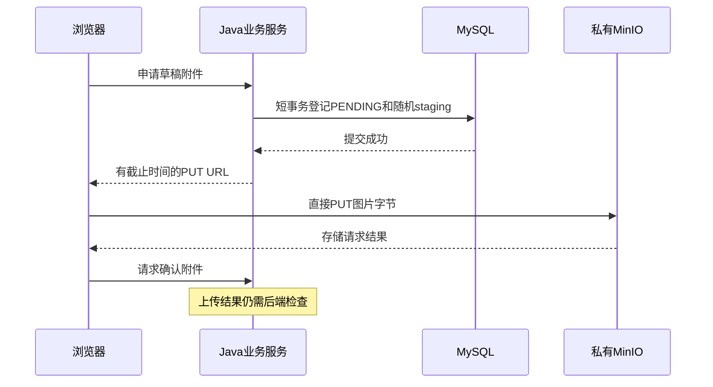
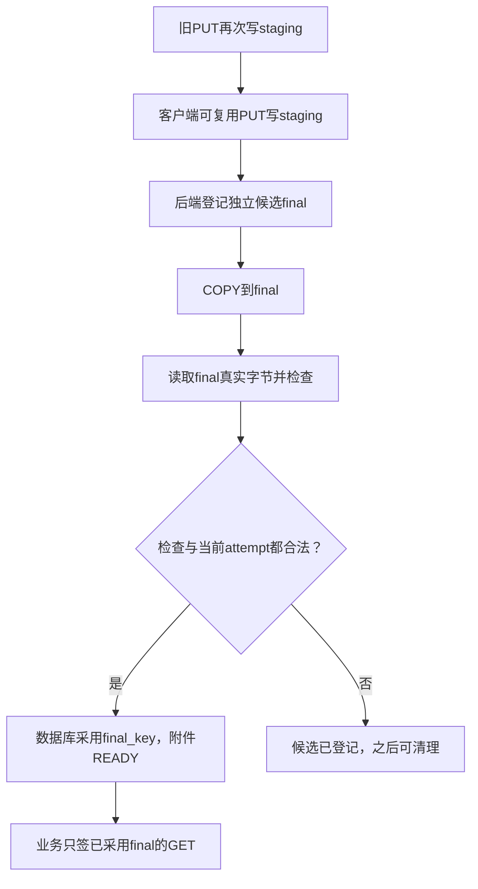
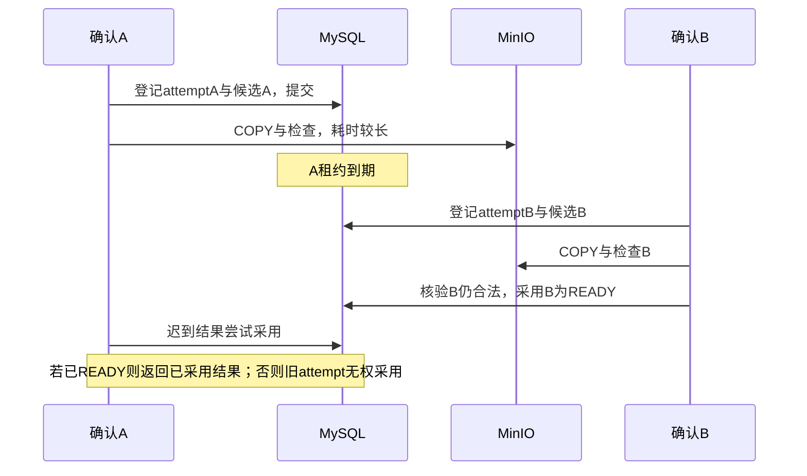
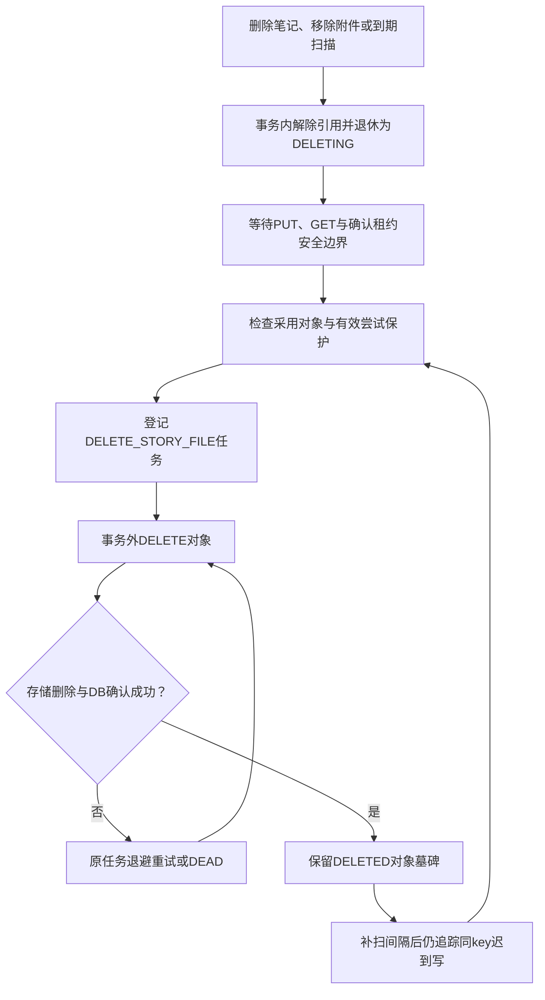
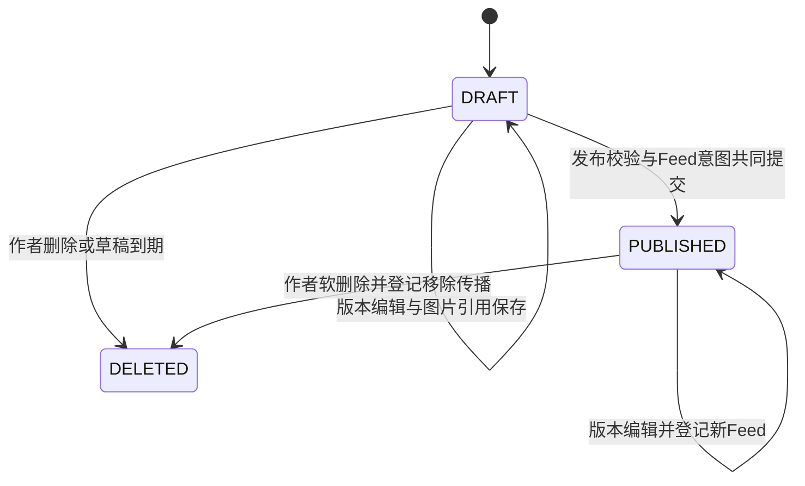
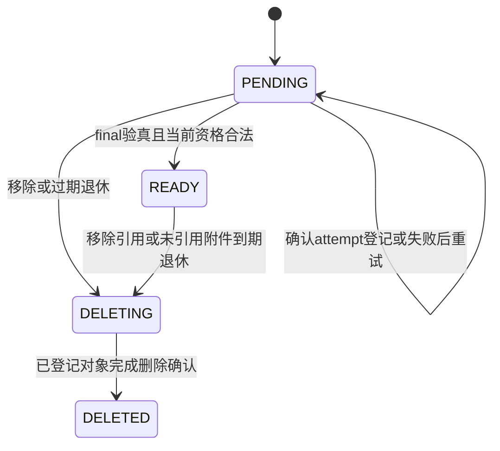

# CityPass 学习文档三：活动笔记发布与文件管理

> 按最新副项目简历逐句理解，结构与 01 一致：简历讲解 → 重要补充 → 15 道深挖问答。
>
> 更新日期：2026-10-28。依据核对时 main 提交 [`9c995aee273bf641cd0152bf626805aadbb83078`](https://github.com/SyH-101/citypass-platform/commit/9c995aee273bf641cd0152bf626805aadbb83078)。代码节选保留真实条件，示例时序为教学推演。本次只修改文档，没有重新启动整套容器或重跑完整验收；历史记录与未实现的能力分别说明。
>
> 相关主线：[01 预约与候补](https://github.com/SyH-101/citypass-platform/blob/main/01-异步预约与候补调度.md)、[02 多级缓存](https://github.com/SyH-101/citypass-platform/blob/main/02-多级缓存一致性.md)。本篇以私有 MinIO 为主，不把已有适配器或测试当成真实云端生产经历。

## 先看这次要解释的简历原文

**活动笔记发布与文件管理：** 基于私有 MinIO 与短期签名 URL 实现图片直传和授权读取；通过 staging/final 分离、图片检验及租约/尝试号控制并发确认，结合持久对象登记与延迟回收实现失败补偿；发布事务内登记 Feed 任务，利用版本控制和批次进度保障异步更新可重试。

用一个例子串起来：小林参加演出后写笔记、上传两张照片，保存顺序并发布。期间浏览器可能重试上传、确认响应可能丢失，作者也可能在确认没结束时删除笔记。系统要同时回答：谁能看、哪份字节可信、哪个确认有资格采用、失败副本由谁回收、订阅者信息流怎样更新。

先记住完整时间线：

| 阶段 | 数据库与外部组件发生什么 | 还没有保证什么 |
| --- | --- | --- |
| 创建草稿 | 标题正文初次写入 MySQL，状态 DRAFT | 未公开，尚未关联新附件 |
| 申请上传 | 先登记 PENDING 附件和 staging 对象，再签 PUT | 没有上传成功事实 |
| 浏览器 PUT | 图片字节直接进入 MinIO staging | 未通过真实内容检查 |
| 确认 | COPY 独立 final，验真，合法 attempt 才写 READY | READY 尚不等于笔记已引用或发布 |
| 保存编辑 | 标题正文、附件顺序与 active 引用同事务更新 | DRAFT 仍只有作者可见 |
| 发布 | PUBLISHED 与 Feed 待办同事务提交 | 所有订阅者 Feed 尚未同步完成 |
| 删除／过期 | 先停业务使用，之后按安全期回收字节 | 已签 GET 可能尚未到期，在途写也可能迟到 |

所以“保存笔记”可以发生两次：创建草稿时就保存初始正文，确认图片以后通过编辑接口再保存引用和排序；发布负责改变公开状态，不能把三步混成一次操作。

## 阅读顺序与目录

- [第一部分：按简历逐句讲解](#part-1)
  - [1.1 私有 MinIO 与短期签名：图片直传](#resume-1)
  - [1.2 授权读取：什么时候能签 GET](#resume-2)
  - [1.3 staging/final 分离：旧 PUT 不能改已采用文件](#resume-3)
  - [1.4 图片检验：确认实际字节和资源限制](#resume-4)
  - [1.5 租约／尝试号：并发确认只采用合法结果](#resume-5)
  - [1.6 持久对象登记：COPY 成功但回写失败仍可追踪](#resume-6)
  - [1.7 延迟回收：先退业务资格，再删对象](#resume-7)
  - [1.8 发布事务登记 Feed：保存可恢复传播意图](#resume-8)
  - [1.9 版本与批次进度：传播可以安全重试](#resume-9)
- [第二部分：其他重要内容](#part-2)
- [第三部分：15 道大厂面试深挖问答](#part-3)
- [最后复习：两分钟介绍、参数与源码导航](#review)

<a id="part-1"></a>

## 第一部分：按简历逐句讲解

<a id="resume-1"></a>

### 1.1 “基于私有 MinIO 与短期签名 URL 实现图片直传”是什么意思？

#### MinIO、对象 key 和签名 URL 分别是什么？

MinIO 用来保存图片字节，可以把 bucket 理解为受权限保护的文件容器，对象 key 是容器里唯一定位文件的名字。`stories/staging/8/某个UUID` 看起来像目录路径，但在业务里首先是对象标识，不由客户端任意指定。

私有 bucket 不允许匿名直接读取全部对象。后端经过登录、本人归属与配额检查后，为某个 key 的某个操作签发限时凭证。浏览器拿到 PUT URL，就直接把字节发给 MinIO，Java 只处理授权、状态、确认与清理。



控制请求经过 Java，图片字节直达 MinIO。直传减少应用带宽、长连接与上传线程占用，但代价是上传完成后必须确认，还要处理 CORS、过期 URL 和无人使用的对象。

#### 为什么先登记，再签 URL？

如果先给写权限，客户端上传完成后应用才尝试登记，进程中途退出就可能留下无法关联业务的文件。当前先锁用户与笔记，检查本人、存活状态、PENDING 配额与单篇图片额度，再登记：

**源码位置：** `src/main/java/com/citypass/story/StoryFileService.java`  
**类／方法：** `StoryFileService.requestUpload（对象登记）`；[固定版本源码，第 64–91 行](https://github.com/SyH-101/citypass-platform/blob/9c995aee273bf641cd0152bf626805aadbb83078/src/main/java/com/citypass/story/StoryFileService.java#L64-L91)。以下为连续节选，原语句未改动，省略的外围条件见上下文。

```java
                            String stagingKey =
                                    "stories/staging/" + userId + "/" + UUID.randomUUID();
                            LocalDateTime uploadDeadline =
                                    LocalDateTime.now()
                                            .plusSeconds(storyFileProperties.getUploadSeconds());
                            long id =
                                    storyTransactions.insert(
                                            "INSERT INTO tb_story_attachment(user_id,story_id,staging_key,expires_at,upload_url_expires_at) VALUES(?,?,?,?,?)",
                                            userId,
                                            storyId,
                                            stagingKey,
                                            uploadDeadline,
                                            uploadDeadline);
                            storyTransactions.jdbcTemplate.update(
                                    "INSERT INTO tb_story_file_object(attachment_id,object_key,kind,cleanup_after) VALUES(?,?,'STAGING',?)",
                                    id,
                                    stagingKey,
                                    uploadDeadline.plusSeconds(
                                            storyFileProperties.getCleanupGraceSeconds()));
                            return storyTransactions.attachment(id, false);
                        });
        try {
            Map<String, Object> result = publicInfo(attachment);
            int remainingSeconds =
                    (int)
                            Duration.between(
                                            LocalDateTime.now(),
                                            time(attachment, "upload_url_expires_at"))
```

随机 key 由服务端生成。PENDING 附件表保存 user_id、story_id 和最晚上传截止；`tb_story_file_object` 登记同一个 staging key 与清理下限。事务提交以后才签 URL，后续没上传或没确认也有记录可扫。

**源码位置：** `src/main/java/com/citypass/story/StoryFileService.java`  
**类／方法：** `StoryFileService.requestUpload（按剩余有效期签名）`；[固定版本源码，第 87–108 行](https://github.com/SyH-101/citypass-platform/blob/9c995aee273bf641cd0152bf626805aadbb83078/src/main/java/com/citypass/story/StoryFileService.java#L87-L108)。以下为连续节选，原语句未改动，省略的外围条件见上下文。

```java
            int remainingSeconds =
                    (int)
                            Duration.between(
                                            LocalDateTime.now(),
                                            time(attachment, "upload_url_expires_at"))
                                    .getSeconds();
            if (remainingSeconds < 1) {
                throw StoryProblem.conflict("上传凭证申请已超时，请移除附件后重新申请");
            }
            // Signing must not extend the durable latest-expiry boundary used by cleanup.
            result.put(
                    "uploadUrl",
                    objectStorage.signPut(
                            (String) attachment.get("staging_key"), remainingSeconds));
            result.put("method", "PUT");
            result.put("expiresAt", attachment.get("upload_url_expires_at"));
            result.put("maxBytes", storyFileProperties.getMaxBytes());
            return result;
        } catch (Exception exception) {
            throw new StoryProblem(503, "上传凭证生成失败，可移除此附件后重新申请");
        }
    }
```

签名用数据库截止时间减去当前时间的**剩余秒数**。不能排队很久后又重新签完整 300 秒，否则实际写权限晚于数据库保存的清理边界，后台可能过早回收。

真正签名时指定 bucket、key、HTTP 方法与有效期：

**源码位置：** `src/main/java/com/citypass/storage/MinioObjectStorage.java`  
**类／方法：** `MinioObjectStorage.sign`；[固定版本源码，第 67–75 行](https://github.com/SyH-101/citypass-platform/blob/9c995aee273bf641cd0152bf626805aadbb83078/src/main/java/com/citypass/storage/MinioObjectStorage.java#L67-L75)。以下为连续节选，原语句未改动，省略的外围条件见上下文。

```java
    private String sign(String key, Method method, int seconds) throws Exception {
        return signingClient.getPresignedObjectUrl(
                GetPresignedObjectUrlArgs.builder()
                        .bucket(bucket)
                        .object(key)
                        .method(method)
                        .expiry(seconds)
                        .build());
    }
```

适配器区分内部访问 endpoint 与浏览器 publicEndpoint。HEAD／COPY／DELETE 用内部客户端，签名针对浏览器真正访问的 host 生成，签完再替换域名会破坏签名语义。

#### 短期签名不等于一次性上传

有效期内 PUT 一般可重复使用，当前没有“一用即焚”协议；URL 持有人在授权窗口内可重写同一 staging。默认 PUT 300 秒，确认后还要防止这个旧写权限改变已发布内容，下一节的 final 分离因此很重要。

返回 maxBytes 只是业务提示，当前预签 PUT 没有对应存储层硬大小策略，超限文件可能先占空间，再在确认时被拒绝。Spring multipart 的 5MB 配置也不约束直接传到 MinIO 的字节。

**面试时可以这样说：**

> 我让后端先校验身份、笔记归属和额度，在数据库登记随机 staging 与上传截止，再签短期 PUT，浏览器直接传 MinIO。应用不转发图片字节，但保留业务控制。签名有效期不超过已登记边界，失败对象能按记录回收；PUT 可复用，因此后续还需要确认与 final 分离。

**记忆主线：** 业务校验／登记 → 签限时 PUT → 浏览器直传 → 后端确认。

<a id="resume-2"></a>

### 1.2 “和授权读取”是什么意思？

#### bucket 私有，公开笔记的图片怎样给别人看？

公开的是应用允许展示的笔记，存储并未因此改成匿名公共 bucket。客户端先向应用申请图片 URL，应用检查可见性，合法后为已采用 final 签短期 GET。

当前读取权限可以这样理解：

| 笔记状态 | 谁能申请读取 | 附件还要满足什么 |
| --- | --- | --- |
| DRAFT 且未过期 | 作者本人 | 属于该笔记、READY、存在 active 引用 |
| PUBLISHED | 允许公开读取，包括匿名访问应用的公开读接口 | 同样检查所属笔记、READY 与 active 引用 |
| DELETED | 拒绝新的读取授权 | 不能因知道附件 ID 绕过状态 |

**源码位置：** `src/main/java/com/citypass/story/StoryFileService.java`  
**类／方法：** `StoryFileService.readUrl`；[固定版本源码，第 299–324 行](https://github.com/SyH-101/citypass-platform/blob/9c995aee273bf641cd0152bf626805aadbb83078/src/main/java/com/citypass/story/StoryFileService.java#L299-L324)。以下为连续节选，原语句未改动，省略的外围条件见上下文。

```java
    public String readUrl(long storyId, long id, Long userId) {
        Map<String, Object> story = storyTransactions.story(storyId, false);
        assertReadable(story, userId);
        Map<String, Object> attachment = storyTransactions.attachment(id, false);
        long activeReferenceCount =
                storyTransactions.jdbcTemplate.queryForObject(
                        "SELECT COUNT(*) FROM tb_story_attachment_ref WHERE story_id=? AND attachment_id=? AND active=1",
                        Long.class,
                        storyId,
                        id);
        if (activeReferenceCount != 1
                || number(attachment, "story_id") != storyId
                || !"READY".equals(attachment.get("state"))) {
            throw StoryProblem.missing();
        }

        try {
            return objectStorage.signGet(
                    (String) attachment.get("final_key"), storyFileProperties.getReadSeconds());
        } catch (Exception exception) {
            throw new StoryProblem(503, "图片访问链接暂不可用");
        }
    }

    public static void assertReadable(Map<String, Object> story, Long userId) {
        String state = (String) story.get("status");
```

`activeReferenceCount` 说明图片真的在这篇笔记当前列表中；`state=READY` 说明字节确认过；story_id 防跨篇借用。笔记可见性由前面的 `assertReadable` 检查。附件 READY 但尚未保存引用时，不能仅凭 ID 获得这条正式读取授权。

默认 GET 120 秒。作者编辑、移除或删除后，新的签发会按数据库条件拒绝；已经发出的 URL 可能在到期前仍然可读。它是期限内的访问凭证，不与应用 Token 的每次状态实时绑定，也不会因应用退出登录立刻自动撤销。

图片相关接口还需避免公共缓存签名信息，当前 story 响应有 no-store 控制。生产中不要把完整签名 URL 记入日志或错误消息。

**面试时可以这样说：**

> 我先用笔记可见性、附件 READY、所属笔记与有效引用检查授权，再给 adopted final 签短期 GET。公开笔记也经应用获取授权，bucket 仍私有。这样可以限制新签发，但已经签出的地址有到期前的撤权延迟，不能承诺删除后所有旧链接瞬间失效。

**记忆主线：** 笔记可见 → READY 且有效引用 → 签 final GET → 在有效期内使用。

<a id="resume-3"></a>

### 1.3 “通过 staging/final 分离”是什么意思？

#### 为什么不能把上传成功的 staging 直接标 READY？

浏览器手中的 PUT 还没过期，若笔记始终引用这个 key，用户可以在确认以后再次 PUT，替换后端已经检查过的字节。只更新数据库状态无法撤销已签写权限。

当前让客户端只写 staging。确认时为本次 attempt 生成一个独立随机 final key，由后端 COPY，然后检查 final 的实际内容，成功才把附件 final_key 指向它。客户端从未拿到 final 的 PUT URL。

| 存储位置 | 谁能通过当前协议写 | 用来做什么 |
| --- | --- | --- |
| staging | 持有有效 PUT 的客户端 | 临时接收不可信上传 |
| 候选 final | 后端本次确认过程 | COPY 后验真，可能被采用也可能失败 |
| 被 adopted 的 final | 应用协议中没有客户端写入口 | 正式读取与发布引用 |

**源码位置：** `src/main/java/com/citypass/story/StoryFileService.java`  
**类／方法：** `StoryFileService.confirmWithPermit（事务外COPY与final检查）`；[固定版本源码，第 187–200 行](https://github.com/SyH-101/citypass-platform/blob/9c995aee273bf641cd0152bf626805aadbb83078/src/main/java/com/citypass/story/StoryFileService.java#L187-L200)。以下为连续节选，原语句未改动，省略的外围条件见上下文。

```java
            long stagingSize = objectStorage.size((String) claim.get("staging_key"));
            if (stagingSize <= 0 || stagingSize > storyFileProperties.getMaxBytes()) {
                throw new StoryProblem(422, "上传对象实际大小超过限制或为空");
            }

            objectStorage.copy((String) claim.get("staging_key"), finalObjectKey);
            long finalSize = objectStorage.size(finalObjectKey);
            ImageInspector.Info imageInfo;
            try (InputStream input = objectStorage.open(finalObjectKey)) {
                imageInfo = imageInspector.inspect(input, finalSize);
            }

            return storyTransactions.inTransaction(
                    () -> {
```

特别注意执行顺序：HEAD staging 只做初步大小检查；COPY 到 final；再 HEAD、打开并检查 **final**。staging 在第一次 HEAD 与 COPY 之间仍可变化，所以最终采用必须看复制后的字节。



旧 PUT 以后只能改变 staging，不能改这份 final。但这只是应用层隔离，并未启用存储 WORM／对象锁。管理员或持有后端存储凭据者仍能绕过协议改对象。

当前也没有用 ETag、对象版本或预先提交哈希绑定“最初那一次上传”。若 COPY 取得另一张合法图片且 final 检查通过，协议采用的是那份合法 final；不能宣称它必然与客户端第一次声明的字节相同。

**面试时可以这样说：**

> PUT 在有效期内可复用，所以我把客户端能写的 staging 与业务正式引用的 final 分开。每次确认复制到独立 key，并检查复制后的实际字节，合法后才采用。这样旧上传链接不能覆盖正式图片；代价是多一次 COPY 和失败副本清理，还没有存储强制不可变或上传哈希绑定。

**记忆主线：** staging 可写 → COPY 独立 final → 检查 final → 采用；旧 PUT 不接触 final。

<a id="resume-4"></a>

### 1.4 “图片检验”具体检查什么？

#### 文件名与 Content-Type 为什么不能作为依据？

客户端可以把文本命名为 jpg，也可以伪造请求头。HEAD 的长度或图片头也不能证明内容能正常解码，压缩字节很小的图可能包含巨大像素尺寸。

当前检查分层进行：

| 检查 | 当前默认或动作 | 目的 |
| --- | --- | --- |
| 实际对象大小 | 非空，最多 10 MiB | 拒绝明显超限对象 |
| 受限读取 | 8KiB 缓冲累计，超过上限立即拒绝 | 不盲信外部长度 |
| 长度一致 | 实际 total 必须等于 HEAD 的 actualSize | 防止读取结果发生长度变化 |
| 实际格式 | ImageIO reader 识别 JPEG／PNG | 不相信扩展名 |
| 尺寸与像素 | 单边最多 10000，总像素最多 2000 万 | 在完整解码前控制资源 |
| 真实解码 | reader.read 成功 | 不仅检查文件头 |

**源码位置：** `src/main/java/com/citypass/story/ImageInspector.java`  
**类／方法：** `ImageInspector.inspect（受限读取与长度检查）`；[固定版本源码，第 37–52 行](https://github.com/SyH-101/citypass-platform/blob/9c995aee273bf641cd0152bf626805aadbb83078/src/main/java/com/citypass/story/ImageInspector.java#L37-L52)。以下为连续节选，原语句未改动，省略的外围条件见上下文。

```java
        ByteArrayOutputStream bytes = new ByteArrayOutputStream((int) Math.min(actualSize, 65536));
        byte[] buffer = new byte[8192];
        long total = 0;
        int bytesRead;
        while ((bytesRead = input.read(buffer)) != -1) {
            total += bytesRead;
            if (total > limits.getMaxBytes()) {
                throw new StoryProblem(422, "图片实际大小超过限制");
            }

            bytes.write(buffer, 0, bytesRead);
        }

        if (total != actualSize) {
            throw new StoryProblem(422, "对象长度发生变化，请重新上传");
        }
```

第一段限制实际读取量，并检查长度与传入 actualSize 一致。之后才交给图片 reader：

**源码位置：** `src/main/java/com/citypass/story/ImageInspector.java`  
**类／方法：** `ImageInspector.inspect（格式、尺寸与解码）`；[固定版本源码，第 64–85 行](https://github.com/SyH-101/citypass-platform/blob/9c995aee273bf641cd0152bf626805aadbb83078/src/main/java/com/citypass/story/ImageInspector.java#L64-L85)。以下为连续节选，原语句未改动，省略的外围条件见上下文。

```java
                String format = reader.getFormatName().toLowerCase(Locale.ROOT);
                if (!format.equals("jpeg") && !format.equals("png")) {
                    throw new StoryProblem(422, "仅支持 JPEG 和 PNG 图片内容");
                }

                int width = reader.getWidth(0), height = reader.getHeight(0);
                if (width <= 0
                        || height <= 0
                        || width > limits.getMaxDimension()
                        || height > limits.getMaxDimension()
                        || (long) width * height > limits.getMaxPixels()) {
                    throw new StoryProblem(422, "图片尺寸或像素数量超过限制");
                }
                // Decode after checking dimensions; headers alone do not prove a valid image.
                BufferedImage decoded = reader.read(0);
                if (decoded == null) {
                    throw new StoryProblem(422, "图片解码失败");
                }

                decoded.flush();
                return new Info(format, total, width, height);
            } finally {
```

像素乘法使用 long，先限制 width／height／总像素再完整 decode。确认入口另有每 JVM 默认 4 个 Semaphore 许可，忙时快速 503，finally 释放，避免大量图片同时占堆。

这些限制仍不等于所有资源都安全：内存中会保留压缩字节并产生解码像素，实际内存还取决于 reader 与图片内容，需结合堆大小验证。十 MiB 文件解码后完全可能远大于十 MiB。

当前没有恶意软件扫描、内容审核、EXIF 清洗、统一重编码或独立解码沙箱；“可以解码”也不表示图像没有隐私元数据或所有安全风险。非法内容 422、处理繁忙 503 是不同情况。

**面试时可以这样说：**

> 我确认 final 的实际长度，用有界读取检查字节，再由 ImageIO 识别格式，先限制尺寸与像素后解码，并限制确认并发。这样控制输入真实性和部分资源消耗，但没有把可解码图片当作完整安全审计，也没有做内容审核或元数据清洗。

**记忆主线：** 实际长度 → 有界读 → 真实格式 → 尺寸／像素 → 解码 → 记录元数据。

<a id="resume-5"></a>

### 1.5 “租约/尝试号控制并发确认”是什么意思？

#### 为什么不一直锁着数据库完成 COPY？

存储网络、读流和图片解码耗时不可控。持有事务行锁等待全部 I/O，会占数据库连接，阻塞编辑、删除和另一确认。当前把一次确认拆成两段短数据库事务，中间执行外部操作。

| 阶段 | 保存或检查什么 | 是否持有本次数据库事务锁 |
| --- | --- | --- |
| 第一个事务 | 本人笔记、附件状态、会话期限；登记 attempt、候选 final、租约 | 是，短时间 |
| 外部阶段 | HEAD、COPY、读取、图片检查 | 否 |
| 第二个事务 | 再锁笔记与附件，核对状态、当前 attempt、租约，再采用 final | 是，短时间 |

`attempt` 是这轮确认的 UUID，区分前后尝试；`confirm_lease_until` 是这轮采用资格的时间边界。附件枚举仍是 PENDING，确认进行中由这两个字段表达，**当前没有 CONFIRMING 枚举状态**。

第一个事务发现有效确认租约尚在，会返回 409；没有有效租约时可以登记新尝试：

**源码位置：** `src/main/java/com/citypass/story/StoryFileService.java`  
**类／方法：** `StoryFileService.confirmWithPermit（登记attempt与候选）`；[固定版本源码，第 155–179 行](https://github.com/SyH-101/citypass-platform/blob/9c995aee273bf641cd0152bf626805aadbb83078/src/main/java/com/citypass/story/StoryFileService.java#L155-L179)。以下为连续节选，原语句未改动，省略的外围条件见上下文。

```java
                            String confirmationAttempt = UUID.randomUUID().toString();
                            String key = "stories/final/" + userId + "/" + confirmationAttempt;
                            LocalDateTime confirmationLeaseUntil =
                                    LocalDateTime.now()
                                            .plusSeconds(
                                                    storyFileProperties
                                                            .getConfirmationLeaseSeconds());
                            // Attempt and destination are persisted before external I/O, including
                            // crash windows.
                            storyTransactions.jdbcTemplate.update(
                                    "INSERT INTO tb_story_file_object(attachment_id,object_key,attempt_id,kind,cleanup_after) VALUES(?,?,?,'FINAL',?)",
                                    id,
                                    key,
                                    confirmationAttempt,
                                    confirmationLeaseUntil.plusSeconds(
                                            storyFileProperties.getCleanupGraceSeconds()));
                            storyTransactions.jdbcTemplate.update(
                                    "UPDATE tb_story_attachment SET current_attempt=?,confirm_lease_until=? WHERE id=? AND state='PENDING'",
                                    confirmationAttempt,
                                    confirmationLeaseUntil,
                                    id);
                            attachment.put("attempt", confirmationAttempt);
                            attachment.put("candidate_key", key);
                            return attachment;
                        });
```

候选 final 在 COPY 前就持久登记。一个 attempt 对应一个独立候选，当前附件记录保存“哪一次是当前尝试”。外部 I/O 完成后不能只凭成功就标 READY，还要重新验证：

**源码位置：** `src/main/java/com/citypass/story/StoryFileService.java`  
**类／方法：** `StoryFileService.confirmWithPermit（二次核验后采用）`；[固定版本源码，第 210–231 行](https://github.com/SyH-101/citypass-platform/blob/9c995aee273bf641cd0152bf626805aadbb83078/src/main/java/com/citypass/story/StoryFileService.java#L210-L231)。以下为连续节选，原语句未改动，省略的外围条件见上下文。

```java
                        if (!"PENDING".equals(attachment.get("state"))
                                || !confirmationAttempt.equals(attachment.get("current_attempt"))
                                || !time(attachment, "confirm_lease_until")
                                        .isAfter(LocalDateTime.now())) {
                            throw StoryProblem.conflict("确认租约已失效，请重试");
                        }

                        int updatedRows =
                                storyTransactions.jdbcTemplate.update(
                                        "UPDATE tb_story_attachment SET state='READY',final_key=?,actual_format=?,actual_size=?,width=?,height=?,confirm_lease_until=NULL WHERE id=? AND state='PENDING' AND current_attempt=?",
                                        finalObjectKey,
                                        imageInfo.getFormat(),
                                        imageInfo.getSize(),
                                        imageInfo.getWidth(),
                                        imageInfo.getHeight(),
                                        id,
                                        confirmationAttempt);
                        if (updatedRows != 1) {
                            throw StoryProblem.conflict("附件确认状态冲突");
                        }
                        // Adopted final objects are excluded by DB predicate from all cleanup
                        // claims.
```

`state=PENDING`、`current_attempt` 匹配、租约仍未过期，三项一起决定采用资格。最终 UPDATE 也带状态与 attempt 条件，并检查影响行数。

#### A 租约过期，B 接管后，A 又回来了怎么办？



A 的外部 COPY 可能已经发生，租约不杀线程。它不能覆盖 B 采用的结果，未采用候选仍在对象表里等待清理。若第二事务看到附件已 READY，就返回现有结果，因此“确认调用返回成功”不必然表示采用的是该调用复制的候选。

默认确认租约 60 秒，存储太慢或处理超时会失去采用资格，需要重试。当前没有为确认线程做心跳续租，不能说后台复制恰好一次。

**面试时可以这样说：**

> 我用短事务登记 attempt 和租约，事务外复制验真，回来再核对当前状态、attempt 和租约决定是否 READY。租约提供失败后重试机会，attempt 区分新旧结果；它们控制最终采用，外部 COPY 仍可能多次。候选在 I/O 前已经登记，所以旧尝试迟到也不会丢失回收线索。

**记忆主线：** 登记尝试 → 外部处理 → 再核资格 → 采用；过期旧尝试不能覆盖新结果。

<a id="resume-6"></a>

### 1.6 “结合持久对象登记……实现失败补偿”是什么意思？

#### COPY 已成功，READY 提交失败，文件去哪儿找？

MinIO 和 MySQL 是不同系统。后面的数据库事务回滚，无法撤销已经完成的 COPY。如果候选 key 只放在 Java 局部变量，应用退出后很难判断那份文件属于谁、能否删除。

当前在第一个事务里把 key、attachment_id、attempt_id、kind、cleanup_after 保存到 `tb_story_file_object`，再调用存储。即使没有采用，候选也能通过数据库被找到；不依赖扫描整个 bucket 后猜 UUID 归属。

| 对象登记 | 生命周期意义 |
| --- | --- |
| STAGING 记录 | 申请了上传权限，即使客户端不回调也知道可能存在这个 key |
| 每个 FINAL 候选记录 | COPY 前已经知道目的地，失败副本可以追踪 |
| 附件 final_key | 唯一指向业务已采用的候选 |
| 对象 state、删除时间与任务指针 | 记录已尝试删除和后续补扫进度 |

失败 catch 的实际动作如下：

**源码位置：** `src/main/java/com/citypass/story/StoryFileService.java`  
**类／方法：** `StoryFileService.confirmWithPermit（失败只释放当前attempt租约）`；[固定版本源码，第 234–249 行](https://github.com/SyH-101/citypass-platform/blob/9c995aee273bf641cd0152bf626805aadbb83078/src/main/java/com/citypass/story/StoryFileService.java#L234-L249)。以下为连续节选，原语句未改动，省略的外围条件见上下文。

```java
        } catch (Exception exception) {
            // A failed DB commit cannot roll back the copy. The persisted attempt remains
            // sweepable.
            storyTransactions.inTransaction(
                    () -> {
                        storyTransactions.jdbcTemplate.update(
                                "UPDATE tb_story_attachment SET confirm_lease_until=NULL WHERE id=? AND state='PENDING' AND current_attempt=?",
                                id,
                                confirmationAttempt);
                        return null;
                    });
            if (exception instanceof StoryProblem) {
                throw (StoryProblem) exception;
            }
            // SDK messages can contain URLs. Do not return or log those messages.
            throw new StoryProblem(503, "对象不存在、存储不可用或确认提交失败，请检查上传后重试");
```

它只对匹配当前 attempt 的 PENDING 记录清理租约，不会回滚存储 COPY，也不会立即同步删所有候选。数据库不可用时这个清理自身也可能失败，后续还依赖租约到期和扫描。

#### 分几种失败结果解释，才不会误答

| 失败窗口 | 留下什么 | 当前恢复方式 |
| --- | --- | --- |
| 附件登记成功，签名失败 | PENDING 与 staging 记录 | 用户移除、重新申请或到期清理 |
| 上传成功，没有确认 | staging 可能有字节，附件仍 PENDING | 到期后退休与回收 |
| COPY 成功，READY 未提交 | 未采用 final 与对象登记 | 再次确认开新尝试，旧副本按安全期回收 |
| READY 已提交，响应丢失 | 已采用 final 与 READY | 重试返回已有 READY |
| 旧确认失去资格后 COPY 迟到 | 旧候选可能存在 | 已登记 key，安全后清理与墓碑补扫 |
| DELETE 成功，数据库确认失败 | 字节已无，数据库仍未确认 | 重试删除同 key，再确认数据库 |

补偿目标是让失败结果可追踪、可继续，不意味着每次失败都马上物理删除。删除也可能失败，需要可靠任务；合法 READY final 还必须受到保护。

**面试时可以这样说：**

> 我先把每个可能产生的存储对象登记到数据库，再执行外部动作。COPY 成功但 READY 回写失败时，候选仍有持久记录，重试可以开新 attempt，旧对象安全期后进入清理。数据库回滚只能撤销数据库修改，补偿靠记录和后续任务推进，不存在自动 MinIO 回滚。

**记忆主线：** 先登记目的地 → COPY → DB采用；未采用有账可查，有资格后回收。

<a id="resume-7"></a>

### 1.7 “与延迟回收实现失败补偿”里的“延迟”为什么必要？

#### 删除记录以后，为什么不立刻 DELETE？

作者移除或删除笔记时，先解除 active 引用，把附件推进 DELETING，阻止新的确认与绑定，再等待安全时间。这是在立即撤销业务使用资格与最终物理回收之间划清边界。

安全时间取以下下限的最大值：

- 当前退休时刻加 `max(GET有效期, 清理宽限)`；
- 数据库登记的最晚 PUT 到期时间加宽限；
- 当前确认租约到期时间加宽限（如果有）。

**源码位置：** `src/main/java/com/citypass/story/StoryTransactions.java`  
**类／方法：** `StoryTransactions.retireAttachment（安全时间）`；[固定版本源码，第 132–162 行](https://github.com/SyH-101/citypass-platform/blob/9c995aee273bf641cd0152bf626805aadbb83078/src/main/java/com/citypass/story/StoryTransactions.java#L132-L162)。以下为连续节选，原语句未改动，省略的外围条件见上下文。

```java
        LocalDateTime cleanupAfter =
                LocalDateTime.now()
                        .plusSeconds(
                                Math.max(
                                        storyFileProperties.getReadSeconds(),
                                        storyFileProperties.getCleanupGraceSeconds()));
        LocalDateTime uploadSafeAfter =
                time(attachment, "upload_url_expires_at")
                        .plusSeconds(storyFileProperties.getCleanupGraceSeconds());
        if (uploadSafeAfter.isAfter(cleanupAfter)) {
            cleanupAfter = uploadSafeAfter;
        }

        Object confirmationLease = attachment.get("confirm_lease_until");
        if (confirmationLease != null) {
            LocalDateTime leaseSafeAfter =
                    time(attachment, "confirm_lease_until")
                            .plusSeconds(storyFileProperties.getCleanupGraceSeconds());
            if (leaseSafeAfter.isAfter(cleanupAfter)) {
                cleanupAfter = leaseSafeAfter;
            }
        }

        jdbcTemplate.update(
                "UPDATE tb_story_attachment SET state='DELETING',delete_after=? WHERE id=? AND state IN ('PENDING','READY')",
                cleanupAfter,
                id);
        jdbcTemplate.update(
                "UPDATE tb_story_file_object SET cleanup_after=GREATEST(cleanup_after,?) WHERE attachment_id=?",
                cleanupAfter,
                id);
```

随后事务更新附件的 `delete_after` 与所有对象的 `cleanup_after`，使用 GREATEST 防止已有下限倒退。原本候选登记时间已到，也不能误删后来被采用的正式文件。

假设 12:00 签 300 秒 PUT，12:01 开始 60 秒确认，12:01:10 删除，GET 与宽限都是 120 秒。三个下限分别为 12:03:10、12:07:00、12:04:00，应取 12:07:00。这个算例只帮助理解默认值，不是本次验收等待结果。

#### 什么对象必须保护？

**源码位置：** `src/main/java/com/citypass/story/StoryFileCleanup.java`  
**类／方法：** `StoryFileCleanup.canDelete`；[固定版本源码，第 160–181 行](https://github.com/SyH-101/citypass-platform/blob/9c995aee273bf641cd0152bf626805aadbb83078/src/main/java/com/citypass/story/StoryFileCleanup.java#L160-L181)。以下为连续节选，原语句未改动，省略的外围条件见上下文。

```java
    boolean canDelete(Map<String, Object> fileObject, Map<String, Object> attachment) {
        if (time(fileObject, "cleanup_after").isAfter(LocalDateTime.now())) {
            return false;
        }

        if ("READY".equals(attachment.get("state"))
                && fileObject.get("object_key").equals(attachment.get("final_key"))) {
            return false;
        }

        if ("FINAL".equals(fileObject.get("kind"))
                && "PENDING".equals(attachment.get("state"))
                && Objects.equals(fileObject.get("attempt_id"), attachment.get("current_attempt"))
                && attachment.get("confirm_lease_until") != null
                && time(attachment, "confirm_lease_until").isAfter(LocalDateTime.now())) {
            return false;
        }

        return true;
    }

    public void execute(String payload) {
```

当前已采用的 READY final 不因原始 cleanup_after 到期被删除；PENDING 当前合法 attempt 的候选也受租约保护。绑定与退休使用一致的笔记→附件锁顺序，再检查归属、引用和状态，避免先判断无引用、稍后又被重新绑定。



已经签出的旧请求可能在到期前开始、到期后才完成，因此第一次删成功不证明这个 key 永远不会再出现。对象登记记录保留 DELETED 墓碑，之后仍能再次调度删除。当前默认补扫间隔 3600 秒，永久记录与任务历史尚无完整归档。

宽限只是有限等待，不是对所有网络时序的数学保证；墓碑补扫提供后续追踪，仍依赖存储恢复、任务重试与 DEAD 处理。

**面试时可以这样说：**

> 我先在数据库撤销引用和采用资格，再按 PUT、GET、确认租约的安全边界延迟回收，删除前排除 adopted final 和有效 attempt。成功后保留对象墓碑，补扫处理迟到写。这样可以防误删和丢失清理线索，代价是空间延迟回收、记录增长，以及仍需治理永久失败任务。

**记忆主线：** 先停业务使用 → 等安全期 → 保护合法对象 → 可靠DELETE → 留墓碑补扫。

<a id="resume-8"></a>

### 1.8 “发布事务内登记 Feed 任务”是什么意思？

#### Feed 是什么？为什么发布成功还要后台更新？

Feed 是“我订阅的作者最近发布了什么”的候选列表。当前使用 Redis ZSET 保存笔记 ID 与发布时间分数，数据库才保存笔记正文与公开状态。

如果发布接口同步给所有订阅者写 Redis，粉丝越多，请求越慢，任何一次 Redis 故障还可能牵连发布事务。当前先在 MySQL 同事务提交 PUBLISHED 与传播待办，后台再分批执行。

发布之前检查本人、笔记存活与版本、标题正文、可选关联活动有效性，以及 active 引用的附件是否合法：

**源码位置：** `src/main/java/com/citypass/story/StoryDraftService.java`  
**类／方法：** `StoryDraftService.publish（附件校验）`；[固定版本源码，第 131–145 行](https://github.com/SyH-101/citypass-platform/blob/9c995aee273bf641cd0152bf626805aadbb83078/src/main/java/com/citypass/story/StoryDraftService.java#L131-L145)。以下为连续节选，原语句未改动，省略的外围条件见上下文。

```java
                    List<Map<String, Object>> attachments =
                            storyTransactions.jdbcTemplate.queryForList(
                                    "SELECT a.* FROM tb_story_attachment_ref r JOIN tb_story_attachment a ON a.id=r.attachment_id WHERE r.story_id=? AND r.active=1 ORDER BY a.id FOR UPDATE",
                                    id);
                    if (attachments.size() > storyFileProperties.getMaxImages()) {
                        throw new StoryProblem(422, "图片数量超过限制");
                    }

                    for (Map<String, Object> attachment : attachments) {
                        if (number(attachment, "user_id") != userId
                                || !"READY".equals(attachment.get("state"))
                                || attachment.get("final_key") == null) {
                            throw StoryProblem.conflict("笔记存在尚未就绪的附件");
                        }
                    }
```

READY 的附件不一定正在引用，发布只检查当前 active 图片列表；纯文字笔记可以没有图片。关联活动要求存在且上架，当前没有强制校验用户真的预约或参加过该活动，也没有内容审核流程。

状态变更与任务登记相邻，并处于同一 TransactionTemplate 事务：

**源码位置：** `src/main/java/com/citypass/story/StoryDraftService.java`  
**类／方法：** `StoryDraftService.publish（状态与Feed意图同事务）`；[固定版本源码，第 147–160 行](https://github.com/SyH-101/citypass-platform/blob/9c995aee273bf641cd0152bf626805aadbb83078/src/main/java/com/citypass/story/StoryDraftService.java#L147-L160)。以下为连续节选，原语句未改动，省略的外围条件见上下文。

```java
                    long version = expectedVersion + 1;
                    if (storyTransactions.jdbcTemplate.update(
                                    "UPDATE tb_story SET status='PUBLISHED',version=?,publish_time=NOW(3),draft_expires_at=NULL WHERE id=? AND status='DRAFT' AND version=?",
                                    version,
                                    id,
                                    expectedVersion)
                            != 1) {
                        throw StoryProblem.conflict("发布状态冲突");
                    }

                    storyTransactions.queueFeed(id, version);
                    return result(id, version, "PUBLISHED");
                });
    }
```

`queueFeed` 实际调用可靠任务仓库：

**源码位置：** `src/main/java/com/citypass/story/StoryTransactions.java`  
**类／方法：** `StoryTransactions.queueFeed`；[固定版本源码，第 120–125 行](https://github.com/SyH-101/citypass-platform/blob/9c995aee273bf641cd0152bf626805aadbb83078/src/main/java/com/citypass/story/StoryTransactions.java#L120-L125)。以下为连续节选，原语句未改动，省略的外围条件见上下文。

```java
    public void queueFeed(long id, long version) {
        reliableTaskRepository.enqueue(
                ReliableTaskRepository.STORY_FEED,
                "story-feed:" + id + ":" + version,
                id + ":" + version);
    }
```

任务 biz_key 和 payload 使用 `storyId:version`。Outbox 插入失败，PUBLISHED 更新也回滚；事务已提交但 Redis 尚未更新，笔记已公开，订阅 Feed 允许稍后可见。发布响应丢失时，重复 publish 看到 PUBLISHED 会返回当前已发布结果，不再重复更改状态。

已发布编辑和软删除也会推进笔记版本并登记 Feed，保证“修改后的内容”与“删除”有传播意图。

**面试时可以这样说：**

> 发布先检查正文、版本与有效附件引用，在同一数据库事务里修改为 PUBLISHED 并登记 storyId:version 的 Feed 待办。这样不会出现发布已提交却没有传播意图的宕机窗口，后台失败还能重试。发布成功承诺的是数据库事实与待办，不承诺所有订阅者立刻看到。

**记忆主线：** 合法引用检查 → 发布状态与Feed意图同事务 → 后台传播。

<a id="resume-9"></a>

### 1.9 “利用版本控制和批次进度保障异步更新可重试”是什么意思？

#### 为什么有任务重试还需要版本？

发布 v2、编辑 v3、删除 v4，执行顺序可能与发生顺序不同。若只做 ZADD，迟到发布可能把已经移除的笔记 ID 再加回去。

当前每个用户都有 Feed ZSET 与每篇笔记最高处理版本 Hash。Lua 原子比较版本，再决定 ZADD 或 ZREM：

**源码位置：** `src/main/resources/story-feed.lua`  
**类／方法：** `story-feed.lua 完整脚本`；[固定版本源码，第 1–11 行](https://github.com/SyH-101/citypass-platform/blob/9c995aee273bf641cd0152bf626805aadbb83078/src/main/resources/story-feed.lua#L1-L11)。以下为连续节选，原语句未改动，省略的外围条件见上下文。

```lua
-- Per-user per-story version fences late events. Replaying ZADD never increments a counter.
local current = tonumber(redis.call('HGET', KEYS[2], ARGV[1]) or '-1')
local version = tonumber(ARGV[2])
if version < current then return 0 end
redis.call('HSET', KEYS[2], ARGV[1], version)
if ARGV[3] == 'PUBLISHED' then
    redis.call('ZADD', KEYS[1], ARGV[4], ARGV[1])
else
    redis.call('ZREM', KEYS[1], ARGV[1])
end
return 1
```

低版本返回 0，不覆盖高版本；同版本允许重放，ZADD 用 storyId 作成员，不会因为重复消息多出两条。PUBLISHED 加入候选，其余状态移除。每位用户的一次 Lua 是原子的，所有订阅者整批并非一个 Redis 原子事务。

#### 事件版本是完整内容快照吗？

不是完整内容快照。事件 key 含版本用于区分待办与进度，handler 每批会重新读取数据库中笔记**当前**的状态和版本，按最新事实传播：

**源码位置：** `src/main/java/com/citypass/story/StoryFeedHandler.java`  
**类／方法：** `StoryFeedHandler.execute（读最新事实与按订阅ID取批）`；[固定版本源码，第 45–66 行](https://github.com/SyH-101/citypass-platform/blob/9c995aee273bf641cd0152bf626805aadbb83078/src/main/java/com/citypass/story/StoryFeedHandler.java#L45-L66)。以下为连续节选，原语句未改动，省略的外围条件见上下文。

```java
        while (true) {
            Map<String, Object> story = storyTransactions.story(storyId, false);
            List<Map<String, Object>> subscribers =
                    storyTransactions.jdbcTemplate.queryForList(
                            "SELECT id,user_id FROM tb_subscription WHERE target_user_id=? AND id>? ORDER BY id LIMIT ?",
                            number(story, "user_id"),
                            lastSubscriptionId,
                            storyFileProperties.getFeedBatch());
            if (subscribers.isEmpty()) {
                return;
            }

            String status = (String) story.get("status");
            long version = number(story, "version");
            long score =
                    story.get("publish_time") == null
                            ? 0
                            : time(story, "publish_time")
                                    .atZone(ZoneId.systemDefault())
                                    .toInstant()
                                    .toEpochMilli();
            for (Map<String, Object> subscriber : subscribers) {
```

所以旧发布任务晚执行时，通常读到当前已删除事实，再执行移除。仍有并发读旧事实的窗口，Redis 最高版本进一步拒绝回退；在删除传播尚未到达某用户时，公开查询还会用数据库状态过滤，防止仅凭旧 Feed ID 展示删除正文。

#### 批次进度解决什么？

按订阅记录 ID 升序分页，每批默认 200 人，成功一批后推进 `last_subscription_id`：

**源码位置：** `src/main/java/com/citypass/story/StoryFeedHandler.java`  
**类／方法：** `StoryFeedHandler.execute（批次后单调回写进度）`；[固定版本源码，第 84–90 行](https://github.com/SyH-101/citypass-platform/blob/9c995aee273bf641cd0152bf626805aadbb83078/src/main/java/com/citypass/story/StoryFeedHandler.java#L84-L90)。以下为连续节选，原语句未改动，省略的外围条件见上下文。

```java
            // If the worker dies here, repeating the batch applies the same member/score/version.
            storyTransactions.jdbcTemplate.update(
                    "UPDATE tb_story_feed_progress SET last_subscription_id=GREATEST(last_subscription_id,?) WHERE event_key=?",
                    lastSubscriptionId,
                    eventKey);
        }
    }
```

假设 450 个订阅者，按 200、200、50 批次处理。第一批写完且进度已保存，重启能从后面继续；第一批 Redis 已写、进度尚未保存就退出，重试会再处理该批，由版本与同成员写入保证安全。进度减少重复工作，幂等保护重复时的业务结果。

使用 GREATEST 让进度不倒退。当前一次 execute 内有 while(true) 循环，会处理到全部订阅者结束，并没有每批主动退出重新领取；大作者任务仍可能占住共享 Relay 并超过租约。订阅者也没有按发布时间冻结快照，订阅后历史回补未实现。

**面试时可以这样说：**

> 我用事件 key 保存传播意图和批次进度，每批读取笔记最新状态，按订阅记录 ID 更新用户 Feed。Lua 保存最高笔记版本并原子加删同一个 ZSET 成员，进度失败时重复一批也不会多出成员或覆盖更高版本。它支持恢复，但不是整批恰好一次，也没有解决大作者写扩散总量与 Redis 全量丢失重建。

**记忆主线：** 事件待办 → 读最新事实 → 订阅ID分批 → 每用户版本Lua → 单调保存进度。

<a id="part-2"></a>

## 第二部分：其他重要内容

<a id="extra-draft"></a>

### 2.1 草稿创建、保存与图片绑定：什么时候写了什么？

创建草稿要求 `Idempotency-Key`，当前格式为 8～64 位字母、数字、下划线或横线。同一用户相同 client_key 查询到已有记录就返回，配合数据库唯一约束与用户行锁，避免响应丢失后重复创建草稿。

**源码位置：** `src/main/java/com/citypass/story/StoryDraftService.java`  
**类／方法：** `StoryDraftService.create（客户端幂等键与已有草稿查询）`；[固定版本源码，第 23–39 行](https://github.com/SyH-101/citypass-platform/blob/9c995aee273bf641cd0152bf626805aadbb83078/src/main/java/com/citypass/story/StoryDraftService.java#L23-L39)。以下为连续节选，原语句未改动，省略的外围条件见上下文。

```java
        if (idempotencyKey == null || !idempotencyKey.matches("[A-Za-z0-9_-]{8,64}")) {
            throw new StoryProblem(400, "创建草稿需提供 8-64 位 Idempotency-Key");
        }

        validateContent(request, false);
        return storyTransactions.inTransaction(
                () -> {
                    storyTransactions.jdbcTemplate.queryForObject(
                            "SELECT id FROM tb_user WHERE id=? FOR UPDATE", Long.class, userId);
                    List<Map<String, Object>> existingDrafts =
                            storyTransactions.jdbcTemplate.queryForList(
                                    "SELECT id,version,status FROM tb_story WHERE user_id=? AND client_key=?",
                                    userId,
                                    idempotencyKey);
                    if (!existingDrafts.isEmpty()) {
                        return existingDrafts.get(0);
                    }
```

这个幂等键作用于创建草稿，不代表所有编辑、附件申请或确认自动共用同一个请求去重协议。第一次创建已写标题正文；再次使用相同 key 返回原记录，不通过创建接口覆盖它。

编辑带读取时的 version，服务端锁笔记、检查本人和存活状态，核对旧版本，再维护引用与正文：

**源码位置：** `src/main/java/com/citypass/story/StoryDraftService.java`  
**类／方法：** `StoryDraftService.edit（版本编辑与发布后Feed）`；[固定版本源码，第 86–108 行](https://github.com/SyH-101/citypass-platform/blob/9c995aee273bf641cd0152bf626805aadbb83078/src/main/java/com/citypass/story/StoryDraftService.java#L86-L108)。以下为连续节选，原语句未改动，省略的外围条件见上下文。

```java
                    int updatedRows =
                            storyTransactions.jdbcTemplate.update(
                                    "UPDATE tb_story SET title=?,content=?,activity_pass_id=?,version=version+1,update_time=NOW() WHERE id=? AND version=? AND status<>'DELETED'",
                                    text(request.getTitle()),
                                    text(request.getContent()),
                                    request.getActivityPassId(),
                                    id,
                                    request.getVersion());
                    if (updatedRows != 1) {
                        throw StoryProblem.conflict("笔记版本冲突");
                    }

                    long version = request.getVersion() + 1;
                    if (published) {
                        storyTransactions.queueFeed(id, version);
                    }

                    return result(id, version, (String) story.get("status"));
                });
    }

    public Map<String, Object> publish(long id, long userId, long expectedVersion) {
        return storyTransactions.inTransaction(
```

两个客户端同时保存同一版本，先完成的一方推进版本，另一方 409；当前是整篇版本控制，不是多人协同逐字符合并。正文不是通用 PATCH，省略字段可能按请求语义处理为空；不要把图片列表的“null 保留”类推到所有字段。

附件绑定会按 ID 排序拿锁，检查本人、所属笔记与 READY：

**源码位置：** `src/main/java/com/citypass/story/StoryDraftService.java`  
**类／方法：** `StoryDraftService.bind（排序加锁与归属检查）`；[固定版本源码，第 213–226 行](https://github.com/SyH-101/citypass-platform/blob/9c995aee273bf641cd0152bf626805aadbb83078/src/main/java/com/citypass/story/StoryDraftService.java#L213-L226)。以下为连续节选，原语句未改动，省略的外围条件见上下文。

```java
        List<Long> sortedAttachmentIds = new ArrayList<>(attachmentIds);
        Collections.sort(sortedAttachmentIds);
        for (Long attachmentId : sortedAttachmentIds) {
            Map<String, Object> attachment = storyTransactions.attachment(attachmentId, true);
            if (number(attachment, "user_id") != userId || number(attachment, "story_id") != id) {
                throw StoryProblem.missing();
            }

            if (!"READY".equals(attachment.get("state"))) {
                throw StoryProblem.conflict("只能关联已确认且未进入清理的图片");
            }
        }

        List<Long> previousAttachmentIds =
```

排序是降低不同请求加锁次序不一致的风险，图片展示顺序仍按传入列表的 position 保存。`attachmentIds=null` 保留原引用，`[]` 清空引用；移除的附件进入退休流程，不能为了保存新列表直接删除存储字节。

发布和绑定都要在持锁后再次检查状态。单靠前端禁止选择“确认中图片”无法防越权 ID 或与清理交错。

**对应源码：** [StoryEditRequest](https://github.com/SyH-101/citypass-platform/blob/9c995aee273bf641cd0152bf626805aadbb83078/src/main/java/com/citypass/story/StoryEditRequest.java)、[StoryDraftService](https://github.com/SyH-101/citypass-platform/blob/9c995aee273bf641cd0152bf626805aadbb83078/src/main/java/com/citypass/story/StoryDraftService.java)、[v6 DDL](https://github.com/SyH-101/citypass-platform/blob/9c995aee273bf641cd0152bf626805aadbb83078/deploy/mysql/migration-v6-story-files.sql)。

<a id="extra-state"></a>

### 2.2 三套状态与 active 引用分别表达什么？

| 对象 | 状态／字段 | 表达什么 |
| --- | --- | --- |
| 笔记 `tb_story` | DRAFT、PUBLISHED、DELETED；version | 内容是否公开、当前是哪轮编辑 |
| 附件 `tb_story_attachment` | PENDING、READY、DELETING、DELETED；current_attempt、confirm_lease_until、final_key | 上传确认与业务采用资格 |
| 对象 `tb_story_file_object` | kind=STAGING／FINAL；state=TRACKED／DELETED | 某个真实 key 的追踪与删除确认 |
| 引用 `tb_story_attachment_ref` | active、position | 哪些附件目前用于这篇笔记，按什么顺序展示 |
| Feed 进度 `tb_story_feed_progress` | event_key、last_subscription_id | 某次传播已经处理到哪里 |





对象 DELETED 表示数据库曾确认删除，不代表未来绝不再有迟到字节，因此墓碑仍可扫。附件 DELETED 也不是恢复到 PENDING 的入口。READY 与 active 是两个维度，未引用 READY 的有效期结束后可被退休；仍在用的 adopted final 则受保护。

没有审核中、视频转码、撤回后恢复草稿等状态链。修改已发布内容当前仍保持 PUBLISHED 并推进版本，不能把未实现的审核流程加到回答里。

<a id="extra-cleanup"></a>

### 2.3 清理任务为什么需要指针、墓碑和两段事务？

扫描器每轮取有限批次，处理过期草稿、无 active 引用的到期附件，以及达到安全时间的对象和墓碑。它会重新锁笔记、附件，再检查能否删除；扫描第一次查到“无引用”并不是最终删除资格。

每对象保存 `cleanup_task_id`。已有未完成任务时继续依赖原任务，不每五秒另建一条：

**源码位置：** `src/main/java/com/citypass/story/StoryFileCleanup.java`  
**类／方法：** `StoryFileCleanup.sweep（未完成清理任务去重）`；[固定版本源码，第 118–129 行](https://github.com/SyH-101/citypass-platform/blob/9c995aee273bf641cd0152bf626805aadbb83078/src/main/java/com/citypass/story/StoryFileCleanup.java#L118-L129)。以下为连续节选，原语句未改动，省略的外围条件见上下文。

```java
                            if (fileObject.get("cleanup_task_id") != null) {
                                List<String> statuses =
                                        storyTransactions.jdbcTemplate.queryForList(
                                                "SELECT status FROM tb_reliable_task WHERE id=?",
                                                String.class,
                                                fileObject.get("cleanup_task_id"));
                                if (!statuses.isEmpty() && !"DONE".equals(statuses.get(0))) {
                                    return null;
                                }
                            }

                            if (fileObject.get("last_scheduled_at") != null
```

PENDING、RUNNING、DEAD 都不会新建替代任务；DEAD 需人工处理。原任务 DONE 并超过补扫间隔后，才允许新一轮。这限制同一对象的未完成任务堆积，但历史任务与墓碑仍持续增长，归档问题没有因此消失。

DELETE 也采用“短事务核验 → 外部删除 → 短事务确认”的方式。外部阶段及确认开头的真实节选：

**源码位置：** `src/main/java/com/citypass/story/StoryFileCleanup.java`  
**类／方法：** `StoryFileCleanup.execute（存储删除与数据库确认）`；[固定版本源码，第 214–247 行](https://github.com/SyH-101/citypass-platform/blob/9c995aee273bf641cd0152bf626805aadbb83078/src/main/java/com/citypass/story/StoryFileCleanup.java#L214-L247)。以下为连续节选，原语句未改动，省略的外围条件见上下文。

```java
            objectStorage.delete(key);
        } catch (Exception exception) {
            throw new IllegalStateException("对象存储删除失败，请通过可靠任务重试");
        }

        storyTransactions.inTransaction(
                () -> {
                    Map<String, Object> fileObject =
                            storyTransactions.jdbcTemplate.queryForMap(
                                    "SELECT * FROM tb_story_file_object WHERE id=?", id);
                    long attachmentId = number(fileObject, "attachment_id");
                    Map<String, Object> existingAttachment =
                            storyTransactions.attachment(attachmentId, false);
                    storyTransactions.story(number(existingAttachment, "story_id"), true);
                    Map<String, Object> attachment =
                            storyTransactions.attachment(attachmentId, true);
                    storyTransactions.jdbcTemplate.update(
                            "UPDATE tb_story_file_object SET state='DELETED',last_deleted_at=NOW() WHERE id=?",
                            id);
                    if ("DELETING".equals(attachment.get("state"))) {
                        long remainingObjectCount =
                                storyTransactions.jdbcTemplate.queryForObject(
                                        "SELECT COUNT(*) FROM tb_story_file_object WHERE attachment_id=? AND state<>'DELETED'",
                                        Long.class,
                                        attachmentId);
                        if (remainingObjectCount == 0) {
                            storyTransactions.jdbcTemplate.update(
                                    "UPDATE tb_story_attachment SET state='DELETED' WHERE id=? AND state='DELETING'",
                                    attachmentId);
                        }
                    }

                    return null;
                });
```

不存在对象按存储删除的幂等语义处理；DELETE 成功但数据库回写失败，任务重试再删同 key 并确认。不能收到删除异常就随意标 DELETED，也不能在删除成功后立刻丢弃追踪记录。

绑定与退休使用相同的笔记→附件锁顺序。绑定先提交，清理看到 active 引用不能按无引用退休；退休先提交，绑定看到 DELETING 应失败。采用 final 与有效 attempt 保护还会在执行前检查，防止清理任务的旧判断误删合法对象。

当前有可信工具重新写回相同 key 的迟到对象实验，证明墓碑能补扫；它没有证明覆盖所有真实慢网络 PUT、COPY 或多段上传时序。安全期也不是网络无限迟到的上界。

<a id="extra-feed"></a>

### 2.4 Feed 查询为什么仍要回数据库过滤？批次和游标有什么边界？

ZSET 只是候选索引。删除传播还没完成时，里面可能有已删笔记 ID；查询必须读取 MySQL 并只展示 PUBLISHED，不能直接把缓存候选当正文或授权事实。

当前 `StoryServiceImpl.queryStoriesOfSubscriptions` 最多扫描 20 轮，目标页面大小为 2。过滤掉无效项后继续有界扫描，并按实际扫描成员推进 score／offset，尤其要累计相同 score 的消费数量。只按最终展示条数更新 offset，可能反复卡在同一批已删成员。

| 概念 | 保护哪件事 |
| --- | --- |
| 用户 Feed 版本 Lua | 不被低版本投影覆盖 |
| 同 storyId 的 ZSET 成员 | 重复 ZADD 不增加重复条目 |
| 持久批进度 | 重启后可少做已完成工作 |
| 查询数据库过滤 | 投影未清完时也不公开已删正文 |
| score／offset 按扫描推进 | 无效成员也不能让分页永远不前进 |

Feed 事件处理并没有冻结发布当时的订阅者快照，也没有新订阅后历史回补。execute 内循环可能很长，与任务租约和共享 Relay 相互影响。Redis 全量丢失后，DONE 事件与旧进度不会自动从头为所有人重建索引；需要额外恢复协议。

千万粉丝写扩散、冷热作者混合读写、分片并行都是可讨论的扩展方案，当前没有实现或容量证明。

**对应源码：** [StoryServiceImpl](https://github.com/SyH-101/citypass-platform/blob/9c995aee273bf641cd0152bf626805aadbb83078/src/main/java/com/citypass/service/impl/StoryServiceImpl.java)、[StoryFeedHandler](https://github.com/SyH-101/citypass-platform/blob/9c995aee273bf641cd0152bf626805aadbb83078/src/main/java/com/citypass/story/StoryFeedHandler.java)、[ReliableTaskRepository](https://github.com/SyH-101/citypass-platform/blob/9c995aee273bf641cd0152bf626805aadbb83078/src/main/java/com/citypass/reliable/ReliableTaskRepository.java)。

<a id="extra-deploy"></a>

### 2.5 接口、权限与部署怎样串起来？

| 操作 | 当前入口 | 主要要求 |
| --- | --- | --- |
| 创建草稿 | `POST /stories` 或 `/stories/drafts` | 登录，Idempotency-Key |
| 保存正文／引用 | `PUT /stories/{id}` | 本人，当前 version，合法附件 |
| 申请上传 | `POST /stories/{id}/attachments` | 本人、存活、额度 |
| 确认附件 | `POST /stories/attachments/{id}/confirm` | 本人、状态与有效确认资格 |
| 正式读取授权 | `GET /stories/{storyId}/attachments/{id}/url` | 笔记可见，active READY 附件 |
| 发布 | `POST /stories/{id}/publish?version=...` | 本人、内容、版本与引用检查 |
| 删除笔记 | `DELETE /stories/{id}?version=...` | 本人、当前版本；软删除与清理登记 |

这些接口都由 [StoryWriteController](https://github.com/SyH-101/citypass-platform/blob/9c995aee273bf641cd0152bf626805aadbb83078/src/main/java/com/citypass/story/StoryWriteController.java) 暴露。登录用户来自服务端上下文，客户端提交的 userId、key 或 bucket 不构成权限依据。

MinIO bucket 默认私有，浏览器跨域 PUT 还需要正确的来源配置。页面能打开、控制台能登录或服务端脚本 PUT 成功，都不能单独证明浏览器 CORS 正确。签名 publicEndpoint 必须是浏览器实际可访问地址，内部 endpoint 供后端 I/O 使用。

新环境按 README 与验收说明启动；已有库升级 v6 要先停止旧 JVM，再按迁移顺序处理。基础初始化 SQL 含重建操作，只适合空环境，不能拿到已有数据库重跑。历史本地图片有受控兼容读取，不会自动当作新 MinIO 对象或被自动回收。

当前 ES 代码与新运行依赖已退役，第三篇围绕笔记与文件；历史 v5 留在迁移链，v6 只退休明确的搜索任务，不能说启动时破坏性删除全部历史表。

**参考入口：** [README](https://github.com/SyH-101/citypass-platform/blob/9c995aee273bf641cd0152bf626805aadbb83078/README.md)、[验收与启动说明](https://github.com/SyH-101/citypass-platform/blob/9c995aee273bf641cd0152bf626805aadbb83078/docs/10-活动笔记与文件验收.md)、[Compose](https://github.com/SyH-101/citypass-platform/blob/9c995aee273bf641cd0152bf626805aadbb83078/docker-compose.yml)、[MvcConfig 可见性与 no-store](https://github.com/SyH-101/citypass-platform/blob/9c995aee273bf641cd0152bf626805aadbb83078/src/main/java/com/citypass/config/MvcConfig.java)。

<a id="extra-evidence"></a>

### 2.6 用什么证据说明这块做完整了？

| 证据 | 已覆盖的方向 | 不能扩大为 |
| --- | --- | --- |
| [ImageInspectorTest](https://github.com/SyH-101/citypass-platform/blob/9c995aee273bf641cd0152bf626805aadbb83078/src/test/java/com/citypass/story/ImageInspectorTest.java) | 真 PNG／JPEG、伪装和截断、实际字节与尺寸边界 | 反恶意软件或完整图片安全审计 |
| [StoryFileCleanupSafetyTest](https://github.com/SyH-101/citypass-platform/blob/9c995aee273bf641cd0152bf626805aadbb83078/src/test/java/com/citypass/story/StoryFileCleanupSafetyTest.java) | adopted final 保护、当前 attempt、宽限与墓碑可扫 | 所有真实网络迟到时序已验证 |
| [文件验收脚本](https://github.com/SyH-101/citypass-platform/blob/9c995aee273bf641cd0152bf626805aadbb83078/scripts/story-files-test.ps1) | 提供真实 PUT、并发确认、回写失败、清理重试等复现入口 | 脚本存在就等于今天重新执行通过 |
| [2026-10-05 验收记录](https://github.com/SyH-101/citypass-platform/blob/9c995aee273bf641cd0152bf626805aadbb83078/docs/10-活动笔记与文件验收.md) | 记录本地 MinIO 图片闭环、并发、COPY后DB失败、删除重试、CORS与重启恢复等观察 | 生产性能、真实云 OSS 全链路或真实资金安全 |
| [脱敏文件验收结果](https://github.com/SyH-101/citypass-platform/blob/9c995aee273bf641cd0152bf626805aadbb83078/docs/evidence/story-files-acceptance.json) | 保存当时 17 项文件场景结果 | 每项都代表独立大规模压力实验 |

如果自己复现，先准备隔离数据和真实图片；记录每次 attachmentId、attempt、candidate key、adopted final、对象状态与清理任务。故障注入后观察“字节是否存在”“业务是否可引用”“谁有权采用”和“恢复任务是否继续”，不要只看一个 HTTP 成功响应。

性能与资源还需测确认耗时、CPU／堆、并行解码、存储延迟、最老到期任务年龄和清理积压。当前没有生产吞吐、尾延迟或大粉丝规模数据；没有审核、视频、缩略图、跨用户去重、即时撤销 GET 或安全归档闭环。

**这一模块的恢复主线：** MySQL 保存状态与意图，MinIO 保存字节，Redis 保存 Feed 投影；分别检查各系统已经提交什么，再判断重试与补偿。

<a id="part-3"></a>

## 第三部分：15 道大厂面试深挖问答

每题都从简历机制继续追问失败与并发。先练完整回答，再回代码定位判断条件；第一人称素材不替代本人实际经历。

### Q01. 为什么采用预签名直传？小项目让 Java 接收文件再上传不是更简单吗？

**面试官考察：** 能否说明控制面与字节传输的取舍，而不是只说 MinIO 性能高。

**参考回答：**

我让 Java 负责身份、笔记归属、额度和对象键，浏览器拿到短期 PUT 后直接把字节送到私有 MinIO，减少应用带宽与上传连接占用。后端先登记 PENDING 附件和 staging key，再签不超过数据库截止时间的 URL，避免客户端已获写权限、后台却没有回收线索。

小规模用应用中转确实更简单，我也会承认直传增加了 CORS、签名过期、确认与遗留文件清理成本。选择这套方案是为了完整管理文件生命周期，当前没有用生产压测证明吞吐提升。直传不意味着信任客户端上传结果，后端确认仍要实际复制、读取和验图。

**继续追问：申请上传接口响应丢了，再申请会怎样？**

附件申请没有与草稿创建共用同一种客户端幂等键，可能留下旧 PENDING 并新建附件；额度限制、附件列表和到期清理负责管理这些记录，不能说所有请求都只产生一条附件。

**源码回看：** [1.1 先登记再签名](#resume-1)、[2.1 草稿幂等范围](#extra-draft)。

**容易答错：** 直传后不用确认，或 Spring multipart 限制自动约束 MinIO PUT。

### Q02. 私有 bucket 加短期签名是否等于安全授权？删除笔记能立即撤销别人手里的链接吗？

**面试官考察：** 是否理解凭证期限、应用权限检查与撤权延迟。

**参考回答：**

当前 bucket 私有，应用先检查笔记可见性，再检查附件属于该笔记、READY 且有 active 引用，才为 adopted final 签 GET。客户端无法自己指定任意 key 让服务端签名。公开笔记可以经应用获取短期读取授权，不需要把 bucket 整体公开。

URL 本身是有效期内的凭证，拿到的人可能在期限内重复访问，并不与应用 Token 每次状态实时绑定。笔记删除后停止新的签发，但已有 GET 默认可能继续有效到期，物理删除也要等安全窗口。因此我不会说私有 bucket 或短期 URL 实现了瞬时撤权。

**继续追问：业务必须删除后每次访问立即拒绝，怎么改？**

可以通过应用或受控下载网关实时鉴权，或设计可撤销访问协议，但会增加请求与传输成本。当前项目没有实现这一层，不能把未来方案写成成果。

**源码回看：** [1.2 授权读取](#resume-2)。

**容易答错：** 已签 URL 一用即焚，或退出登录会自动撤销所有图片链接。

### Q03. 为什么需要 staging/final？在 staging 验证完直接设 READY 会有什么漏洞？

**面试官考察：** 是否识别可复用上传权限与验证后的覆盖风险。

**参考回答：**

普通预签 PUT 在到期前可重复写同一个 key。如果正式笔记直接引用 staging，用户在后端验证后还能用旧 URL 改掉字节，数据库 READY 不会自动撤销那份写权限。

我每次确认生成独立 final，后端 COPY 到那里，并检查 final 的实际长度、图片格式和解码，再采用为附件 final_key。客户端只有 staging PUT，没有 final 写入口，旧链接重写 staging 不影响已采用图片。代价是 COPY、额外空间和失败副本清理，所以候选必须提前登记。

这仍是应用协议隔离，没有开启存储对象锁或 WORM，后端凭据持有者仍可直接修改对象。

**继续追问：HEAD staging 后用户恰好重写，COPY 得到另一张图呢？**

最终判断依据是复制后的 final。非法字节被拒绝；另一张合法图可能被采用。当前没有用 ETag 或哈希绑定最初上传版本，不能承诺与客户端最初声明完全一致。

**源码回看：** [1.3 staging/final 与 TOCTOU](#resume-3)。

**容易答错：** 只检查 COPY 前 staging 的元信息，就等于验证了最终文件。

### Q04. JPEG 只有十 MiB，为什么还要限制像素和确认并发？ImageIO 检查算安全审核吗？

**面试官考察：** 能否说明压缩大小与解码资源不同，以及安全能力范围。

**参考回答：**

压缩文件小不代表解码内存小，像素缓冲的规模主要与宽高和格式有关。我先用实际对象长度和受限流限制字节，确认读取总量与 HEAD 一致，再由真实 reader 识别 JPEG／PNG。完整 decode 前限制单边尺寸和总像素，避免只靠图片头接收巨大或损坏输入。

确认入口默认每 JVM 四个许可，满就 503，完成或异常都释放，降低同时解码的堆压力。但内存仍有字节数组和像素对象，配置是否合适要按堆大小测量。当前没有病毒扫描、内容审核、EXIF 清洗或隔离解码进程，可解码不能被说成绝对安全。

**继续追问：客户端声明 Content-Type 为 image/png，可以省掉 reader 吗？**

不能，客户端头和文件名都可伪造。后端验真看 final 的实际内容，声明只能作提示。

**源码回看：** [1.4 ImageInspector](#resume-4)。

**容易答错：** 字节上限等于解码内存上限，或合法格式检查等于完整安全审计。

### Q05. 两个确认同时到来，Lease 和 Attempt 怎样决定谁的 COPY 结果能被采用？

**面试官考察：** 能否推演短事务之外的并发、旧线程迟到与结果采用。

**参考回答：**

第一段短事务锁笔记和附件，检查 PENDING、会话有效且没有仍有效的确认租约，再生成 attempt UUID、候选 final 和租约并提交。第二个请求遇到有效租约会冲突；旧租约到期后，新的 attempt 可以接管。

外部 COPY 与验图不持数据库锁。回来后重新锁行，检查附件仍 PENDING、current_attempt 与本次相同且租约未到期，才 UPDATE 为 READY。旧尝试失去资格后不能覆盖新结果，候选仍有对象登记可回收。

租约过期不会停线程，COPY 可能多次。如果回来时已经 READY，代码返回已采用结果，因此确认调用成功也不一定采用了该调用自己的候选。当前没有 CONFIRMING 枚举，用 PENDING 加 attempt／lease 表达进行中。

**继续追问：处理超过六十秒怎么办？**

失去采用资格后会失败并需要重试，旧候选按记录清理。可以后续考虑更合理超时、异步处理或有条件续租，但当前没有确认心跳协议。

**源码回看：** [1.5 两段事务与迟到确认图](#resume-5)。

**容易答错：** Lease 只让 COPY 发生一次，或租约到期自动取消旧 I/O。

### Q06. COPY 成功但数据库提交失败，为什么文件不会失去追踪？提交响应不确定又怎么判断？

**面试官考察：** 是否理解持久意图、事务范围与未知结果。

**参考回答：**

我在 COPY 前把候选 key、所属附件、attempt 和安全时间保存到对象表，并独立提交。后面的 READY 事务失败不会撤销这份登记，所以候选仍能被扫描找到；补偿不是立即在 catch 同步删所有文件，而是安全期后安排可靠删除。

如果 READY 实际已经提交，只是响应丢失，再确认会看到 READY 并返回已采用结果，清理逻辑也保护 final_key。若确实没有采用，则后续尝试可创建新候选，旧对象按登记回收。普通 MySQL 回滚不会把 MinIO COPY 撤销，数据库整体不可用时释放租约也可能失败，恢复还依赖租约到期。

**继续追问：登记了候选，但应用还没 COPY 就退出，会不会把不存在的文件当成错误？**

清理可以幂等删除不存在对象。登记表示“这个 key 可能出现，需要追踪”，不表示字节一定已经存在。

**源码回看：** [1.6 跨存储失败矩阵](#resume-6)。

**容易答错：** 一个 @Transactional 能覆盖 MySQL 与 MinIO，或 COPY 成功等于附件 READY。

### Q07. 清理刚判断图片没人用，作者又把它保存进笔记，会不会误删？

**面试官考察：** 是否将检查与资格变更放在同一锁和事务协议中。

**参考回答：**

我不把扫描的一次无引用查询当最终结论。清理会按笔记、附件的固定顺序加锁，重新检查引用与状态，再把可退休附件改 DELETING。绑定也遵守同样锁顺序，并在持锁后要求本人、同篇、READY。

绑定先提交，清理看见有效引用就不能按无引用退休；清理先提交，绑定看到 DELETING 应冲突。真正存储删除在事务外，执行前还检查 adopted READY final 和当前有效 attempt，保证已经选择清理的 key 不会合法地重新成为采用对象。

这种协议比只写一个 version 条件更完整，因为它涉及笔记、附件、引用与对象记录多个事实，最后一次版本 UPDATE 无法自动保护前面读过的所有条件。

**继续追问：只用“笔记 version 相同”为什么不够？**

它能发现旧编辑，但不能单独阻止附件在读状态后被回收。还需要附件资格、归属与固定锁顺序的协调。

**源码回看：** [1.7 canDelete](#resume-7)、[2.1 引用绑定](#extra-draft)、[2.3 清理协议](#extra-cleanup)。

**容易答错：** 查到没有引用就可以直接事务外 DELETE，之后无需再检查。

### Q08. 删除为什么要等安全期还保留墓碑？URL 到期后难道不能一次删除就结束？

**面试官考察：** 能否考虑在途请求、授权有效期与迟到字节。

**参考回答：**

URL 到期限制新的授权使用，不一定证明到期前已经开始的 PUT 或 COPY 全部完成。我先撤业务资格，再取退休后 GET／宽限、最晚 PUT 到期加宽限、当前确认租约加宽限中的最晚时间，避免立刻删掉还可能合法使用或写入的对象。

第一次删除成功后也保留对象墓碑，补扫同一个已登记 key。这样迟到写重新出现时仍有追踪线索。DELETED 表示曾确认删除，不代表未来不会再出现字节；当前墓碑和任务历史没有完整归档，不能为了省空间直接删除所有历史。

**继续追问：你已经证明覆盖所有真实慢上传了吗？**

没有。仓库记录用可信工具重新放回相同 key 模拟迟到结果，验证补扫能删除；没有把它扩大为所有真实网络和多段上传时序的证明。

**源码回看：** [1.7 安全时间与墓碑](#resume-7)、[2.3 清理任务](#extra-cleanup)。

**容易答错：** PUT 到期就意味着相关上传字节绝不会再写入。

### Q09. MinIO 长期不可用，每次扫墓碑都新建删除任务，任务表不会越积越多吗？

**面试官考察：** 是否具备故障期间的任务治理意识。

**参考回答：**

当前每个对象保存 cleanup_task_id，扫描登记时在锁下检查它对应的任务。已有 PENDING、RUNNING 或 DEAD 就保留原任务，不另建一条；依靠原任务退避和人工处理。DONE 并超过补扫间隔后，才允许新的清理轮次，并在同一事务保存新任务 ID。

这既支持删除后的迟到对象补扫，也避免存储故障时每轮扫描都制造新任务。只限制同一对象的未完成工作，历史 DONE 和墓碑仍会增长，需要安全归档策略，不能说数据库容量问题已经彻底解决。

DELETE 成功、数据库确认失败时，重试仍删同 key，之后再确认，不能把 SDK 成功和任务 DONE 混成一个原子动作。

**继续追问：任务已 DEAD，下一轮会自动新建任务绕过去吗？**

不会。当前 DEAD 也被指针保护，需要检查原因并重放原任务。无限造新任务会掩盖故障并挤占共享 Relay。

**源码回看：** [2.3 cleanup_task_id 与删除确认](#extra-cleanup)。

**容易答错：** DEAD 等于 DONE，或每次扫描都应重新 enqueue 一个随机业务键。

### Q10. 图片 READY 就能发布吗？发布时 Outbox 插入失败，笔记会不会已经公开？

**面试官考察：** 能否区分字节检查、附件引用和发布事务。

**参考回答：**

READY 只表示某个 final 已通过确认并被采用，图片还要通过版本化编辑绑定到这篇笔记，形成 active 引用。绑定检查本人、同篇与状态；发布再检查正文、笔记版本、关联活动，以及当前 active 附件都 READY 且有 final_key。没有图片的纯文字笔记也允许发布。

PUBLISHED 更新和 Feed 待办通过同一个 TransactionTemplate 事务提交。任务登记失败就回滚发布状态，不会只留下已公开却没有传播意图的这次变更。提交后 Feed 暂未出现，则是允许的异步传播延迟；接口不等所有订阅者写完。

**继续追问：重复 publish 带旧 version，为什么可能仍返回成功？**

代码先判断已经 PUBLISHED 就返回当前版本，是对已发布结果的重试确认，不再执行一次修改。改变正文要走 edit 的版本检查。

**源码回看：** [1.8 发布事务](#resume-8)、[2.1 引用保存](#extra-draft)。

**容易答错：** 上传成功、READY、active 引用和 PUBLISHED 是同一件事。

### Q11. 手机和电脑同时编辑，为什么同时用行锁和 version？草稿创建键能替代它们吗？

**面试官考察：** 是否区分请求去重、旧编辑检测与跨表并发协调。

**参考回答：**

创建草稿的 Idempotency-Key 让同一用户重复请求返回同一个初始草稿，解决的是创建响应丢失或重试。编辑 version 则表示客户端基于哪一轮内容修改，手机先提交推进版本后，电脑拿旧版本应 409，避免静默覆盖。

行锁在短事务里保护笔记、附件与引用共同条件，绑定和退休还按统一顺序拿锁，防止状态检查到更新之间被另一个事务改变。最后 UPDATE 的 version 条件仍保留，用影响行数确认结果。它们各解决一个层次，没有一个键能自动代替其他机制。

当前是整篇编辑，不是协作合并；图片列表 null 保留、空列表清空，也需要与前端约定清楚。删除已发布图片通过版本编辑，不直接走绕开笔记版本的移除路径。

**继续追问：两个客户端一律让后来的覆盖，能不能更简单？**

技术上可以，但会丢失用户先前修改；当前选择明确冲突，让客户端重新读取和合并输入，这符合项目的版本控制语义。

**源码回看：** [2.1 草稿、编辑与绑定](#extra-draft)。

**容易答错：** 幂等键等于编辑版本号，或乐观版本号能独自保护所有附件回收竞态。

### Q12. 旧发布任务在删除后才执行，会不会把笔记重新加回 Feed？

**面试官考察：** 是否理解最新事实、单调版本和查询权限的多层保护。

**参考回答：**

任务 payload 的 storyId:version 用来区分事件与进度，不是冻结的正文快照。handler 每批重新读笔记当前状态与版本，旧任务晚运行通常会读到 DELETED 和更高版本，然后给用户 Feed 做 ZREM。

如果某轮已经读了旧 PUBLISHED，删除并发发生，Redis 每用户每笔记保存最高处理版本，Lua 在同一步比较并加删，已经处理高版本的用户会拒绝旧版本回写。删除投影尚未到达时仍可能残留候选 ID，所以查询还要读取数据库并只展示 PUBLISHED，不能靠 ZSET 成员直接授权内容。

这些保护有前提：Redis 水位要保留，更新任务要能继续。没有承诺所有用户整批原子同步。

**继续追问：直接按 MQ 到达顺序消费能省掉版本吗？**

不能依赖所有重试和多实例都按业务发生顺序执行，版本反映业务代次，处理顺序只是执行现象。当前 Feed 也由可靠任务处理，不应凭空说成一条已实现的顺序 MQ 消费链。

**源码回看：** [1.9 最新事实与版本 Lua](#resume-9)、[2.4 查询过滤](#extra-feed)。

**容易答错：** 事件保存完整历史内容快照，或只要存在 Feed ID 就可展示正文。

### Q13. 一批写了两百个用户后宕机，进度没来得及保存，为什么不会重复推送两条？

**面试官考察：** 是否区分恢复进度与业务幂等，理解外部成功、DB回写失败窗口。

**参考回答：**

我按订阅记录 ID 分批，成功一批后把 last_subscription_id 以 GREATEST 保存。进度已提交时重启可从后面继续；Redis 已写、进度未提交时，这批会重复执行。

重复不会在候选列表多出两个相同笔记，因为 ZSET 的成员是 storyId，ZADD 更新同一个成员，Lua 又以最高版本防回退。进度用于少做工作，幂等用于重复仍然安全；不能把它们混成跨 Redis／MySQL 的原子提交。

当前 execute 内循环处理到全部订阅者结束，批处理限制每次读取量，却没有每批退出重领，所以大任务仍可能超过租约、被另一个 worker 接管。外部重复靠上述幂等承受，容量与隔离还需改进。

**继续追问：Redis 全丢但 DB 进度已经到最后，重试会重建 Feed 吗？**

不会自动全部从头做，DONE 任务也不自动复活。需要专门的索引重建与进度重置协议，当前未完成。

**源码回看：** [1.9 批进度与重试](#resume-9)、[2.4 恢复边界](#extra-feed)。

**容易答错：** 一批两百人等于每两百人释放一次任务租约，或保存进度就能恢复丢失的全部 Redis 数据。

### Q14. Feed 里很多已删笔记，过滤以后返回空页就行吗？相同分数怎样翻页？

**面试官考察：** 能否考虑投影滞后下的分页可用性。

**参考回答：**

Redis 返回的是候选 ID，数据库过滤后可能都不可展示。如果只返回空页且不正确推进游标，下一次可能又读到同一批无效成员。当前会有界继续扫描，按实际扫描结果推进 score 和 offset，即使成员被过滤也算已经消费。

相同发布时间分数时，offset 要反映该分数下已经扫过的成员数，不能只根据展示条数计算。当前最多二十轮，目标每页两条，保护请求不无限循环，因此也允许短页。这是分页稳定性与容量保护的取舍，没有为了凑满一页无限回源。

**继续追问：用最高版本 Lua 能替代数据库过滤吗？**

不能。删除传播可能尚未到达该用户，水位与候选也可能丢失或滞后；公开状态与权限仍应以数据库事实判断。

**源码回看：** [2.4 Feed 查询与游标](#extra-feed)。

**容易答错：** 返回了几条就 offset 加几，忽略已扫描但不可见的条目。

### Q15. 你如何证明这块工程能力？未来扩到大量图片或千万粉丝，先改哪里？

**面试官考察：** 是否以证据和瓶颈排序改进，避免夸大个人项目成果。

**参考回答：**

我先展示关键条件：只签后端随机 key、检查 final 字节、READY 采用前核验 attempt／lease、COPY 前登记对象、清理保护 adopted final、发布与待办同事务、Feed 版本与进度。然后说明测试和本地验收覆盖了哪些故障，不把历史记录说成本次刚重跑，也不编生产 QPS、真实云 OSS 或完整安全审计。

扩展时先完善恢复协议和任务隔离：大 Feed 在共享 Relay 长循环，图片确认耗时与租约也有关联。可以拆小可恢复工作、限制队列与并发、观察最老任务年龄，并给墓碑和历史记录设计安全归档。大作者写扩散成本与粉丝数成正比，可能需要混合读写或分片，但那是后续方案。

图片侧还需结合堆和存储测 CPU、解码内存与尾延迟，再决定异步隔离、缩略图或内容审核。先测实际瓶颈，再选机制。

**继续追问：副项目没有真实用户，应该怎样讲成果？**

讲明确的业务约束、可复现的故障、数据库与存储实际状态，以及知道哪些边界没解决。工程闭环和判断能力足以体现价值，无需虚构规模。

**源码回看：** [2.6 测试证据](#extra-evidence)、[2.3 清理治理](#extra-cleanup)、[2.4 Feed 边界](#extra-feed)。

**容易答错：** 把本地功能验收、默认限制或 SDK 适配器等同于生产容量证明。

<a id="review"></a>

## 最后复习：两分钟介绍、参数与源码导航

### 两分钟口述素材

> 我的活动笔记模块管理正文、图片与订阅 Feed。作者先建草稿，后端检查归属和额度，在数据库登记附件与随机 staging，再签短期 PUT，让浏览器直传私有 MinIO。确认时 COPY 到独立 final，检查真实格式、大小、尺寸与解码，客户端旧 PUT 无法改变已采用图片。
>
> 确认分两段短事务，中间不持锁做存储 I/O。第一段登记 attempt、租约和候选对象，第二段再次核对资格后 READY，外部 COPY 可以重复但只采用合法结果。复制成功、数据库失败的候选已经持久登记，删除或过期时先停止引用，再按授权和租约的安全边界延迟回收，保留墓碑处理迟到写，清理通过可靠任务重试。
>
> READY 图片还要保存为笔记 active 引用。发布检查内容、版本与附件，把 PUBLISHED 和 Feed 待办同事务提交，后台按订阅 ID 分批读取最新笔记状态，以用户级版本 Lua 与同一个 ZSET 成员支持重放，进度保存后可以恢复。当前仍有已签 GET 撤权延迟、共享任务长循环、Redis 全量重建和记录归档等边界，没有宣称真实生产容量或完整内容安全能力。

### 参数只记它控制的边界

以下是 [StoryFileProperties](https://github.com/SyH-101/citypass-platform/blob/9c995aee273bf641cd0152bf626805aadbb83078/src/main/java/com/citypass/config/StoryFileProperties.java) 默认值，验收缩短 TTL 的配置不能拿来当默认部署值。

| 配置 | 默认 | 含义 |
| --- | --- | --- |
| maxBytes | 10 MiB | 确认时实际字节上限，不是预签 PUT 的存储硬策略 |
| maxDimension／maxPixels | 10000／2000万 | 完整解码前尺寸与像素边界 |
| maxImages | 9 | 单篇有效附件额度，包含申请阶段计数 |
| pendingQuota | 20 | 对应待上传与草稿配额检查 |
| uploadSeconds／readSeconds | 300／120 | PUT 与 GET 默认签名有效期 |
| confirmationLeaseSeconds | 60 | 一轮确认采用资格 |
| ioConcurrency | 每 JVM 4 | 确认并发许可 |
| draftHours | 24小时 | 草稿默认过期时间 |
| cleanupGraceSeconds | 120 | 回收宽限 |
| sweepBatch／扫描间隔 | 100／默认5秒 | 每次扫描数量与 fixedDelay |
| tombstoneRescanSeconds | 3600 | 删除墓碑新一轮补扫间隔 |
| feedBatch | 200 | 每轮查询订阅者数量，不代表总任务耗时有上限 |

### IDE 按这个顺序阅读

| 优先级／文件 | 重点方法 | 对应章节 |
| --- | --- | --- |
| P0 [StoryWriteController.java](https://github.com/SyH-101/citypass-platform/blob/9c995aee273bf641cd0152bf626805aadbb83078/src/main/java/com/citypass/story/StoryWriteController.java) | create、edit、upload、confirm、publish、read | 全链入口 |
| P0 [StoryDraftService.java](https://github.com/SyH-101/citypass-platform/blob/9c995aee273bf641cd0152bf626805aadbb83078/src/main/java/com/citypass/story/StoryDraftService.java) | create、edit、bind、publish、deleteLocked | 1.8、2.1 |
| P0 [StoryFileService.java](https://github.com/SyH-101/citypass-platform/blob/9c995aee273bf641cd0152bf626805aadbb83078/src/main/java/com/citypass/story/StoryFileService.java) | requestUpload、confirmWithPermit、readUrl、remove | 1.1–1.6 |
| P0 [StoryTransactions.java](https://github.com/SyH-101/citypass-platform/blob/9c995aee273bf641cd0152bf626805aadbb83078/src/main/java/com/citypass/story/StoryTransactions.java) | inTransaction、ownedStory、attachment、queueFeed、retireAttachment | 1.5–1.8 |
| P0 [ImageInspector.java](https://github.com/SyH-101/citypass-platform/blob/9c995aee273bf641cd0152bf626805aadbb83078/src/main/java/com/citypass/story/ImageInspector.java) | inspect | 1.4 |
| P1 [ObjectStorage.java](https://github.com/SyH-101/citypass-platform/blob/9c995aee273bf641cd0152bf626805aadbb83078/src/main/java/com/citypass/storage/ObjectStorage.java) | signPut、signGet、size、open、copy、delete | 存储抽象 |
| P0 [MinioObjectStorage.java](https://github.com/SyH-101/citypass-platform/blob/9c995aee273bf641cd0152bf626805aadbb83078/src/main/java/com/citypass/storage/MinioObjectStorage.java) | 内外endpoint与签名／COPY／DELETE | 1.1–1.3 |
| P0 [StoryFileCleanup.java](https://github.com/SyH-101/citypass-platform/blob/9c995aee273bf641cd0152bf626805aadbb83078/src/main/java/com/citypass/story/StoryFileCleanup.java) | sweep、canDelete、execute | 1.7、2.3 |
| P0 [StoryFeedHandler.java](https://github.com/SyH-101/citypass-platform/blob/9c995aee273bf641cd0152bf626805aadbb83078/src/main/java/com/citypass/story/StoryFeedHandler.java) | execute | 1.9 |
| P0 [story-feed.lua](https://github.com/SyH-101/citypass-platform/blob/9c995aee273bf641cd0152bf626805aadbb83078/src/main/resources/story-feed.lua) | 最高版本比较与ZADD／ZREM | 1.9 |
| P1 [StoryServiceImpl.java](https://github.com/SyH-101/citypass-platform/blob/9c995aee273bf641cd0152bf626805aadbb83078/src/main/java/com/citypass/service/impl/StoryServiceImpl.java) | queryStoriesOfSubscriptions、公开状态过滤 | 2.4 |
| P1 [StoryFileProperties.java](https://github.com/SyH-101/citypass-platform/blob/9c995aee273bf641cd0152bf626805aadbb83078/src/main/java/com/citypass/config/StoryFileProperties.java) | 限制与期限默认值 | 参数表 |
| P0 [migration-v6-story-files.sql](https://github.com/SyH-101/citypass-platform/blob/9c995aee273bf641cd0152bf626805aadbb83078/deploy/mysql/migration-v6-story-files.sql) | 状态约束、引用、对象与Feed进度表 | 2.2 |
| P1 [ReliableTaskScheduler.java](https://github.com/SyH-101/citypass-platform/blob/9c995aee273bf641cd0152bf626805aadbb83078/src/main/java/com/citypass/task/ReliableTaskScheduler.java) | STORY_FEED、DELETE_STORY_FILE分支 | 1.7–1.9 |
| P1 [StoryFileCleanupSafetyTest.java](https://github.com/SyH-101/citypass-platform/blob/9c995aee273bf641cd0152bf626805aadbb83078/src/test/java/com/citypass/story/StoryFileCleanupSafetyTest.java) | 合法final、有效attempt与墓碑保护 | 2.6 |
| P1 [ImageInspectorTest.java](https://github.com/SyH-101/citypass-platform/blob/9c995aee273bf641cd0152bf626805aadbb83078/src/test/java/com/citypass/story/ImageInspectorTest.java) | 真图片、伪装、截断与资源限制 | 2.6 |

**最后自测：** 能否按“哪份字节存在、哪份已采用、哪些引用有效、谁仍有资格、外部动作失败留了什么记录”推演一次 COPY 后宕机、删除绑定竞争和 Feed 进度丢失？副项目要把这些条件讲清楚，再扩展技术名词。
