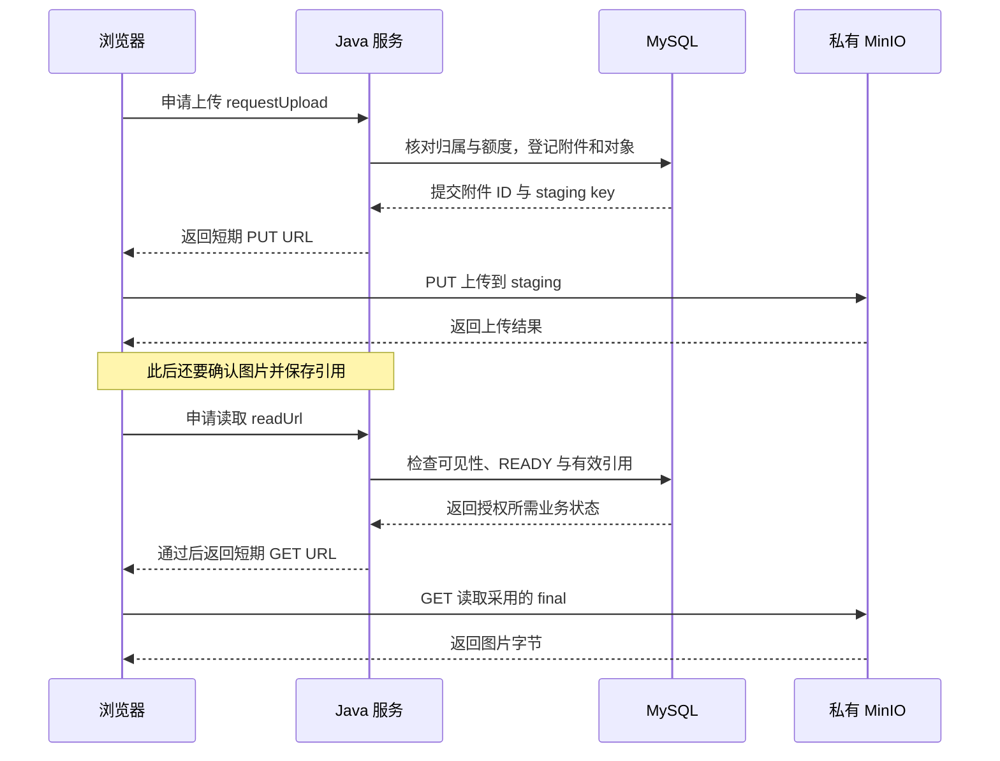
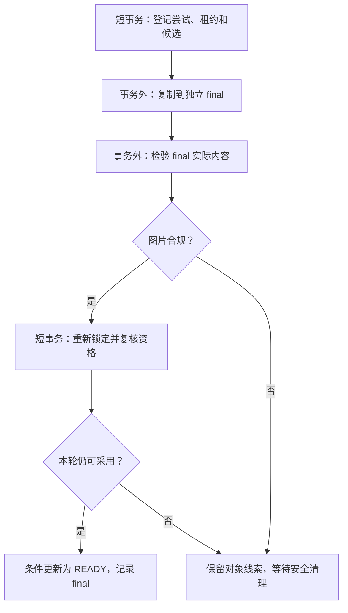
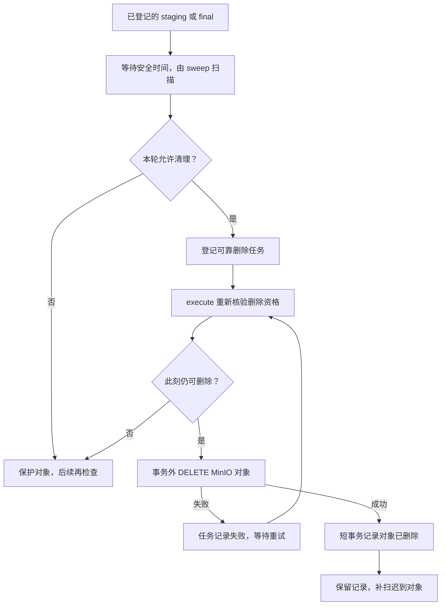
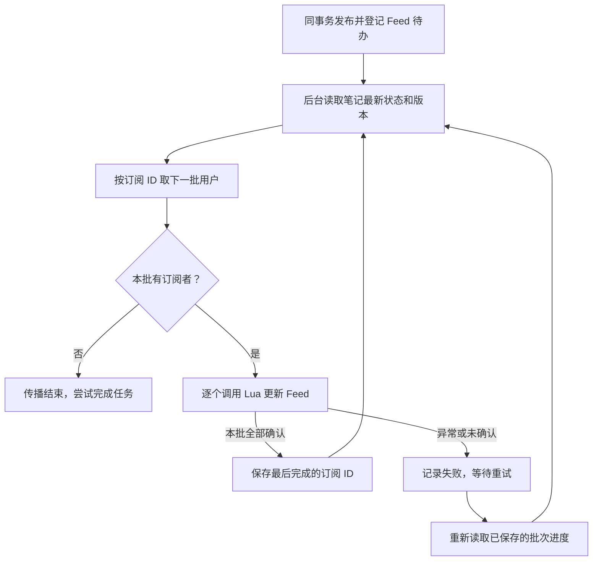
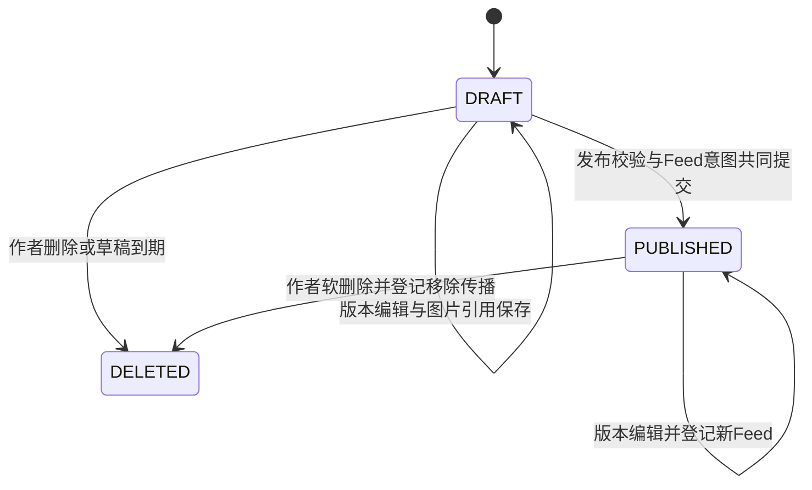
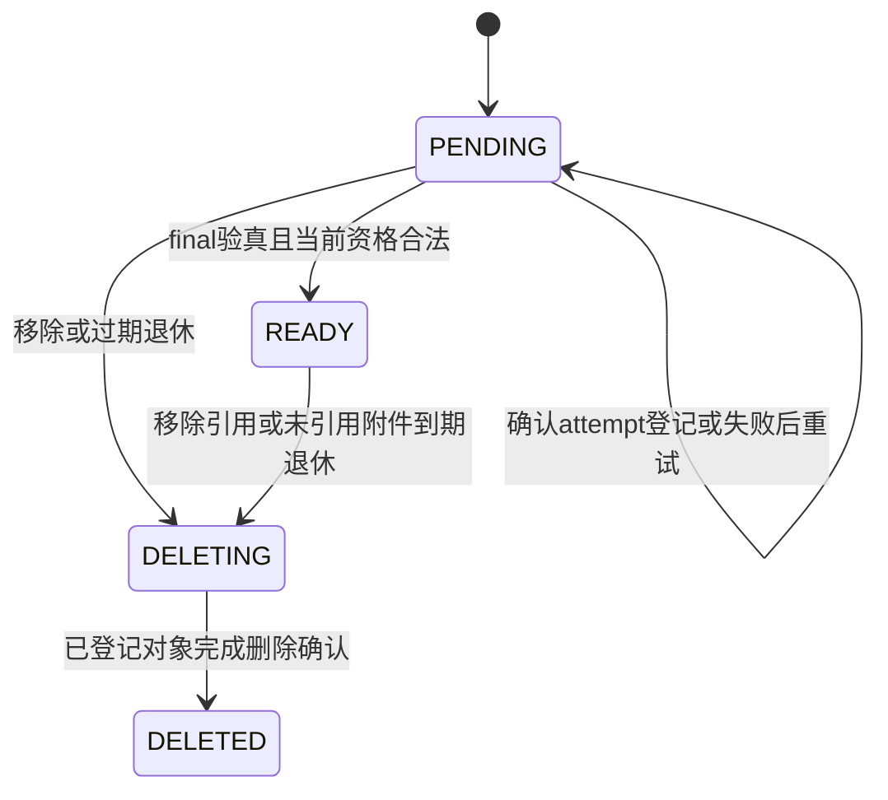
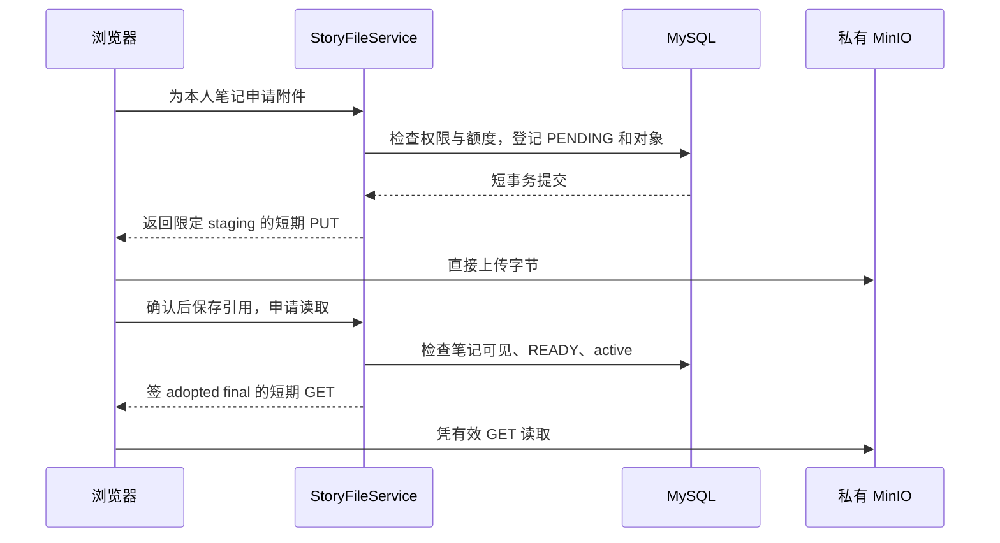
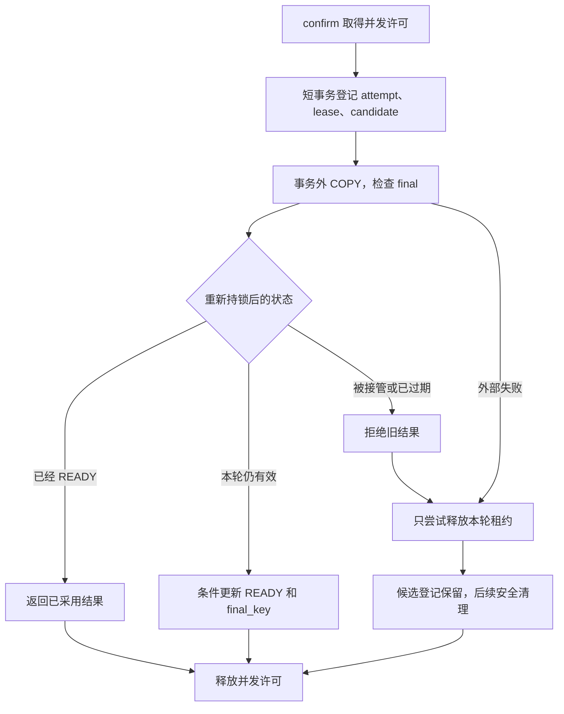
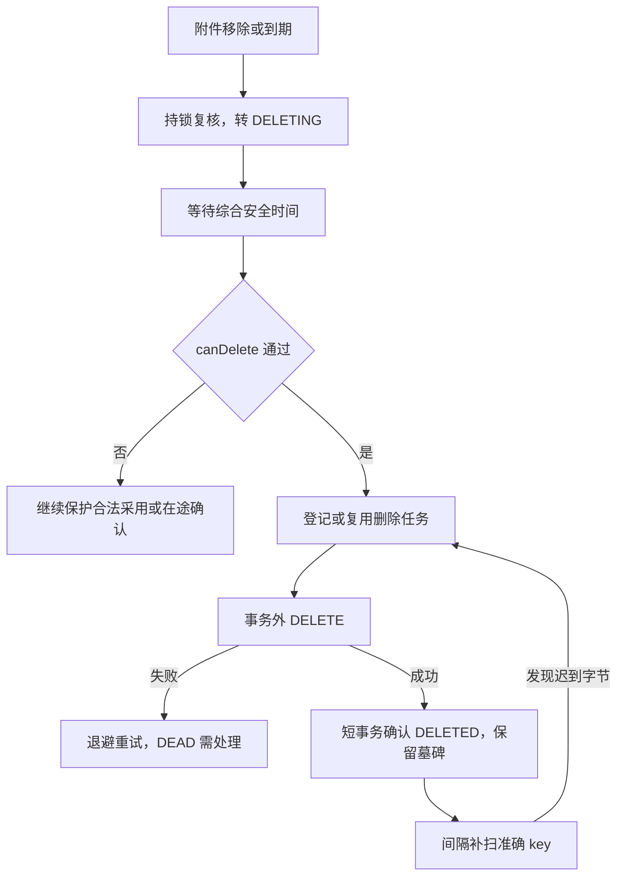
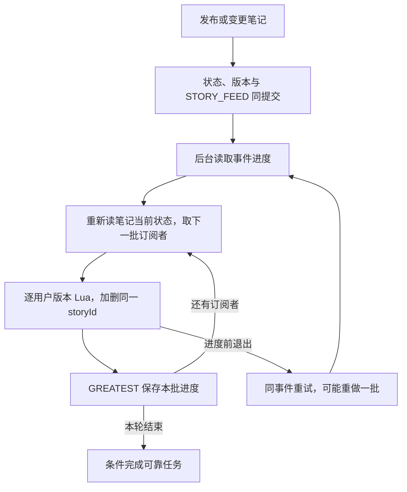

# CityPass 学习文档三：活动笔记发布与文件管理

> 修订日期：2026-10-31。第一部分按副项目面试权重展开完整流程，每节保留 3～4 段核心代码与口述答案；详细 SQL、参数和故障边界继续放到第二部分按需细读。
>
> 源码依据仍见各段固定版本链接。本次只调整学习文档，没有重新运行整套 MinIO、MySQL、Redis 验收；历史测试记录与当前实现边界分别说明。

## 先看简历：这一点需要讲清四件事

> **活动笔记发布与文件管理：** 基于私有 MinIO 与短期签名 URL 实现图片直传和授权读取；通过 staging/final 分离、图片检验及租约/尝试号控制并发确认，结合持久对象登记与延迟回收实现失败补偿；发布事务内登记 Feed 任务，利用版本控制和批次进度保障异步更新可重试。

| 简历中的重点 | 第一遍要掌握的结论 |
| --- | --- |
| 私有 MinIO + 短期签名 URL | 后端控制权限，浏览器直接传字节；读图片也先经业务授权 |
| staging/final + 验图 + 租约／尝试号 | 正式对象与旧上传链接隔离，只有当前合法尝试可以采用结果 |
| 持久登记 + 延迟回收 | 外部操作前留下对象线索，失败或不用的文件由后台安全清理 |
| 发布事务 + Feed 版本与进度 | 发布不丢传播意图，重试既能防旧状态回退，也能从批进度继续 |

**学习顺序：** 先按第一部分的流程图讲顺“上传 → 确认 → 保存引用与发布 → 失败恢复”，再看各步骤旁的核心代码。第一部分四节分别保留 3、4、4、4 段代码；遇到细节追问再读第二部分，最后用第三部分的 15 道题检查能否口述。

- [第一部分：简历必讲的四个重点](#part-1)
- [1.1 图片直传与授权读取](#resume-1)
- [1.2 图片确认与并发采用](#resume-2)
- [1.3 失败文件怎样回收](#resume-3)
- [1.4 发布与 Feed 怎样可靠重试](#resume-4)
- [第二部分：补充与按需细读](#part-2)
- [2.7 直传与读取的完整源码](#detail-upload)
- [2.8 确认、验图与租约的完整源码](#detail-confirm)
- [2.9 延迟回收与清理补偿的完整源码](#detail-cleanup)
- [2.10 发布、版本与进度的完整源码](#detail-feed)
- [第三部分：15 道面试问答](#part-3)
- [最后复习：口述与源码导航](#review)

相关文档：[01 异步预约与候补调度](https://github.com/SyH-101/citypass-platform/blob/main/01-异步预约与候补调度.md)、[02 多级缓存一致性](https://github.com/SyH-101/citypass-platform/blob/main/02-多级缓存一致性.md)。

<a id="part-1"></a>

## 第一部分：简历必讲的四个重点

这一部分的目标是让你讲顺完整业务过程，并记住支撑设计的核心代码。**每节保留 3～4 段代码，不需要背长 SQL 和 SDK 参数。** 先理解“这一步处理什么、为什么需要、完成后进入什么阶段”，再看代码里的判断和调用。

沿一个例子读：用户给活动笔记加一张照片，先申请上传并把照片传到 MinIO；后端确认这是一张合规图片，再将它保存为可用附件；用户保存图片引用、发布笔记；后台把这篇笔记更新到订阅者 Feed。上传失败、不再使用或未被采用的对象，走另一条清理链。

| 组件或业务状态 | 在这条链中的含义 |
| --- | --- |
| MinIO | 保存真实文件字节；文件存在不等于已经确认或公开 |
| MySQL | 保存笔记、附件、引用、对象 key、可靠任务与处理进度 |
| Redis Feed | 保存每个用户的信息流候选笔记 ID 与版本，正文仍以 MySQL 为准 |
| 附件 PENDING → READY | 从等待上传确认，到正式候选通过检查并被数据库采用 |
| active 图片引用 | 表示这篇笔记正在使用该附件，READY 不会自动建立引用 |
| 笔记 DRAFT → PUBLISHED | 内容正式发布；Feed 的异步更新随后继续进行 |

**四节的分工：** 1.1 讲谁能上传和读取；1.2 讲上传的东西怎样成为可用附件；1.3 讲外部文件操作失败后怎样收尾；1.4 讲发布后怎样可靠更新 Feed。

<a id="resume-1"></a>

### 1.1 图片直传与授权读取

**对应简历：** “基于私有 MinIO 与短期签名 URL 实现图片直传和授权读取”。

**本节重点：后端先确认业务权限并登记上传会话，再给临时权限；浏览器直接向 MinIO 传字节，读取图片也先经过业务授权。**

#### 先看完整流程：Java 管权限，MinIO 接收和返回字节

用户已经有一篇自己的草稿。浏览器请求申请上传，Java 检查登录用户、笔记归属、存活状态和图片额度；检查通过后，在数据库保存附件和随机 staging key，再签发短期 PUT URL。浏览器拿这个地址上传图片，文件字节直接进入 MinIO。



图中上传申请进入 `StoryFileService.requestUpload`，读取申请进入 `StoryFileService.readUrl`，签名底层由 `MinioObjectStorage` 完成。中间的确认与引用保存由另外的接口触发，1.2 会接着讲；**PUT 成功只能说明字节传上去了。**

#### 申请上传：为什么先登记，再把地址给浏览器

如果先给地址、后登记，用户已经传了文件但应用退出，数据库可能没有留下这个 key，后台就不知道该追踪和清理什么。当前实现先在一个短事务里完成登记，再签地址。

下面这段执行前，方法已经核对用户与笔记，并生成随机 `stagingKey`、计算 `uploadDeadline`。两次数据库写入分别保存附件业务记录、准确的存储对象记录；后者也为 1.3 的失败清理留下线索。

<a id="core-upload-register"></a>

**关键代码：先保存附件与 staging 对象记录**

**功能：** 在同一短事务中保存附件记录和对象 key，让上传字节之前就有可追踪的业务记录。

**源码文件：** `src/main/java/com/citypass/story/StoryFileService.java`  
**所属方法：** `StoryFileService.requestUpload`；[查看固定版本源码](https://github.com/SyH-101/citypass-platform/blob/3103a6f64046f040bf88c01f2cf40f86474018cf/src/main/java/com/citypass/story/StoryFileService.java#L69-L82)。以下为真实方法中的教学注释版节选，省略部分见链接。

```java
long id =                                                                                                                               // 接收新建附件的 ID
        storyTransactions.insert(                                                                                                       // 向数据库插入附件记录
                "INSERT INTO tb_story_attachment(user_id,story_id,staging_key,expires_at,upload_url_expires_at) VALUES(?,?,?,?,?)",     // 记录归属、staging key、会话与上传凭证期限
                userId,                                                                                                                 // 绑定当前登录用户
                storyId,                                                                                                                // 绑定已核对归属的笔记
                stagingKey,                                                                                                             // 保存后端生成的随机 staging key
                uploadDeadline,                                                                                                         // 设置上传会话截止时间
                uploadDeadline);                                                                                                        // 持久保存上传 URL 的最晚到期时间
storyTransactions.jdbcTemplate.update(                                                                                                  // 同时登记需要追踪的对象
        "INSERT INTO tb_story_file_object(attachment_id,object_key,kind,cleanup_after) VALUES(?,?,'STAGING',?)",                        // 把这个 key 记为 STAGING 对象
        id,                                                                                                                             // 关联刚创建的附件
        stagingKey,                                                                                                                     // 登记即将允许上传的准确对象 key
        uploadDeadline.plusSeconds(                                                                                                     // 从上传授权截止时间开始计算清理安全时间
                storyFileProperties.getCleanupGraceSeconds()));                                                                         // 额外留出清理宽限时间
```


这里记住**附件表记录业务会话，对象表记录具体 key**。`upload_url_expires_at` 持久保存最晚上传授权时间；事务提交后，签名使用距这个截止时间的剩余秒数，避免签名阶段的延迟让 URL 超过数据库记录的清理边界。完整剩余时间计算见 [2.7](#detail-upload)。

#### 签名怎样限制权限：对象、方法和期限

业务层用 `signPut(stagingKey, remainingSeconds)` 申请上传地址，最后进入下面的签名方法。`ObjectStorage` 是业务使用的存储封装，底层 MinIO SDK 负责生成预签名 URL。

<a id="code-f-minio-sign"></a>

**代码 03：把对象、方法和期限绑定到签名**

**功能：** 使用面向浏览器的 MinIO 客户端，为指定 bucket、key、HTTP 方法和有效期生成预签地址。

**源码文件：** `src/main/java/com/citypass/storage/MinioObjectStorage.java`  
**所属类／方法：** `MinioObjectStorage.sign`；[查看固定版本源码](https://github.com/SyH-101/citypass-platform/blob/48ab46bb3c6484151c8dc61cfdb928d875928d12/src/main/java/com/citypass/storage/MinioObjectStorage.java#L67-L75)。以下为教学注释版节选，保留原语句与关键条件。

```java
private String sign(String key, Method method, int seconds) throws Exception {  // 统一签发指定方法和期限的对象 URL
    return signingClient.getPresignedObjectUrl(                                 // 使用面向浏览器地址的签名客户端
            GetPresignedObjectUrlArgs.builder()                                 // 构建 MinIO 预签参数
                    .bucket(bucket)                                             // 仅针对配置的私有 bucket
                    .object(key)                                                // 仅针对后端决定的对象 key
                    .method(method)                                             // 明确 PUT 或 GET 权限
                    .expiry(seconds)                                            // 设置短期有效秒数
                    .build());                                                  // 构建并生成签名地址
}                                                                               // 结束签名方法
```


最需要记的是 `object(key)`、`method(method)`、`expiry(seconds)`。浏览器得到的是**特定对象、特定 HTTP 方法、限定时间内的访问能力**，长期存储凭据保留在服务端。PUT URL 在有效期内仍可复用，因此后面才需要 staging/final 分离；返回给前端的大小提示也不能替代后端对实际文件的检查。

#### 读取也要授权：知道附件 ID，并不自动有权拿图片

bucket 保持私有，应用不会把任意对象都变成永久公开地址。用户申请图片 URL 时，先看笔记是否对当前用户可读，再看附件是否 READY、属于这篇笔记并被有效引用，最后为已采用的 final 签短期 GET。

<a id="core-authorized-read"></a>

**关键代码：先查业务权限与引用，再签 GET**

**功能：** 要求笔记对当前访问者可读、附件属于该笔记且 READY，并存在有效引用，然后签发正式对象的短期读取地址。

**源码文件：** `src/main/java/com/citypass/story/StoryFileService.java`  
**所属方法：** `StoryFileService.readUrl`；[查看固定版本源码](https://github.com/SyH-101/citypass-platform/blob/3103a6f64046f040bf88c01f2cf40f86474018cf/src/main/java/com/citypass/story/StoryFileService.java#L299-L321)。以下为真实方法中的教学注释版节选，省略部分见链接。

```java
public String readUrl(long storyId, long id, Long userId) {                                                             // 接收笔记、附件和当前访问者
    Map<String, Object> story = storyTransactions.story(storyId, false);                                                // 读取笔记的业务状态
    assertReadable(story, userId);                                                                                      // 检查公开可读或作者本人有权读取
    Map<String, Object> attachment = storyTransactions.attachment(id, false);                                           // 读取附件当前状态
    long activeReferenceCount =                                                                                         // 准备统计当前有效引用
            storyTransactions.jdbcTemplate.queryForObject(                                                              // 查询这篇笔记是否仍在使用这个附件
                    "SELECT COUNT(*) FROM tb_story_attachment_ref WHERE story_id=? AND attachment_id=? AND active=1",   // 只统计 active=1 的对应关系
                    Long.class,                                                                                         // 按整数接收引用数量
                    storyId,                                                                                            // 限定这篇笔记
                    id);                                                                                                // 限定这个附件
    if (activeReferenceCount != 1                                                                                       // 必须恰好存在一条有效引用
            || number(attachment, "story_id") != storyId                                                                // 附件归属也必须与请求笔记相同
            || !"READY".equals(attachment.get("state"))) {                                                              // 附件必须已经确认成 READY
        throw StoryProblem.missing();                                                                                   // 任一条件不满足就拒绝提供地址
    }                                                                                                                   // 结束附件读取资格检查

    try {                                                                                                               // 开始生成对象存储地址
        return objectStorage.signGet(                                                                                   // 只为正式对象签 GET
                (String) attachment.get("final_key"), storyFileProperties.getReadSeconds());                            // 使用已采用的 final key 和配置的短期时长
    } catch (Exception exception) {                                                                                     // 捕获存储签名失败
        throw new StoryProblem(503, "图片访问链接暂不可用");                                                            // 返回可重试的服务错误
    }                                                                                                                   // 结束签名处理
}                                                                                                                       // 结束读取地址方法
```


`assertReadable` 允许公开笔记被读取，也允许作者读取自己的存活草稿；其后 `activeReferenceCount`、`story_id` 和 `READY` 三个条件一起约束附件。**READY 但没有被这篇笔记有效引用，也不能经这个接口拿到地址。** 草稿图片不会仅因为确认成功就向所有人公开。

已签 GET 是临时授权，链接被拿到后在有效期内可能继续使用；删除笔记会阻止新的授权，不能立刻撤销所有已签链接。

#### 面试时可以这样说

> 我把图片字节传输和业务授权分开。用户先有自己的笔记，再向后端申请上传。后端检查登录身份、笔记归属与额度，在一个短事务里保存附件会话和随机 staging key，提交以后才签短期 PUT。浏览器随后直接把字节传给私有 MinIO，Java 不用中转整份图片，数据库也在外部上传前留下了可追踪记录。
>
> 预签名约束的是对象 key、HTTP 方法和有效期。客户端拿不到长期存储凭据，也不能用这份地址随意操作其他对象。上传 URL 的截止时间已经存进数据库，真正签名时使用剩余有效时间，避免延长后台清理所依赖的授权边界。
>
> 读图片也要先经过应用。应用检查笔记对当前访问者可读，附件属于这篇笔记、已经 READY，并且存在有效引用，然后只为采用的 final 签短期 GET。上传完成、确认 READY、被笔记引用和正式发布是不同阶段。边界是 URL 在有效期内可以复用，已发出的读取地址也可能继续有效到期，所以不能承诺删除后所有旧链接瞬时失效。

**本节记忆：** 检查权限并登记 → 签短期 PUT → 浏览器直传 → 确认并保存引用 → 再授权短期 GET。重点记签名的三个约束和读取前的业务检查。

<a id="resume-2"></a>

### 1.2 图片确认与并发采用

**对应简历：** “通过 staging/final 分离、图片检验及租约/尝试号控制并发确认”。

**本节重点：把用户仍可改写的上传区，与后端采用的正式对象隔开；先检查独立候选的真实内容，再确认本轮仍有资格把它采用为 READY。**

#### 先看为什么：一次上传成功，还留下哪两个问题

第一个问题是旧 PUT 链接可能继续覆盖 staging。如果直接把 staging 当作正式图片，即使刚检查过内容，用户仍可能用旧链接换掉字节。因此后端每轮确认都复制到一个独立 final key，客户端只拿过 staging 的写权限，没有这个 final 的 PUT 权限。

第二个问题是 COPY、下载和解码需要时间。不能一直拿着数据库锁做这些外部操作，所以确认分成两次短事务；中间释放锁后，就需要在最后重新确认这轮有没有失去资格。

| 机制 | 负责处理什么 |
| --- | --- |
| staging/final 分离 | 旧上传链接继续改写 staging，也不会直接改掉已采用 final |
| 检查 final 的真实内容 | 不相信文件名和 Content-Type，判断复制结果能否作为图片使用 |
| attempt 尝试号 | 标识当前是哪一轮确认，防止旧轮次迟到覆盖新结果 |
| lease 确认租约 | 规定本轮采用结果的有效期；超时以后不能继续按旧资格提交 |

#### 流程图：登记资格、外部处理、复核采用



这条链在 `StoryFileService.confirmWithPermit` 中完成：前后两段是 `inTransaction`，中间调用 `objectStorage.copy`、打开 final，并交给 `ImageInspector.inspect`。COPY 或读取失败也会走失败收尾；已采用的 READY 结果会直接返回，图中的“本轮资格”判断针对仍待采用的 PENDING 附件。

#### 前一个短事务：明确本轮身份，并提前登记候选

方法先核对归属、笔记存活、附件状态和上传会话期限。如果上一轮租约仍有效，会返回“正在确认”；可以开启新轮次时，生成唯一 `confirmationAttempt`，用它组成独立 final key，并计算租约截止时间。

下面两次更新在同一事务里执行。先登记候选对象，再记录当前确认资格，提交之后才允许开始 COPY。

<a id="core-confirm-register"></a>

**关键代码：COPY 前先登记候选对象和确认资格**

**功能：** 将本轮 final key 与 attempt 先持久保存，再把 attempt 和租约写进附件行；事务提交后才开始外部 COPY。

**源码文件：** `src/main/java/com/citypass/story/StoryFileService.java`  
**所属方法：** `StoryFileService.confirmWithPermit`；[查看固定版本源码](https://github.com/SyH-101/citypass-platform/blob/3103a6f64046f040bf88c01f2cf40f86474018cf/src/main/java/com/citypass/story/StoryFileService.java#L164-L175)。以下为真实方法中的教学注释版节选，省略部分见链接。

```java
storyTransactions.jdbcTemplate.update(                                                                                          // 先登记本轮可能生成的正式候选
        "INSERT INTO tb_story_file_object(attachment_id,object_key,attempt_id,kind,cleanup_after) VALUES(?,?,?,'FINAL',?)",     // 保存附件、final key、尝试号和最早清理时间
        id,                                                                                                                     // 关联当前附件
        key,                                                                                                                    // 记录本轮独立的 final key
        confirmationAttempt,                                                                                                    // 记录本轮唯一尝试号
        confirmationLeaseUntil.plusSeconds(                                                                                     // 清理时间不得早于确认租约截止
                storyFileProperties.getCleanupGraceSeconds()));                                                                 // 在租约截止后再留清理宽限时间
storyTransactions.jdbcTemplate.update(                                                                                          // 把本轮资格写回附件
        "UPDATE tb_story_attachment SET current_attempt=?,confirm_lease_until=? WHERE id=? AND state='PENDING'",                // 仅对 PENDING 附件设置当前尝试和租约
        confirmationAttempt,                                                                                                    // 以本轮尝试号标记当前持有者
        confirmationLeaseUntil,                                                                                                 // 设置本轮允许提交采用结果的截止时间
        id);                                                                                                                    // 限定当前附件
```


这里记住**本轮 final key 和尝试号在外部操作前已经存下来了**。即使进程在 COPY 成功后退出，数据库仍知道这个候选对象在哪里。下一轮可以生成另一个 final key，两个线程的字节不会互相覆盖，最后再由数据库决定采用谁。

#### 事务外：先复制，再检查这份 final 的实际内容

<a id="core-confirm-copy"></a>

**关键代码：复制到独立 final，再读取它做检验**

**功能：** 先限制 staging 的实际大小，再复制到本轮独立 final，并检查这份 final 的实际内容。该段位于两次数据库短事务之间。

**源码文件：** `src/main/java/com/citypass/story/StoryFileService.java`  
**所属方法：** `StoryFileService.confirmWithPermit`；[查看固定版本源码](https://github.com/SyH-101/citypass-platform/blob/3103a6f64046f040bf88c01f2cf40f86474018cf/src/main/java/com/citypass/story/StoryFileService.java#L187-L197)。以下为真实方法中的教学注释版节选，省略部分见链接。

```java
long stagingSize = objectStorage.size((String) claim.get("staging_key"));   // 查询 staging 对象的实际字节数
if (stagingSize <= 0 || stagingSize > storyFileProperties.getMaxBytes()) {  // 拒绝空对象和超过大小上限的对象
    throw new StoryProblem(422, "上传对象实际大小超过限制或为空");          // 返回图片不符合限制的业务错误
}                                                                           // 结束 staging 大小检查

objectStorage.copy((String) claim.get("staging_key"), finalObjectKey);      // 由服务端复制到本轮独立 final key
long finalSize = objectStorage.size(finalObjectKey);                        // 查询复制结果的实际字节数
ImageInspector.Info imageInfo;                                              // 准备接收真实图片检查结果
try (InputStream input = objectStorage.open(finalObjectKey)) {              // 打开 final 对象的内容流，结束后自动关闭
    imageInfo = imageInspector.inspect(input, finalSize);                   // 校验 final 的实际内容并取得格式和尺寸
}                                                                           // 关闭读取流
```


检查对象是复制后的 final。这样即使 staging 被旧 PUT 改写，已经复制出的候选仍然需要独立通过检验。代码先限制实际字节数，`inspect` 还会读取内容、核对实际长度，再识别真实格式和尺寸。

下面是验图最值得掌握的判断：JPEG/PNG、尺寸与像素上限，以及真正解码。完整读取缓冲、异常与资源释放细节见 [2.8](#detail-confirm)。

<a id="core-confirm-inspect"></a>

**关键代码：按真实格式和尺寸检查，并实际解码**

**功能：** 在已根据实际字节创建 ImageReader 后，限制格式、尺寸和总像素，再通过真实解码确认内容可用。

**源码文件：** `src/main/java/com/citypass/story/ImageInspector.java`  
**所属方法：** `ImageInspector.inspect`；[查看固定版本源码](https://github.com/SyH-101/citypass-platform/blob/3103a6f64046f040bf88c01f2cf40f86474018cf/src/main/java/com/citypass/story/ImageInspector.java#L63-L84)。以下为真实方法中的教学注释版节选，省略部分见链接。

```java
reader.setInput(stream, true, true);                                            // 让解码器读取实际图片字节
String format = reader.getFormatName().toLowerCase(Locale.ROOT);                // 从内容识别真实格式并统一大小写
if (!format.equals("jpeg") && !format.equals("png")) {                          // 只接受 JPEG 和 PNG 内容
    throw new StoryProblem(422, "仅支持 JPEG 和 PNG 图片内容");                 // 拒绝扩展名看似图片而实际格式不合规的文件
}                                                                               // 结束格式判断

int width = reader.getWidth(0), height = reader.getHeight(0);                   // 读取图片宽度和高度
if (width <= 0                                                                  // 宽高必须为正数
        || height <= 0                                                          // 继续检查高度有效性
        || width > limits.getMaxDimension()                                     // 宽度不能超过限制
        || height > limits.getMaxDimension()                                    // 高度不能超过限制
        || (long) width * height > limits.getMaxPixels()) {                     // 总像素不能超过上限，先转 long 避免乘法溢出
    throw new StoryProblem(422, "图片尺寸或像素数量超过限制");                  // 拒绝尺寸或像素量超限
}                                                                               // 结束尺寸检查
// Decode after checking dimensions; headers alone do not prove a valid image.  // 源码说明：先限制尺寸，再实际解码验证内容
BufferedImage decoded = reader.read(0);                                         // 实际解码第一帧，不能只信头部信息
if (decoded == null) {                                                          // 检查解码结果是否存在
    throw new StoryProblem(422, "图片解码失败");                                // 拒绝无法解码的图片
}                                                                               // 结束解码结果检查

decoded.flush();                                                                // 释放已解码图像占用的资源
return new Info(format, total, width, height);                                  // 返回真实格式、字节数和尺寸
```


尺寸检查放在完整解码前，能避免仅凭一个“小文件”就无条件分配巨大的解码资源。实际解码则用于发现只有合法头部、但内容损坏的文件。这里做的是图片有效性和资源限制检查，当前没有内容审核或防病毒流程。

#### 后一个短事务：验图通过以后，还要检查谁有采用资格

外部操作结束后，再锁笔记和附件、检查笔记仍存活。若附件已经 READY，会返回已有正式结果；若仍是 PENDING，就检查本轮尝试号和租约。

<a id="core-confirm-check"></a>

**关键代码：最终采用前检查三个条件**

**功能：** 对仍待确认的附件，要求状态仍为 PENDING、尝试号仍属于本轮、租约仍有效；否则拒绝采用。

**源码文件：** `src/main/java/com/citypass/story/StoryFileService.java`  
**所属方法：** `StoryFileService.confirmWithPermit`；[固定版本源码](https://github.com/SyH-101/citypass-platform/blob/d4b0648baa7f10e5b17fd616d0be2b7fe762744a/src/main/java/com/citypass/story/StoryFileService.java#L210-L215)。以下为节选，采用更新的详细节选见[代码 09](#code-f-adopt)。

```java
if (!"PENDING".equals(attachment.get("state"))                              // 重新持锁后确认附件仍可被采用
        || !confirmationAttempt.equals(attachment.get("current_attempt"))   // 必须仍由本轮尝试持有确认资格
        || !time(attachment, "confirm_lease_until")                         // 还要读取当前确认租约
                .isAfter(LocalDateTime.now())) {                            // 租约此刻必须仍有效
    throw StoryProblem.conflict("确认租约已失效，请重试");                  // 资格已丢失就拒绝本轮结果
}                                                                           // 结束采用资格复核
```


资格通过以后，同一短事务用带 `PENDING + current_attempt` 条件的 UPDATE 写入 READY、final key 和真实图片信息，并校验影响一行。长 SQL 不需要背，完整采用语句见 [2.8 的采用代码](#code-f-adopt)。**检查资格与写入采用结果发生在同一个持锁事务里。**

用一次并发交错记住它：线程甲登记尝试甲后卡在 COPY，租约过期；线程乙开启尝试乙并采用成功。甲后来完成 COPY，再进数据库时，可能直接看到并返回乙已采用的 READY 结果，也可能在仍待确认时因尝试号或租约不匹配而被拒绝；它都不能把自己的候选覆盖上去。租约不会强行停止甲的外部 COPY，没被采用的对象由 1.3 继续回收。

确认成功以后，用户还需要通过版本化编辑保存附件引用，再执行发布。READY 说明附件可用，不会自动写入有效引用，也不会自动把草稿公开。

#### 面试时可以这样说

> 图片确认主要解决上传内容能不能用，以及并发时哪个结果能被采用。浏览器先写 staging，旧上传链接在有效期内还可能覆盖它，所以后端确认时复制到每轮独立的 final key，并只检查和采用这个 final。正式对象的写权限没有交给客户端，旧 PUT 就不能直接覆盖已采用图片。
>
> 确认分成短事务登记、事务外处理、短事务采用三段。前一个事务检查附件，生成 attempt 和租约，并在 COPY 前持久登记候选 key；中间释放数据库锁，完成 COPY、实际字节读取、格式与尺寸检查和解码，避免把外部耗时操作放进长事务。
>
> 最后重新拿锁，检查笔记和附件状态。已经 READY 就返回现有结果；仍待确认时，要求当前尝试号匹配、租约仍有效，再条件更新为 READY。这样旧线程即使后来完成 COPY，也不能覆盖新轮次的正式结果。COPY 成功只是生成了候选，数据库采用成功才算附件就绪；未采用候选仍有登记，后台会在安全时间后处理。

**本节记忆：** 登记本轮身份和候选 → 事务外 COPY 并验图 → 重新核对状态、尝试号和租约 → 采用 READY。重点记三个资格条件，以及外部操作不放在长事务里。

<a id="resume-3"></a>

### 1.3 失败文件怎样回收

**对应简历：** “结合持久对象登记与延迟回收实现失败补偿”。

**本节重点：MinIO 操作不能跟着 MySQL 一起回滚，所以外部操作前先登记 key；清理时先撤可用资格、等待安全时间，再复核并删除，失败交给可靠任务。**

#### 先看三种失败，理解为什么需要这条清理链

| 具体场景 | 数据库里留下什么线索 | 后面怎样处理 |
| --- | --- | --- |
| 申请了上传，但用户没完成后续步骤 | 附件会话与 staging 对象记录 | 会话到期后退休附件，再到安全时间清理 |
| COPY 已成功，但事务没采用这个 final | COPY 前登记的本轮 final 候选 | 判断它不再受正式结果或有效租约保护后回收 |
| 用户移除图片或删除笔记 | 引用与附件状态、已登记的相关对象 | 先停用，再延迟删除字节；失败继续重试 |

前两节已经完成“先登记 key”。这一节不要求你背清理扫描 SQL，重点是看懂：**对象有记录，也不能仅凭“看起来没在用”就直接删。**

#### 流程图：从退休或闲置对象，到可靠删除



失效候选可以按对象记录清理；正在被使用的正式附件，则先通过移除引用、删除笔记或到期退休撤销业务资格。图中的 `sweep`、`canDelete`、`execute` 都位于 `StoryFileCleanup`；可靠任务负责让删除失败以后还有后续执行机会。

#### 先退休、再等安全时间：为什么不能移除就立刻删字节

用户已经拿到的 GET URL 可能还有效，旧 PUT 也可能仍在进行，确认线程还可能持有租约。直接 DELETE 容易打断尚在有效窗口内的使用，或者刚删完又出现迟到字节。

`retireAttachment` 会先计算安全时间，覆盖读取授权等待、上传授权截止加宽限，以及现有确认租约加宽限。下面只看它最后的两次更新：先把附件转成 DELETING，再把对象清理时间向后推。

<a id="core-cleanup-retire"></a>

**关键代码：撤销可用状态，并推迟对象清理时间**

**功能：** 在已经按顺序锁定笔记和附件后，把附件转为 DELETING，并把关联对象的清理时间推进到安全时间之后。

**源码文件：** `src/main/java/com/citypass/story/StoryTransactions.java`  
**所属方法：** `StoryTransactions.retireAttachment`；[查看固定版本源码](https://github.com/SyH-101/citypass-platform/blob/3103a6f64046f040bf88c01f2cf40f86474018cf/src/main/java/com/citypass/story/StoryTransactions.java#L155-L162)。以下为真实方法中的教学注释版节选，省略部分见链接。

```java
jdbcTemplate.update(                                                                                                    // 先更新附件的业务资格
        "UPDATE tb_story_attachment SET state='DELETING',delete_after=? WHERE id=? AND state IN ('PENDING','READY')",   // 把待上传或就绪附件转入 DELETING，并记录延迟删除时间
        cleanupAfter,                                                                                                   // 写入前面计算好的安全时间
        id);                                                                                                            // 限定当前附件
jdbcTemplate.update(                                                                                                    // 同步调整已登记对象的清理门槛
        "UPDATE tb_story_file_object SET cleanup_after=GREATEST(cleanup_after,?) WHERE attachment_id=?",                // 只能延后清理时间，不能把已有更晚时间改早
        cleanupAfter,                                                                                                   // 传入本轮安全时间
        id);                                                                                                            // 处理该附件登记的所有对象
```


DELETING 状态会阻止后续确认或重新绑定；`GREATEST` 保证延后清理，不会把原来更晚的期限改早。确切时间计算放在 [2.9](#detail-cleanup)，第一遍记住“先停用，再等已有授权与确认的安全窗口”。

#### 删除前复核：怎样避免把正式图片误删

扫描第一次查到候选，只是找到了待检查对象。登记任务和实际执行时还要持锁复核，尤其保护这两种对象：附件已经 READY 且正采用这个 final；或者本候选仍属于当前有效确认轮次。

<a id="core-cleanup-guard"></a>

**关键代码：删除前保护已采用 final 和有效确认尝试**

**功能：** 扫描登记任务和真正执行删除时都会使用此判断；安全时间未到、正式结果正在使用或当前尝试租约有效，都不允许清理。

**源码文件：** `src/main/java/com/citypass/story/StoryFileCleanup.java`  
**所属方法：** `StoryFileCleanup.canDelete`；[查看固定版本源码](https://github.com/SyH-101/citypass-platform/blob/3103a6f64046f040bf88c01f2cf40f86474018cf/src/main/java/com/citypass/story/StoryFileCleanup.java#L160-L179)。以下为真实方法中的教学注释版节选，省略部分见链接。

```java
boolean canDelete(Map<String, Object> fileObject, Map<String, Object> attachment) {             // 判断这条对象记录目前是否允许物理删除
    if (time(fileObject, "cleanup_after").isAfter(LocalDateTime.now())) {                       // 如果还没到最早安全时间
        return false;                                                                           // 保持对象，稍后再判断
    }                                                                                           // 结束时间检查

    if ("READY".equals(attachment.get("state"))                                                 // 如果附件已经 READY
            && fileObject.get("object_key").equals(attachment.get("final_key"))) {              // 而本对象正是它采用的 final
        return false;                                                                           // 保护当前正式图片，拒绝删除
    }                                                                                           // 结束已采用对象检查

    if ("FINAL".equals(fileObject.get("kind"))                                                  // 如果对象是一个 FINAL 候选
            && "PENDING".equals(attachment.get("state"))                                        // 而附件仍在等待确认
            && Objects.equals(fileObject.get("attempt_id"), attachment.get("current_attempt"))  // 候选尝试号仍然等于当前确认轮次
            && attachment.get("confirm_lease_until") != null                                    // 并且存在确认租约
            && time(attachment, "confirm_lease_until").isAfter(LocalDateTime.now())) {          // 租约此刻仍然有效
        return false;                                                                           // 保护仍有资格被采用的候选
    }                                                                                           // 结束有效确认尝试检查

    return true;                                                                                // 以上保护均不命中，允许后续清理
}                                                                                               // 结束可删除判断
```


这段值得看懂三个“返回 false”：**时间没到；它就是已采用 final；它还是当前有效租约下的候选。** 不是简单用“没有引用”判断对象可删。例如刚确认、还没保存引用的 READY final 也不能在这里直接删除，要先由到期或移除流程把附件退休。

执行阶段在短事务中按笔记、附件的锁顺序重新检查，通过后才把 key 带到事务外做 DELETE。此时候选已经失去确认资格，或附件已经进入不能重新绑定的清理状态，防止释放锁以后又合法变成正在使用的正式结果；完整锁定过程见 [2.9](#detail-cleanup)。

#### 可靠任务接手：删除失败和数据库确认失败分别怎么办

扫描器确认对象可清理后，先登记任务。这里 payload 是对象登记表的 ID，不让客户端随意传一个 key 就触发删除。

<a id="core-cleanup-enqueue"></a>

**关键代码：把删除工作交给可靠任务**

**功能：** 扫描器核验可删除后，用本轮业务键登记删除任务；payload 保存对象登记表的 ID，执行时据此重新查询准确 key。

**源码文件：** `src/main/java/com/citypass/story/StoryFileCleanup.java`  
**所属方法：** `StoryFileCleanup.sweep`；[查看固定版本源码](https://github.com/SyH-101/citypass-platform/blob/3103a6f64046f040bf88c01f2cf40f86474018cf/src/main/java/com/citypass/story/StoryFileCleanup.java#L137-L142)。以下为真实方法中的教学注释版节选，省略部分见链接。

```java
String cleanupRound = UUID.randomUUID().toString();             // 为本次清理轮次生成标识
String key = "delete-story-file:" + id + ":" + cleanupRound;    // 对象记录 ID 与轮次组成删除任务业务键
storyTransactions.reliableTaskRepository.enqueue(               // 在数据库保存后续必须执行的删除工作
        ReliableTaskRepository.DELETE_STORY_FILE,               // 指定删除笔记文件的任务类型
        key,                                                    // 传入本轮去重业务键
        String.valueOf(id));                                    // 载荷保存对象登记记录 ID，执行时再查 key
```


扫描器还会把任务 ID 写回对象记录。已有未完成或 DEAD 的任务时不会每轮新建替代任务，避免存储故障时不断堆积重复待办；指针和墓碑补扫的详细代码放在 [2.9](#detail-cleanup)。

后台执行删除任务时，重新核验后才执行下面的外部调用。对象存储失败会向外抛异常，由可靠任务记录失败并按策略重试。

<a id="core-cleanup-delete"></a>

**关键代码：事务外删除，失败则让可靠任务重试**

**功能：** 执行阶段已在前一个短事务重新核验删除资格并取出 key；这里调用对象存储删除，失败时向调度器抛出异常。

**源码文件：** `src/main/java/com/citypass/story/StoryFileCleanup.java`  
**所属方法：** `StoryFileCleanup.execute`；[查看固定版本源码](https://github.com/SyH-101/citypass-platform/blob/3103a6f64046f040bf88c01f2cf40f86474018cf/src/main/java/com/citypass/story/StoryFileCleanup.java#L213-L217)。以下为真实方法中的教学注释版节选，省略部分见链接。

```java
try {                                                                           // 开始执行数据库事务外的存储删除
    objectStorage.delete(key);                                                  // 删除前面核验通过的准确对象 key
} catch (Exception exception) {                                                 // 捕获对象存储异常
    throw new IllegalStateException("对象存储删除失败，请通过可靠任务重试");    // 把失败向可靠任务执行器传播，保留重试机会
}                                                                               // 结束外部删除调用
```


DELETE 成功以后，再开一个短事务将对象记录为 DELETED，并在相关对象都确认删除后推进附件删除状态。如果 DELETE 已经成功、数据库确认却失败，下次仍可针对同一个 key 重试删除，不能把它当成需要“恢复图片字节”的回滚。

对象记录不会一删就抹掉。一个旧 PUT 可能在第一次删除之后才结束，或旧 COPY 在失去资格后仍迟到完成；保留的删除记录还能按间隔补扫这些 key。它不能消除任意长的外部迟到，但在持续扫描、存储恢复的前提下能继续收尾。重试耗尽进入 DEAD 仍需要处理。

#### 面试时可以这样说

> 这里最主要的失败窗口是，MinIO COPY 已经成功，但 MySQL 的确认事务没有提交。数据库事务无法把外部复制一起回滚，所以我在上传授权和每轮 COPY 前就登记准确对象 key。这样未被采用的 staging 或 final 候选都还有线索，后台能够继续判断和回收。
>
> 清理先考虑业务资格和安全时间。对不再使用的附件，先移除引用、转成 DELETING，再等待读取授权、上传期限和确认租约的安全窗口。真正删对象之前重新持锁判断：时间未到不删，已经采用的 READY final 不删，当前有效确认尝试的候选也不删。这样扫描到旧结果以后，不会不经复核就误删后来已经被采用的图片。
>
> 删除工作先存成可靠任务。任务执行时再核验，事务外调用 MinIO DELETE，成功后用短事务记录已删除。存储删除失败会重试；删除成功但数据库确认失败，也可以对同一个 key 再次删除。对象记录保留供补扫，处理旧 PUT 或 COPY 迟到留下的字节。恢复依赖任务和扫描继续执行，进入 DEAD 的任务需要处理。

**本节记忆：** 外部 I/O 前登记 key → 不用的附件先退休 → 到安全时间再复核 → 可靠任务删除 → 数据库确认与补扫。重点记 canDelete 的三个保护条件。

<a id="resume-4"></a>

### 1.4 发布与 Feed 怎样可靠重试

**对应简历：** “发布事务内登记 Feed 任务，利用版本控制和批次进度保障异步更新可重试”。

**本节重点：发布事实与传播待办一起提交；后台按最新业务状态分批更新，版本防旧结果覆盖，进度决定失败后从哪里继续。**

#### 先理解 Feed 保存什么，为什么异步更新

Feed 是订阅者的信息流。这里 Redis ZSET 的成员是笔记 `storyId`，分数用于按发布时间排序，并不保存完整正文；另外记录每用户、每笔记已经应用的版本。用户浏览时仍会回数据库过滤当前是否可见，详细查询见 [2.4](#extra-feed)。

一篇笔记可能要更新很多订阅者。如果发布接口同步完成所有人的 Redis 更新，接口耗时会随订阅量增加，也容易被某次 Redis 故障拖住。因此发布先提交业务事实和待办，后台再分批传播。



图中发布由 `StoryDraftService.publish` 完成，待办由 `StoryTransactions.queueFeed` 登记；后台进入 `StoryFeedHandler.execute`，每批读取最新笔记状态并调用 `story-feed.lua`。一批处理完，才更新 `tb_story_feed_progress`。

#### 发布事务：不能只改 PUBLISHED，再凭内存记得通知

发布前已经检查本人归属、草稿版本、内容和有效附件。确认后的图片还要先保存有效引用，发布事务会锁定引用中的附件，检查 READY 和 final key。

下面是在同一 `inTransaction` 回调里执行的关键部分：先按旧版本和 DRAFT 状态更新笔记，再登记 Feed 待办。任一步抛异常，当前数据库事务一起回滚。

<a id="core-feed-publish"></a>

**关键代码：发布状态和 Feed 待办同事务保存**

**功能：** 在已完成归属、内容、版本和附件校验的发布事务中，条件更新为 PUBLISHED，随后登记同一新版本的 Feed 待办。

**源码文件：** `src/main/java/com/citypass/story/StoryDraftService.java`  
**所属方法：** `StoryDraftService.publish`；[查看固定版本源码](https://github.com/SyH-101/citypass-platform/blob/3103a6f64046f040bf88c01f2cf40f86474018cf/src/main/java/com/citypass/story/StoryDraftService.java#L147-L158)。以下为真实方法中的教学注释版节选，省略部分见链接。

```java
long version = expectedVersion + 1;                                                                                                                         // 计算这次发布的新版本
if (storyTransactions.jdbcTemplate.update(                                                                                                                  // 在当前事务按旧状态和旧版本尝试发布
                "UPDATE tb_story SET status='PUBLISHED',version=?,publish_time=NOW(3),draft_expires_at=NULL WHERE id=? AND status='DRAFT' AND version=?",   // 只允许指定 DRAFT 版本发布，并写发布时间
                version,                                                                                                                                    // 设置新版本
                id,                                                                                                                                         // 限定这篇笔记
                expectedVersion)                                                                                                                            // 限定调用者基于的旧版本
        != 1) {                                                                                                                                             // 必须恰好更新成功一行
    throw StoryProblem.conflict("发布状态冲突");                                                                                                            // 失败则抛冲突，回滚本次事务
}                                                                                                                                                           // 结束发布状态检查

storyTransactions.queueFeed(id, version);                                                                                                                   // 在同一事务登记新版本的 Feed 传播
return result(id, version, "PUBLISHED");                                                                                                                    // 向调用者返回新版本和已发布状态
```


需要记的连接点是**状态更新后紧接着 `queueFeed(id, version)`，两者在同一数据库事务**。如果分成“先提交发布，再写待办”，进程在中间退出就可能丢掉传播意图。

<a id="code-f-outbox"></a>

**代码 17：保存稳定版本的 Feed 待办**

**功能：** 以笔记 ID 和版本组成业务键，为后台传播持久保存意图。

**源码文件：** `src/main/java/com/citypass/story/StoryTransactions.java`  
**所属类／方法：** `StoryTransactions.queueFeed`；[查看固定版本源码](https://github.com/SyH-101/citypass-platform/blob/48ab46bb3c6484151c8dc61cfdb928d875928d12/src/main/java/com/citypass/story/StoryTransactions.java#L120-L125)。以下为教学注释版节选，保留原语句与关键条件。

```java
public void queueFeed(long id, long version) {      // 为某篇笔记某个版本登记传播意图
    reliableTaskRepository.enqueue(                 // 通过可靠任务仓储持久保存
            ReliableTaskRepository.STORY_FEED,      // 任务类型是 STORY_FEED
            "story-feed:" + id + ":" + version,     // 笔记 ID 与版本组成稳定业务键
            id + ":" + version);                    // 载荷提供待传播笔记与事件版本
}                                                   // 结束 Feed 待办登记
```


任务键中的“笔记 ID + 版本”标识这次传播意图和对应进度。`queueFeed` 不会同步写完所有用户的 Feed；后台领取后，每批都会重新读 MySQL 当前状态和版本，避免把旧事件中的过时内容原样传播。

#### 版本与幂等：解决旧结果迟到和同一批重复执行

举一个交错：旧批次已经读到笔记 v5 为 PUBLISHED；之后用户删除笔记，新批次把 v6 的移除结果写到某用户 Feed；旧批次随后才来写 v5。如果直接 ZADD，已删除笔记可能重新出现在候选索引里，所以每次更新都要比较版本。

<a id="core-feed-apply"></a>

**关键代码：低版本拒绝，同一个 storyId 可重复写**

**功能：** 为一个用户的一篇笔记原子比较版本并更新 Feed；PUBLISHED 时加入 ZSET，其他状态移除。

**源码文件：** `src/main/resources/story-feed.lua`  
**所属方法：** `story-feed.lua`；[查看固定版本源码](https://github.com/SyH-101/citypass-platform/blob/3103a6f64046f040bf88c01f2cf40f86474018cf/src/main/resources/story-feed.lua#L1-L11)。以下为真实方法中的教学注释版节选，省略部分见链接。

```lua
-- Per-user per-story version fences late events. Replaying ZADD never increments a counter.    -- 源码说明：按用户和笔记限制旧事件，重复 ZADD 不会累加条目
local current = tonumber(redis.call('HGET', KEYS[2], ARGV[1]) or '-1')                          -- 读取该用户已处理的这篇笔记版本，不存在时按负一
local version = tonumber(ARGV[2])                                                               -- 读取本次投影携带的实际笔记版本
if version < current then return 0 end                                                          -- 低于已处理版本就跳过，避免旧发布覆盖新删除
redis.call('HSET', KEYS[2], ARGV[1], version)                                                   -- 保存本次接受的版本
if ARGV[3] == 'PUBLISHED' then                                                                  -- 当前笔记仍是已发布状态
    redis.call('ZADD', KEYS[1], ARGV[4], ARGV[1])                                               -- 以 storyId 为同一成员、发布时间为分数写入 Feed
else                                                                                            -- 否则按不再公开的状态处理
    redis.call('ZREM', KEYS[1], ARGV[1])                                                        -- 从这个用户的 Feed 移除同一 storyId
end                                                                                             -- 结束按状态更新
return 1                                                                                        -- 返回本次投影已接受
```


`KEYS[1]` 是该用户的 Feed ZSET，`KEYS[2]` 是该用户的笔记版本 Hash；`ARGV` 依次传笔记 ID、当前读取的版本、当前状态和排序分数。**版本更低就返回 0；相等允许重放；PUBLISHED 用 ZADD，否则 ZREM。** 比较和更新在同一次 Lua 执行里完成。

同一个 `storyId` 是同一个 ZSET 成员，重复 ZADD 是更新这个成员，不会增加第二条相同笔记。版本管新旧，成员唯一性承受重复写，两者作用不同。返回 0 表示发现更高版本、这次旧投影已跳过；Java 只有收到 null 或发生调用异常才会把该次更新当作未确认并失败。

#### 批次进度：已经写了 Redis、还没保存进度就退出怎么办

后台按照订阅表 ID 递增分批读取。`lastSubscriptionId` 表示最后完成的**订阅记录 ID**，不是用户 ID、处理数量或最后一篇笔记 ID。事件键用于找到对应的进度记录。

每批所有用户的 Redis 调用都得到确认以后，执行下面的更新；下一批和故障重试从持久化进度之后继续。

<a id="core-feed-progress"></a>

**关键代码：整批处理完成后保存订阅游标**

**功能：** 当前一批所有订阅者的 Redis 调用均得到确认后，保存最后处理的订阅记录 ID，供下一批及故障重试继续。

**源码文件：** `src/main/java/com/citypass/story/StoryFeedHandler.java`  
**所属方法：** `StoryFeedHandler.execute`；[查看固定版本源码](https://github.com/SyH-101/citypass-platform/blob/3103a6f64046f040bf88c01f2cf40f86474018cf/src/main/java/com/citypass/story/StoryFeedHandler.java#L85-L88)。以下为真实方法中的教学注释版节选，省略部分见链接。

```java
storyTransactions.jdbcTemplate.update(                                                                                  // 开始持久记录本批完成位置
        "UPDATE tb_story_feed_progress SET last_subscription_id=GREATEST(last_subscription_id,?) WHERE event_key=?",    // 单调推进订阅游标，旧回写不能使进度倒退
        lastSubscriptionId,                                                                                             // 记录本批最后完成的订阅记录 ID
        eventKey);                                                                                                      // 限定这次事件对应的进度记录
```


假设一批处理到订阅 ID 200，Redis 已写完，但进度仍停在 100 就宕机。恢复时数据库只知道 100，所以会重做后面这一批：**版本判断防止写旧，同一 storyId 成员防止重复条目，重新成功后再保存 200。** 如果进度已成功保存，就从更后的订阅记录继续，减少重复工作。

因此进度不能替代幂等。Redis 和 MySQL 进度不在同一个事务里，允许重做一批，依靠版本与相同成员让重做安全。新增订阅、取消订阅、超大粉丝量和 Redis 全量重建的边界放在补充部分，本节不要求展开这些扩展设计。

#### 面试时可以这样说

> Feed 我按“发布不能丢待办，传播允许重复但不能写旧”来设计。发布事务先检查版本、内容和引用中的 READY 附件，条件更新为 PUBLISHED，然后在同一个 MySQL 事务登记 Feed 任务。提交成功以后后台再传播，应用即使在发布后退出，也能继续领取这条待办。
>
> 后台每批重新读取笔记最新状态和版本，按订阅记录 ID 获取一批用户，再逐个更新 Redis Feed。Lua 先比较每用户、每笔记的版本，拒绝低版本；PUBLISHED 就 ZADD，否则 ZREM。成员始终是同一个 storyId，所以重复添加不会多一条相同笔记。版本解决旧发布迟到覆盖新删除，成员唯一性解决重复执行。
>
> 一批都得到确认后才保存最后完成的订阅 ID。如果 Redis 已写、进度未保存就退出，重试会重做这一批，仍靠版本和幂等承受重复；进度保存成功后才从后面继续。它让异步传播能够恢复并减少重复工作，但没有把 Redis 与数据库变成共同恰好执行一次的事务。

**本节记忆：** 发布与待办同事务 → 每批读最新状态 → Lua 比版本并更新同一成员 → 整批成功才保存订阅游标。版本管新旧，幂等承受重复，进度记录恢复位置。

### 第一遍学到什么程度就够了

能顺着四张图讲清“申请上传 → staging → 独立 final 与验图 → READY → 保存引用并发布 → Feed 分批传播”，再讲出两个故障过程：**COPY 成功但未被数据库采用；Feed 一批已写但进度未保存。**

代码优先记这些位置：签名绑定 key／方法／期限；确认核对状态／尝试号／租约；清理保护已采用 final 和有效候选；发布调用 queueFeed；Feed Lua 的低版本判断与同成员更新；整批成功后推进游标。完整 SQL、参数及更细的竞态继续从第二部分查。

<a id="part-2"></a>

## 第二部分：补充与按需细读

2.1～2.6 保留原有补充；2.7～2.10 收纳从第一部分移来的详细源码与推演，按面试追问选读。

<a id="extra-draft"></a>

### 2.1 草稿创建、保存与图片绑定：什么时候写了什么？

创建草稿要求 `Idempotency-Key`，当前格式为 8～64 位字母、数字、下划线或横线。同一用户相同 client_key 查询到已有记录就返回，配合数据库唯一约束与用户行锁，避免响应丢失后重复创建草稿。

<a id="code-f-draft"></a>

**代码 21：按客户端幂等键确认草稿创建**

**功能：** 检查键格式、锁用户并查同一创建意图，重试直接返回已有草稿。

**源码文件：** `src/main/java/com/citypass/story/StoryDraftService.java`  
**所属类／方法：** `StoryDraftService.create`；[查看固定版本源码](https://github.com/SyH-101/citypass-platform/blob/48ab46bb3c6484151c8dc61cfdb928d875928d12/src/main/java/com/citypass/story/StoryDraftService.java#L23-L39)。以下为教学注释版节选，保留原语句与关键条件。

```java
if (idempotencyKey == null || !idempotencyKey.matches("[A-Za-z0-9_-]{8,64}")) {                         // 创建必须带符合格式的客户端幂等键
    throw new StoryProblem(400, "创建草稿需提供 8-64 位 Idempotency-Key");                              // 非法键返回明确参数错误
}                                                                                                       // 结束幂等键格式检查

validateContent(request, false);                                                                        // 按草稿规则校验正文输入
return storyTransactions.inTransaction(                                                                 // 进入创建草稿的短事务
        () -> {                                                                                         // 事务回调开始
            storyTransactions.jdbcTemplate.queryForObject(                                              // 先锁当前用户，协调草稿额度与创建
                    "SELECT id FROM tb_user WHERE id=? FOR UPDATE", Long.class, userId);                // 同一用户的创建在此协调
            List<Map<String, Object>> existingDrafts =                                                  // 准备查同一创建意图是否已有记录
                    storyTransactions.jdbcTemplate.queryForList(                                        // 查询这个用户使用过的 client_key
                            "SELECT id,version,status FROM tb_story WHERE user_id=? AND client_key=?",  // 按用户与键查已有笔记
                            userId,                                                                     // 绑定实际登录用户
                            idempotencyKey);                                                            // 绑定客户端本次创建键
            if (!existingDrafts.isEmpty()) {                                                            // 已经存在同一意图的结果
                return existingDrafts.get(0);                                                           // 直接返回已有记录，不覆盖其正文
            }                                                                                           // 结束创建重试确认分支
```

**读完抓住：** 创建幂等键不会自动代替编辑版本和附件确认资格。

这个幂等键作用于创建草稿，不代表所有编辑、附件申请或确认自动共用同一个请求去重协议。第一次创建已写标题正文；再次使用相同 key 返回原记录，不通过创建接口覆盖它。

编辑带读取时的 version，服务端锁笔记、检查本人和存活状态，核对旧版本，再维护引用与正文：

<a id="code-f-edit"></a>

**代码 22：按旧版本保存正文并登记公开内容变更**

**功能：** 条件更新正文与版本，已发布笔记再同事务登记 Feed；引用变更在同一外层事务完成。

**源码文件：** `src/main/java/com/citypass/story/StoryDraftService.java`  
**所属类／方法：** `StoryDraftService.edit`；[查看固定版本源码](https://github.com/SyH-101/citypass-platform/blob/48ab46bb3c6484151c8dc61cfdb928d875928d12/src/main/java/com/citypass/story/StoryDraftService.java#L86-L105)。以下为教学注释版节选，保留原语句与关键条件。

```java
                int updatedRows =                                                                                                                                               // 接收本次版本化编辑的影响行数
                        storyTransactions.jdbcTemplate.update(                                                                                                                  // 在当前事务更新正文与版本
                                "UPDATE tb_story SET title=?,content=?,activity_pass_id=?,version=version+1,update_time=NOW() WHERE id=? AND version=? AND status<>'DELETED'",  // 要求版本相同且未删除，版本在数据库加一
                                text(request.getTitle()),                                                                                                                       // 写入请求中的标题语义
                                text(request.getContent()),                                                                                                                     // 写入请求中的正文语义
                                request.getActivityPassId(),                                                                                                                    // 更新关联活动
                                id,                                                                                                                                             // 限定当前笔记
                                request.getVersion());                                                                                                                          // 要求客户端基于该旧版本编辑
                if (updatedRows != 1) {                                                                                                                                         // 版本条件没有赢得更新
                    throw StoryProblem.conflict("笔记版本冲突");                                                                                                                // 返回编辑冲突，回滚当前事务
                }                                                                                                                                                               // 结束编辑行数判断

                long version = request.getVersion() + 1;                                                                                                                        // 记录编辑后新的版本
                if (published) {                                                                                                                                                // 如果这篇笔记已经公开
                    storyTransactions.queueFeed(id, version);                                                                                                                   // 同事务登记该新版本的 Feed 传播
                }                                                                                                                                                               // 结束已发布内容处理

                return result(id, version, (String) story.get("status"));                                                                                                       // 返回新版本与当前状态
            });                                                                                                                                                                 // 提交正文、引用与传播意图
}                                                                                                                                                                               // 结束编辑方法
```

**读完抓住：** 整篇乐观冲突检查用于拒绝旧编辑，不提供多人内容自动合并。

两个客户端同时保存同一版本，先完成的一方推进版本，另一方 409；当前是整篇版本控制，不是多人协同逐字符合并。正文不是通用 PATCH，省略字段可能按请求语义处理为空；不要把图片列表的“null 保留”类推到所有字段。

附件绑定会按 ID 排序拿锁，检查本人、所属笔记与 READY：

<a id="code-f-bind"></a>

**代码 23：按固定顺序锁定并检查绑定附件**

**功能：** 排序后锁附件，逐个检查同用户、同笔记和 READY，避免越权与清理交错。

**源码文件：** `src/main/java/com/citypass/story/StoryDraftService.java`  
**所属类／方法：** `StoryDraftService.bind`；[查看固定版本源码](https://github.com/SyH-101/citypass-platform/blob/48ab46bb3c6484151c8dc61cfdb928d875928d12/src/main/java/com/citypass/story/StoryDraftService.java#L213-L224)。以下为教学注释版节选，保留原语句与关键条件。

```java
List<Long> sortedAttachmentIds = new ArrayList<>(attachmentIds);                            // 复制附件 ID 列表用于锁顺序
Collections.sort(sortedAttachmentIds);                                                      // 按 ID 排序，统一多个附件的加锁次序
for (Long attachmentId : sortedAttachmentIds) {                                             // 逐个验证并锁定附件
    Map<String, Object> attachment = storyTransactions.attachment(attachmentId, true);      // 取得附件行锁
    if (number(attachment, "user_id") != userId || number(attachment, "story_id") != id) {  // 附件必须属于当前用户和当前笔记
        throw StoryProblem.missing();                                                       // 拒绝越权或跨笔记附件
    }                                                                                       // 结束归属检查

    if (!"READY".equals(attachment.get("state"))) {                                         // 只有 READY 附件才有绑定资格
        throw StoryProblem.conflict("只能关联已确认且未进入清理的图片");                    // 已删除或正在清理不能重新绑定
    }                                                                                       // 结束附件状态检查
}                                                                                           // 结束全部待绑定附件检查
```

**读完抓住：** 锁顺序用于协调，展示顺序仍由引用 position 保存。

排序是降低不同请求加锁次序不一致的风险，图片展示顺序仍按传入列表的 position 保存。`attachmentIds=null` 保留原引用，`[]` 清空引用；移除的附件进入退休流程，不能为了保存新列表直接删除存储字节。

发布和绑定都要在持锁后再次检查状态。单靠前端禁止选择“确认中图片”无法防越权 ID 或与清理交错。

**对应源码：** [StoryEditRequest](https://github.com/SyH-101/citypass-platform/blob/48ab46bb3c6484151c8dc61cfdb928d875928d12/src/main/java/com/citypass/story/StoryEditRequest.java)、[StoryDraftService](https://github.com/SyH-101/citypass-platform/blob/48ab46bb3c6484151c8dc61cfdb928d875928d12/src/main/java/com/citypass/story/StoryDraftService.java)、[v6 DDL](https://github.com/SyH-101/citypass-platform/blob/48ab46bb3c6484151c8dc61cfdb928d875928d12/deploy/mysql/migration-v6-story-files.sql)。

<a id="extra-state"></a>

### 2.2 三套状态与 active 引用分别表达什么？

| 对象 | 状态／字段 | 表达什么 |
| --- | --- | --- |
| 笔记 `tb_story` | DRAFT、PUBLISHED、DELETED；version | 内容是否公开、当前是哪轮编辑 |
| 附件 `tb_story_attachment` | PENDING、READY、DELETING、DELETED；current_attempt、confirm_lease_until、final_key | 上传确认与业务采用资格 |
| 对象 `tb_story_file_object` | kind=STAGING／FINAL；state=TRACKED／DELETED | 某个真实 key 的追踪与删除确认 |
| 引用 `tb_story_attachment_ref` | active、position | 哪些附件目前用于这篇笔记，按什么顺序展示 |
| Feed 进度 `tb_story_feed_progress` | event_key、last_subscription_id | 某次传播已经处理到哪里 |





对象 DELETED 表示数据库曾确认删除，不代表未来绝不再有迟到字节，因此墓碑仍可扫。附件 DELETED 也不是恢复到 PENDING 的入口。READY 与 active 是两个维度，未引用 READY 的有效期结束后可被退休；仍在用的 adopted final 则受保护。

没有审核中、视频转码、撤回后恢复草稿等状态链。修改已发布内容当前仍保持 PUBLISHED 并推进版本，不能把未实现的审核流程加到回答里。

<a id="extra-cleanup"></a>

### 2.3 清理任务为什么需要指针、墓碑和两段事务？

扫描器每轮取有限批次，处理过期草稿、无 active 引用的到期附件，以及达到安全时间的对象和墓碑。它会重新锁笔记、附件，再检查能否删除；扫描第一次查到“无引用”并不是最终删除资格。

每对象保存 `cleanup_task_id`。已有未完成任务时继续依赖原任务，不每五秒另建一条：

清理任务指针的逐行代码见 [2.9：对象清理任务去重](#code-f-task-pointer)。

PENDING、RUNNING、DEAD 都不会新建替代任务；DEAD 需人工处理。原任务 DONE 并超过补扫间隔后，才允许新一轮。这限制同一对象的未完成任务堆积，但历史任务与墓碑仍持续增长，归档问题没有因此消失。

DELETE 也采用“短事务核验 → 外部删除 → 短事务确认”的方式。外部删除与数据库确认的详细顺序见 2.9，这里重点看它怎样和绑定并发协调：

完整逐行讲解见 [2.9：DELETE 与墓碑确认](#code-f-delete)。

不存在对象按存储删除的幂等语义处理；DELETE 成功但数据库回写失败，任务重试再删同 key 并确认。不能收到删除异常就随意标 DELETED，也不能在删除成功后立刻丢弃追踪记录。

绑定与退休使用相同的笔记→附件锁顺序。绑定先提交，清理看到 active 引用不能按无引用退休；退休先提交，绑定看到 DELETING 应失败。采用 final 与有效 attempt 保护还会在执行前检查，防止清理任务的旧判断误删合法对象。

当前有可信工具重新写回相同 key 的迟到对象实验，证明墓碑能补扫；它没有证明覆盖所有真实慢网络 PUT、COPY 或多段上传时序。安全期也不是网络无限迟到的上界。

<a id="extra-feed"></a>

### 2.4 Feed 查询为什么仍要回数据库过滤？批次和游标有什么边界？

ZSET 只是候选索引。删除传播还没完成时，里面可能有已删笔记 ID；查询必须读取 MySQL 并只展示 PUBLISHED，不能直接把缓存候选当正文或授权事实。

当前 `StoryServiceImpl.queryStoriesOfSubscriptions` 最多扫描 20 轮，目标页面大小为 2。过滤掉无效项后继续有界扫描，并按实际扫描成员推进 score／offset，尤其要累计相同 score 的消费数量。只按最终展示条数更新 offset，可能反复卡在同一批已删成员。

| 概念 | 保护哪件事 |
| --- | --- |
| 用户 Feed 版本 Lua | 不被低版本投影覆盖 |
| 同 storyId 的 ZSET 成员 | 重复 ZADD 不增加重复条目 |
| 持久批进度 | 重启后可少做已完成工作 |
| 查询数据库过滤 | 投影未清完时也不公开已删正文 |
| score／offset 按扫描推进 | 无效成员也不能让分页永远不前进 |

Feed 事件处理并没有冻结发布当时的订阅者快照，也没有新订阅后历史回补。execute 内循环可能很长，与任务租约和共享 Relay 相互影响。Redis 全量丢失后，DONE 事件与旧进度不会自动从头为所有人重建索引；需要额外恢复协议。

千万粉丝写扩散、冷热作者混合读写、分片并行都是可讨论的扩展方案，当前没有实现或容量证明。

**对应源码：** [StoryServiceImpl](https://github.com/SyH-101/citypass-platform/blob/48ab46bb3c6484151c8dc61cfdb928d875928d12/src/main/java/com/citypass/service/impl/StoryServiceImpl.java)、[StoryFeedHandler](https://github.com/SyH-101/citypass-platform/blob/48ab46bb3c6484151c8dc61cfdb928d875928d12/src/main/java/com/citypass/story/StoryFeedHandler.java)、[ReliableTaskRepository](https://github.com/SyH-101/citypass-platform/blob/48ab46bb3c6484151c8dc61cfdb928d875928d12/src/main/java/com/citypass/reliable/ReliableTaskRepository.java)。

<a id="extra-deploy"></a>

### 2.5 接口、权限与部署怎样串起来？

| 操作 | 当前入口 | 主要要求 |
| --- | --- | --- |
| 创建草稿 | `POST /stories` 或 `/stories/drafts` | 登录，Idempotency-Key |
| 保存正文／引用 | `PUT /stories/{id}` | 本人，当前 version，合法附件 |
| 申请上传 | `POST /stories/{id}/attachments` | 本人、存活、额度 |
| 确认附件 | `POST /stories/attachments/{id}/confirm` | 本人、状态与有效确认资格 |
| 正式读取授权 | `GET /stories/{storyId}/attachments/{id}/url` | 笔记可见，active READY 附件 |
| 发布 | `POST /stories/{id}/publish?version=...` | 本人、内容、版本与引用检查 |
| 删除笔记 | `DELETE /stories/{id}?version=...` | 本人、当前版本；软删除与清理登记 |

这些接口都由 [StoryWriteController](https://github.com/SyH-101/citypass-platform/blob/48ab46bb3c6484151c8dc61cfdb928d875928d12/src/main/java/com/citypass/story/StoryWriteController.java) 暴露。登录用户来自服务端上下文，客户端提交的 userId、key 或 bucket 不构成权限依据。

MinIO bucket 默认私有，浏览器跨域 PUT 还需要正确的来源配置。页面能打开、控制台能登录或服务端脚本 PUT 成功，都不能单独证明浏览器 CORS 正确。签名 publicEndpoint 必须是浏览器实际可访问地址，内部 endpoint 供后端 I/O 使用。

新环境按 README 与验收说明启动；已有库升级 v6 要先停止旧 JVM，再按迁移顺序处理。基础初始化 SQL 含重建操作，只适合空环境，不能拿到已有数据库重跑。历史本地图片有受控兼容读取，不会自动当作新 MinIO 对象或被自动回收。

当前 ES 代码与新运行依赖已退役，第三篇围绕笔记与文件；历史 v5 留在迁移链，v6 只退休明确的搜索任务，不能说启动时破坏性删除全部历史表。

**参考入口：** [README](https://github.com/SyH-101/citypass-platform/blob/48ab46bb3c6484151c8dc61cfdb928d875928d12/README.md)、[验收与启动说明](https://github.com/SyH-101/citypass-platform/blob/48ab46bb3c6484151c8dc61cfdb928d875928d12/docs/10-活动笔记与文件验收.md)、[Compose](https://github.com/SyH-101/citypass-platform/blob/48ab46bb3c6484151c8dc61cfdb928d875928d12/docker-compose.yml)、[MvcConfig 可见性与 no-store](https://github.com/SyH-101/citypass-platform/blob/48ab46bb3c6484151c8dc61cfdb928d875928d12/src/main/java/com/citypass/config/MvcConfig.java)。

<a id="extra-evidence"></a>

### 2.6 用什么证据说明这块做完整了？

| 证据 | 已覆盖的方向 | 不能扩大为 |
| --- | --- | --- |
| [ImageInspectorTest](https://github.com/SyH-101/citypass-platform/blob/48ab46bb3c6484151c8dc61cfdb928d875928d12/src/test/java/com/citypass/story/ImageInspectorTest.java) | 真 PNG／JPEG、伪装和截断、实际字节与尺寸边界 | 反恶意软件或完整图片安全审计 |
| [StoryFileCleanupSafetyTest](https://github.com/SyH-101/citypass-platform/blob/48ab46bb3c6484151c8dc61cfdb928d875928d12/src/test/java/com/citypass/story/StoryFileCleanupSafetyTest.java) | adopted final 保护、当前 attempt、宽限与墓碑可扫 | 所有真实网络迟到时序已验证 |
| [文件验收脚本](https://github.com/SyH-101/citypass-platform/blob/48ab46bb3c6484151c8dc61cfdb928d875928d12/scripts/story-files-test.ps1) | 提供真实 PUT、并发确认、回写失败、清理重试等复现入口 | 脚本存在就等于今天重新执行通过 |
| [2026-10-05 验收记录](https://github.com/SyH-101/citypass-platform/blob/48ab46bb3c6484151c8dc61cfdb928d875928d12/docs/10-活动笔记与文件验收.md) | 记录本地 MinIO 图片闭环、并发、COPY后DB失败、删除重试、CORS与重启恢复等观察 | 生产性能、真实云 OSS 全链路或真实资金安全 |
| [脱敏文件验收结果](https://github.com/SyH-101/citypass-platform/blob/48ab46bb3c6484151c8dc61cfdb928d875928d12/docs/evidence/story-files-acceptance.json) | 保存当时 17 项文件场景结果 | 每项都代表独立大规模压力实验 |

如果自己复现，先准备隔离数据和真实图片；记录每次 attachmentId、attempt、candidate key、adopted final、对象状态与清理任务。故障注入后观察“字节是否存在”“业务是否可引用”“谁有权采用”和“恢复任务是否继续”，不要只看一个 HTTP 成功响应。

性能与资源还需测确认耗时、CPU／堆、并行解码、存储延迟、最老到期任务年龄和清理积压。当前没有生产吞吐、尾延迟或大粉丝规模数据；没有审核、视频、缩略图、跨用户去重、即时撤销 GET 或安全归档闭环。

**这一模块的恢复主线：** MySQL 保存状态与意图，MinIO 保存字节，Redis 保存 Feed 投影；分别检查各系统已经提交什么，再判断重试与补偿。

<a id="detail-upload"></a>

### 2.7 细读：直传与读取的完整源码

#### 先把四个动作分开

| 动作 | 完成以后说明什么 | 尚未说明什么 |
| --- | --- | --- |
| 申请附件 | 数据库有 PENDING 及可追踪 key，客户端拿到短期写权限 | 图片字节还可能不存在 |
| 浏览器 PUT | MinIO 接收到一次上传 | 内容尚未经过业务确认 |
| 后端确认 READY | 一个 final 已通过检查并被采用 | 尚未必有 active 引用或公开笔记 |
| 签发 GET | 此刻业务权限允许读取这个正式对象 | URL 到期前不会每次回应用重新鉴权 |

主入口是 `StoryWriteController`，业务由 `StoryDraftService`、`StoryFileService` 执行。用户号来自登录上下文，前端不能靠自带 userId、bucket 或任意对象 key 获取权限。

#### 第一步：先登记，再签发，避免字节没有追踪线索

`requestUpload` 先锁用户与所属笔记、检查存活和额度。默认用户最多 20 个待上传附件，单篇 PENDING／READY 合计最多 9 个。权限通过以后，在同一短事务登记附件与 staging 对象。

<a id="code-f-allocate"></a>

**代码 01：先登记附件和临时对象**

**功能：** 权限与额度检查后，在短事务中保存 PENDING 附件、随机 staging key 和回收时间，再进入签名阶段。

**源码文件：** `src/main/java/com/citypass/story/StoryFileService.java`  
**所属类／方法：** `StoryFileService.requestUpload`；[查看固定版本源码](https://github.com/SyH-101/citypass-platform/blob/48ab46bb3c6484151c8dc61cfdb928d875928d12/src/main/java/com/citypass/story/StoryFileService.java#L64-L84)。以下为教学注释版节选，保留原语句与关键条件。

```java
    String stagingKey =                                                                                                                     // 为本次附件生成独立临时路径
            "stories/staging/" + userId + "/" + UUID.randomUUID();                                                                          // 包含用户号与随机 UUID，不接收客户端任意 key
    LocalDateTime uploadDeadline =                                                                                                          // 准备记录上传凭证的持久截止
            LocalDateTime.now()                                                                                                             // 以服务端当前时间为基准
                    .plusSeconds(storyFileProperties.getUploadSeconds());                                                                   // 增加配置的上传有效秒数
    long id =                                                                                                                               // 接收附件表生成的 ID
            storyTransactions.insert(                                                                                                       // 先登记附件，再把上传权限交给浏览器
                    "INSERT INTO tb_story_attachment(user_id,story_id,staging_key,expires_at,upload_url_expires_at) VALUES(?,?,?,?,?)",     // 插入归属、临时 key 与会话截止，初始为 PENDING
                    userId,                                                                                                                 // 绑定实际登录用户
                    storyId,                                                                                                                // 绑定当前笔记
                    stagingKey,                                                                                                             // 绑定随机临时 key
                    uploadDeadline,                                                                                                         // 保存附件会话截止
                    uploadDeadline);                                                                                                        // 同时保存上传 URL 最晚截止
    storyTransactions.jdbcTemplate.update(                                                                                                  // 再登记可能出现在存储里的对象
            "INSERT INTO tb_story_file_object(attachment_id,object_key,kind,cleanup_after) VALUES(?,?,'STAGING',?)",                        // 对象种类为 STAGING，保存可清理时间
            id,                                                                                                                             // 对象记录关联刚创建的附件
            stagingKey,                                                                                                                     // 记录需要长期追踪的准确 key
            uploadDeadline.plusSeconds(                                                                                                     // 安全清理要晚于上传截止
                    storyFileProperties.getCleanupGraceSeconds()));                                                                         // 额外等待配置的回收宽限
    return storyTransactions.attachment(id, false);                                                                                         // 返回已登记附件供后面签名
});                                                                                                                                         // 结束先登记意图的短事务
```

**读完抓住：** 先有持久追踪记录，后给客户端写入权限。

这时还没有上传字节。登记表示“这个 key 可能出现，需要负责回收”；之后签名失败或响应丢失，旧 PENDING 仍有数据库记录，能通过额度、列表与过期清理继续管理。

#### 第二步：签的是有限权限，并遵守持久截止

<a id="code-f-sign"></a>

**代码 02：按剩余有效期签发上传凭证**

**功能：** 以已保存的最晚截止计算剩余秒数，签发限定 staging 的 PUT，并返回方法与业务限制。

**源码文件：** `src/main/java/com/citypass/story/StoryFileService.java`  
**所属类／方法：** `StoryFileService.requestUpload`；[查看固定版本源码](https://github.com/SyH-101/citypass-platform/blob/48ab46bb3c6484151c8dc61cfdb928d875928d12/src/main/java/com/citypass/story/StoryFileService.java#L87-L108)。以下为教学注释版节选，保留原语句与关键条件。

```java
        int remainingSeconds =                                                          // 计算这份持久凭证还剩多少有效秒
                (int)                                                                   // 转换为 SDK 接受的整数
                        Duration.between(                                               // 计算当前时刻到既定截止的差
                                        LocalDateTime.now(),                            // 从此刻开始计算
                                        time(attachment, "upload_url_expires_at"))      // 使用数据库保存的最晚上传截止
                                .getSeconds();                                          // 取剩余秒数，不能重新给足完整时长
        if (remainingSeconds < 1) {                                                     // 已经到期就不再签发
            throw StoryProblem.conflict("上传凭证申请已超时，请移除附件后重新申请");    // 要求重新申请有效附件会话
        }                                                                               // 结束凭证时效检查
        // Signing must not extend the durable latest-expiry boundary used by cleanup.  // 源码说明签名不能延长清理依赖的截止
        result.put(                                                                     // 向响应加入浏览器上传地址
                "uploadUrl",                                                            // 响应字段为 uploadUrl
                objectStorage.signPut(                                                  // 由对象存储适配器签 PUT
                        (String) attachment.get("staging_key"), remainingSeconds));     // 只签登记的 staging，并使用剩余有效期
        result.put("method", "PUT");                                                    // 告诉客户端应使用 PUT 方法
        result.put("expiresAt", attachment.get("upload_url_expires_at"));               // 返回同一持久截止时间
        result.put("maxBytes", storyFileProperties.getMaxBytes());                      // 告知业务字节限制，最终还要后端校验
        return result;                                                                  // 返回申请结果，尚未上传与确认
    } catch (Exception exception) {                                                     // 签发阶段异常也保留已登记对象线索
        throw new StoryProblem(503, "上传凭证生成失败，可移除此附件后重新申请");        // 返回可重试的服务失败信息
    }                                                                                   // 结束签发异常处理
}                                                                                       // 结束上传申请方法
```

**读完抓住：** 签名耗时不会重新延长整段上传期限。

上传凭证默认最长 300 秒。若登记到签名已经花了 20 秒，应按剩余约 280 秒签发，让清理依据的最晚截止仍然可信。响应中的 maxBytes 是业务提示，不能当作 MinIO 已强制执行了相同字节上限。


完整签名 SDK 调用见[第一部分的核心节选](#code-f-minio-sign)。


签名客户端使用浏览器能够访问的 publicEndpoint，后端 HEAD／COPY／DELETE 使用内部存储地址。签名后替换 URL host 可能破坏签名，因此要在适配器配置好地址。直传还需要正确 CORS，服务端 PUT 成功不能单独证明浏览器跨域可用。



图中“确认后保存引用”将在后面展开。它们是独立业务步骤，PUT 成功不会自动完成。

#### 第三步：读取签名仍从业务权限出发

<a id="code-f-read"></a>

**代码 04：检查业务授权以后再签 GET**

**功能：** 先核对笔记可见性、附件归属、READY 与 active 引用，再签正式 final 的短期读取地址。

**源码文件：** `src/main/java/com/citypass/story/StoryFileService.java`  
**所属类／方法：** `StoryFileService.readUrl`；[查看固定版本源码](https://github.com/SyH-101/citypass-platform/blob/48ab46bb3c6484151c8dc61cfdb928d875928d12/src/main/java/com/citypass/story/StoryFileService.java#L299-L321)。以下为教学注释版节选，保留原语句与关键条件。

```java
public String readUrl(long storyId, long id, Long userId) {                                                             // 申请某篇笔记某个附件的读取地址
    Map<String, Object> story = storyTransactions.story(storyId, false);                                                // 先从数据库取得笔记事实
    assertReadable(story, userId);                                                                                      // 检查当前访问者是否有权看这篇笔记
    Map<String, Object> attachment = storyTransactions.attachment(id, false);                                           // 取得附件记录
    long activeReferenceCount =                                                                                         // 准备核对它是否正在被这篇笔记引用
            storyTransactions.jdbcTemplate.queryForObject(                                                              // 查询有效引用数量
                    "SELECT COUNT(*) FROM tb_story_attachment_ref WHERE story_id=? AND attachment_id=? AND active=1",   // 同时匹配笔记、附件和 active 状态
                    Long.class,                                                                                         // 计数结果按 Long 读取
                    storyId,                                                                                            // 绑定目标笔记
                    id);                                                                                                // 绑定目标附件
    if (activeReferenceCount != 1                                                                                       // 必须恰好存在一条有效引用
            || number(attachment, "story_id") != storyId                                                                // 附件本身也必须属于这篇笔记
            || !"READY".equals(attachment.get("state"))) {                                                              // 且已经完成确认采用
        throw StoryProblem.missing();                                                                                   // 不合法时不泄露对象读取地址
    }                                                                                                                   // 结束引用与附件状态检查

    try {                                                                                                               // 权限通过以后才联系签名适配器
        return objectStorage.signGet(                                                                                   // 为正式采用的 final 签 GET
                (String) attachment.get("final_key"), storyFileProperties.getReadSeconds());                            // 使用数据库 final_key 与配置的短期读有效期
    } catch (Exception exception) {                                                                                     // 存储签名异常
        throw new StoryProblem(503, "图片访问链接暂不可用");                                                            // 返回暂时不可读，不暴露 SDK 细节
    }                                                                                                                   // 结束读取授权异常处理
}                                                                                                                       // 结束读取地址方法
```

**读完抓住：** READY、属于本人、正在被引用和笔记可见是不同条件。

`assertReadable` 根据笔记状态判断：公开笔记可读，草稿只给合法作者，已删除不可读。然后还要检查附件同篇、READY 和 active 引用，最后只签数据库采用的 final_key，默认 120 秒。

普通预签 URL 可以在有效期内重复使用，持有人也可能转发给别人。删除笔记以后停止新的签发，已有 URL 仍可能有效到期；当前没有即时撤权下载网关。

<a id="detail-confirm"></a>

### 2.8 细读：确认、验图与租约

#### 先看完整执行顺序，三个机制都落在这条链上

| 阶段 | 实际动作 | 此时靠什么保护 |
| --- | --- | --- |
| 第一段短事务 | 锁笔记、附件，检查 PENDING／会话／已有租约；保存新 attempt、候选 key、租约 | 行锁、状态与持久登记 |
| 事务外 I/O | HEAD staging → COPY final → HEAD／读取 final → 验图 | 独立候选 key、字节与资源限制 |
| 第二段短事务 | 重新锁行，核对状态、当前 attempt、有效租约，再保存 READY 与 final_key | 重新判断资格与条件 UPDATE |

确认入口还使用 Semaphore，默认每 JVM 最多 4 个并发处理，许可不足返回 503，结束必释放。耗时 COPY 和解码不占着数据库事务与行锁，避免把外部延迟变成长数据库锁。

#### 第一步：登记租约与尝试号，明确这轮谁有采用资格

<a id="code-f-attempt"></a>

**代码 05：登记本轮确认资格与候选**

**功能：** 检查会话后生成 attempt、租约与独立 final，并在外部 COPY 前持久保存。

**源码文件：** `src/main/java/com/citypass/story/StoryFileService.java`  
**所属类／方法：** `StoryFileService.confirmWithPermit：第一段短事务`；[查看固定版本源码](https://github.com/SyH-101/citypass-platform/blob/48ab46bb3c6484151c8dc61cfdb928d875928d12/src/main/java/com/citypass/story/StoryFileService.java#L155-L179)。以下为教学注释版节选，保留原语句与关键条件。

```java
    String confirmationAttempt = UUID.randomUUID().toString();                                                                      // 为这次确认生成独立尝试号
    String key = "stories/final/" + userId + "/" + confirmationAttempt;                                                             // 每个尝试使用自己的 final 候选 key
    LocalDateTime confirmationLeaseUntil =                                                                                          // 准备确认租约截止
            LocalDateTime.now()                                                                                                     // 以服务端当前时间为起点
                    .plusSeconds(                                                                                                   // 添加配置的确认租约秒数
                            storyFileProperties                                                                                     // 读取文件模块参数
                                    .getConfirmationLeaseSeconds());                                                                // 默认确认租约为六十秒
    // Attempt and destination are persisted before external I/O, including                                                         // 源码说明先登记尝试和目标，再发外部 I/O
    // crash windows.                                                                                                               // 这样进程崩溃后候选仍可追踪
    storyTransactions.jdbcTemplate.update(                                                                                          // 持久登记可能出现的 FINAL 对象
            "INSERT INTO tb_story_file_object(attachment_id,object_key,attempt_id,kind,cleanup_after) VALUES(?,?,?,'FINAL',?)",     // 记录附件、候选 key、尝试号和安全时间
            id,                                                                                                                     // 绑定当前附件
            key,                                                                                                                    // 绑定当前独立 final 候选
            confirmationAttempt,                                                                                                    // 绑定本轮 attempt
            confirmationLeaseUntil.plusSeconds(                                                                                     // 回收时间必须晚于本次租约
                    storyFileProperties.getCleanupGraceSeconds()));                                                                 // 还要留出回收宽限
    storyTransactions.jdbcTemplate.update(                                                                                          // 同时登记附件当前确认资格
            "UPDATE tb_story_attachment SET current_attempt=?,confirm_lease_until=? WHERE id=? AND state='PENDING'",                // 只为 PENDING 更新 attempt 与租约
            confirmationAttempt,                                                                                                    // 绑定本轮尝试号
            confirmationLeaseUntil,                                                                                                 // 绑定本轮有效截止
            id);                                                                                                                    // 绑定目标附件
    attachment.put("attempt", confirmationAttempt);                                                                                 // 把本轮 attempt 带到事务外
    attachment.put("candidate_key", key);                                                                                           // 把候选 key 带到事务外
    return attachment;                                                                                                              // 返回外部复制所需信息
});                                                                                                                                 // 第一段短事务到此提交
```

**读完抓住：** Lease 限定采用资格，Attempt 区分旧线程和新尝试。

Lease 限定资格有效到什么时候，Attempt UUID 区分哪一轮确认。A 租约到期以后 B 可以接管，A 的线程却可能仍继续复制；后面必须靠 attempt 识别它已经失去资格。当前附件继续使用 PENDING 加这些字段，没有另一个 CONFIRMING 枚举，也没有确认心跳续租。

#### 第二步：staging/final 隔离旧上传权限

普通预签 PUT 有效期内可反复写同一 staging。如果验证后直接把 staging 当正式文件，旧链接还能覆盖已经发布的内容。因此每轮确认使用新的 `stories/final/{userId}/{attempt}`，前端没有该 key 的 PUT。

<a id="code-f-copy"></a>

**代码 06：在事务外复制并检查 final**

**功能：** 读取 staging 大小，把字节复制到本轮已登记的独立候选，再读取 final 验证真实图片。

**源码文件：** `src/main/java/com/citypass/story/StoryFileService.java`  
**所属类／方法：** `StoryFileService.confirmWithPermit`；[查看固定版本源码](https://github.com/SyH-101/citypass-platform/blob/48ab46bb3c6484151c8dc61cfdb928d875928d12/src/main/java/com/citypass/story/StoryFileService.java#L187-L197)。以下为教学注释版节选，保留原语句与关键条件。

```java
long stagingSize = objectStorage.size((String) claim.get("staging_key"));   // HEAD 取得临时对象的实际长度
if (stagingSize <= 0 || stagingSize > storyFileProperties.getMaxBytes()) {  // 拒绝空对象或超过业务字节上限的对象
    throw new StoryProblem(422, "上传对象实际大小超过限制或为空");          // 报告上传内容不符合要求
}                                                                           // 结束复制前的大小检查

objectStorage.copy((String) claim.get("staging_key"), finalObjectKey);      // 复制到本轮独立且已登记的 final 候选
long finalSize = objectStorage.size(finalObjectKey);                        // 再次读取 final 的真实长度
ImageInspector.Info imageInfo;                                              // 准备保存实际验图结果
try (InputStream input = objectStorage.open(finalObjectKey)) {              // 打开复制后正式候选的字节流
    imageInfo = imageInspector.inspect(input, finalSize);                   // 验真基于 final 的实际内容
}                                                                           // 关闭对象流，随后才进入数据库采用事务
```

**读完抓住：** 最终检查对象是即将采用的 final，前台无法用旧 PUT 改写它。

最终检查的是复制后的 final。用户在 HEAD staging 与 COPY 之间重写 staging，复制内容可能变化，所以不能只检查复制前的信息；当前没有用 ETag／哈希绑定最初那一版上传。另一张合法图可能被采用，非法内容则应在 final 检查时拒绝。

#### 第三步：验证实际内容，同时控制解码资源

<a id="code-f-inspect-bytes"></a>

**代码 07：受限读取真实字节并核对长度**

**功能：** 读取途中限制累计字节数，流结束以后核对实际总量与对象存储长度。

**源码文件：** `src/main/java/com/citypass/story/ImageInspector.java`  
**所属类／方法：** `ImageInspector.inspect`；[查看固定版本源码](https://github.com/SyH-101/citypass-platform/blob/48ab46bb3c6484151c8dc61cfdb928d875928d12/src/main/java/com/citypass/story/ImageInspector.java#L37-L52)。以下为教学注释版节选，保留原语句与关键条件。

```java
ByteArrayOutputStream bytes = new ByteArrayOutputStream((int) Math.min(actualSize, 65536));     // 初始化受实际长度约束的字节缓冲
byte[] buffer = new byte[8192];                                                                 // 使用八 KiB 分块读取
long total = 0;                                                                                 // 累计真实读取字节数
int bytesRead;                                                                                  // 记录每轮读到多少字节
while ((bytesRead = input.read(buffer)) != -1) {                                                // 逐块读取到流结束
    total += bytesRead;                                                                         // 更新累计长度
    if (total > limits.getMaxBytes()) {                                                         // 读取途中也执行字节上限检查
        throw new StoryProblem(422, "图片实际大小超过限制");                                    // 超限立即停止验图
    }                                                                                           // 结束累计字节限制

    bytes.write(buffer, 0, bytesRead);                                                          // 保存当前读取块
}                                                                                               // 结束受限读取循环

if (total != actualSize) {                                                                      // 读取总量必须与 HEAD 长度相同
    throw new StoryProblem(422, "对象长度发生变化，请重新上传");                                // 对象长度变化则拒绝采用
}                                                                                               // 结束长度一致性检查
```

**读完抓住：** 不能只相信文件名、客户端 Content-Type 或一次 HEAD。

先检查实际大小，再在读取中限制累计字节并核对长度。随后由真实 ImageReader 识别格式，读出尺寸，并在完整解码以前限制资源。

<a id="code-f-inspect-image"></a>

**代码 08：检查实际格式、尺寸和完整解码**

**功能：** 由 reader 确认 JPEG 或 PNG，在解码前检查尺寸与像素，再完整解码确认图像有效。

**源码文件：** `src/main/java/com/citypass/story/ImageInspector.java`  
**所属类／方法：** `ImageInspector.inspect`；[查看固定版本源码](https://github.com/SyH-101/citypass-platform/blob/48ab46bb3c6484151c8dc61cfdb928d875928d12/src/main/java/com/citypass/story/ImageInspector.java#L64-L84)。以下为教学注释版节选，保留原语句与关键条件。

```java
String format = reader.getFormatName().toLowerCase(Locale.ROOT);                // 使用真实图片 reader 识别实际格式
if (!format.equals("jpeg") && !format.equals("png")) {                          // 业务仅接受 JPEG 与 PNG
    throw new StoryProblem(422, "仅支持 JPEG 和 PNG 图片内容");                 // 其他格式直接拒绝
}                                                                               // 结束格式白名单判断

int width = reader.getWidth(0), height = reader.getHeight(0);                   // 在完整解码前读取实际宽高
if (width <= 0                                                                  // 宽度必须为正数
        || height <= 0                                                          // 高度必须为正数
        || width > limits.getMaxDimension()                                     // 宽度不能超过单边尺寸上限
        || height > limits.getMaxDimension()                                    // 高度也不能超过单边尺寸上限
        || (long) width * height > limits.getMaxPixels()) {                     // 总像素用 long 计算并检查上限
    throw new StoryProblem(422, "图片尺寸或像素数量超过限制");                  // 过大尺寸或像素直接拒绝
}                                                                               // 结束解码资源预检查
// Decode after checking dimensions; headers alone do not prove a valid image.  // 源码强调图片头不足以证明图像有效
BufferedImage decoded = reader.read(0);                                         // 实际完整解码第一张图像
if (decoded == null) {                                                          // 无法得到有效解码结果
    throw new StoryProblem(422, "图片解码失败");                                // 拒绝损坏或不可解码图片
}                                                                               // 结束解码结果检查

decoded.flush();                                                                // 释放已解码图像的相关资源
return new Info(format, total, width, height);                                  // 返回真实格式、字节数、宽高供数据库采用
```

**读完抓住：** 压缩字节上限不等于解码内存上限，验图也不等于完整内容安全审核。

默认只允许 JPEG／PNG、最大 10 MiB、单边不超过 10000、总像素不超过 2000 万。压缩文件小也可能占很多像素内存，所以字节、尺寸、像素、并发一起限制。当前没有病毒扫描、内容审核、EXIF 清洗、重新编码或隔离解码进程，可解码的图片不能被描述为绝对安全。

#### 第四步：外部工作做完，再检查本轮还能否采用

第二段事务先锁笔记与附件。若别人已经成功把附件变 READY，会返回那个已采用结果；否则需要本轮仍合法。

<a id="code-f-adopt"></a>

**代码 09：复核本轮资格后采用为 READY**

**功能：** 重新持锁检查 PENDING、current_attempt、有效租约，再把实际元数据与 final_key 一起保存。

**源码文件：** `src/main/java/com/citypass/story/StoryFileService.java`  
**所属类／方法：** `StoryFileService.confirmWithPermit：第二段短事务`；[查看固定版本源码](https://github.com/SyH-101/citypass-platform/blob/48ab46bb3c6484151c8dc61cfdb928d875928d12/src/main/java/com/citypass/story/StoryFileService.java#L210-L229)。以下为教学注释版节选，保留原语句与关键条件。

```java
if (!"PENDING".equals(attachment.get("state"))                                                                                                                                                              // 重新持锁后确认附件仍可被采用
        || !confirmationAttempt.equals(attachment.get("current_attempt"))                                                                                                                                   // 必须仍由本轮尝试持有确认资格
        || !time(attachment, "confirm_lease_until")                                                                                                                                                         // 还要读取当前确认租约
                .isAfter(LocalDateTime.now())) {                                                                                                                                                            // 租约此刻必须仍有效
    throw StoryProblem.conflict("确认租约已失效，请重试");                                                                                                                                                  // 资格已丢失就拒绝本轮结果
}                                                                                                                                                                                                           // 结束采用资格复核

int updatedRows =                                                                                                                                                                                           // 准备取得采用 UPDATE 的影响行数
        storyTransactions.jdbcTemplate.update(                                                                                                                                                              // 正式保存本轮验证后的对象
                "UPDATE tb_story_attachment SET state='READY',final_key=?,actual_format=?,actual_size=?,width=?,height=?,confirm_lease_until=NULL WHERE id=? AND state='PENDING' AND current_attempt=?",    // 限定 PENDING 与当前 attempt，并写 READY 和真实元数据
                finalObjectKey,                                                                                                                                                                             // 采用本次独立 final key
                imageInfo.getFormat(),                                                                                                                                                                      // 保存实际识别格式
                imageInfo.getSize(),                                                                                                                                                                        // 保存实际字节长度
                imageInfo.getWidth(),                                                                                                                                                                       // 保存已验证宽度
                imageInfo.getHeight(),                                                                                                                                                                      // 保存已验证高度
                id,                                                                                                                                                                                         // 只更新当前附件
                confirmationAttempt);                                                                                                                                                                       // 再次把尝试号写进最终 UPDATE 条件
if (updatedRows != 1) {                                                                                                                                                                                     // 必须准确修改一行
    throw StoryProblem.conflict("附件确认状态冲突");                                                                                                                                                        // 并发状态冲突则回滚采用事务
}                                                                                                                                                                                                           // 结束最终修改行数检查
```

**读完抓住：** 旧尝试即使 COPY 成功，失去资格也不能覆盖后来者。

例如 A 的 final-A 做完但租约已过，B 接管成 attempt-B。A 回来时 current_attempt 已不同，不能覆盖 B；final-A 仍有登记，后面按安全条件清理。Lease 约束采用，无法让外部 I/O 只发生一次。

<a id="code-f-catch"></a>

**代码 10：失败只释放本轮仍持有的资格**

**功能：** 对仍是当前 attempt 的 PENDING 清租约，让后续重试继续；候选对象由持久登记追踪。

**源码文件：** `src/main/java/com/citypass/story/StoryFileService.java`  
**所属类／方法：** `StoryFileService.confirmWithPermit：异常处理`；[查看固定版本源码](https://github.com/SyH-101/citypass-platform/blob/48ab46bb3c6484151c8dc61cfdb928d875928d12/src/main/java/com/citypass/story/StoryFileService.java#L234-L249)。以下为教学注释版节选，保留原语句与关键条件。

```java
} catch (Exception exception) {                                                                                                             // 捕获复制、检查或最终提交失败
    // A failed DB commit cannot roll back the copy. The persisted attempt remains                                                          // 源码提醒数据库失败无法撤销存储复制
    // sweepable.                                                                                                                           // 已经登记的候选仍有清理线索
    storyTransactions.inTransaction(                                                                                                        // 尝试在短事务释放本轮确认租约
            () -> {                                                                                                                         // 进入释放资格的事务回调
                storyTransactions.jdbcTemplate.update(                                                                                      // 执行带本轮资格条件的更新
                        "UPDATE tb_story_attachment SET confirm_lease_until=NULL WHERE id=? AND state='PENDING' AND current_attempt=?",     // 仅清理仍 PENDING 且仍属于此 attempt 的租约
                        id,                                                                                                                 // 限定目标附件
                        confirmationAttempt);                                                                                               // 限定本次尝试号，避免释放后来者
                return null;                                                                                                                // 结束回调，不返回业务数据
            });                                                                                                                             // 提交资格释放，数据库不可用时此步也可能失败
    if (exception instanceof StoryProblem) {                                                                                                // 业务校验异常保留原状态码
        throw (StoryProblem) exception;                                                                                                     // 继续抛出已知的业务异常
    }                                                                                                                                       // 结束业务异常分支
    // SDK messages can contain URLs. Do not return or log those messages.                                                                  // 源码提醒 SDK 原文可能含签名 URL
    throw new StoryProblem(503, "对象不存在、存储不可用或确认提交失败，请检查上传后重试");                                                  // 统一返回受控错误，不外泄存储异常细节
```

**读完抓住：** 数据库回滚不会撤销 MinIO COPY，数据库不可用时补偿更新也可能失败。

失败只释放仍属于本轮 PENDING 的租约，数据库故障时这次更新也可能失败，恢复还要等租约到期。它不会在 catch 里随意删除所有 key，更不会用数据库回滚撤销已经完成的 COPY。



<a id="detail-cleanup"></a>

### 2.9 细读：延迟回收与清理补偿

#### 持久对象登记填上哪个失败窗口

MySQL 保存附件状态与 adopted final，MinIO 保存字节。它们没有共同事务；数据库回滚不能回滚对象存储 COPY。

| 退出或失败位置 | 已经发生什么 | 后续处理依据 |
| --- | --- | --- |
| 登记候选后、COPY 前退出 | 有对象记录，字节可能不存在 | 安全后对这个 key 幂等删除 |
| COPY 成功、READY 提交前失败 | 有真实候选，但尚未被业务采用 | 原先提交的登记仍可被扫描 |
| READY 已提交、响应丢失 | 数据库已有 adopted final | 重试返回 READY，清理保护该 key |
| DELETE 成功、DB 确认失败 | 字节已删，状态暂时没追上 | 同 key 重删，再确认墓碑 |

第一节登记 staging，第二节 COPY 前登记每个 candidate final，因此这里能明确找到对象，减少“存储有东西但系统不知道属于谁”的孤儿窗口。对外部结果不确定时，先回到数据库判断有没有采用，不能看到一次异常就立即删。

#### 为什么要先退休，不能从引用里一移除就 DELETE

客户端可能仍持有有效 GET，或者 PUT／COPY 已经在途。`retireAttachment` 在短事务先转 DELETING，让后续绑定无法再采用；清理时间同时考虑读授权、最晚上传截止和当前确认租约，取较晚值。

<a id="code-f-safe"></a>

**代码 11：先退休，再延迟到安全时间回收**

**功能：** 综合读链接、最晚上传期限和在途确认租约，把附件改为 DELETING 并延后所有对象的清理时间。

**源码文件：** `src/main/java/com/citypass/story/StoryTransactions.java`  
**所属类／方法：** `StoryTransactions.retireAttachment`；[查看固定版本源码](https://github.com/SyH-101/citypass-platform/blob/48ab46bb3c6484151c8dc61cfdb928d875928d12/src/main/java/com/citypass/story/StoryTransactions.java#L132-L162)。以下为教学注释版节选，保留原语句与关键条件。

```java
LocalDateTime cleanupAfter =                                                                                            // 先计算退休后最早安全清理时间
        LocalDateTime.now()                                                                                             // 从本次退休时刻开始
                .plusSeconds(                                                                                           // 增加保护秒数
                        Math.max(                                                                                       // 读链接期限和清理宽限取较大者
                                storyFileProperties.getReadSeconds(),                                                   // 覆盖仍可能有效的读取链接
                                storyFileProperties.getCleanupGraceSeconds()));                                         // 也至少保留清理宽限
LocalDateTime uploadSafeAfter =                                                                                         // 再计算上传写权限的保护时间
        time(attachment, "upload_url_expires_at")                                                                       // 以持久保存的最晚 PUT 截止为基准
                .plusSeconds(storyFileProperties.getCleanupGraceSeconds());                                             // 截止以后再等一段宽限
if (uploadSafeAfter.isAfter(cleanupAfter)) {                                                                            // 如果上传保护更晚
    cleanupAfter = uploadSafeAfter;                                                                                     // 把清理时刻推迟到该时间
}                                                                                                                       // 结束上传保护比较

Object confirmationLease = attachment.get("confirm_lease_until");                                                       // 读取当前是否存在确认租约
if (confirmationLease != null) {                                                                                        // 有租约还需保护在途确认
    LocalDateTime leaseSafeAfter =                                                                                      // 计算本次租约的安全结束
            time(attachment, "confirm_lease_until")                                                                     // 从租约截止起算
                    .plusSeconds(storyFileProperties.getCleanupGraceSeconds());                                         // 再留确认 I/O 宽限
    if (leaseSafeAfter.isAfter(cleanupAfter)) {                                                                         // 如果确认保护时间更晚
        cleanupAfter = leaseSafeAfter;                                                                                  // 继续推迟清理时间
    }                                                                                                                   // 结束租约安全时间比较
}                                                                                                                       // 结束租约存在判断

jdbcTemplate.update(                                                                                                    // 在同一事务先撤销附件采用资格
        "UPDATE tb_story_attachment SET state='DELETING',delete_after=? WHERE id=? AND state IN ('PENDING','READY')",   // 状态转 DELETING，并记录延迟清理时刻
        cleanupAfter,                                                                                                   // 绑定计算出的安全时刻
        id);                                                                                                            // 限定当前附件
jdbcTemplate.update(                                                                                                    // 所有已登记对象同步推迟安全时间
        "UPDATE tb_story_file_object SET cleanup_after=GREATEST(cleanup_after,?) WHERE attachment_id=?",                // GREATEST 保证回收时刻只推后不缩短
        cleanupAfter,                                                                                                   // 绑定本次安全时刻
        id);                                                                                                            // 限定该附件的对象记录
```

**读完抓住：** 撤业务资格与删除字节分开，安全时间取较晚值。

`GREATEST` 防止已有更晚的清理时间被缩短。安全时间是正常在途请求的缓冲，无法证明任意网络延迟都已经结束，所以后面还保留补扫。

#### 删除前再次核资格，防止扫描旧结论误伤

扫描发现过期无引用，只是候选；退休会锁笔记、附件后重新判断。真正 DELETE 前，清理代码还会保护正在使用的 adopted final，以及当前仍有效 attempt 的候选。

<a id="code-f-can-delete"></a>

**代码 12：最终删除前保护采用对象与在途确认**

**功能：** 检查对象安全时间，并阻止删除 READY 正式对象及当前租约仍有效的候选。

**源码文件：** `src/main/java/com/citypass/story/StoryFileCleanup.java`  
**所属类／方法：** `StoryFileCleanup.canDelete`；[查看固定版本源码](https://github.com/SyH-101/citypass-platform/blob/48ab46bb3c6484151c8dc61cfdb928d875928d12/src/main/java/com/citypass/story/StoryFileCleanup.java#L160-L179)。以下为教学注释版节选，保留原语句与关键条件。

```java
boolean canDelete(Map<String, Object> fileObject, Map<String, Object> attachment) {             // 最终判断某个已登记对象是否允许删除
    if (time(fileObject, "cleanup_after").isAfter(LocalDateTime.now())) {                       // 对象自己的安全时间还没到
        return false;                                                                           // 本次不可删除
    }                                                                                           // 结束安全时间检查

    if ("READY".equals(attachment.get("state"))                                                 // 附件仍处于 READY
            && fileObject.get("object_key").equals(attachment.get("final_key"))) {              // 且这个 key 就是已采用的 final
        return false;                                                                           // 保护业务当前采用的正式对象
    }                                                                                           // 结束 adopted final 保护

    if ("FINAL".equals(fileObject.get("kind"))                                                  // 如果对象是 FINAL 候选
            && "PENDING".equals(attachment.get("state"))                                        // 而附件仍在等待确认
            && Objects.equals(fileObject.get("attempt_id"), attachment.get("current_attempt"))  // 候选尝试号仍等于当前有效尝试
            && attachment.get("confirm_lease_until") != null                                    // 当前确认租约存在
            && time(attachment, "confirm_lease_until").isAfter(LocalDateTime.now())) {          // 并且租约此刻尚未到期
        return false;                                                                           // 保护当前仍有采用资格的在途候选
    }                                                                                           // 结束有效候选保护

    return true;                                                                                // 通过保护条件后才可继续删除流程
}                                                                                               // 结束资格判断方法
```

**读完抓住：** 扫描找到对象不等于已经拥有删除资格。

READY final 当前受保护；无引用附件要经过合法退休以后才变可清理，不能把“它的初始 cleanup_after 到了”当成删除充分条件。绑定和退休都按笔记→附件顺序协调，具体并发推演放在补充章节。

#### 可靠任务承受删除失败，指针限制重复登记

默认每 5 秒扫描有限一批对象；每个对象保存 cleanup_task_id。已有任务未完成时继续依赖原任务，避免存储故障以后每次扫描都新建一条。

<a id="code-f-task-pointer"></a>

**代码 13：用对象任务指针限制未完成清理重复登记**

**功能：** 发现已有清理任务时先查状态，未完成或 DEAD 就继续依赖原任务。

**源码文件：** `src/main/java/com/citypass/story/StoryFileCleanup.java`  
**所属类／方法：** `StoryFileCleanup.sweep`；[查看固定版本源码](https://github.com/SyH-101/citypass-platform/blob/48ab46bb3c6484151c8dc61cfdb928d875928d12/src/main/java/com/citypass/story/StoryFileCleanup.java#L118-L127)。以下为教学注释版节选，保留原语句与关键条件。

```java
if (fileObject.get("cleanup_task_id") != null) {                        // 对象已经保存过清理任务 ID
    List<String> statuses =                                             // 准备核对该任务是否完成
            storyTransactions.jdbcTemplate.queryForList(                // 查询它的实际可靠任务状态
                    "SELECT status FROM tb_reliable_task WHERE id=?",   // 按保存的任务号查询
                    String.class,                                       // 状态字段按字符串读取
                    fileObject.get("cleanup_task_id"));                 // 绑定对象持有的 cleanup_task_id
    if (!statuses.isEmpty() && !"DONE".equals(statuses.get(0))) {       // PENDING、RUNNING、DEAD 均不新建替代任务
        return null;                                                    // 继续依赖原任务重试或人工处理
    }                                                                   // 结束未完成任务保护
}                                                                       // 结束已保存任务指针检查
```

**读完抓住：** 存储故障时不会每次扫描都新建同一对象的替代任务。

PENDING、RUNNING 和 DEAD 都不会被新任务绕过；DEAD 需要检查并重放原任务。原任务 DONE、超过墓碑补扫间隔以后，才允许下一轮。它限制未完成工作重复，不会自动消除历史任务和对象记录增长。

<a id="code-f-delete"></a>

**代码 14：外部删除成功以后持久确认**

**功能：** 事务外 DELETE，随后短事务保存对象墓碑，必要时把全部对象已删的附件推进为 DELETED。

**源码文件：** `src/main/java/com/citypass/story/StoryFileCleanup.java`  
**所属类／方法：** `StoryFileCleanup.execute`；[查看固定版本源码](https://github.com/SyH-101/citypass-platform/blob/48ab46bb3c6484151c8dc61cfdb928d875928d12/src/main/java/com/citypass/story/StoryFileCleanup.java#L214-L247)。以下为教学注释版节选，保留原语句与关键条件。

```java
    objectStorage.delete(key);                                                                                              // 在数据库事务外删除这个准确 key
} catch (Exception exception) {                                                                                             // 存储调用失败
    throw new IllegalStateException("对象存储删除失败，请通过可靠任务重试");                                                // 向可靠任务执行器报告可重试失败
}                                                                                                                           // 结束存储异常分支

storyTransactions.inTransaction(                                                                                            // 外部成功后进入数据库确认事务
        () -> {                                                                                                             // 开始短事务确认
            Map<String, Object> fileObject =                                                                                // 重新读取持久对象登记
                    storyTransactions.jdbcTemplate.queryForMap(                                                             // 按对象 ID 查记录
                            "SELECT * FROM tb_story_file_object WHERE id=?", id);                                           // 读取将要确认删除的对象事实
            long attachmentId = number(fileObject, "attachment_id");                                                        // 取得对象所属附件 ID
            Map<String, Object> existingAttachment =                                                                        // 准备读取附件关联信息
                    storyTransactions.attachment(attachmentId, false);                                                      // 读取附件以定位所属笔记
            storyTransactions.story(number(existingAttachment, "story_id"), true);                                          // 先按协议锁笔记
            Map<String, Object> attachment =                                                                                // 再准备锁附件
                    storyTransactions.attachment(attachmentId, true);                                                       // 按固定顺序取得附件锁
            storyTransactions.jdbcTemplate.update(                                                                          // 记录本次物理删除曾经成功
                    "UPDATE tb_story_file_object SET state='DELETED',last_deleted_at=NOW() WHERE id=?",                     // 保存对象墓碑状态与删除时刻
                    id);                                                                                                    // 绑定本次对象记录
            if ("DELETING".equals(attachment.get("state"))) {                                                               // 附件本身已处于退休清理中
                long remainingObjectCount =                                                                                 // 准备检查还有没有未删对象
                        storyTransactions.jdbcTemplate.queryForObject(                                                      // 按附件统计剩余对象
                                "SELECT COUNT(*) FROM tb_story_file_object WHERE attachment_id=? AND state<>'DELETED'",     // 只统计尚未确认 DELETED 的登记
                                Long.class,                                                                                 // 计数结果按 Long 读取
                                attachmentId);                                                                              // 限定当前附件
                if (remainingObjectCount == 0) {                                                                            // 全部登记对象都已经确认删除
                    storyTransactions.jdbcTemplate.update(                                                                  // 推进附件最终状态
                            "UPDATE tb_story_attachment SET state='DELETED' WHERE id=? AND state='DELETING'",               // 只把仍 DELETING 的附件改为 DELETED
                            attachmentId);                                                                                  // 绑定目标附件
                }                                                                                                           // 结束附件最终关闭
            }                                                                                                               // 结束退休附件判断

            return null;                                                                                                    // 结束事务回调
        });                                                                                                                 // 提交删除确认并保留墓碑记录
```

**读完抓住：** DELETE 成功但 DB 确认失败可重复删同 key，追踪记录保留供补扫。

DELETE 在事务外执行，随后短事务确认删除。如果数据库回写失败，外部 DELETE 可能重复；不存在对象可以幂等再删。对象状态 DELETED 表示曾确认删除，记录仍保留，默认一小时后的补扫可以清理同 key 的迟到字节。



<a id="detail-feed"></a>

### 2.10 细读：发布、版本与批进度

#### 第一步：发布引用必须合法，READY 不会自动公开

作者通过编辑把 READY 附件绑定到笔记，形成 active 引用。发布锁住笔记并核对版本、内容与关联活动，再锁当前有效附件核验。纯文字笔记也可以发布。

<a id="code-f-publish-check"></a>

**代码 15：发布前锁定并核对有效附件**

**功能：** 查询 active 引用，锁住附件并检查数量、作者归属、READY 与 final_key。

**源码文件：** `src/main/java/com/citypass/story/StoryDraftService.java`  
**所属类／方法：** `StoryDraftService.publish`；[查看固定版本源码](https://github.com/SyH-101/citypass-platform/blob/48ab46bb3c6484151c8dc61cfdb928d875928d12/src/main/java/com/citypass/story/StoryDraftService.java#L131-L145)。以下为教学注释版节选，保留原语句与关键条件。

```java
List<Map<String, Object>> attachments =                                                                                                                                     // 准备读取这篇笔记当前的有效附件
        storyTransactions.jdbcTemplate.queryForList(                                                                                                                        // 在发布事务中查询引用与附件
                "SELECT a.* FROM tb_story_attachment_ref r JOIN tb_story_attachment a ON a.id=r.attachment_id WHERE r.story_id=? AND r.active=1 ORDER BY a.id FOR UPDATE",  // 只取 active 引用并按附件 ID 加锁
                id);                                                                                                                                                        // 绑定即将发布的笔记
if (attachments.size() > storyFileProperties.getMaxImages()) {                                                                                                              // 数量仍必须不超过图片额度
    throw new StoryProblem(422, "图片数量超过限制");                                                                                                                        // 超限拒绝发布
}                                                                                                                                                                           // 结束数量检查

for (Map<String, Object> attachment : attachments) {                                                                                                                        // 逐个检查本次发布引用的附件
    if (number(attachment, "user_id") != userId                                                                                                                             // 必须属于作者本人
            || !"READY".equals(attachment.get("state"))                                                                                                                     // 必须已经确认 READY
            || attachment.get("final_key") == null) {                                                                                                                       // 且必须有已采用的 final_key
        throw StoryProblem.conflict("笔记存在尚未就绪的附件");                                                                                                              // 任一附件未就绪就让发布失败
    }                                                                                                                                                                       // 结束附件合法性判断
}                                                                                                                                                                           // 结束全部附件检查
```

**读完抓住：** 上传、确认、绑定引用和公开发布是四个阶段。

活动关联只检查对应活动存在且满足代码状态条件，当前没有核验作者实际参加或预约过活动。不能因为业务名称叫活动笔记，就介绍成已实现参与资格凭证。

#### 第二步：PUBLISHED 与传播待办在同一个数据库事务

<a id="code-f-publish"></a>

**代码 16：发布状态与 Feed 意图同事务提交**

**功能：** 按草稿状态和旧版本更新为 PUBLISHED，并在同一事务保存传播待办。

**源码文件：** `src/main/java/com/citypass/story/StoryDraftService.java`  
**所属类／方法：** `StoryDraftService.publish`；[查看固定版本源码](https://github.com/SyH-101/citypass-platform/blob/48ab46bb3c6484151c8dc61cfdb928d875928d12/src/main/java/com/citypass/story/StoryDraftService.java#L147-L160)。以下为教学注释版节选，保留原语句与关键条件。

```java
                long version = expectedVersion + 1;                                                                                                                         // 本次发布推进一个笔记版本
                if (storyTransactions.jdbcTemplate.update(                                                                                                                  // 执行带原版本和草稿状态条件的更新
                                "UPDATE tb_story SET status='PUBLISHED',version=?,publish_time=NOW(3),draft_expires_at=NULL WHERE id=? AND status='DRAFT' AND version=?",   // 改为公开，清草稿期限并记录发布时间
                                version,                                                                                                                                    // 绑定新的笔记版本
                                id,                                                                                                                                         // 绑定目标笔记
                                expectedVersion)                                                                                                                            // 客户端必须基于这个旧版本发布
                        != 1) {                                                                                                                                             // 必须准确修改一行
                    throw StoryProblem.conflict("发布状态冲突");                                                                                                            // 并发冲突使发布事务失败
                }                                                                                                                                                           // 结束发布修改检查

                storyTransactions.queueFeed(id, version);                                                                                                                   // 在同一个事务登记 Feed 传播意图
                return result(id, version, "PUBLISHED");                                                                                                                    // 返回数据库已发布的结果
            });                                                                                                                                                             // 提交发布状态和待办
}                                                                                                                                                                           // 结束发布方法
```

**读完抓住：** 待办登记失败会回滚发布；提交成功后 Feed 允许异步可见。


登记方法见[第一部分的 Feed 核心节选](#code-f-outbox)。


待办插入抛异常，发布状态回滚；事务提交以后就算进程退出，后台仍能发现 STORY_FEED。初次发布成功表示数据库已公开，订阅者索引稍后可见。已发布内容编辑、软删除也会按新版本登记 Feed 工作。

#### 第三步：后台每批读最新事实，按订阅 ID 继续

<a id="code-f-feed-batch"></a>

**代码 18：每批读取最新事实并按订阅 ID 翻页**

**功能：** 从已保存的订阅游标继续取有限一批，并为本轮传播使用笔记当前状态、版本和发布时间。

**源码文件：** `src/main/java/com/citypass/story/StoryFeedHandler.java`  
**所属类／方法：** `StoryFeedHandler.execute`；[查看固定版本源码](https://github.com/SyH-101/citypass-platform/blob/48ab46bb3c6484151c8dc61cfdb928d875928d12/src/main/java/com/citypass/story/StoryFeedHandler.java#L45-L65)。以下为教学注释版节选，保留原语句与关键条件。

```java
while (true) {                                                                                                      // 本次执行持续处理下一批订阅者
    Map<String, Object> story = storyTransactions.story(storyId, false);                                            // 每一批重新读取笔记最新数据库事实
    List<Map<String, Object>> subscribers =                                                                         // 准备取尚未处理的订阅记录
            storyTransactions.jdbcTemplate.queryForList(                                                            // 通过递增订阅 ID 做游标分页
                    "SELECT id,user_id FROM tb_subscription WHERE target_user_id=? AND id>? ORDER BY id LIMIT ?",   // 按作者、上次进度取一批订阅者
                    number(story, "user_id"),                                                                       // 目标是这篇笔记的作者
                    lastSubscriptionId,                                                                             // 只取大于上轮游标的订阅记录
                    storyFileProperties.getFeedBatch());                                                            // 批量大小由配置限制，默认二百
    if (subscribers.isEmpty()) {                                                                                    // 没有剩余订阅者
        return;                                                                                                     // 结束本次传播执行
    }                                                                                                               // 结束空批判断

    String status = (String) story.get("status");                                                                   // 使用刚读出的当前笔记状态
    long version = number(story, "version");                                                                        // 使用当前数据库版本，未冻结旧事件内容
    long score =                                                                                                    // 准备计算 Feed 排序分数
            story.get("publish_time") == null                                                                       // 没有正式发布时间时
                    ? 0                                                                                             // 采用缺省零分数
                    : time(story, "publish_time")                                                                   // 否则取持久发布时间
                            .atZone(ZoneId.systemDefault())                                                         // 按服务端时区转换
                            .toInstant()                                                                            // 得到对应时间点
                            .toEpochMilli();                                                                        // 以毫秒时间戳作为排序分数
```

**读完抓住：** 事件载荷没有冻结完整内容，也没有固定发布时订阅者快照。

事件 key 带版本，用来区分待办与进度；handler 每批读取当前数据库状态与版本，没有冻结旧发布内容。默认每批 200 个订阅者，按递增订阅记录 ID 分页。

例如发布 v2、编辑 v3、删除 v4，旧发布任务晚执行，读到的可能已经是 DELETED v4，应传播移除。若某个执行者仍拿到更旧快照，用户侧 Lua 再比较版本，降低回退风险。

<a id="code-f-feed-lua"></a>

**代码 19：单个用户 Feed 的版本化投影**

**功能：** 原子比较笔记版本，拒绝更低版本，再根据当前状态添加或移除同一个 storyId。

**源码文件：** `src/main/resources/story-feed.lua`  
**所属类／方法：** `story-feed.lua`；[查看固定版本源码](https://github.com/SyH-101/citypass-platform/blob/48ab46bb3c6484151c8dc61cfdb928d875928d12/src/main/resources/story-feed.lua#L1-L11)。以下为教学注释版节选，保留原语句与关键条件。

```lua
-- Per-user per-story version fences late events. Replaying ZADD never increments a counter.    -- 每个用户每篇笔记用版本约束迟到事件
local current = tonumber(redis.call('HGET', KEYS[2], ARGV[1]) or '-1')                          -- 从用户的版本 Hash 读取已处理最高版本
local version = tonumber(ARGV[2])                                                               -- 读取当前要投影的笔记版本
if version < current then return 0 end                                                          -- 更低版本直接跳过，不覆盖高版本
redis.call('HSET', KEYS[2], ARGV[1], version)                                                   -- 接受时保存本用户该笔记版本
if ARGV[3] == 'PUBLISHED' then                                                                  -- 当前笔记仍公开
    redis.call('ZADD', KEYS[1], ARGV[4], ARGV[1])                                               -- 用 storyId 作为 ZSET 成员重复加也不增条数
else                                                                                            -- 删除或其他非公开状态
    redis.call('ZREM', KEYS[1], ARGV[1])                                                        -- 从用户候选索引移除同一个成员
end                                                                                             -- 结束按状态加删
return 1                                                                                        -- 返回本轮投影被接受
```

**读完抓住：** 同版本可重放，整个订阅者集合并非一次原子更新。

每个用户的 Feed ZSET 用 storyId 作成员，另一个 Hash 保存该笔记最高处理版本。低版本拒绝，同版本允许重放；PUBLISHED 做 ZADD，其他状态 ZREM。单用户这段 Redis 修改原子，整批订阅者不是一个原子事务。

#### 第四步：先完成一批，再推进持久进度

<a id="code-f-feed-progress"></a>

**代码 20：成功一批以后单调保存进度**

**功能：** 本批用户投影完成后用 GREATEST 记录最后订阅 ID，允许重启后继续或安全重做一批。

**源码文件：** `src/main/java/com/citypass/story/StoryFeedHandler.java`  
**所属类／方法：** `StoryFeedHandler.execute`；[查看固定版本源码](https://github.com/SyH-101/citypass-platform/blob/48ab46bb3c6484151c8dc61cfdb928d875928d12/src/main/java/com/citypass/story/StoryFeedHandler.java#L84-L90)。以下为教学注释版节选，保留原语句与关键条件。

```java
        // If the worker dies here, repeating the batch applies the same member/score/version.                                  // 本批 Redis 完成后崩溃仍可能整批重做
        storyTransactions.jdbcTemplate.update(                                                                                  // 在数据库中保存已处理到的订阅 ID
                "UPDATE tb_story_feed_progress SET last_subscription_id=GREATEST(last_subscription_id,?) WHERE event_key=?",    // GREATEST 让同一事件的批次进度不倒退
                lastSubscriptionId,                                                                                             // 绑定本批已经处理的最后订阅记录
                eventKey);                                                                                                      // 只更新当前事件的进度记录
    }                                                                                                                           // 继续循环下一批
}                                                                                                                               // 结束本次处理方法
```

**读完抓住：** 进度减少重复工作，版本和同成员写入保障重放安全。

450 个订阅者可以分 200、200、50。第一批 Redis 已完成但进度回写前退出，重试会重做这一批，靠版本与同成员操作保持安全；进度已提交则从后面继续。GREATEST 让相同事件的游标不倒退。

当前一次 execute 在 while 循环内处理全部批次，不会每批退出重新领取；大作者任务可能占住共享 Relay 或超过租约。订阅者集合也没有冻结发布时快照，新订阅历史回补与 Redis 全量丢失后的全量索引重建仍需额外设计。



查询端还要按 MySQL 的 PUBLISHED 过滤候选 ID，避免删除传播尚未结束就展示旧正文。投影与业务事实分别承担什么职责，要在面试中讲清。

<a id="part-3"></a>

## 第三部分：15 道大厂面试深挖问答

每题都从简历机制继续追问失败与并发。先练完整回答，再回代码定位判断条件；第一人称素材不替代本人实际经历。

### Q01. 预签名直传相比 Java 中转，有哪些实际收益和额外成本？

**重要程度：** 必背。

**面试官考察：** 能否说明控制面与字节传输的取舍，而不是只说 MinIO 性能高。

**参考回答：**

我让 Java 负责身份、笔记归属、额度和对象键，浏览器拿到短期 PUT 后直接把字节送到私有 MinIO，减少应用带宽与上传连接占用。后端先登记 PENDING 附件和 staging key，再签不超过数据库截止时间的 URL，避免客户端已获写权限、后台却没有回收线索。

小规模用应用中转确实更简单，我也会承认直传增加了 CORS、签名过期、确认与遗留文件清理成本。选择这套方案是为了完整管理文件生命周期，当前没有用生产压测证明吞吐提升。直传不意味着信任客户端上传结果，后端确认仍要实际复制、读取和验图。

我会把申请成功、PUT 成功和确认 READY 分别展示。申请只给出可追踪的临时权限，存储有字节以后还要复制与验证，最后数据库采用以后才能绑定。这样发生问题时能准确知道卡在哪个阶段，而不依赖客户端自己上报“已经上传成功”。

**继续追问：申请上传接口响应丢了，再申请会怎样？**

附件申请没有与草稿创建共用同一种客户端幂等键，可能留下旧 PENDING 并新建附件；额度限制、附件列表和到期清理负责管理这些记录，不能说所有请求都只产生一条附件。

**源码回看：** [1.1 先登记再签名](#resume-1)、[2.1 草稿幂等范围](#extra-draft)。

**容易答错：** 直传后不用确认，或 Spring multipart 限制自动约束 MinIO PUT。

**快速记忆：** 业务先登记 → 短期 PUT 直传 → 后端确认 → 结果可追踪。

### Q02. 私有 bucket 加短期签名是否等于安全授权？删除笔记能立即撤销别人手里的链接吗？

**重要程度：** 必背。

**面试官考察：** 是否理解凭证期限、应用权限检查与撤权延迟。

**参考回答：**

当前 bucket 私有，应用先检查笔记可见性，再检查附件属于该笔记、READY 且有 active 引用，才为 adopted final 签 GET。客户端无法自己指定任意 key 让服务端签名。公开笔记可以经应用获取短期读取授权，不需要把 bucket 整体公开。

URL 本身是有效期内的凭证，拿到的人可能在期限内重复访问，并不与应用 Token 每次状态实时绑定。笔记删除后停止新的签发，但已有 GET 默认可能继续有效到期，物理删除也要等安全窗口。因此我不会说私有 bucket 或短期 URL 实现了瞬时撤权。

另外，READY 只是文件被采用，尚未绑定到当前笔记就不能直接签读取地址；正式读取还要查 active 引用。授权决定能否签发，延迟回收决定何时删字节，两条规则需要配合，不能只凭对象存在就跳过业务判断。

**继续追问：业务必须删除后每次访问立即拒绝，怎么改？**

可以通过应用或受控下载网关实时鉴权，或设计可撤销访问协议，但会增加请求与传输成本。当前项目没有实现这一层，不能把未来方案写成成果。

**源码回看：** [1.1 授权读取](#resume-1)。

**容易答错：** 已签 URL 一用即焚，或退出登录会自动撤销所有图片链接。

**快速记忆：** 笔记可见 + 同篇 READY + active → 签 GET → 期限内仍可复用。

### Q03. 为什么需要 staging/final？在 staging 验证完直接设 READY 会有什么漏洞？

**重要程度：** 必背。

**面试官考察：** 是否识别可复用上传权限与验证后的覆盖风险。

**参考回答：**

普通预签 PUT 在到期前可重复写同一个 key。如果正式笔记直接引用 staging，用户在后端验证后还能用旧 URL 改掉字节，数据库 READY 不会自动撤销那份写权限。

我每次确认生成独立 final，后端 COPY 到那里，并检查 final 的实际长度、图片格式和解码，再采用为附件 final_key。客户端只有 staging PUT，没有 final 写入口，旧链接重写 staging 不影响已采用图片。代价是 COPY、额外空间和失败副本清理，所以候选必须提前登记。

这仍是应用协议隔离，没有开启存储对象锁或 WORM，后端凭据持有者仍可直接修改对象。

每轮确认使用带 attempt 的不同 final key，因此并发旧尝试产生的是另一个候选，后端还要判断它有没有资格被采用。这个隔离同时给失败补偿带来明确对象边界，代价是可能有多个未采用副本，所以 COPY 以前的持久登记也很关键。

**继续追问：HEAD staging 后用户恰好重写，COPY 得到另一张图呢？**

最终判断依据是复制后的 final。非法字节被拒绝；另一张合法图可能被采用。当前没有用 ETag 或哈希绑定最初上传版本，不能承诺与客户端最初声明完全一致。

**源码回看：** [1.2 staging/final 与 TOCTOU](#resume-2)。

**容易答错：** 只检查 COPY 前 staging 的元信息，就等于验证了最终文件。

**快速记忆：** staging 可重写 → 独立 final → 检查复制后字节 → 合法结果才采用。

### Q04. JPEG 只有十 MiB，为什么还要限制像素和确认并发？ImageIO 检查算安全审核吗？

**重要程度：** 必背。

**面试官考察：** 能否说明压缩大小与解码资源不同，以及安全能力范围。

**参考回答：**

压缩文件小不代表解码内存小，像素缓冲的规模主要与宽高和格式有关。我先用实际对象长度和受限流限制字节，确认读取总量与 HEAD 一致，再由真实 reader 识别 JPEG／PNG。完整 decode 前限制单边尺寸和总像素，避免只靠图片头接收巨大或损坏输入。

确认入口默认每 JVM 四个许可，满就 503，完成或异常都释放，降低同时解码的堆压力。但内存仍有字节数组和像素对象，配置是否合适要按堆大小测量。当前没有病毒扫描、内容审核、EXIF 清洗或隔离解码进程，可解码不能被说成绝对安全。

当前默认实际字节最多十 MiB、单边一万、总像素两千万，再配合每 JVM 四个确认许可。我会结合堆大小测实际峰值，因为字节数组、像素缓冲和 reader 本身都会占资源，限制值是当前配置事实，不能直接推导生产安全容量。

**继续追问：客户端声明 Content-Type 为 image/png，可以省掉 reader 吗？**

不能，客户端头和文件名都可伪造。后端验真看 final 的实际内容，声明只能作提示。

**源码回看：** [1.2 ImageInspector](#resume-2)。

**容易答错：** 字节上限等于解码内存上限，或合法格式检查等于完整安全审计。

**快速记忆：** 真实字节 → 格式 → 尺寸像素 → 完整解码 → 并发控制。

### Q05. 两个确认同时到来，Lease 和 Attempt 怎样决定谁的 COPY 结果能被采用？

**重要程度：** 必背。

**面试官考察：** 能否推演短事务之外的并发、旧线程迟到与结果采用。

**参考回答：**

第一段短事务锁笔记和附件，检查 PENDING、会话有效且没有仍有效的确认租约，再生成 attempt UUID、候选 final 和租约并提交。第二个请求遇到有效租约会冲突；旧租约到期后，新的 attempt 可以接管。

外部 COPY 与验图不持数据库锁。回来后重新锁行，检查附件仍 PENDING、current_attempt 与本次相同且租约未到期，才 UPDATE 为 READY。旧尝试失去资格后不能覆盖新结果，候选仍有对象登记可回收。

租约过期不会停线程，COPY 可能多次。如果回来时已经 READY，代码返回已采用结果，因此确认调用成功也不一定采用了该调用自己的候选。当前没有 CONFIRMING 枚举，用 PENDING 加 attempt／lease 表达进行中。

并发许可只控制当前 JVM 同时处理多少图片，多实例之间不共享，所以附件确认权仍由数据库行锁、attempt 和租约决定。即使只有一个本地处理线程，也可能与另一台实例的旧请求交错，不能把线程池大小当作分布式采用保证。

**继续追问：处理超过六十秒怎么办？**

失去采用资格后会失败并需要重试，旧候选按记录清理。可以后续考虑更合理超时、异步处理或有条件续租，但当前没有确认心跳协议。

**源码回看：** [1.2 两段事务与迟到确认图](#resume-2)。

**容易答错：** Lease 只让 COPY 发生一次，或租约到期自动取消旧 I/O。

**快速记忆：** 登记 attempt 和 lease → 事务外 COPY → 复核当前资格 → READY。

### Q06. COPY 成功但数据库提交失败，为什么文件不会失去追踪？提交响应不确定又怎么判断？

**重要程度：** 必背。

**面试官考察：** 是否理解持久意图、事务范围与未知结果。

**参考回答：**

我在 COPY 前把候选 key、所属附件、attempt 和安全时间保存到对象表，并独立提交。后面的 READY 事务失败不会撤销这份登记，所以候选仍能被扫描找到；补偿不是立即在 catch 同步删所有文件，而是安全期后安排可靠删除。

如果 READY 实际已经提交，只是响应丢失，再确认会看到 READY 并返回已采用结果，清理逻辑也保护 final_key。若确实没有采用，则后续尝试可创建新候选，旧对象按登记回收。普通 MySQL 回滚不会把 MinIO COPY 撤销，数据库整体不可用时释放租约也可能失败，恢复还依赖租约到期。

结果未知时，我会先区分“字节存在”和“业务采用”。前者通过对象 key 核对，后者以数据库 final_key 与 READY 为准。数据库仍不可用就不能贸然判定没有采用，当前补偿也可能失败，恢复需要等待存储和任务条件重新具备。

**继续追问：登记了候选，但应用还没 COPY 就退出，会不会把不存在的文件当成错误？**

清理可以幂等删除不存在对象。登记表示“这个 key 可能出现，需要追踪”，不表示字节一定已经存在。

**源码回看：** [1.3 跨存储失败矩阵](#resume-3)。

**容易答错：** 一个 @Transactional 能覆盖 MySQL 与 MinIO，或 COPY 成功等于附件 READY。

**快速记忆：** COPY 前登记 → 判断是否采用 → 合法对象受保护 → 未采用延迟回收。

### Q07. 清理刚判断图片没人用，作者又把它保存进笔记，会不会误删？

**重要程度：** 必背。

**面试官考察：** 是否将检查与资格变更放在同一锁和事务协议中。

**参考回答：**

我不把扫描的一次无引用查询当最终结论。清理会按笔记、附件的固定顺序加锁，重新检查引用与状态，再把可退休附件改 DELETING。绑定也遵守同样锁顺序，并在持锁后要求本人、同篇、READY。

绑定先提交，清理看见有效引用就不能按无引用退休；清理先提交，绑定看到 DELETING 应冲突。真正存储删除在事务外，执行前还检查 adopted READY final 和当前有效 attempt，保证已经选择清理的 key 不会合法地重新成为采用对象。

这种协议比只写一个 version 条件更完整，因为它涉及笔记、附件、引用与对象记录多个事实，最后一次版本 UPDATE 无法自动保护前面读过的所有条件。

已经进入 DELETING 的附件没有恢复 READY 的正常绑定入口，因此事务外删除期间，客户端不能合法把同一附件重新绑回去。相反，一个已采用且仍 READY 的 final 会被删除资格检查保护，清理不会只根据它最初登记的时间到了就删。

**继续追问：只用“笔记 version 相同”为什么不够？**

它能发现旧编辑，但不能单独阻止附件在读状态后被回收。还需要附件资格、归属与固定锁顺序的协调。

**源码回看：** [1.3 canDelete](#resume-3)、[2.1 引用绑定](#extra-draft)、[2.3 清理协议](#extra-cleanup)。

**容易答错：** 查到没有引用就可以直接事务外 DELETE，之后无需再检查。

**快速记忆：** 绑定与退休同锁顺序 → 持锁复核 → DELETING 不可再绑定。

### Q08. 删除为什么要等安全期还保留墓碑？URL 到期后难道不能一次删除就结束？

**重要程度：** 必背。

**面试官考察：** 能否考虑在途请求、授权有效期与迟到字节。

**参考回答：**

URL 到期限制新的授权使用，不一定证明到期前已经开始的 PUT 或 COPY 全部完成。我先撤业务资格，再取退休后 GET／宽限、最晚 PUT 到期加宽限、当前确认租约加宽限中的最晚时间，避免立刻删掉还可能合法使用或写入的对象。

第一次删除成功后也保留对象墓碑，补扫同一个已登记 key。这样迟到写重新出现时仍有追踪线索。DELETED 表示曾确认删除，不代表未来不会再出现字节；当前墓碑和任务历史没有完整归档，不能为了省空间直接删除所有历史。

墓碑保留的是准确对象 key 和曾经删除的事实，默认一小时后可再安排检查。它让有限安全期之外的迟到结果仍有处理线索，但也会增加历史记录和扫描成本，安全归档需要先定义迟到重放边界，当前并没有完整实现。

**继续追问：你已经证明覆盖所有真实慢上传了吗？**

没有。仓库记录用可信工具重新放回相同 key 模拟迟到结果，验证补扫能删除；没有把它扩大为所有真实网络和多段上传时序的证明。

**源码回看：** [1.3 安全时间与墓碑](#resume-3)、[2.3 清理任务](#extra-cleanup)。

**容易答错：** PUT 到期就意味着相关上传字节绝不会再写入。

**快速记忆：** 安全时间取较晚 → 删除留墓碑 → 补扫迟到字节。

### Q09. MinIO 长期不可用，每次扫墓碑都新建删除任务，任务表不会越积越多吗？

**重要程度：** 高频。

**面试官考察：** 是否具备故障期间的任务治理意识。

**参考回答：**

当前每个对象保存 cleanup_task_id，扫描登记时在锁下检查它对应的任务。已有 PENDING、RUNNING 或 DEAD 就保留原任务，不另建一条；依靠原任务退避和人工处理。DONE 并超过补扫间隔后，才允许新的清理轮次，并在同一事务保存新任务 ID。

这既支持删除后的迟到对象补扫，也避免存储故障时每轮扫描都制造新任务。只限制同一对象的未完成工作，历史 DONE 和墓碑仍会增长，需要安全归档策略，不能说数据库容量问题已经彻底解决。

DELETE 成功、数据库确认失败时，重试仍删同 key，之后再确认，不能把 SDK 成功和任务 DONE 混成一个原子动作。

排查时我还会看最老到期对象、原任务的失败次数与状态，区分安全窗口尚未到、存储删除失败和数据库确认失败。每个阶段恢复方式不同，直接删任务记录或者不断造新键会丢失追踪关系，也可能把共享调度器挤满。

**继续追问：任务已 DEAD，下一轮会自动新建任务绕过去吗？**

不会。当前 DEAD 也被指针保护，需要检查原因并重放原任务。无限造新任务会掩盖故障并挤占共享 Relay。

**源码回看：** [2.3 cleanup_task_id 与删除确认](#extra-cleanup)。

**容易答错：** DEAD 等于 DONE，或每次扫描都应重新 enqueue 一个随机业务键。

**快速记忆：** cleanup_task_id → 复用未完成任务 → DEAD 处理 → 间隔新轮次。

### Q10. 图片 READY 就能发布吗？发布时 Outbox 插入失败，笔记会不会已经公开？

**重要程度：** 必背。

**面试官考察：** 能否区分字节检查、附件引用和发布事务。

**参考回答：**

READY 只表示某个 final 已通过确认并被采用，图片还要通过版本化编辑绑定到这篇笔记，形成 active 引用。绑定检查本人、同篇与状态；发布再检查正文、笔记版本、关联活动，以及当前 active 附件都 READY 且有 final_key。没有图片的纯文字笔记也允许发布。

PUBLISHED 更新和 Feed 待办通过同一个 TransactionTemplate 事务提交。任务登记失败就回滚发布状态，不会只留下已公开却没有传播意图的这次变更。提交后 Feed 暂未出现，则是允许的异步传播延迟；接口不等所有订阅者写完。

发布事实和订阅索引可见时间是两个时刻。我会沿同一 storyId 的版本、STORY_FEED 任务和进度核对传播；页面还必须从数据库判断当前是否公开。任务重试可推进索引，但不能把用户 Feed 尚未出现误判成发布事务一定回滚。

**继续追问：重复 publish 带旧 version，为什么可能仍返回成功？**

代码先判断已经 PUBLISHED 就返回当前版本，是对已发布结果的重试确认，不再执行一次修改。改变正文要走 edit 的版本检查。

**源码回看：** [1.4 发布事务](#resume-4)、[2.1 引用保存](#extra-draft)。

**容易答错：** 上传成功、READY、active 引用和 PUBLISHED 是同一件事。

**快速记忆：** READY → 绑定 active → 发布校验 → 状态与 Feed 同提交。

### Q11. 手机和电脑同时编辑，为什么同时用行锁和 version？草稿创建键能替代它们吗？

**重要程度：** 高频。

**面试官考察：** 是否区分请求去重、旧编辑检测与跨表并发协调。

**参考回答：**

创建草稿的 Idempotency-Key 让同一用户重复请求返回同一个初始草稿，解决的是创建响应丢失或重试。编辑 version 则表示客户端基于哪一轮内容修改，手机先提交推进版本后，电脑拿旧版本应 409，避免静默覆盖。

行锁在短事务里保护笔记、附件与引用共同条件，绑定和退休还按统一顺序拿锁，防止状态检查到更新之间被另一个事务改变。最后 UPDATE 的 version 条件仍保留，用影响行数确认结果。它们各解决一个层次，没有一个键能自动代替其他机制。

当前采用整篇版本化编辑，不进行多人内容自动合并；图片列表 null 保留、空列表清空，也需要与前端约定清楚。删除已发布图片通过版本编辑，不直接走绕开笔记版本的移除路径。

多个附件还会按 ID 排序加锁，降低两个请求以相反次序拿锁带来的竞争风险，真正展示顺序由引用 position 保存。这个细节体现锁协议与用户输入顺序的分工，不能为了统一锁顺序就把所有图片展示顺序也改成 ID 顺序。

**继续追问：两个客户端一律让后来的覆盖，能不能更简单？**

技术上可以，但会丢失用户先前修改；当前选择明确冲突，让客户端重新读取和合并输入，这符合项目的版本控制语义。

**源码回看：** [2.1 草稿、编辑与绑定](#extra-draft)。

**容易答错：** 幂等键等于编辑版本号，或乐观版本号能独自保护所有附件回收竞态。

**快速记忆：** 创建键防重复 → 编辑版本防旧写 → 行锁协调跨表条件。

### Q12. 旧发布任务在删除后才执行，会不会把笔记重新加回 Feed？

**重要程度：** 必背。

**面试官考察：** 是否理解最新事实、单调版本和查询权限的多层保护。

**参考回答：**

任务 payload 的 storyId:version 用来区分事件与进度，不是冻结的正文快照。handler 每批重新读笔记当前状态与版本，旧任务晚运行通常会读到 DELETED 和更高版本，然后给用户 Feed 做 ZREM。

如果某轮已经读了旧 PUBLISHED，删除并发发生，Redis 每用户每笔记保存最高处理版本，Lua 在同一步比较并加删，已经处理高版本的用户会拒绝旧版本回写。删除投影尚未到达时仍可能残留候选 ID，所以查询还要读取数据库并只展示 PUBLISHED，不能靠 ZSET 成员直接授权内容。

这些保护有前提：Redis 水位要保留，更新任务要能继续。没有承诺所有用户整批原子同步。

这里每个用户都分别更新，删除传播可能有快有慢，因此查询过滤也是必要的一层。订阅者列表还是执行时分页读取，没有冻结在发布时间；新增订阅的历史补发和全部用户同时可见并不在当前保证范围里。

**继续追问：直接按 MQ 到达顺序消费能省掉版本吗？**

不能依赖所有重试和多实例都按业务发生顺序执行，版本反映业务代次，处理顺序只是执行现象。当前 Feed 也由可靠任务处理，不应凭空说成一条已实现的顺序 MQ 消费链。

**源码回看：** [1.4 最新事实与版本 Lua](#resume-4)、[2.4 查询过滤](#extra-feed)。

**容易答错：** 事件保存完整历史内容快照，或只要存在 Feed ID 就可展示正文。

**快速记忆：** 每批读最新状态 → 用户最高版本拒旧 → 查询过滤非公开。

### Q13. 一批写了两百个用户后宕机，进度没来得及保存，为什么不会重复推送两条？

**重要程度：** 必背。

**面试官考察：** 是否区分恢复进度与业务幂等，理解外部成功、DB回写失败窗口。

**参考回答：**

我按订阅记录 ID 分批，成功一批后把 last_subscription_id 以 GREATEST 保存。进度已提交时重启可从后面继续；Redis 已写、进度未提交时，这批会重复执行。

重复不会在候选列表多出两个相同笔记，因为 ZSET 的成员是 storyId，ZADD 更新同一个成员，Lua 又以最高版本防回退。进度用于少做工作，幂等用于重复仍然安全；不能把它们混成跨 Redis／MySQL 的原子提交。

当前 execute 内循环处理到全部订阅者结束，批处理限制每次读取量，却没有每批退出重领，所以大任务仍可能超过租约、被另一个 worker 接管。外部重复靠上述幂等承受，容量与隔离还需改进。

如果两个执行轮次交错，数据库 GREATEST 只保证进度不倒退，不会阻止旧线程继续写 Redis。业务安全仍来自每用户版本判断和同一个成员，所以我会把任务领取资格、恢复游标和投影幂等这三件事分别说明。

**继续追问：Redis 全丢但 DB 进度已经到最后，重试会重建 Feed 吗？**

不会自动全部从头做，DONE 任务也不自动复活。需要专门的索引重建与进度重置协议，当前未完成。

**源码回看：** [1.4 批进度与重试](#resume-4)、[2.4 恢复边界](#extra-feed)。

**容易答错：** 一批两百人等于每两百人释放一次任务租约，或保存进度就能恢复丢失的全部 Redis 数据。

**快速记忆：** 本批写完 → 单调保存游标 → 进度丢则安全重做。

### Q14. Feed 里很多已删笔记，过滤以后返回空页就行吗？相同分数怎样翻页？

**重要程度：** 高频。

**面试官考察：** 能否考虑投影滞后下的分页可用性。

**参考回答：**

Redis 返回的是候选 ID，数据库过滤后可能都不可展示。如果只返回空页且不正确推进游标，下一次可能又读到同一批无效成员。当前会有界继续扫描，按实际扫描结果推进 score 和 offset，即使成员被过滤也算已经消费。

相同发布时间分数时，offset 要反映该分数下已经扫过的成员数，不能只根据展示条数计算。当前最多二十轮，目标每页两条，保护请求不无限循环，因此也允许短页。这是分页稳定性与容量保护的取舍，没有为了凑满一页无限回源。

扫描上限也意味着数据脏项很多时可能返回短页，即使更后面还有合法笔记。当前选择有界工作量，客户端应使用返回游标继续；实际效果需要观察无效候选比例与扫描轮数，再决定是否增加索引清理或调整分页策略。

**继续追问：用最高版本 Lua 能替代数据库过滤吗？**

不能。删除传播可能尚未到达该用户，水位与候选也可能丢失或滞后；公开状态与权限仍应以数据库事实判断。

**源码回看：** [2.4 Feed 查询与游标](#extra-feed)。

**容易答错：** 返回了几条就 offset 加几，忽略已扫描但不可见的条目。

**快速记忆：** 候选可无效 → 有界补扫 → 按已扫描 score／offset 继续。

### Q15. 你如何证明这块工程能力？未来扩到大量图片或千万粉丝，先改哪里？

**重要程度：** 必背。

**面试官考察：** 是否以证据和瓶颈排序改进，避免夸大个人项目成果。

**参考回答：**

我先展示关键条件：只签后端随机 key、检查 final 字节、READY 采用前核验 attempt／lease、COPY 前登记对象、清理保护 adopted final、发布与待办同事务、Feed 版本与进度。然后说明测试和本地验收覆盖了哪些故障，不把历史记录说成本次刚重跑，也不编生产 QPS、真实云 OSS 或完整安全审计。

扩展时先完善恢复协议和任务隔离：大 Feed 在共享 Relay 长循环，图片确认耗时与租约也有关联。可以拆小可恢复工作、限制队列与并发、观察最老任务年龄，并给墓碑和历史记录设计安全归档。大作者写扩散成本与粉丝数成正比，可能需要混合读写或分片，但那是后续方案。

图片侧还需结合堆和存储测 CPU、解码内存与尾延迟，再决定异步隔离、缩略图或内容审核。先测实际瓶颈，再选机制。

实验应该记录 attachmentId、attempt、candidate、adopted final、任务状态与笔记版本。只有同时观察数据库和存储、再故意打断流程，才能证明恢复链在继续；只展示一张图片最终能打开，不足以说明并发采用、清理补偿与传播可靠性。

**继续追问：副项目没有真实用户，应该怎样讲成果？**

讲明确的业务约束、可复现的故障、数据库与存储实际状态，以及知道哪些边界没解决。工程闭环和判断能力足以体现价值，无需虚构规模。

**源码回看：** [2.6 测试证据](#extra-evidence)、[2.3 清理治理](#extra-cleanup)、[2.4 Feed 边界](#extra-feed)。

**容易答错：** 把本地功能验收、默认限制或 SDK 适配器等同于生产容量证明。

**快速记忆：** 关键条件 → 故障实验 → 资源指标 → 按真实瓶颈改进。

<a id="review"></a>

## 最后复习：两分钟介绍、参数与源码导航

### 两分钟口述素材

> 我的活动笔记模块管理正文、图片与订阅 Feed。作者先建草稿，后端检查归属和额度，在数据库登记附件与随机 staging，再签短期 PUT，让浏览器直传私有 MinIO。确认时 COPY 到独立 final，检查真实格式、大小、尺寸与解码，客户端旧 PUT 无法改变已采用图片。
>
> 确认分两段短事务，中间不持锁做存储 I/O。第一段登记 attempt、租约和候选对象，第二段再次核对资格后 READY，外部 COPY 可以重复但只采用合法结果。复制成功、数据库失败的候选已经持久登记，删除或过期时先停止引用，再按授权和租约的安全边界延迟回收，保留墓碑处理迟到写，清理通过可靠任务重试。
>
> READY 图片还要保存为笔记 active 引用。发布检查内容、版本与附件，把 PUBLISHED 和 Feed 待办同事务提交，后台按订阅 ID 分批读取最新笔记状态，以用户级版本 Lua 与同一个 ZSET 成员支持重放，进度保存后可以恢复。当前仍有已签 GET 撤权延迟、共享任务长循环、Redis 全量重建和记录归档等边界，没有宣称真实生产容量或完整内容安全能力。

### 参数只记它控制的边界

以下是 [StoryFileProperties](https://github.com/SyH-101/citypass-platform/blob/48ab46bb3c6484151c8dc61cfdb928d875928d12/src/main/java/com/citypass/config/StoryFileProperties.java) 默认值，验收缩短 TTL 的配置不能拿来当默认部署值。

| 配置 | 默认 | 含义 |
| --- | --- | --- |
| maxBytes | 10 MiB | 确认时实际字节上限，不是预签 PUT 的存储硬策略 |
| maxDimension／maxPixels | 10000／2000万 | 完整解码前尺寸与像素边界 |
| maxImages | 9 | 单篇有效附件额度，包含申请阶段计数 |
| pendingQuota | 20 | 对应待上传与草稿配额检查 |
| uploadSeconds／readSeconds | 300／120 | PUT 与 GET 默认签名有效期 |
| confirmationLeaseSeconds | 60 | 一轮确认采用资格 |
| ioConcurrency | 每 JVM 4 | 确认并发许可 |
| draftHours | 24小时 | 草稿默认过期时间 |
| cleanupGraceSeconds | 120 | 回收宽限 |
| sweepBatch／扫描间隔 | 100／默认5秒 | 每次扫描数量与 fixedDelay |
| tombstoneRescanSeconds | 3600 | 删除墓碑新一轮补扫间隔 |
| feedBatch | 200 | 每轮查询订阅者数量，不代表总任务耗时有上限 |

### IDE 按这个顺序阅读

| 优先级／文件 | 重点方法 | 对应章节 |
| --- | --- | --- |
| P0 [StoryWriteController.java](https://github.com/SyH-101/citypass-platform/blob/48ab46bb3c6484151c8dc61cfdb928d875928d12/src/main/java/com/citypass/story/StoryWriteController.java) | create、edit、upload、confirm、publish、read | 全链入口 |
| P0 [StoryDraftService.java](https://github.com/SyH-101/citypass-platform/blob/48ab46bb3c6484151c8dc61cfdb928d875928d12/src/main/java/com/citypass/story/StoryDraftService.java) | create、edit、bind、publish、deleteLocked | 1.4、2.1 |
| P0 [StoryFileService.java](https://github.com/SyH-101/citypass-platform/blob/48ab46bb3c6484151c8dc61cfdb928d875928d12/src/main/java/com/citypass/story/StoryFileService.java) | requestUpload、confirmWithPermit、readUrl、remove | 1.1–1.3 |
| P0 [StoryTransactions.java](https://github.com/SyH-101/citypass-platform/blob/48ab46bb3c6484151c8dc61cfdb928d875928d12/src/main/java/com/citypass/story/StoryTransactions.java) | inTransaction、ownedStory、attachment、queueFeed、retireAttachment | 1.2–1.4 |
| P0 [ImageInspector.java](https://github.com/SyH-101/citypass-platform/blob/48ab46bb3c6484151c8dc61cfdb928d875928d12/src/main/java/com/citypass/story/ImageInspector.java) | inspect | 1.2 |
| P1 [ObjectStorage.java](https://github.com/SyH-101/citypass-platform/blob/48ab46bb3c6484151c8dc61cfdb928d875928d12/src/main/java/com/citypass/storage/ObjectStorage.java) | signPut、signGet、size、open、copy、delete | 存储抽象 |
| P0 [MinioObjectStorage.java](https://github.com/SyH-101/citypass-platform/blob/48ab46bb3c6484151c8dc61cfdb928d875928d12/src/main/java/com/citypass/storage/MinioObjectStorage.java) | 内外endpoint与签名／COPY／DELETE | 1.1–1.2 |
| P0 [StoryFileCleanup.java](https://github.com/SyH-101/citypass-platform/blob/48ab46bb3c6484151c8dc61cfdb928d875928d12/src/main/java/com/citypass/story/StoryFileCleanup.java) | sweep、canDelete、execute | 1.3、2.3 |
| P0 [StoryFeedHandler.java](https://github.com/SyH-101/citypass-platform/blob/48ab46bb3c6484151c8dc61cfdb928d875928d12/src/main/java/com/citypass/story/StoryFeedHandler.java) | execute | 1.4 |
| P0 [story-feed.lua](https://github.com/SyH-101/citypass-platform/blob/48ab46bb3c6484151c8dc61cfdb928d875928d12/src/main/resources/story-feed.lua) | 最高版本比较与ZADD／ZREM | 1.4 |
| P1 [StoryServiceImpl.java](https://github.com/SyH-101/citypass-platform/blob/48ab46bb3c6484151c8dc61cfdb928d875928d12/src/main/java/com/citypass/service/impl/StoryServiceImpl.java) | queryStoriesOfSubscriptions、公开状态过滤 | 2.4 |
| P1 [StoryFileProperties.java](https://github.com/SyH-101/citypass-platform/blob/48ab46bb3c6484151c8dc61cfdb928d875928d12/src/main/java/com/citypass/config/StoryFileProperties.java) | 限制与期限默认值 | 参数表 |
| P0 [migration-v6-story-files.sql](https://github.com/SyH-101/citypass-platform/blob/48ab46bb3c6484151c8dc61cfdb928d875928d12/deploy/mysql/migration-v6-story-files.sql) | 状态约束、引用、对象与Feed进度表 | 2.2 |
| P1 [ReliableTaskScheduler.java](https://github.com/SyH-101/citypass-platform/blob/48ab46bb3c6484151c8dc61cfdb928d875928d12/src/main/java/com/citypass/task/ReliableTaskScheduler.java) | STORY_FEED、DELETE_STORY_FILE分支 | 1.3–1.4 |
| P1 [StoryFileCleanupSafetyTest.java](https://github.com/SyH-101/citypass-platform/blob/48ab46bb3c6484151c8dc61cfdb928d875928d12/src/test/java/com/citypass/story/StoryFileCleanupSafetyTest.java) | 合法final、有效attempt与墓碑保护 | 2.6 |
| P1 [ImageInspectorTest.java](https://github.com/SyH-101/citypass-platform/blob/48ab46bb3c6484151c8dc61cfdb928d875928d12/src/test/java/com/citypass/story/ImageInspectorTest.java) | 真图片、伪装、截断与资源限制 | 2.6 |

**最后自测：** 能否按“哪份字节存在、哪份已采用、哪些引用有效、谁仍有资格、外部动作失败留了什么记录”推演一次 COPY 后宕机、删除绑定竞争和 Feed 进度丢失？副项目要把这些条件讲清楚，再扩展技术名词。

优先复习顺序：先用 Q01、Q03、Q05 讲通上传确认；再练 Q06、Q07、Q08 的失败与清理；最后串 Q10、Q12、Q13 的发布传播，再补 Q02 的授权边界。
